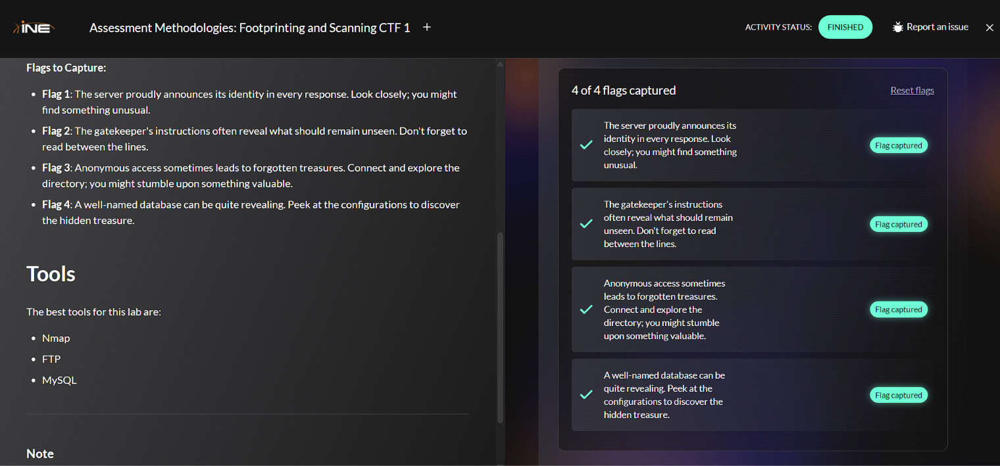
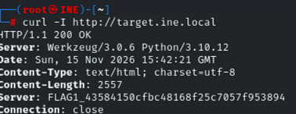
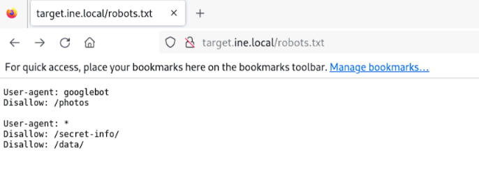
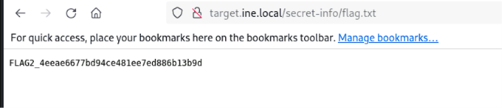
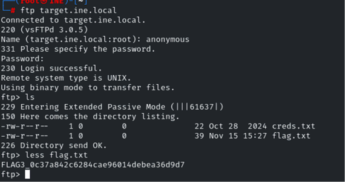
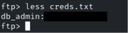
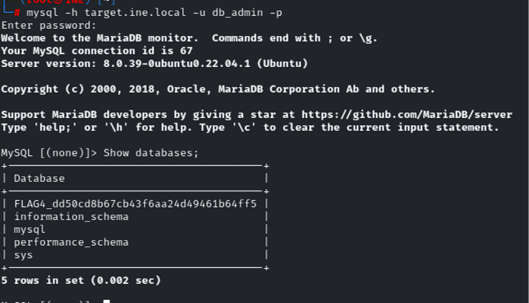

# Assessment Methodologies: Footprinting and Scanning CTF 1 — INE / eJPT Walkthrough

---

## Lab Information

| Attribute | Specification |
| :--- | :--- |
| **Lab Name** | Assessment Methodologies: Footprinting and Scanning CTF 1 |
| **Platform** | INE Security |
| **Certification Track** | eJPT (Junior Penetration Tester) |
| **Domain** | Assessment Methodologies — Footprinting & Scanning |
| **Target Hostname** | `target.ine.local` / `http://target.ine.local` |
| **Target Architecture** | Linux (Ubuntu 22.04) / Python 3.10.12 (Werkzeug 3.0.6) / vsFTPd 3.0.5 / MySQL 8.0.39 |
| **Status** | 100% Completed (4 of 4 Flags Captured) |
| **Tools Used** | Mozilla Firefox, cURL, FTP Client, MySQL / MariaDB Client, Nmap |

---

## Table of Contents

- [01. Lab Overview](#01-lab-overview)
- [02. Understanding the Challenge](#02-understanding-the-challenge)
- [03. Initial Reconnaissance](#03-initial-reconnaissance)
- [04. HTTP Header Footprinting - Flag 1](#04-http-header-footprinting---flag-1)
- [05. Robots.txt Crawler Footprinting - Flag 2](#05-robots-txt-crawler-footprinting---flag-2)
- [06. FTP Service Footprinting & Anonymous Access - Flag 3](#06-ftp-service-footprinting--anonymous-access---flag-3)
- [07. Credential Harvesting & Lateral Pivoting](#07-credential-harvesting--lateral-pivoting)
- [08. Database Footprinting & Schema Enumeration - Flag 4](#08-database-footprinting--schema-enumeration---flag-4)
- [09. Flag Collection Summary](#09-flag-collection-summary)
- [10. Technical Analysis & Attack Flow](#10-technical-analysis--attack-flow)
- [11. Key Learning Outcomes](#11-key-learning-outcomes)
- [12. Security Recommendations](#12-security-recommendations)
- [13. Conclusion](#13-conclusion)

---

## 01. Lab Overview

This laboratory exercise is part of the **INE eJPT (Junior Penetration Tester)** curriculum under the **Assessment Methodologies: Footprinting and Scanning** module. The challenge focuses on active and passive footprinting techniques across multiple protocols and network services (HTTP, FTP, MySQL) in an authorized lab environment.

### Learning Objectives
- Conduct HTTP banner grabbing and response header interrogation using `curl`.
- Identify hidden application routes and administrative directives by analyzing crawler policies in `robots.txt`.
- Discover and exploit insecure default service configurations, specifically **anonymous FTP access** on vsFTPd.
- Harvest leaked credentials stored in unencrypted text files within exposed network shares.
- Perform remote database footprinting and schema enumeration using harvested administrative credentials against MySQL.

### Scope & Authorized Environment
- **Target Hostname:** `target.ine.local`
- **Authorized Testing Boundary:** All scanning, banner grabbing, and service interaction was conducted exclusively against the assigned target host within the private INE virtual testing lab.
- **Rules of Engagement:** Denial of service, infrastructure disruption, and out-of-scope subnet scanning were strictly prohibited.

### Skills Demonstrated
- Service Banner Grabbing & Header Interrogation
- Web Crawler Footprinting (`robots.txt`)
- Insecure Network Share Enumeration (Anonymous FTP)
- Credential Harvesting & Lateral Pivoting
- Remote Database Footprinting (MySQL)
- Root Cause Analysis & Defensive Remediation

### Target Environment Evidence

The screenshot below illustrates the INE challenge dashboard, confirming the 4 lab objectives and verifying that all 4 flags were successfully captured.



---

## 02. Understanding the Challenge

Footprinting and scanning represent the initial intelligence-gathering phases of an assessment. The goal is to map listening services, identify daemon software versions, inspect headers for sensitive data leaks, and evaluate access controls across non-web services.

The challenge establishes four distinct reconnaissance objectives:

1. **Flag 1 — Identity in Response Headers:** *"The server proudly announces its identity in every response. Look closely; you might find something unusual."*
   - Focus: Web server banner grabbing and HTTP header inspection.
2. **Flag 2 — Gatekeeper's Instructions:** *"The gatekeeper's instructions often reveal what should remain unseen. Don't forget to read between the lines."*
   - Focus: Crawler guidance analysis (`robots.txt`) and hidden path discovery.
3. **Flag 3 — Anonymous Access to Forgotten Treasures:** *"Anonymous access sometimes leads to forgotten treasures. Connect and explore the directory; you might stumble upon something valuable."*
   - Focus: FTP service reconnaissance and anonymous login exploitation.
4. **Flag 4 — Revealing Database Configurations:** *"A well-named database can be quite revealing. Peek at the configurations to discover the hidden treasure."*
   - Focus: Credential reuse, remote database connection, and schema enumeration.

### Real-World Penetration Testing Relevance

| Technique | Assessment Purpose | Real-World Attack Surface |
| :--- | :--- | :--- |
| **HTTP Banner Grabbing** | Interrogate HTTP response headers to identify web frameworks, versions, and custom headers. | Leaked framework versions (e.g., Werkzeug, Express), internal server names, staging tokens. |
| **`robots.txt` Analysis** | Discover non-indexed directories that administrators intentionally secluded. | Hidden administrative portals, staging environments, unlinked file directories. |
| **Anonymous FTP Testing** | Verify whether public read/write access is permitted on file transfer services. | Exposed backups, legacy source code, software archives, unencrypted credentials. |
| **Credential Pivoting & DB Access** | Test harvested credentials against discovered database ports (e.g., MySQL 3306). | Unauthorized database read/write access, sensitive customer data exfiltration. |

---

## 03. Initial Reconnaissance

The target system is identified by its local domain name:

```text
http://target.ine.local
```

### Hostname Resolution & Networking Context
In professional penetration testing environments, hostnames often resolve locally via the testing system's `/etc/hosts` file or internal DNS servers. Testing against hostnames rather than raw IP addresses is essential when interacting with modern web servers that utilize **Virtual Hosting (VHosts)**, routing traffic based on the HTTP `Host` header.

The assessment began with systematic protocol interrogation starting with the web service on port 80.

---

## 04. HTTP Header Footprinting - Flag 1

The first challenge objective indicated that the server "proudly announces its identity in every response." To inspect the server's raw response headers without downloading the HTML payload, **cURL** was executed with the `-I` flag.

### Execution Command

```bash
curl -I http://target.ine.local
```

### Parameter Breakdown
- `curl`: Command-line utility for transferring data with URLs using various network protocols.
- `-I` (or `--head`): Instructs cURL to send an HTTP `HEAD` request, retrieving only the HTTP response headers and discarding the message body.
- `http://target.ine.local`: The target URL.

### Command Output & Analysis

```text
HTTP/1.1 200 OK
Server: Werkzeug/3.0.6 Python/3.10.12
Date: Sun, 15 Nov 2026 15:42:21 GMT
Content-Type: text/html; charset=utf-8
Content-Length: 2557
Server: FLAG1_43584150cfbc48168f25c7057f953894
Connection: close
```

### Technical Findings
1. **HTTP Status Code `200 OK`**: The web service is active and responding normally.
2. **Underlying Technology Stack**: The primary `Server` header discloses `Werkzeug/3.0.6 Python/3.10.12`, revealing that the web application is powered by Python and the Werkzeug WSGI web application library (commonly underlying Flask applications).
3. **Information Disclosure (Flag 1)**: A duplicate/custom `Server` header was returned by the application containing the first flag value:
   ```text
   Server: FLAG1_43584150cfbc48168f25c7057f953894
   ```

### Security Implications of Verbose Headers
Web application headers frequently reveal internal software versions, reverse proxy configurations, and developer debug flags. In production deployments, verbose banners assist attackers in selecting version-specific exploits (e.g., Werkzeug console vulnerabilities).

### Screenshot Evidence — Flag 1

The screenshot below displays the terminal output of `curl -I` exposing the server banners and `FLAG1`.



```text
Captured Flag 1: FLAG1_43584150cfbc48168f25c7057f953894
```

---

## 05. Robots.txt Crawler Footprinting - Flag 2

The second challenge objective referenced "the gatekeeper's instructions." In web applications, the primary gatekeeper for web crawlers, search spiders, and indexing bots is `/robots.txt`.

### Inspecting `robots.txt`

The file was inspected directly using Mozilla Firefox:

```text
http://target.ine.local/robots.txt
```

### Disclosed Content

```text
User-agent: googlebot
Disallow: /photos

User-agent: *
Disallow: /secret-info/
Disallow: /data/
```

### Technical Breakdown
- **`User-agent: googlebot`**: Directs Google's web crawler specifically to avoid indexing the `/photos` directory.
- **`User-agent: *`**: Directs all other automated search crawlers and bots.
- **`Disallow: /secret-info/`**: Instructs crawlers not to index the `/secret-info/` directory.
- **`Disallow: /data/`**: Instructs crawlers not to index the `/data/` directory.

### Screenshot Evidence — Robots.txt Inspection

The screenshot below displays the Mozilla Firefox browser window inspecting `robots.txt`.



---

### Discovering Flag 2 in Disallowed Directory

Because `robots.txt` is an advisory file and does not enforce server-side access control, attackers and penetration testers routinely examine disallowed directories for sensitive files.

Navigating to the `/secret-info/` path in Firefox revealed an accessible text file:

```text
http://target.ine.local/secret-info/flag.txt
```

### File Content

```text
FLAG2_4eeae6677bd94ce481ee7ed886b13b9d
```

### Vulnerability Analysis: Sensitive Path Disclosure via Robots.txt
- **Vulnerability**: Information Disclosure through Crawler Directives (CWE-200).
- **Root Cause**: The application administrator attempted to hide sensitive administrative content by placing it in `robots.txt` without applying access-control restrictions on the web server.
- **Impact**: Any unauthenticated user can directly view the crawler configuration and access the hidden directories.

### Screenshot Evidence — Flag 2

The screenshot below displays the second flag retrieved from `/secret-info/flag.txt`.



```text
Captured Flag 2: FLAG2_4eeae6677bd94ce481ee7ed886b13b9d
```

---

## 06. FTP Service Footprinting & Anonymous Access - Flag 3

The third challenge objective stated: *"Anonymous access sometimes leads to forgotten treasures. Connect and explore the directory; you might stumble upon something valuable."*

This pointed directly to an active **FTP (File Transfer Protocol)** service running on the target.

### Connecting to the FTP Service

The standard command-line `ftp` client was used to initiate a connection to `target.ine.local`:

```bash
ftp target.ine.local
```

### Authentication Sequence & Banner Grabbing

```text
Connected to target.ine.local.
220 (vsFTPd 3.0.5)
Name (target.ine.local:root): anonymous
331 Please specify the password.
Password:
230 Login successful.
Remote system type is UNIX.
Using binary mode to transfer files.
```

### Technical Breakdown
1. **Daemon Fingerprint**: The initial FTP service banner returned `220 (vsFTPd 3.0.5)`, confirming the daemon is **vsFTPd (Very Secure FTP Daemon) version 3.0.5** running on a UNIX system.
2. **Anonymous Authentication**:
   - Username: `anonymous` (RFC 1635 convention for public FTP access).
   - Password: Left blank (or arbitrary email address).
   - Response: `230 Login successful.`, verifying that unauthenticated guest access is enabled.

---

### Directory Enumeration & Flag 3 Extraction

Once authenticated to the FTP session, the directory contents were enumerated:

```text
ftp> ls
229 Entering Extended Passive Mode (|||61637|)
150 Here comes the directory listing.
-rw-r--r--    1 0        0              22 Oct 28  2024 creds.txt
-rw-r--r--    1 0        0              39 Nov 15 15:27 flag.txt
226 Directory send OK.
```

Two files were discovered:
- `creds.txt` (Size: 22 bytes, dated Oct 28 2024)
- `flag.txt` (Size: 39 bytes, dated Nov 15 15:27)

To inspect `flag.txt` without terminating the FTP session, the client's built-in `less` command was executed:

```text
ftp> less flag.txt
FLAG3_0c37a842c6284cae96014debea36d9d7
```

### Screenshot Evidence — Flag 3

The screenshot below displays the successful anonymous login, directory listing, and extraction of `FLAG3`.



```text
Captured Flag 3: FLAG3_0c37a842c6284cae96014debea36d9d7
```

---

## 07. Credential Harvesting & Lateral Pivoting

While inspecting the FTP share, the presence of `creds.txt` indicated potential credential leakage.

### Inspecting `creds.txt`

```text
ftp> less creds.txt
db_admin:[REDACTED]
```

### Analysis of Harvested Credentials

```text
Username: db_admin
Password: [REDACTED]
```

### Security Implications
- **Plaintext Credential Storage**: Storing credentials in an unencrypted `.txt` file violates security best practices.
- **Lateral Movement Opportunity**: In penetration testing, credential harvesting frequently enables lateral movement across services. The prefix `db_admin` suggests an administrative account for a database management system (such as MySQL or PostgreSQL).

### Screenshot Evidence — Leaked Credentials

The screenshot below displays the contents of `creds.txt` viewed within the active FTP terminal session.



---

## 08. Database Footprinting & Schema Enumeration - Flag 4

The fourth challenge objective stated: *"A well-named database can be quite revealing. Peek at the configurations to discover the hidden treasure."*

With the credentials `db_admin:[REDACTED]` retrieved from the FTP server, the next logical step was connecting to the target's database service.

### Connecting to MySQL

Using the MySQL client from the attacker's terminal, a remote connection was established to `target.ine.local`:

```bash
mysql -h target.ine.local -u db_admin -p
```

### Parameter Breakdown
- `mysql`: Command-line interface for MySQL/MariaDB database management.
- `-h target.ine.local`: Specifies the remote database host address.
- `-u db_admin`: Authenticates with the harvested username.
- `-p`: Prompts the operator to enter the database password securely.

### Connection Output & Version Detection

```text
Enter password: 
Welcome to the MariaDB monitor.  Commands end with ; or \g.
Your MySQL connection id is 67
Server version: 8.0.39-0ubuntu0.22.04.1 (Ubuntu)

Copyright (c) 2000, 2018, Oracle, MariaDB Corporation Ab and others.

Support MariaDB developers by giving a star at https://github.com/MariaDB/server
Type 'help;' or '\h' for help. Type '\c' to clear the current input statement.
```

The database server returned version `8.0.39-0ubuntu0.22.04.1 (Ubuntu)`, confirming an active **MySQL 8.0** service running on Ubuntu 22.04 LTS.

---

### Enumerating Databases (Schema Footprinting)

To locate the "well-named database," the standard SQL schema discovery command was executed:

```sql
MySQL [(none)]> Show databases;
```

### Query Results

```text
+------------------------------------+
| Database                           |
+------------------------------------+
| FLAG4_dd50cd8b67cb43f6aa24d49461b64ff5 |
| information_schema                 |
| mysql                              |
| performance_schema                 |
| sys                                |
+------------------------------------+
5 rows in set (0.002 sec)
```

### Findings
Among the system databases (`information_schema`, `mysql`, `performance_schema`, `sys`), a custom database name was revealed containing the fourth flag:

```text
FLAG4_dd50cd8b67cb43f6aa24d49461b64ff5
```

### Screenshot Evidence — Flag 4

The screenshot below displays the successful MySQL authentication and the database listing exposing `FLAG4`.



```text
Captured Flag 4: FLAG4_dd50cd8b67cb43f6aa24d49461b64ff5
```

---

## 09. Flag Collection Summary

All 4 challenge flags were captured, verified, and cross-referenced with the lab screenshots:

| Flag | Objective / Challenge Focus | Discovery Method & Tool | Captured Flag Value | Screenshot Evidence |
| :---: | :--- | :--- | :--- | :---: |
| **Flag 1** | Server announces identity in every response | `curl -I` (HTTP Response Headers) | `FLAG1_43584150cfbc48168f25c7057f953894` | `02-http-headers-flag1.png` |
| **Flag 2** | Gatekeeper's instructions reveal hidden paths | Mozilla Firefox (`/robots.txt` & `/secret-info/flag.txt`) | `FLAG2_4eeae6677bd94ce481ee7ed886b13b9d` | `04-secret-info-flag2.png` |
| **Flag 3** | Anonymous access leads to forgotten treasures | FTP Client (`anonymous` login & `less flag.txt`) | `FLAG3_0c37a842c6284cae96014debea36d9d7` | `05-ftp-anonymous-access-flag3.png` |
| **Flag 4** | Well-named database reveals hidden treasure | MySQL Client (`db_admin` login & `Show databases;`) | `FLAG4_dd50cd8b67cb43f6aa24d49461b64ff5` | `07-mysql-database-flag4.png` |

---

## 10. Technical Analysis & Attack Flow

The investigation followed an interconnected footprinting and lateral movement methodology:

```text
[1. HTTP Footprinting] ────► curl -I reveals Server header & FLAG1
         │
         ▼
[2. Crawler Footprinting] ──► robots.txt reveals /secret-info/ ──► flag.txt reveals FLAG2
         │
         ▼
[3. FTP Footprinting] ──────► vsFTPd allows anonymous login ───► flag.txt reveals FLAG3
         │                                                    └──► creds.txt leaks db_admin credentials
         ▼
[4. Database Footprinting] ─► mysql login with creds ────────► Show databases; reveals FLAG4
```

### Attack Chain Breakdown
1. **Protocol-Specific Banner Grabbing**: Initiating with lightweight HTTP `HEAD` requests quickly yielded technology versions (Werkzeug/Python) and captured Flag 1 from an informational leak in server response headers.
2. **Crawler Policy Exploitation**: Examining `/robots.txt` mapped hidden application routes, bypassing intended obscurity and capturing Flag 2.
3. **Insecure Service Configuration**: Moving beyond HTTP to port 21 uncovered an insecure vsFTPd server permitting anonymous logins, allowing unrestricted file listing and reading Flag 3.
4. **Credential Chaining**: Exfiltrating `creds.txt` from the FTP root provided valid administrative credentials for another service on the same host.
5. **Privileged Database Enumeration**: Leveraging the harvested credentials against MySQL port 3306 granted administrative database access, exposing the schema and capturing Flag 4.

---

## 11. Key Learning Outcomes

1. **Lightweight Banner Grabbing is Highly Informative**: `curl -I` provides immediate visibility into web servers, frameworks, and custom headers without generating heavy web traffic.
2. **Robots.txt is Not Access Control**: Never rely on `robots.txt` to protect sensitive files. It acts as an open roadmap for penetration testers and attackers.
3. **Anonymous Access Remains a Critical Threat**: Insecure FTP configurations permitting anonymous authentication expose filesystems to unauthenticated exfiltration.
4. **Plaintext Credential Storage Enables Pivoting**: Hardcoded credentials stored on shared file services provide attackers with high-value keys for lateral movement across backend daemons.
5. **Database Exposure**: Exposing database ports (e.g., MySQL 3306) directly to the network without IP allowlisting allows attackers with harvested credentials to directly access and manipulate data.

---

## 12. Security Recommendations

To address the vulnerabilities identified during this assessment, the following remediation and hardening controls should be applied:

### 1. Suppress Verbose HTTP Server Headers
Configure the web server or reverse proxy to strip detailed version numbers and custom debugging headers. In production, ensure debugging headers are completely disabled:
```python
# In Flask / Werkzeug WSGI applications, override or remove the Server header:
response.headers['Server'] = 'Web-Server'
```

### 2. Implement Server-Side Access Controls on Sensitive Paths
Do not list confidential directories in `robots.txt`. Restrict access to paths like `/secret-info/` using authentication middleware or web server authorization rules:
```apache
<Directory "/var/www/html/secret-info">
    Require all denied
</Directory>
```

### 3. Disable Anonymous Access on vsFTPd
Edit `/etc/vsftpd.conf` to explicitly prohibit unauthenticated logins:
```ini
anonymous_enable=NO
```
After modifying the configuration, restart the service:
```bash
sudo systemctl restart vsftpd
```

### 4. Remove Stored Plaintext Credentials
Remove all files containing plaintext passwords (`creds.txt`) from public shares. Enforce secret management tools (e.g., HashiCorp Vault, AWS Secrets Manager, or protected environment variables) for database administrative accounts.

### 5. Restrict Remote Database Access
Configure MySQL to listen only on `localhost` (`127.0.0.1`) if external database connections are not strictly required:
```ini
# In /etc/mysql/mysql.conf.d/mysqld.cnf:
bind-address = 127.0.0.1
```
If remote database administration is required, restrict access using firewall rules (e.g., `ufw allow from <trusted_ip> to any port 3306`) and enforce strong, multi-factor authenticated VPNs.

---

## 13. Conclusion

The **INE Assessment Methodologies: Footprinting and Scanning CTF 1** lab demonstrates the power of multi-service reconnaissance. By systematically footprinting HTTP headers, analyzing crawler policies, enumerating FTP services, and pivoting with harvested credentials into MySQL, all four challenge objectives were met and all flags successfully captured.

This exercise reinforces a fundamental principle of information security: individual low-severity findings (a verbose HTTP header, a `robots.txt` path disclosure, anonymous FTP read permissions) can be chained together by an adversary to achieve privileged administrative access across the target environment.

