# Assessment Methodologies: Information Gathering CTF 1 — INE / eJPT Walkthrough

---

## Lab Information

| Attribute | Specification |
| :--- | :--- |
| **Lab Name** | Assessment Methodologies: Information Gathering CTF 1 |
| **Platform** | INE Security |
| **Certification Track** | eJPT (Junior Penetration Tester) |
| **Target Hostname** | `http://target.ine.local` |
| **Target IP Address** | `192.144.172.3` |
| **Target Architecture** | Linux (Ubuntu) / Apache httpd 2.4.41 / WordPress 6.5.3 |
| **Status** | 100% Completed (5 of 5 Flags Captured) |
| **Tools Used** | Mozilla Firefox, Nmap 7.94SVN, Gobuster v3.6, Dirb v2.22, cURL, HTTrack 3.49-5 |

---

## Table of Contents

- [01. Lab Overview](#01-lab-overview)
- [02. Understanding the Challenge](#02-understanding-the-challenge)
- [03. Initial Reconnaissance](#03-initial-reconnaissance)
- [04. Robots.txt Enumeration - Flag 1](#04-robotstxt-enumeration---flag-1)
- [05. Web Server Fingerprinting - Flag 2](#05-web-server-fingerprinting---flag-2)
- [06. Directory Enumeration Using Gobuster](#06-directory-enumeration-using-gobuster)
- [07. Directory Enumeration Using Dirb](#07-directory-enumeration-using-dirb)
- [08. Finding Flag 3 - Exposed Uploads Directory](#08-finding-flag-3---exposed-uploads-directory)
- [09. Backup File Discovery - Flag 4](#09-backup-file-discovery---flag-4)
- [10. Website Mirroring - Flag 5](#10-website-mirroring---flag-5)
- [11. Flag Collection Summary](#11-flag-collection-summary)
- [12. Key Learning Outcomes](#12-key-learning-outcomes)
- [13. Security Recommendations](#13-security-recommendations)
- [14. Conclusion](#14-conclusion)

---

## 01. Lab Overview

This laboratory exercise is part of the **INE eJPT (Junior Penetration Tester)** pathway under the **Assessment Methodologies: Information Gathering** module. The challenge focuses on foundational reconnaissance, web service fingerprinting, content discovery, configuration auditing, and website mirroring against a simulated target environment.

### Learning Objectives
- Perform passive and active information gathering against a web application.
- Analyze crawler guidance files (`robots.txt`) for sensitive administrative paths.
- Fingerprint web server versions, operating systems, and CMS platforms using Nmap.
- Execute dictionary-based directory and file brute-forcing using **Gobuster** and **Dirb**.
- Identify and exploit web directory indexing (directory listing) vulnerabilities.
- Detect and extract overlooked backup configuration files containing sensitive application secrets.
- Utilize **HTTrack** to mirror web applications for comprehensive offline source analysis.

### Scope & Authorized Environment
- **Target URL:** `http://target.ine.local`
- **Target IP:** `192.144.172.3`
- **Testing Boundaries:** Testing was conducted strictly within the assigned INE private virtual network. Denial-of-service, infrastructure brute forcing, and out-of-scope subnet routing were prohibited.

### Skills Demonstrated
- Network & Port Scanning
- Web Application Fingerprinting
- Directory & File Brute-Forcing
- Sensitive File & Backup Discovery
- Offline Web Source Analysis
- Vulnerability Impact Analysis & Defensive Remediation

### Target Environment Evidence

The screenshot below displays the INE lab environment overview showing the five challenge objectives and confirming the successful capture of all five flags.

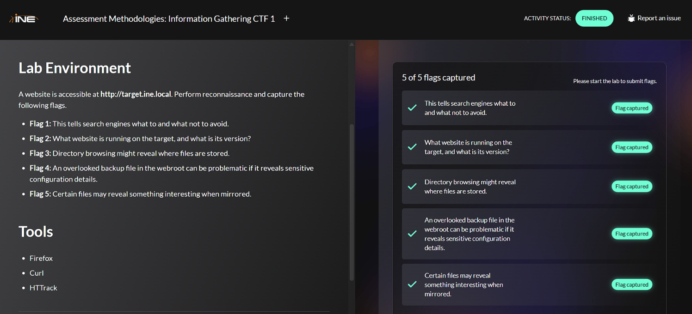

---

## 02. Understanding the Challenge

Information gathering constitutes Phase 2 of the penetration testing lifecycle (PTES / NIST SP 800-115). Without meticulous enumeration, an assessor risks missing misconfigurations, default installations, and exposed administrative assets.

The challenge establishes five progressive objectives:

1. **Discover information in `robots.txt`**: Evaluates whether the application discloses administrative or hidden endpoints to web crawlers.
2. **Identify the web server and its version**: Determines exact daemon versions and technologies to map against known Common Vulnerabilities and Exposures (CVEs).
3. **Discover directories through directory enumeration**: Uncovers hidden routes and unlinked directories not exposed on the front-end interface.
4. **Locate an overlooked backup configuration file**: Identifies uncompiled copies of configuration files left by developers or system administrators.
5. **Discover interesting information through website mirroring**: Employs offline mirroring to uncover hidden API endpoints and comments embedded in client-side code.

### Real-World Pentesting Relevance

| Reconnaissance Technique | Penetration Testing Purpose | Real-World Attack Surface |
| :--- | :--- | :--- |
| **Crawler Inspection (`robots.txt`)** | Rapidly discover paths developers attempted to hide from search engine indexers. | Administrative portals, staging endpoints, internal directories. |
| **Service Version Detection** | Identify the exact web server and CMS version to pinpoint unpatched exploits. | Public CVEs, known component misconfigurations, default credentials. |
| **Directory Brute-Forcing** | Map the entire web application tree beyond visible hyperlinks. | Hidden portals, developer consoles, forgotten endpoints. |
| **Backup File Enumeration** | Exploit text editor and manual backups that bypass server-side script execution. | Hardcoded database credentials, cryptographic salts, API secrets. |
| **Website Mirroring** | Enable deep offline text parsing, metadata scraping, and endpoint mapping. | Hidden API routes, debug comments, disabled client-side functions. |

---

## 03. Initial Reconnaissance

The engagement began by navigating to the target application URL:

```text
http://target.ine.local
```

### Hostname Resolution & Networking Context

During network penetration testing, web applications frequently implement **Name-Based Virtual Hosting (VHosts)**. When multiple websites are hosted on a single web server sharing an IP address (`192.144.172.3`), the web server inspects the HTTP request's `Host` header to determine which application to serve.

If an assessor sends a request directly to `http://192.144.172.3`, the server may return a default Apache landing page or reject the request. Navigating via the fully qualified domain name (`http://target.ine.local`) ensures proper DNS routing through the local laboratory resolver (`/etc/hosts`).

### Initial Web Application Observations
- The application loaded a clean, operational WordPress instance titled **"INE"**.
- Standard navigation links and default theme assets were rendered.
- No immediate vulnerabilities or interactive forms were visible on the landing page, establishing the requirement for methodical directory and service enumeration.

---

## 04. Robots.txt Enumeration - Flag 1

Web crawlers and search engine spiders (e.g., Googlebot, Bingbot) request `/robots.txt` upon visiting a domain to identify which sections of the site should not be indexed.

### Accessing `robots.txt`

The file was accessed directly in Mozilla Firefox:

```text
http://target.ine.local/robots.txt
```

### Disclosed Content

```text
User-agent: *
Disallow: /wp-admin/
Allow: /wp-admin/admin-ajax.php

FLAG1{90325763fda3449086cc95f99448f062}
```

### Technical Breakdown
- **`User-agent: *`**: Specifies that the directive applies universally to all search engine bots and automated spiders.
- **`Disallow: /wp-admin/`**: Requests that search crawlers refrain from indexing the WordPress administrative dashboard.
- **`Allow: /wp-admin/admin-ajax.php`**: Creates an explicit exception allowing crawlers to access the AJAX handler for front-end rendering.
- **`FLAG1{...}`**: Embedded directly at the bottom of the file as proof of discovery.

### Security Implications
`robots.txt` is an **advisory standard** (the Robots Exclusion Protocol), not a security boundary or access-control mechanism. Web servers do not enforce permissions based on `robots.txt`. When administrators place sensitive or internal paths inside `robots.txt`, they inadvertently create an enumerated directory of high-value targets for attackers (**Security through Obscurity Failure**).

### Screenshot Evidence — Flag 1

The screenshot below displays the Mozilla Firefox window rendering `/robots.txt` and exposing `FLAG1`.

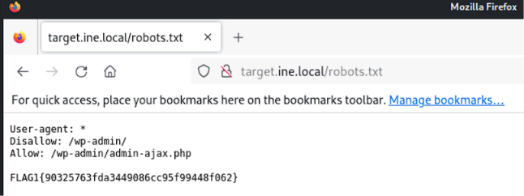

```text
Captured Flag 1: FLAG1{90325763fda3449086cc95f99448f062}
```

---

## 05. Web Server Fingerprinting - Flag 2

To establish a comprehensive profile of listening ports, active daemons, and underlying software versions, a full TCP port scan was conducted using **Nmap**.

### Execution Command

```bash
nmap -sV -sC -p- target.ine.local
```

### Parameter Breakdown
- `-sV` (**Version Detection**): Interrogates open ports with probe payloads to determine service names and exact version strings.
- `-sC` (**Default Scripts**): Runs the standard set of safe Nmap Scripting Engine (NSE) scripts (e.g., `http-title`, `http-server-header`, `http-robots.txt`, `http-generator`).
- `-p-` (**All Ports**): Scans all 65,535 TCP ports to ensure no non-standard or alternative ports (e.g., 8080, 8443, 9000) are overlooked.
- `target.ine.local`: Target hostname (resolved to IP `192.144.172.3`).

### Scan Output & Technical Findings

```text
Starting Nmap 7.94SVN ( https://nmap.org ) at 2026-11-15 19:22 IST
Nmap scan report for target.ine.local (192.144.172.3)
Host is up (0.000025s latency).
Not shown: 65534 closed tcp ports (reset)
PORT   STATE SERVICE VERSION
80/tcp open  http    Apache httpd 2.4.41 ((Ubuntu))
|_http-generator: WordPress 6.5.3 - FL@G2{0480379aac34491fba7018c626e3f895}
| http-robots.txt: 1 disallowed entry 
|_/wp-admin/
|_http-title: INE
|_http-server-header: Apache/2.4.41 (Ubuntu)
MAC Address: 02:42:C0:90:AC:03 (Unknown)

Service detection performed. Please report any incorrect results at https://nmap.org/submit/ .
Nmap done: 1 IP address (1 host up) scanned in 10.55 seconds
```

### Analysis of Service Fingerprints
- **Port 80/tcp**: The only listening TCP port on the host, running an HTTP service.
- **Web Server Version**: `Apache httpd 2.4.41 ((Ubuntu))`.
- **Content Management System (CMS)**: `WordPress 6.5.3`.
- **HTTP Generator Tag**: The `http-generator` NSE script extracted the meta generator tag from the HTML header, uncovering `FL@G2`.
- **Robots.txt Script Discovery**: Automated script detected the 1 disallowed entry (`/wp-admin/`).
- **HTTP Title**: Confirmed site title `INE`.

### Screenshot Evidence — Flag 2

The screenshot below displays the terminal output of the Nmap scan revealing the open HTTP port, Apache version, WordPress CMS release, and `FL@G2`.

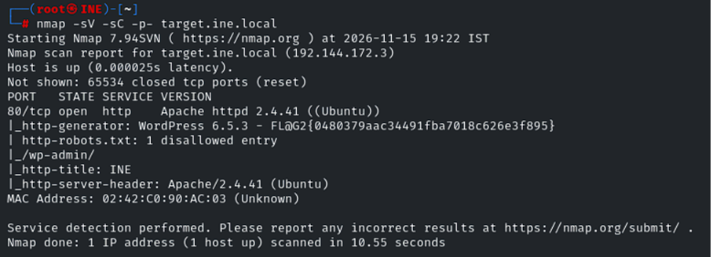

```text
Captured Flag 2: FL@G2{0480379aac34491fba7018c626e3f895}
```

---

## 06. Directory Enumeration Using Gobuster

To identify hidden web directories and application resources not linked in the HTML markup, a dictionary attack was performed using **Gobuster**.

### Execution Command

```bash
gobuster dir -u http://target.ine.local -w /usr/share/seclists/Discovery/Web-Content/big.txt
```

### Parameter Breakdown
- `dir`: Directs Gobuster to run in HTTP directory/file enumeration mode.
- `-u http://target.ine.local`: Specifies the base URL of the target.
- `-w /usr/share/seclists/Discovery/Web-Content/big.txt`: Loads the SecLists `big.txt` dictionary containing 20,477 common directory and file names.

### Scan Output

```text
===============================================================
Gobuster v3.6
by OJ Reeves (@TheColonial) & Christian Mehlmauer (@firefart)
===============================================================
[+] Url:                     http://target.ine.local
[+] Method:                  GET
[+] Threads:                 10
[+] Wordlist:                /usr/share/seclists/Discovery/Web-Content/big.txt
[+] Negative Status codes:   404
[+] User Agent:              gobuster/3.6
[+] Timeout:                 10s
===============================================================
Starting gobuster in directory enumeration mode
===============================================================
/.htaccess           (Status: 403) [Size: 281]
/.htpasswd           (Status: 403) [Size: 281]
/robots.txt          (Status: 200) [Size: 108]
/server-status       (Status: 403) [Size: 281]
/wp-admin            (Status: 301) [Size: 323] [--> http://target.ine.local/wp-admin/]
/wp-content          (Status: 301) [Size: 325] [--> http://target.ine.local/wp-content/]
/wp-includes         (Status: 301) [Size: 326] [--> http://target.ine.local/wp-includes/]
Progress: 20476 / 20477 (100.00%)
===============================================================
Finished
===============================================================
```

### Interpretation of HTTP Response Codes

| Status Code | Description | Discovered Path | Security Significance |
| :---: | :--- | :--- | :--- |
| **`403 Forbidden`** | Server understood the request but refuses authorization. | `/.htaccess`, `/.htpasswd`, `/server-status` | Confirms Apache configuration files and mod_status exist, protected by server policy. |
| **`200 OK`** | Request succeeded and content was returned. | `/robots.txt` | Accessible crawler directive file. |
| **`301 Moved`** | Permanent redirect to canonical path with trailing slash. | `/wp-admin`, `/wp-content`, `/wp-includes` | Validates standard WordPress directory architecture. |

### Technical Significance
The Gobuster scan confirmed standard WordPress core directories. While `403 Forbidden` responses indicate that sensitive Apache files (`.htaccess`, `.htpasswd`) cannot be read directly, the presence of `/wp-content/` highlights a key area where user uploads, themes, and plugins are stored.

### Screenshot Evidence — Gobuster

The screenshot below displays the completed Gobuster scan with the discovered endpoints and status codes.

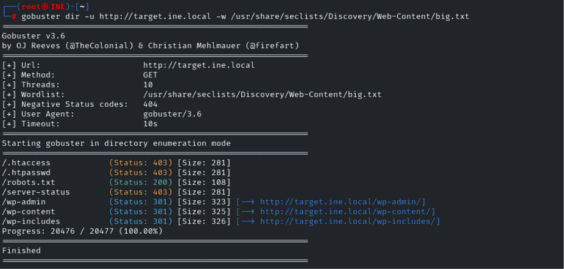

---

## 07. Directory Enumeration Using Dirb

To cross-verify the attack surface and explore subdirectories recursively, **Dirb** was launched against the target.

### Execution Command

```bash
dirb http://target.ine.local
```

### Tool Comparison: Dirb vs. Gobuster
- **Gobuster**: Written in Go; utilizes high concurrency (goroutines); faster execution; non-recursive by default.
- **Dirb**: Written in C; classical dictionary scanner; automatically descends **recursively** into every directory it discovers that returns an accessible status code.

### Scan Progress & Discovered Structure

```text
-----------------
DIRB v2.22
By The Dark Raver
-----------------

START_TIME: Sun Nov 15 20:17:52 2026
URL_BASE: http://target.ine.local/
WORDLIST_FILES: /usr/share/dirb/wordlists/common.txt

-----------------

GENERATED WORDS: 4612

---- Scanning URL: http://target.ine.local/ ----
+ http://target.ine.local/index.php (CODE:301|SIZE:0)
+ http://target.ine.local/robots.txt (CODE:200|SIZE:108)
+ http://target.ine.local/server-status (CODE:403|SIZE:281)
==> DIRECTORY: http://target.ine.local/wp-admin/
==> DIRECTORY: http://target.ine.local/wp-content/
==> DIRECTORY: http://target.ine.local/wp-includes/
+ http://target.ine.local/xmlrpc.php (CODE:405|SIZE:42)

---- Entering directory: http://target.ine.local/wp-admin/ ----
+ http://target.ine.local/wp-admin/admin.php (CODE:302|SIZE:0)
==> DIRECTORY: http://target.ine.local/wp-admin/css/
==> DIRECTORY: http://target.ine.local/wp-admin/images/
==> DIRECTORY: http://target.ine.local/wp-admin/includes/
+ http://target.ine.local/wp-admin/index.php (CODE:302|SIZE:0)
==> DIRECTORY: http://target.ine.local/wp-admin/js/
==> DIRECTORY: http://target.ine.local/wp-admin/maint/
==> DIRECTORY: http://target.ine.local/wp-admin/network/
==> DIRECTORY: http://target.ine.local/wp-admin/user/
```

### Recursive Discovery & Critical Warning

Dirb recursed into `/wp-admin/`, `/wp-content/plugins/`, `/wp-content/themes/`, and `/wp-content/uploads/`. Upon reaching the uploads directory, Dirb generated a critical notification:

```text
---- Entering directory: http://target.ine.local/wp-content/uploads/ ----
(!) WARNING: Directory IS LISTABLE. No need to scan it.
    (Use mode '-w' if you want to scan it anyway)

END_TIME: Sun Nov 15 20:17:59 2026
DOWNLOADED: 32284 - FOUND: 13
```

### What "Directory IS LISTABLE" Means
When an Apache web server has the `Indexes` directive enabled within its configuration (or `.htaccess`) and no default index document (such as `index.html` or `index.php`) is present in the directory, the server automatically generates a formatted HTML listing of all files and folders residing in that directory (**Directory Browsing / Indexing**).

Dirb detected this condition and paused brute-forcing the directory, because all file contents could now be enumerated directly via a web browser.

### Screenshot Evidence — Dirb Enumeration

The screenshots below show the initial Dirb execution and the subsequent listable directory warning.

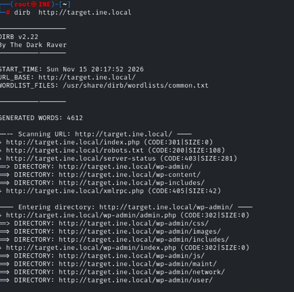

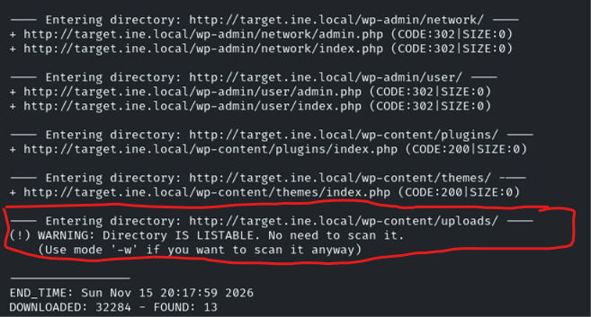

---

## 08. Finding Flag 3 - Exposed Uploads Directory

Following the discovery that `/wp-content/uploads/` was listable, the URL was loaded into Mozilla Firefox:

```text
http://target.ine.local/wp-content/uploads/
```

### Discovery of `flag.txt`

The directory listing immediately displayed an unindexed text file:

```text
http://target.ine.local/wp-content/uploads/flag.txt
```

### Retrieving Flag 3

Navigating directly to the file rendered the flag contents in cleartext:

```text
FLAG3{81227977c7394b3d9aaf7815a7bd2ddd}
```

### Vulnerability Analysis: Insecure Directory Indexing
- **Vulnerability**: Information Disclosure via Directory Indexing (CWE-548).
- **Root Cause**: Apache's `Options Indexes` directive was active without an index file in the uploads path.
- **Risk Impact**: In real-world WordPress deployments, an open `/wp-content/uploads/` directory can expose:
  - Confidential customer uploads (resumes, government IDs, invoices).
  - Plugin-generated export archives and temporary database dumps.
  - Media files containing sensitive EXIF metadata (GPS coordinates, author usernames).

### Screenshot Evidence — Flag 3

The screenshot below displays `flag.txt` accessed via Firefox.

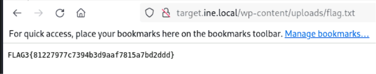

```text
Captured Flag 3: FLAG3{81227977c7394b3d9aaf7815a7bd2ddd}
```

---

## 09. Backup File Discovery - Flag 4

Developers and administrators frequently create temporary backup copies of critical configuration files prior to applying software updates or modifying production code. 

Standard file extensions include:
- `.bak` / `.backup` / `.old` / `.orig`
- `.save` / `.swp` / `~` (text editor swap files)
- `.tmp` / `.copy`

### The Critical Flaw of Backup Extensions
When a client requests a `.php` file (e.g., `wp-config.php`), Apache passes the file to the PHP interpreter (`mod_php` or PHP-FPM), executing the code on the server and returning only HTML/data output to the client.

However, when a file has an extension such as `.bak` (e.g., `wp-config.bak`), Apache does not associate the extension with the PHP handler. Instead, the server treats the file as generic text (`text/plain` or `application/octet-stream`) and serves the raw PHP source code directly to the requester.

### Targeted Gobuster Extension Scan

To identify backup files, Gobuster was executed using the `-x` parameter:

```bash
gobuster dir -u http://target.ine.local -w /usr/share/seclists/Discovery/Web-Content/common.txt -x bak
```

### Parameter Breakdown
- `-w /usr/share/seclists/Discovery/Web-Content/common.txt`: Smaller, targeted list of 4,612 common web terms.
- `-x bak`: Instructs Gobuster to append `.bak` to every wordlist entry.

### Scan Output

```text
===============================================================
Gobuster v3.6
by OJ Reeves (@TheColonial) & Christian Mehlmauer (@firefart)
===============================================================
[+] Url:                     http://target.ine.local
[+] Method:                  GET
[+] Threads:                 10
[+] Wordlist:                /usr/share/seclists/Discovery/Web-Content/common.txt
[+] Negative Status codes:   404
[+] User Agent:              gobuster/3.6
[+] Extensions:              bak
[+] Timeout:                 10s
===============================================================
Starting gobuster in directory enumeration mode
===============================================================
/.htpasswd           (Status: 403) [Size: 281]
/.htaccess.bak       (Status: 403) [Size: 281]
/.hta                (Status: 403) [Size: 281]
/.hta.bak            (Status: 403) [Size: 281]
/.htaccess           (Status: 403) [Size: 281]
/.htpasswd.bak       (Status: 403) [Size: 281]
/index.php           (Status: 301) [Size: 0] [--> http://target.ine.local/]
/robots.txt          (Status: 200) [Size: 108]
/server-status       (Status: 403) [Size: 281]
/wp-admin            (Status: 301) [Size: 323] [--> http://target.ine.local/wp-admin/]
/wp-config.bak       (Status: 200) [Size: 3438]
/wp-content          (Status: 301) [Size: 325] [--> http://target.ine.local/wp-content/]
/wp-includes         (Status: 301) [Size: 326] [--> http://target.ine.local/wp-includes/]
/xmlrpc.php          (Status: 405) [Size: 42]
Progress: 9454 / 9454 (100.00%)
===============================================================
Finished
===============================================================
```

The scan successfully identified:
```text
/wp-config.bak       (Status: 200) [Size: 3438]
```

### Screenshot Evidence — Backup File Discovery

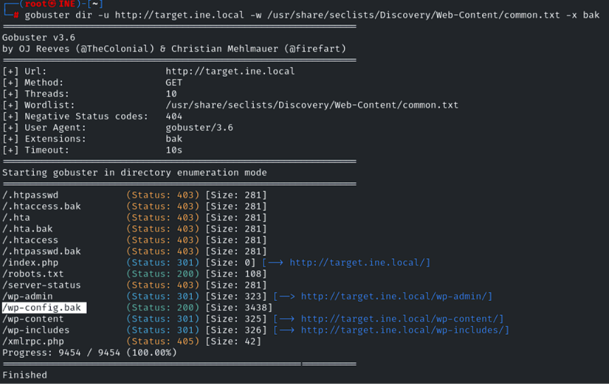

---

### Retrieving and Analyzing `/wp-config.bak` via cURL

To inspect the raw file contents from the command line, `curl` was executed:

```bash
curl http://target.ine.local/wp-config.bak
```

#### File Content Inspection (Top Section)

```text
<?php
/**
 * The base configuration for WordPress
 *
 * The wp-config.php creation script uses this file during the installation.
 * You don't have to use the website, you can copy this file to "wp-config.php"
 * and fill in the values.
 *
 * This file contains the following configurations:
 *
 * * Database settings
 * * Secret keys
 * * Database table prefix
 * * ABSPATH
```

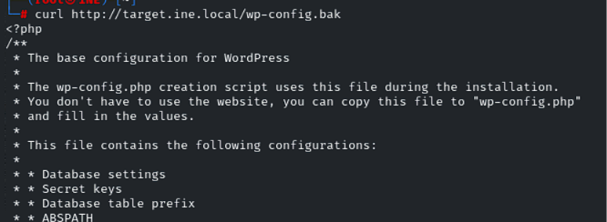

#### Cryptographic Keys & Salts Disclosure (Sanitized)

The terminal output revealed the internal WordPress security keys and cryptographic salts. Per industry best practices and responsible reporting standards, the sensitive values have been redacted:

```php
/**#@+
 * Authentication unique keys and salts.
 *
 * Change these to different unique phrases! You can generate these using
 * the {@link https://api.wordpress.org/secret-key/1.1/salt/ WordPress.org secret-key service}.
 *
 * You can change these at any point in time to invalidate all existing cookies.
 * This will force all users to have to log in again.
 *
 * @since 2.6.0
 */
define('AUTH_KEY',         '[REDACTED]');
define('SECURE_AUTH_KEY',  '[REDACTED]');
define('LOGGED_IN_KEY',    '[REDACTED]');
define('NONCE_KEY',        '[REDACTED]');
define('AUTH_SALT',        '[REDACTED]');
define('SECURE_AUTH_SALT', '[REDACTED]');
define('LOGGED_IN_SALT',   '[REDACTED]');
define('NONCE_SALT',       '[REDACTED]');

/** FLAG4{76a21ff23c784b81988ecf8d5969e6f6} */
```

### Why Exposing WordPress Keys and Salts is Dangerous
- **Authentication Bypass & Cookie Forgery**: WordPress signs session cookies using HMAC combinations of `AUTH_KEY` and `SECURE_AUTH_KEY`. An attacker with knowledge of these secrets can forge administrative authentication cookies without ever knowing the user's password.
- **CSRF Token Invalidation**: `NONCE_KEY` and `NONCE_SALT` generate cryptographic nonces protecting administrative actions against Cross-Site Request Forgery (CSRF). Exposing them allows an attacker to compute valid nonces for unauthorized requests.
- **Session Hijacking**: Compromised salts permit offline cracking of captured cookie hashes.

### Screenshot Evidence — Flag 4

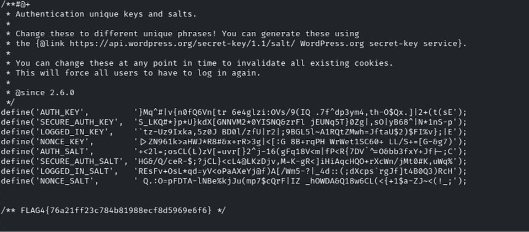

```text
Captured Flag 4: FLAG4{76a21ff23c784b81988ecf8d5969e6f6}
```

---

## 10. Website Mirroring - Flag 5

The final lab objective required discovering interesting information through website mirroring.

### Purpose of HTTrack
**HTTrack Website Copier** is an offline browser utility that recursively downloads a target website, constructing all directories, retrieving HTML, images, and other assets from the server to your local filesystem.

In penetration testing, mirroring a site allows:
- Fast offline searching using `grep`, `find`, and regex without alerting web application firewalls (WAF) or intrusion detection systems (IDS).
- Examination of source code, hidden comments, legacy scripts, and XML/JSON endpoint configurations that are not rendered in normal browsing.

### Mirroring Execution

```bash
httrack http://target.ine.local -O target.ine.local
```

### Parameter Breakdown
- `http://target.ine.local`: Root URL to crawl.
- `-O target.ine.local`: Output path where the mirrored site hierarchy is saved.

### Execution Output

```text
WARNING! You are running this program as root!
It might be a good idea to run as a different user
Mirror launched on Sun, 15 Nov 2026 20:36:59 by HTTrack Website Copier/3.49-5 [XR&CO'2014]
mirroring http://target.ine.local with the wizard help..
* target.ine.local/wp-admin/load-scripts.php?c=0&load%5Bchunk_0%5D=jquery-core,jquery-migrate,zxcvbn-async,wp-polyfill-inert,regenerator-runtime,wp-polyfill,wp-hooks&ver=6.5.3 (159181 by
40/52: target.ine.local/wp-admin/load-scripts.php?c=0&load%5Bchunk_0%5D=jquery-core,jquery-migrate,zxcvbn-async,wp-polyfill-inert,regenerator-runtime,wp-polyfill,wp-hooks&ver=6.5.3 (0 by
Done.: target.ine.local/wp-login.php (4105 bytes) - OK
Thanks for using HTTrack!
```

### Screenshot Evidence — HTTrack Execution

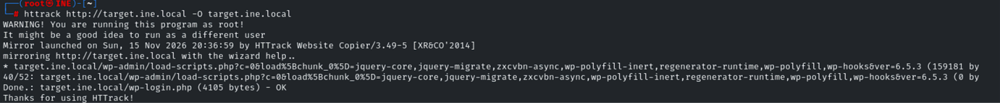

---

### Discovering Flag 5 in Mirrored Files

Following the mirror completion, navigating into the mirrored directory revealed an XML Really Simple Discovery (RSD) file named `xmlrpc0db0.php`.

Inspecting the file using `cat`:

```bash
cd ~/target.ine.local/target.ine.local
cat xmlrpc0db0.php
```

### File Content

```xml
<?xml version="1.0" encoding="UTF-8"?><rsd version="1.0" xmlns="http://archipelago.phrasewise.com/rsd">
  <service>
    <engineName>WordPress</engineName>
    <engineLink>https://wordpress.org/</engineLink>
    <homePageLink>http://target.ine.local</homePageLink>
    <apis>
      <api name="WordPress" blogID="1" preferred="true" apiLink="http://target.ine.local/xmlrpc.php" />
      <api name="Movable Type" blogID="1" preferred="false" apiLink="http://target.ine.local/xmlrpc.php" />
      <api name="MetaWeblog" blogID="1" preferred="false" apiLink="http://target.ine.local/xmlrpc.php" />
      <api name="Blogger" blogID="1" preferred="false" apiLink="http://target.ine.local/xmlrpc.php" />
      <api name="FLAG5{fbe8822f454142d2933959b72b0475b3}" blogID="1" preferred="false" apiLink="http://target.ine.local/xmlrpc.php" />
      <api name="WP-API" blogID="1" preferred="false" apiLink="http://target.ine.local/index.php/wp-json/" />
    </apis>
  </service>
</rsd>
```

### Technical Explanation
WordPress provides an RSD (Really Simple Discovery) XML service document to enable external XML-RPC clients (blogging desktop applications, mobile tools) to discover available remote APIs. 

Inside the `<apis>` node, amongst standard endpoints (WordPress, Movable Type, MetaWeblog, Blogger, WP-API), an auxiliary API entry was embedded containing the fifth flag. Because HTTrack downloads all client-accessible resources referenced by `<link rel="EditURI" type="application/rsd+xml" ...>` tags in the page header, the RSD document was retrieved to the local file system where it was readily discovered.

### Screenshot Evidence — Flag 5

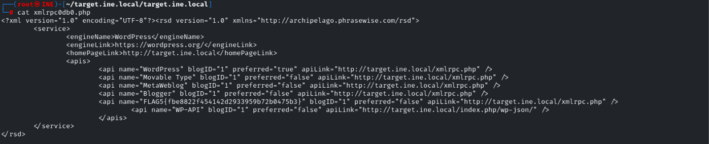

```text
Captured Flag 5: FLAG5{fbe8822f454142d2933959b72b0475b3}
```

---

## 11. Flag Collection Summary

| Flag | Objective / Challenge Description | Discovery Method & Tool | Captured Flag Value | Verification Status |
| :---: | :--- | :--- | :--- | :---: |
| **Flag 1** | This tells search engines what to and what not to avoid. | Mozilla Firefox (`/robots.txt`) | `FLAG1{90325763fda3449086cc95f99448f062}` | Verified (Screenshot 02) |
| **Flag 2** | What website is running on the target, and what is its version? | Nmap Service Scan (`-sV -sC -p-`) | `FL@G2{0480379aac34491fba7018c626e3f895}` | Verified (Screenshot 03) |
| **Flag 3** | Directory browsing might reveal where files are stored. | Dirb (`/wp-content/uploads/`) & Firefox | `FLAG3{81227977c7394b3d9aaf7815a7bd2ddd}` | Verified (Screenshots 05–07) |
| **Flag 4** | An overlooked backup file in the webroot can be problematic. | Gobuster (`-x bak`) & cURL | `FLAG4{76a21ff23c784b81988ecf8d5969e6f6}` | Verified (Screenshots 08–10) |
| **Flag 5** | Certain files may reveal something interesting when mirrored. | HTTrack & local `cat xmlrpc0db0.php` | `FLAG5{fbe8822f454142d2933959b72b0475b3}` | Verified (Screenshots 11–12) |

---

## 12. Key Learning Outcomes

1. **Information Gathering is Foundational**: Reconnaissance establishes the scope and quality of the entire assessment. Skipping detailed scanning leaves critical configuration flaws undiscovered.
2. **Web Server & CMS Fingerprinting**: Identifying Apache 2.4.41 and WordPress 6.5.3 enables direct threat-modeling against known software flaws.
3. **The Fallacy of Robots.txt**: Never use `robots.txt` to conceal sensitive locations; crawlers respect it, but adversaries treat it as an index of interesting targets.
4. **Directory Brute-Forcing Efficiency**: Selecting appropriate wordlists (e.g., SecLists `big.txt` vs `common.txt`) balances thoroughness with assessment time constraints.
5. **Dangers of Directory Indexing**: Unchecked directory listing transforms unindexed folders into public file repositories, exposing internal documents and media.
6. **MIME Type Handling & Backup Exposure**: When a script file (`.php`) is renamed with a non-executable extension (`.bak`), the web server serves the raw source code instead of executing it.
7. **Severe Impact of Configuration Exposure**: Leaking `wp-config` keys and salts bypasses authentication without cracking passwords, demonstrating that information disclosure can equal full application compromise.
8. **Value of Offline Mirroring**: Mirroring assets locally with tools like HTTrack bypasses rate limits and enables fast, stealthy regex analysis across all static code.
9. **Chaining Minor Disclosures**: Low-severity information leakages (server banners, robots.txt paths, directory listings) chain together into high-severity compromise vectors.

---

## 13. Security Recommendations

To address the vulnerabilities identified in this engagement, the following remediation and hardening measures should be implemented:

### 1. Disable Directory Indexing (Apache)
Disable the `Indexes` option globally in `/etc/apache2/apache2.conf` or locally via `.htaccess`:
```apache
<Directory /var/www/html>
    Options -Indexes
</Directory>
```
*Effect*: Prevents the web server from generating automated file listings when no `index.html` or `index.php` is present.

### 2. Prohibit Public Access to Backup & Configuration Files
Configure Apache to deny requests for backup and editor files:
```apache
<FilesMatch "(^#.*#|\.(bak|backup|old|orig|save|swp|tmp|dist)|~)$">
    Require all denied
</FilesMatch>
```
*Effect*: Any attempt to download `.bak` or `.old` files will return an immediate `HTTP 403 Forbidden`.

### 3. Store Configuration Files Outside Web Document Root
Move `wp-config.php` one directory level above the webroot (`/var/www/` instead of `/var/www/html/`). WordPress natively checks the parent directory if `wp-config.php` is missing from the document root. Even if an unparsed backup is created there, it cannot be requested over HTTP.

### 4. Remove Sensitive Paths from `robots.txt`
Ensure `robots.txt` only lists paths that must be blocked from public search engines. Do not list secret administrative directories, staging folders, or sensitive endpoints. Enforce access control via authentication headers and IP firewalls, not crawler directives.

### 5. Minimize Web Server Banner Information
Configure Apache to suppress detailed version and operating system information in the `Server` header and error pages:
```apache
ServerTokens Prod
ServerSignature Off
```
*Effect*: Modifies the response header from `Apache/2.4.41 (Ubuntu)` to generic `Apache`.

### 6. Protect Uploads Directory Against Script Execution
Prevent script execution in the uploads directory by placing a `.htaccess` file inside `/wp-content/uploads/`:
```apache
<Files *.php>
    deny from all
</Files>
```
*Effect*: Blocks any uploaded PHP script from executing, neutralizing remote code execution vectors.

### 7. Rotate Exposed Cryptographic Keys & Salts
Because `wp-config.bak` exposed the active authentication keys and salts, generate new random keys via the official WordPress API (`https://api.wordpress.org/secret-key/1.1/salt/`) and update `wp-config.php`. This immediately invalidates all existing user cookies and active sessions.

---

## 14. Conclusion

The **INE Assessment Methodologies: Information Gathering CTF 1** lab demonstrates the critical role of methodical reconnaissance in penetration testing. By systematically combining browser inspection, port scanning with **Nmap**, directory enumeration with **Gobuster** and **Dirb**, command-line retrieval with **cURL**, and offline site mirroring with **HTTrack**, all five objectives were satisfied and all flags were successfully captured.

This walkthrough illustrates that web application compromises do not always require complex binary exploitation or zero-day vulnerabilities. Severe security breaches frequently originate from basic operational oversights: leaving directory indexing enabled, storing backups with non-executable extensions in the web root, and relying on `robots.txt` for access restriction. Implementing standard configuration hardening and secure administrative practices fully mitigates these exposure vectors.

