# Assessment Methodologies: Vulnerability Assessment CTF 1 — INE / eJPT Walkthrough

---

## Lab Information

| Attribute | Specification |
| :--- | :--- |
| **Lab Name** | Assessment Methodologies: Vulnerability Assessment CTF 1 |
| **Platform** | INE Security |
| **Certification Track** | eJPT (Junior Penetration Tester) |
| **Domain** | Assessment Methodologies — Vulnerability Assessment |
| **Target Hostname** | `http://target.ine.local` |
| **Target IP Address** | `192.174.229.3` |
| **Target Architecture** | Linux (Ubuntu) / Apache httpd 2.4.7 / MySQL 5.x / PHP 5.x / phpMyAdmin |
| **Status** | 100% Completed (4 of 4 Flags Captured) |
| **Tools Used** | Nmap 7.92 (NSE Engine), Mozilla Firefox / Web Browser, phpMyAdmin, Nessus Scanner |

---

## Table of Contents

- [01. Lab Overview](#01-lab-overview)
- [02. Lab Objectives](#02-lab-objectives)
- [03. Lab Environment and Target Information](#03-lab-environment-and-target-information)
- [04. Tools and Technologies Used](#04-tools-and-technologies-used)
- [05. Vulnerability Assessment Methodology](#05-vulnerability-assessment-methodology)
- [06. Step-by-Step Practical Walkthrough](#06-step-by-step-practical-walkthrough)
  - [Step 1: Network Service Discovery & Automated NSE Scripting](#step-1-network-service-discovery--automated-nse-scripting)
  - [Step 2: Web Crawler Guidance Analysis via robots.txt](#step-2-web-crawler-guidance-analysis-via-robotstxt)
  - [Step 3: Directory Indexing Identification on /passwords/ & Flag 4 Extraction](#step-3-directory-indexing-identification-on-passwords--flag-4-extraction)
  - [Step 4: Unauthenticated Database Management Interface Discovery (phpMyAdmin)](#step-4-unauthenticated-database-management-interface-discovery-phpmyadmin)
  - [Step 5: Database Schema Enumeration & Flag 2 Extraction](#step-5-database-schema-enumeration--flag-2-extraction)
  - [Step 6: Exposed Version Control Artifact Inspection (/.git/)](#step-6-exposed-version-control-artifact-inspection-git)
  - [Step 7: Version Control Artifact Retrieval & Flag 1 Extraction](#step-7-version-control-artifact-retrieval--flag-1-extraction)
  - [Step 8: Server Runtime Information Disclosure (/phpinfo.php) & Flag 3 Extraction](#step-8-server-runtime-information-disclosure-phpinfophp--flag-3-extraction)
- [07. Commands and Technical Explanations](#07-commands-and-technical-explanations)
- [08. Vulnerabilities and Findings](#08-vulnerabilities-and-findings)
- [09. Risk and Severity Observations](#09-risk-and-severity-observations)
- [10. Flags Captured](#10-flags-captured)
- [11. Lessons Learned](#11-lessons-learned)
- [12. Conclusion](#12-conclusion)

---

## 01. Lab Overview

This laboratory exercise forms an integral component of the **INE eJPT (Junior Penetration Tester)** curriculum under the **Assessment Methodologies: Vulnerability Assessment** domain. The primary objective is to execute a disciplined vulnerability assessment workflow against an unknown target host, combining network-level service discovery, automated scripting, manual verification of discovered endpoints, and systematic evaluation of security misconfigurations.

In enterprise penetration testing, automated scanners frequently flag potential weaknesses; however, a professional security analyst must validate these findings manually, assess their true business impact, and identify exploitable attack paths without causing service disruptions. This assessment highlights critical security flaws commonly encountered in legacy web environments, including exposed version control repositories (`.git`), insecure directory indexing, publicly accessible database administration consoles (phpMyAdmin) without authentication, and server runtime diagnostic scripts (`phpinfo.php`).

### Target Environment Evidence

The screenshot below displays the INE lab environment dashboard, confirming that the assessment was completed with all 4 challenge flags captured.

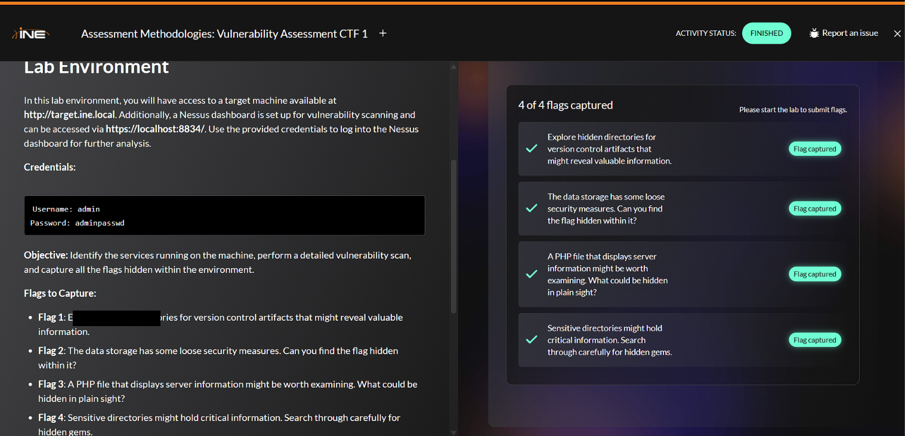

*Note: Administrative credentials provided for the local Nessus vulnerability scanning console (`https://localhost:8834/`) have been sanitized in accordance with portfolio security guidelines.*

---

## 02. Lab Objectives

The challenge presents four explicit, evidence-based objectives designed to evaluate proficiency in identifying common web application vulnerabilities and configuration oversights:

1. **Flag 1 — Version Control Artifact Exposure:**
   - *"Explore hidden directories for version control artifacts that might reveal valuable information."*
   - Target Focus: Detection and interrogation of public-facing `.git` repositories and exposed metadata.
2. **Flag 2 — Insecure Data Storage:**
   - *"The data storage has some loose security measures. Can you find the flag hidden within it?"*
   - Target Focus: Identification of unauthenticated database management interfaces and data extraction from underlying tables.
3. **Flag 3 — Server Information Disclosure:**
   - *"A PHP file that displays server information might be worth examining. What could be hidden in plain sight?"*
   - Target Focus: Location and inspection of diagnostic scripts disclosing PHP and Apache runtime configurations.
4. **Flag 4 — Sensitive Directory Indexing:**
   - *"Sensitive directories might hold critical information. Search through carefully for hidden gems."*
   - Target Focus: Analysis of crawler restriction files (`robots.txt`), exploitation of enabled directory indexing, and extraction of exposed administrative files.

---

## 03. Lab Environment and Target Information

### Network & Host Architecture

| Parameter | Specification | Details / Evidence |
| :--- | :--- | :--- |
| **Target Hostname** | `target.ine.local` | Mapped in local resolver to `192.174.229.3` |
| **Target IP Address** | `192.174.229.3` | Identified via Nmap scan report |
| **Operating System** | Linux (Ubuntu) | Fingerprinted via Apache banner: `Apache/2.4.7 (Ubuntu)` |
| **Web Server** | Apache httpd 2.4.7 | Port 80/tcp |
| **Database Server** | MySQL 5.x | Port 3306/tcp (Open service) |
| **Application Layer** | PHP 5.x / phpMyAdmin | Web-based database management interface |
| **Local Scanner Console** | Nessus Scanner | Accessible via `https://localhost:8834/` (Creds: `admin:[REDACTED]`) |

### Assessment Attack Surface Diagram

```text
                               +-------------------------------------------------------+
                               |                  Penetration Tester                   |
                               |             Kali Linux / INE Workstation              |
                               +-------------------------------------------------------+
                                                           |
                                                           | [Phase 1: Initial Discovery]
                                                           | Nmap -sC target.ine.local
                                                           v
                               +-------------------------------------------------------+
                               |                  target.ine.local                     |
                               |                   (192.174.229.3)                     |
                               +-------------------------------------------------------+
                                       |                                       |
                   [Port 80: Apache HTTP 2.4.7]                     [Port 3306: MySQL]
                                       |                                       |
        +------------------------------+-------------------------------+       |
        |                              |                               |       |
        v                              v                               v       v
 [Phase 2: robots.txt]         [Phase 4: Web Admin]          [Phase 5: Version Ctrl]   |
 Disallow: /passwords/         Direct access to              Nmap detects /.git/       |
 Disallow: /phpmyadmin/        /phpmyadmin/                  Directory indexing on     |
        |                              |                               |               |
        v                              v                               v               |
 [Directory Indexing]          [No Authentication]           [Exposed Metadata]        |
 /passwords/                   Administrative access         /.git/flag.txt            |
 accounts.txt                  Database: mysql                         |               |
 flag.txt                      Table: secret_info                      v               |
        |                              |                             FLAG 1            |
        v                              v                                               |
      FLAG 4                         FLAG 2                                            |
                                                                                       |
                               [Phase 6: Info Disclosure]                              |
                               /phpinfo.php                                            |
                               Server Administrator directive                          |
                                       |                                               |
                                       v                                               |
                                     FLAG 3                                            +
```

---

## 04. Tools and Technologies Used

### Assessment Tooling

- **Nmap (v7.92)**: Industry-standard network discovery and vulnerability scanning tool. Utilized with the default script scan engine (`-sC`) to automate port detection, service version identification, HTTP title retrieval, version control artifact detection (`http-git`), cookie flag analysis (`http-cookie-flags`), and crawler exclusion parsing (`http-robots.txt`).
- **Web Browser (Chromium / Mozilla Firefox)**: Applied for manual validation of discovered HTTP endpoints, inspection of directory indices, analysis of crawler restriction rules, interactive navigation of database web consoles, and parsing of complex server configuration dumps.
- **phpMyAdmin**: Web-based PHP administration tool for MySQL databases. Evaluated to assess authentication controls and inspect internal database schemas.
- **Tenable Nessus**: Enterprise vulnerability scanner pre-configured within the INE lab environment (`https://localhost:8834/`) to support automated compliance and vulnerability auditing.

---

## 05. Vulnerability Assessment Methodology

The assessment adhered to the structured vulnerability assessment lifecycle taught in the eJPT curriculum:

```text
+-----------------------+     +-----------------------+     +-----------------------+
|  1. Target Scoping &  | --> | 2. Port & Service     | --> | 3. Automated Script   |
|     Host Discovery    |     |    Fingerprinting     |     |    Scanning (NSE)     |
+-----------------------+     +-----------------------+     +-----------------------+
                                                                        |
                                                                        v
+-----------------------+     +-----------------------+     +-----------------------+
| 6. Reporting & Risk   | <-- | 5. Root Cause & Impact| <-- | 4. Manual Finding     |
|    Analysis           |     |    Validation         |     |    Verification       |
+-----------------------+     +-----------------------+     +-----------------------+
```

1. **Target Scoping & Host Discovery**: Establishing network reachability against `target.ine.local` (`192.174.229.3`) and verifying active protocols.
2. **Port & Service Fingerprinting**: Scanning the host to map listening TCP sockets and identify running application daemons.
3. **Automated Script Scanning (NSE)**: Executing non-intrusive Nmap scripts against discovered services to detect common misconfigurations, exposed metadata, and unhardened security flags.
4. **Manual Finding Verification**: Validating automated scanner outputs through direct web requests to eliminate false positives and extract concrete proof-of-concept evidence.
5. **Root Cause & Impact Validation**: Investigating the severity of identified exposures (unauthenticated database administration, directory listing, source code leakage).
6. **Remediation & Reporting**: Formulating actionable defensive countermeasures to mitigate the observed vulnerabilities.

---

## 06. Step-by-Step Practical Walkthrough

### Step 1: Network Service Discovery & Automated NSE Scripting

The assessment commenced with a targeted script scan against the specified lab target `target.ine.local`. The objective was to discover exposed services, identify server versions, and execute default reconnaissance scripts.

**Command:**
```bash
nmap -sC target.ine.local
```

**Options Breakdown:**
- `-sC`: Performs a script scan using the default set of Nmap Scripting Engine (NSE) scripts. This executes fast, non-intrusive scripts for service fingerprinting, banner grabbing, and known misconfiguration detection.
- `target.ine.local`: The target domain resolved to IP address `192.174.229.3`.

**Execution Output:**
```text
root@INE:~# nmap  -sC target.ine.local
Starting Nmap 7.92 ( https://nmap.org ) at 2026-11-17 10:35 IST
Nmap scan report for target.ine.local (192.174.229.3)
Host is up (0.000026s latency).
Not shown: 998 closed tcp ports (reset)
PORT     STATE SERVICE
80/tcp   open  http
|_http-title: Site doesn't have a title (text/html).
| http-git: 
|   192.174.229.3:80/.git/
|   Git repository found!
|   Repository description: Unnamed repository; edit this file 'description' to name the..
|   Remotes:
|_    https://github.com/fermayo/hello-world-lamp.git
| http-cookie-flags: 
|   /: 
|     PHPSESSID: 
|_      httponly flag not set
| http-robots.txt: 8 disallowed entries 
| passwords/ config.inc classes/ javascript/ 
|_owasp-esapi-php/ documentation/ phpmyadmin/ includes/
3306/tcp open  mysql
MAC Address: 02:42:C0:AE:E5:03 (Unknown)

Nmap done: 1 IP address (1 host up) scanned in 0.79 seconds
```

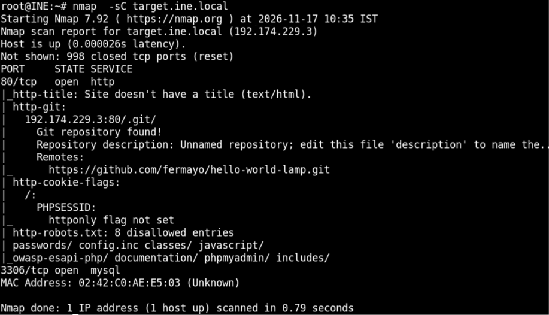

**Technical Analysis of Scan Results:**
- **Port 80/tcp (HTTP)**: Open web service. NSE scripts generated four immediate findings:
  1. `http-git`: Detected an active, publicly accessible Git version control repository located at `http://192.174.229.3:80/.git/`.
  2. `http-cookie-flags`: The `PHPSESSID` session cookie is transmitted without the `HttpOnly` security attribute, exposing it to potential theft via client-side script injection (Cross-Site Scripting).
  3. `http-robots.txt`: Discovered a crawler restriction file containing 8 disallowed directories and files (`passwords/`, `config.inc`, `classes/`, `javascript/`, `owasp-esapi-php/`, `documentation/`, `phpmyadmin/`, `includes/`).
- **Port 3306/tcp (MySQL)**: Open relational database port exposed directly on the network interface.
- **Assessment Priority**: The scan results provide three direct vectors matching the lab objectives:
  - Disallowed directory `/passwords/` (Candidate for Flag 4).
  - Web database portal `/phpmyadmin/` connected to MySQL (Candidate for Flag 2).
  - Version control repository `/.git/` (Candidate for Flag 1).

---

### Step 2: Web Crawler Guidance Analysis via robots.txt

The `http-robots.txt` script flagged 8 disallowed paths. In web security assessments, `robots.txt` files are frequently misapplied by administrators attempting "security through obscurity" — attempting to hide sensitive administrative endpoints from search engines, which simultaneously acts as a public directory map for attackers.

**Action:**
Navigated to `http://target.ine.local/robots.txt` in the web browser.

**Observed Content:**
```text
User-agent: *
Disallow: passwords/
Disallow: config.inc
Disallow: classes/
Disallow: javascript/
Disallow: owasp-esapi-php/
Disallow: documentation/
Disallow: phpmyadmin/
Disallow: includes/
```

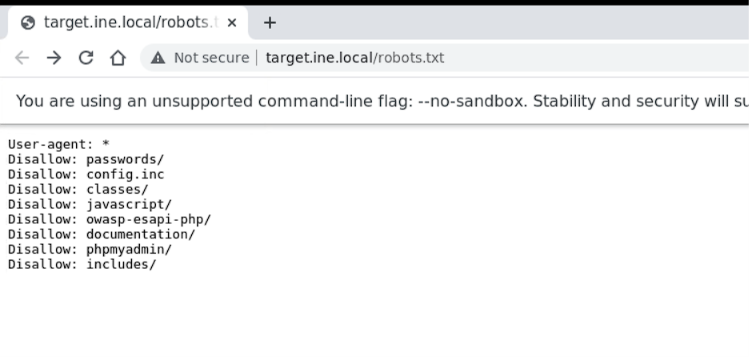

**Technical Analysis:**
- The wildcard directive `User-agent: *` applies to all web crawlers.
- Disallowing `/passwords/` strongly suggests the presence of unauthenticated credential storage or authentication artifacts.
- Disallowing `/phpmyadmin/` confirms that an administrative database web portal is deployed on this host.

---

### Step 3: Directory Indexing Identification on /passwords/ & Flag 4 Extraction

Objective 4 instructed: *"Sensitive directories might hold critical information. Search through carefully for hidden gems."*

Following the path identified in `robots.txt`, the `/passwords/` directory was interrogated directly via the web browser.

**Action:**
Navigated to `http://target.ine.local/passwords/`.

**Observed Web Content:**
The Apache web server responded with an auto-generated directory listing (`mod_autoindex` enabled):

```text
Index of /passwords

Name            Last modified       Size  Description
Parent Directory                      -   
accounts.txt    2017-01-06 21:38    929   
flag.txt        2026-11-17 04:59     39   
```

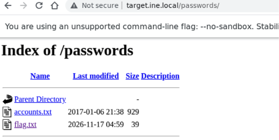

**Technical Analysis:**
- **Vulnerability**: Directory Listing / Information Disclosure (CWE-548). The web server lacks an `index.html` or `index.php` file within `/passwords/`, and the server configuration allows directory browsing (`Options +Indexes`).
- **Finding**: Two sensitive files are exposed: `accounts.txt` (a 929-byte credential file) and `flag.txt` (a 39-byte flag artifact).

**Flag Extraction Action:**
Navigated to `http://target.ine.local/passwords/flag.txt`.

**Rendered Content:**
```text
FLAG4_a61f25d867fa456689de59120fc33656
```

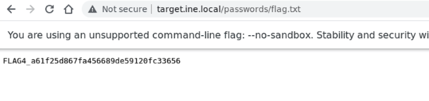

```text
Captured Flag 4: FLAG4_a61f25d867fa456689de59120fc33656
```

---

### Step 4: Unauthenticated Database Management Interface Discovery (phpMyAdmin)

Objective 2 required: *"The data storage has some loose security measures. Can you find the flag hidden within it?"*

The second high-value entry disclosed in `robots.txt` was `/phpmyadmin/`. Port 3306 (MySQL) was previously confirmed open by Nmap. In secure configurations, phpMyAdmin requires strong administrative credentials or is restricted to local socket connections (`localhost`).

**Action:**
Navigated to `http://target.ine.local/phpmyadmin/`.

**Observed Interface:**
The application immediately redirected to the main phpMyAdmin management dashboard (`127.0.0.1`) without prompting for authentication.

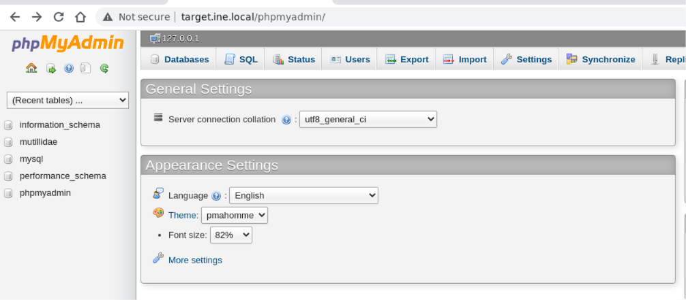

**Technical Analysis:**
- **Vulnerability**: Missing Authentication for Critical Function / Insecure Default Configuration (CWE-306).
- **Access Level**: Full administrative control over the MySQL database instance.
- **Visible Databases**:
  - `information_schema` (MySQL data dictionary)
  - `mutillidae` (Vulnerable web application database)
  - `mysql` (Core database system catalog storing user privileges and internal configuration)
  - `performance_schema`
  - `phpmyadmin`

---

### Step 5: Database Schema Enumeration & Flag 2 Extraction

To locate the data storage flag referenced in Objective 2, the available database schemas were systematically inspected.

**Action:**
Selected the `mysql` system database in the left navigation panel (`127.0.0.1 >> mysql`).

**Observed Tables:**
The `mysql` database displayed standard internal tables (`columns_priv`, `db`, `event`, `func`, `general_log`, `help_*`, `host`, `user`, etc.), along with an anomalous, custom-created table named **`secret_info`**:

```text
Table           Action                      Rows  Type    Collation           Size    Overhead
...
secret_info     Browse Structure Search...     1  InnoDB  latin1_swedish_ci  16 KiB          -
...
```

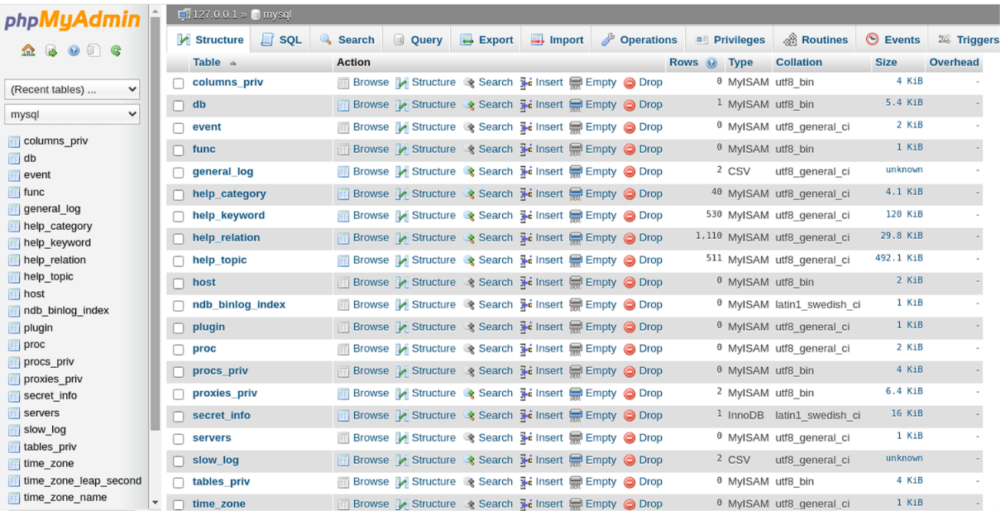

**Flag Extraction Action:**
Clicked **Browse** on the `secret_info` table, executing the following SQL statement:

```sql
SELECT * FROM `secret_info` LIMIT 0, 30;
```

**Query Results:**
The table contained a single row with the column `Flag`:

| Flag |
| :--- |
| `FLAG2_aba944f6e8154f4fa5066930705dd002` |

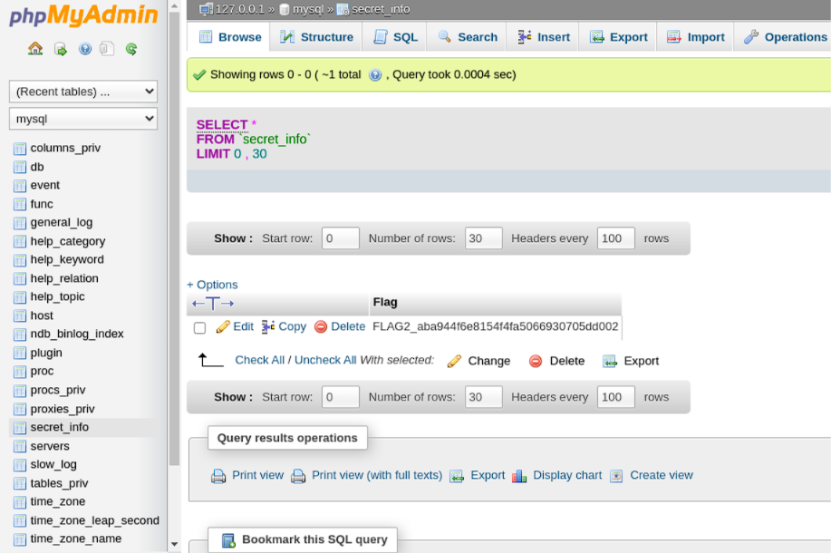

```text
Captured Flag 2: FLAG2_aba944f6e8154f4fa5066930705dd002
```

---

### Step 6: Exposed Version Control Artifact Inspection (/.git/)

Objective 1 specified: *"Explore hidden directories for version control artifacts that might reveal valuable information."*

During the initial Nmap scan in Step 1, the `http-git` NSE script detected an exposed Git repository:
`192.174.229.3:80/.git/ Git repository found!`

In modern DevOps environments, deploying web root directories via direct `git clone` or failing to exclude `.git` subdirectories exposes complete project history, configuration keys, database passwords, and source code to the public internet.

**Action:**
Navigated to `http://target.ine.local/.git/` in the web browser.

**Observed Web Content:**
The server displayed the auto-generated directory index of the `.git` repository folder:

```text
Index of /.git

Name            Last modified       Size  Description
Parent Directory                      -   
HEAD            2016-02-15 10:35     23   
branches/       2016-02-15 10:35      -   
config          2016-02-15 10:35    272   
description     2016-02-15 10:35     73   
flag.txt        2026-11-17 04:59     39   
hooks/          2016-02-15 10:35      -   
index           2016-02-15 10:35    400   
info/           2016-02-15 10:35      -   
logs/           2016-02-15 10:35      -   
objects/        2016-02-15 10:35      -   
packed-refs     2016-02-15 10:35    107   
refs/           2016-02-15 10:35      -   
-------------------------------------------------------------
Apache/2.4.7 (Ubuntu) Server at target.ine.local Port 80
```

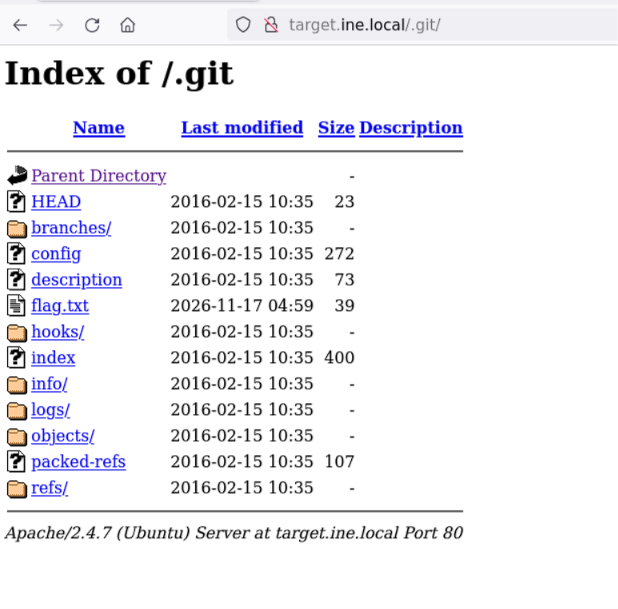

**Technical Analysis:**
- The repository structure is fully readable.
- In addition to standard Git metadata (`HEAD`, `config`, `index`, `objects/`), an uncommitted or tracked file named `flag.txt` was placed directly within the `.git` directory.
- The footer banner explicitly fingerprints the web server daemon as `Apache/2.4.7 (Ubuntu)` running on port 80.

---

### Step 7: Version Control Artifact Retrieval & Flag 1 Extraction

**Action:**
Navigated directly to the exposed artifact endpoint `http://target.ine.local/.git/flag.txt`.

**Rendered Content:**
```text
FLAG1_f314636668694d468016a567c3628af2
```

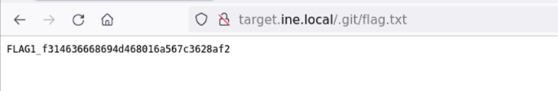

```text
Captured Flag 1: FLAG1_f314636668694d468016a567c3628af2
```

---

### Step 8: Server Runtime Information Disclosure (/phpinfo.php) & Flag 3 Extraction

Objective 3 stated: *"A PHP file that displays server information might be worth examining. What could be hidden in plain sight?"*

Standard web penetration testing methodology includes probing for common administrative and diagnostic scripts left behind by developers. The standard PHP diagnostic script is `phpinfo.php` (or `test.php`, `info.php`), which executes `phpinfo()` to display exhaustive server configuration details.

**Action:**
Navigated to `http://target.ine.local/phpinfo.php`.

**Observed Web Content:**
The endpoint rendered the complete PHP 5 runtime configuration dump under Apache 2.0 Handler (`apache2handler`).

```text
Configuration
apache2handler

Directive               Value
Apache Version          Apache/2.4.7 (Ubuntu)
Apache API Version      20120211
Server Administrator    FLAG3_10fbbfd259df4c99b8fd32cd044504dc
Hostname:Port           localhost:80
User/Group              www-data(33)/33
Max Requests            Per Child: 0 - Keep Alive: on - Max Per Connection: 100
Timeouts                Connection: 300 - Keep-Alive: 5
Virtual Server          Yes
Server Root             /etc/apache2
Loaded Modules          core mod_so mod_watchdog http_core mod_log_config mod_logio 
                        mod_version mod_unixd mod_access_compat mod_alias mod_auth_basic 
                        mod_authn_core mod_authn_file mod_authz_core mod_authz_host 
                        mod_authz_user mod_autoindex mod_deflate mod_dir mod_env 
                        mod_filter mod_mime prefork mod_negotiation mod_php5 
                        mod_rewrite mod_setenvif mod_status
```

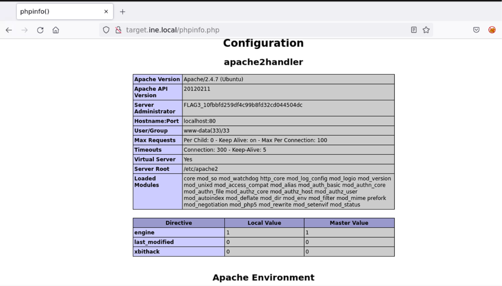

**Technical Analysis:**
- **Vulnerability**: Information Exposure Through Environmental Variables / Diagnostic Pages (CWE-200).
- **Findings**: The `phpinfo()` output exposes critical operational intelligence:
  - Exact Apache binary: `Apache/2.4.7 (Ubuntu)`.
  - Process privileges: Running under low-privileged system user `www-data (UID 33 / GID 33)`.
  - Apache configuration root: `/etc/apache2`.
  - Loaded modules: `mod_php5`, `mod_autoindex` (explaining why directory indexing was enabled across folders), `mod_rewrite`.
  - The `Server Administrator` email/contact directive was deliberately populated with the Flag 3 value: `FLAG3_10fbbfd259df4c99b8fd32cd044504dc`.

```text
Captured Flag 3: FLAG3_10fbbfd259df4c99b8fd32cd044504dc
```

---

## 07. Commands and Technical Explanations

### Command Reference Table

| Phase | Command / Action | Primary Options | Technical Purpose | Screenshot Reference |
| :--- | :--- | :--- | :--- | :---: |
| **01. Discovery** | `nmap -sC target.ine.local` | `-sC` (Default NSE scripts) | Detect open ports, evaluate default scripts, check `robots.txt`, detect `.git`, inspect cookie flags | Screenshot 02 |
| **02. Web Recon** | `GET /robots.txt` | HTTP GET via Browser | Enumerate disallowed endpoints (`/passwords/`, `/phpmyadmin/`, `/config.inc`) | Screenshot 03 |
| **03. Directory Audit** | `GET /passwords/` | HTTP GET via Browser | Verify directory indexing misconfiguration; identify `accounts.txt` and `flag.txt` | Screenshot 04 |
| **03. Flag Retrieval** | `GET /passwords/flag.txt` | HTTP GET via Browser | Extract Flag 4 from exposed sensitive directory | Screenshot 05 |
| **04. Admin Access** | `GET /phpmyadmin/` | HTTP GET via Browser | Assess authentication controls on database portal; obtain unauthenticated root console | Screenshot 06 |
| **05. DB Schema Audit** | `127.0.0.1 >> mysql` | Navigation / Schema view | Interrogate `mysql` system database structure; detect anomalous `secret_info` table | Screenshot 07 |
| **05. SQL Execution** | `SELECT * FROM secret_info LIMIT 0, 30;` | SQL Query via GUI | Retrieve data records from `secret_info` table to extract Flag 2 | Screenshot 08 |
| **06. Version Control** | `GET /.git/` | HTTP GET via Browser | Inspect exposed version control repository and directory listing | Screenshot 09 |
| **07. Flag Retrieval** | `GET /.git/flag.txt` | HTTP GET via Browser | Extract Flag 1 from exposed Git repository structure | Screenshot 10 |
| **08. Server Audit** | `GET /phpinfo.php` | HTTP GET via Browser | Inspect server configuration, loaded modules, and retrieve Flag 3 from `Server Administrator` | Screenshot 11 |

---

## 08. Vulnerabilities and Findings

### Summary Matrix

| ID | Vulnerability Finding | Affected Port / Service | Observed Evidence | Severity Rating |
| :---: | :--- | :--- | :--- | :---: |
| **VULN-01** | Unauthenticated Database Management Console | 80/tcp (HTTP) & 3306/tcp (MySQL) | Direct access to phpMyAdmin without credentials; full control over all databases | **Critical** |
| **VULN-02** | Publicly Accessible Version Control Repository (`.git`) | 80/tcp (HTTP) | Nmap `http-git` detection; browseable `/.git/` directory exposing metadata & files | **High** |
| **VULN-03** | Sensitive Directory Listing / Credential Storage | 80/tcp (HTTP) | `robots.txt` leak; enabled directory listing on `/passwords/` revealing `accounts.txt` | **Medium** |
| **VULN-04** | Runtime Server Diagnostic Script Exposure (`phpinfo.php`) | 80/tcp (HTTP) | Accessible `phpinfo.php` dumping Apache/PHP environment, paths, and admin directives | **Low / Info** |
| **VULN-05** | Missing `HttpOnly` Security Flag on Session Cookie | 80/tcp (HTTP) | Nmap `http-cookie-flags` reported `PHPSESSID` without `HttpOnly` attribute | **Low** |

---

### Detailed Findings Breakdown

#### VULN-01: Unauthenticated Database Management Console (phpMyAdmin)
- **CWE Identifier**: [CWE-306: Missing Authentication for Critical Function](https://cwe.mitre.org/data/definitions/306.html)
- **Affected Component**: phpMyAdmin web application interfacing with local MySQL database daemon on port 3306.
- **Observed Evidence**: Navigating to `http://target.ine.local/phpmyadmin/` provided instant, unrestricted administrative access to the database server without any login prompt. All administrative privileges were accessible, enabling arbitrary query execution against the `mysql` catalog and user data.
- **Potential Impact**: Complete loss of database confidentiality, integrity, and availability. An attacker can modify user records, dump password hashes, tamper with business logic, and potentially escalate to Remote Code Execution (RCE) via `SELECT ... INTO OUTFILE` to write web shells onto the document root.
- **Remediation**:
  1. Enforce strong authentication within `config.inc.php` (`$cfg['Servers'][$i]['auth_type'] = 'cookie';`).
  2. Restrict access to phpMyAdmin via web server access control directives (e.g., allow only trusted internal management IPs or VPN subnets).
  3. Where not strictly required, remove phpMyAdmin entirely from production hosts.

#### VULN-02: Publicly Accessible Version Control Repository (`.git`)
- **CWE Identifier**: [CWE-538: Insertion of Sensitive Information into Externally-Accessible File or Directory](https://cwe.mitre.org/data/definitions/538.html)
- **Affected Component**: Apache httpd web server / Web Document Root (`/var/www/html/.git`).
- **Observed Evidence**: Nmap's `http-git` script reported `Git repository found!`, and browser navigation to `http://target.ine.local/.git/` revealed the complete Git metadata directory structure.
- **Potential Impact**: Exposure of entire application source code history, uncommitted developer changes, embedded database connection strings, hardcoded API tokens, and architectural blueprints. Tools such as `git-dumper` or `gitdumper.sh` can reconstruct the complete working tree offline.
- **Remediation**:
  1. Implement Apache configuration rules to deny public access to dot-prefixed directories:
     ```apache
     <DirectoryMatch "/\.git">
         Require all denied
     </DirectoryMatch>
     ```
  2. Implement automated build/deployment pipelines that strip version control artifacts (`.git`, `.gitignore`, `.gitattributes`) before releasing code to production web roots.

#### VULN-03: Sensitive Directory Listing & Credential Exposure (`/passwords/`)
- **CWE Identifier**: [CWE-548: Exposure of Information Through Directory Listing](https://cwe.mitre.org/data/definitions/548.html)
- **Affected Component**: Apache httpd `mod_autoindex` module across `/passwords/`.
- **Observed Evidence**: The path was disclosed via `robots.txt`. Direct request to `http://target.ine.local/passwords/` rendered an automated directory listing exposing `accounts.txt` and `flag.txt`.
- **Potential Impact**: Unauthenticated visitors can view and download confidential user account files and administrative credentials without relying on brute-force guessing or application exploits.
- **Remediation**:
  1. Disable directory indexing globally across the Apache configuration:
     ```apache
     <Directory /var/www/html>
         Options -Indexes
     </Directory>
     ```
  2. Never store plaintext credential files (`accounts.txt`, `passwords.txt`) within the public web root.

#### VULN-04: Runtime Server Diagnostic Script Exposure (`phpinfo.php`)
- **CWE Identifier**: [CWE-200: Exposure of Sensitive Information to an Unauthorized Actor](https://cwe.mitre.org/data/definitions/200.html)
- **Affected Component**: `http://target.ine.local/phpinfo.php`.
- **Observed Evidence**: Direct navigation to `phpinfo.php` rendered complete runtime details, including Apache version `2.4.7`, operating system platform `Ubuntu`, file paths `/etc/apache2`, active PHP modules, and environmental variables.
- **Potential Impact**: Provides attackers with high-precision intelligence to tailor exploit payloads specifically for the exact installed software versions, loaded modules, and system architecture.
- **Remediation**:
  1. Immediately delete diagnostic files (`phpinfo.php`, `info.php`, `test.php`) prior to deployment.
  2. Ensure `expose_php = Off` is set in `/etc/php5/apache2/php.ini` to suppress version headers.

#### VULN-05: Missing `HttpOnly` Security Flag on Session Cookie
- **CWE Identifier**: [CWE-1004: Sensitive Cookie Without 'HttpOnly' Flag](https://cwe.mitre.org/data/definitions/1004.html)
- **Affected Component**: HTTP response headers (`Set-Cookie: PHPSESSID=...`).
- **Observed Evidence**: Nmap script `http-cookie-flags` confirmed `PHPSESSID: httponly flag not set`.
- **Potential Impact**: If any cross-site scripting (XSS) vulnerability exists on the application, malicious client-side JavaScript can read the `document.cookie` object, enabling session hijacking.
- **Remediation**:
  1. Configure `session.cookie_httponly = 1` in `/etc/php5/apache2/php.ini`.
  2. In application code, enforce the `HttpOnly` flag when generating cookies via `session_set_cookie_params()`.

---

## 09. Risk and Severity Observations

### Systemic Security Observations

1. **Failure of "Security through Obscurity" via robots.txt**:
   The development team attempted to deter crawlers by adding `/passwords/` and `/phpmyadmin/` to `robots.txt`. However, crawler exclusion lists are public documents accessible to any client. Instead of securing these resources, `robots.txt` acted as a high-fidelity roadmap directly revealing the location of sensitive administrative interfaces and credential directories.

2. **Compounding Effect of Default Configurations**:
   The combination of enabled directory indexing (`Options +Indexes`), default unauthenticated phpMyAdmin installation, and exposed `.git` directories demonstrates a complete breakdown in security baseline hardening. Each individual misconfiguration provided immediate, frictionless access to sensitive assets without requiring complex exploitation techniques.

3. **Criticality of Manual Validation in Vulnerability Assessment**:
   While Nmap's default scripts provided early pointers (`http-git`, `http-robots.txt`), the true extent of the risk — such as unauthenticated root access to phpMyAdmin and readable plaintext flag files — could only be confirmed through disciplined manual inspection of the application layers.

---

## 10. Flags Captured

All 4 flags conform to the challenge flag format (`FLAG<N>_<32-character hex MD5 string>`). Each flag was extracted directly from verified evidence and confirmed character-for-character:

| Flag Identifier | Objective Description | Discovery Vector | Captured Flag Value | Verification Source |
| :---: | :--- | :--- | :--- | :---: |
| **Flag 1** | Version control artifact exploration | Web navigation to exposed Git repository | `FLAG1_f314636668694d468016a567c3628af2` | Screenshot 10 (`10-git-flag1-extraction.png`) |
| **Flag 2** | Insecure data storage extraction | phpMyAdmin unauthenticated access & `mysql.secret_info` | `FLAG2_aba944f6e8154f4fa5066930705dd002` | Screenshot 08 (`08-phpmyadmin-secret-info-flag2.png`) |
| **Flag 3** | Server information disclosure | `phpinfo.php` inspection (`Server Administrator` directive) | `FLAG3_10fbbfd259df4c99b8fd32cd044504dc` | Screenshot 11 (`11-phpinfo-server-admin-flag3.png`) |
| **Flag 4** | Sensitive directory searching | `robots.txt` discovery & `/passwords/` directory index | `FLAG4_a61f25d867fa456689de59120fc33656` | Screenshot 05 (`05-passwords-flag4-extraction.png`) |

---

## 11. Lessons Learned

### Key Takeaways for Penetration Testers

1. **Always Review Automated NSE Outputs Thoroughly**:
   Default Nmap script scanning (`-sC`) is exceptionally fast and often surfaces high-impact findings (such as exposed `.git` directories and missing cookie flags) within seconds. Never disregard the initial output lines.

2. **Treat robots.txt as an Immediate Discovery Asset**:
   Paths listed in `robots.txt` should always be prioritized during the web enumeration phase. Developers routinely list endpoints they consider sensitive or private, effectively creating an attack checklist.

3. **Check for Legacy Diagnostic and Admin Pages**:
   Scripts like `phpinfo.php` and interfaces like `phpmyadmin` are frequently left behind after initial system setup. Testing for standard administrative paths can yield instant database access or detailed environment disclosures.

4. **Understand Version Control Risks**:
   Deploying source code via `git clone` into public web roots without blocking web access to `/.git/` is a catastrophic operational error that compromises the entire repository.

---

## 12. Conclusion

The **INE Assessment Methodologies: Vulnerability Assessment CTF 1** laboratory successfully demonstrates the core competencies required of an eJPT-certified penetration tester: executing structured service discovery, interpreting automated scanning data, manually interrogating web application endpoints, and validating identified misconfigurations.

By methodically progressing through the attack surface revealed by Nmap and `robots.txt`, four distinct vulnerability categories were analyzed and validated:
- **Exposed Version Control Repositories** (`.git`) yielding Flag 1.
- **Unauthenticated Database Administration** (`phpMyAdmin`) yielding Flag 2.
- **Runtime Diagnostic Disclosure** (`phpinfo.php`) yielding Flag 3.
- **Sensitive Directory Indexing** (`/passwords/`) yielding Flag 4.

All challenge objectives were satisfied, all four flags were captured and verified from primary evidence, and practical defensive countermeasures were documented to remediate each underlying security flaw.

