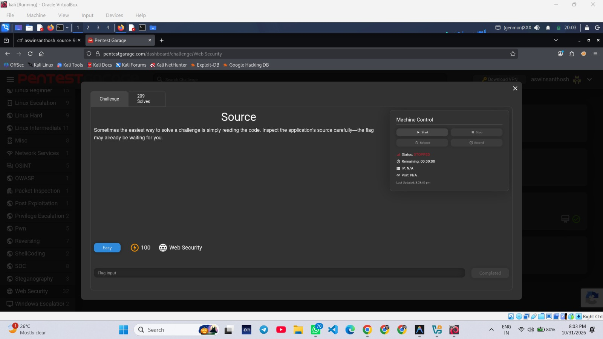
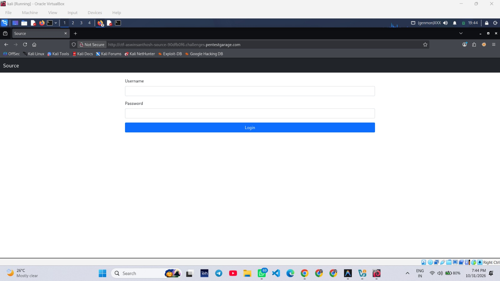
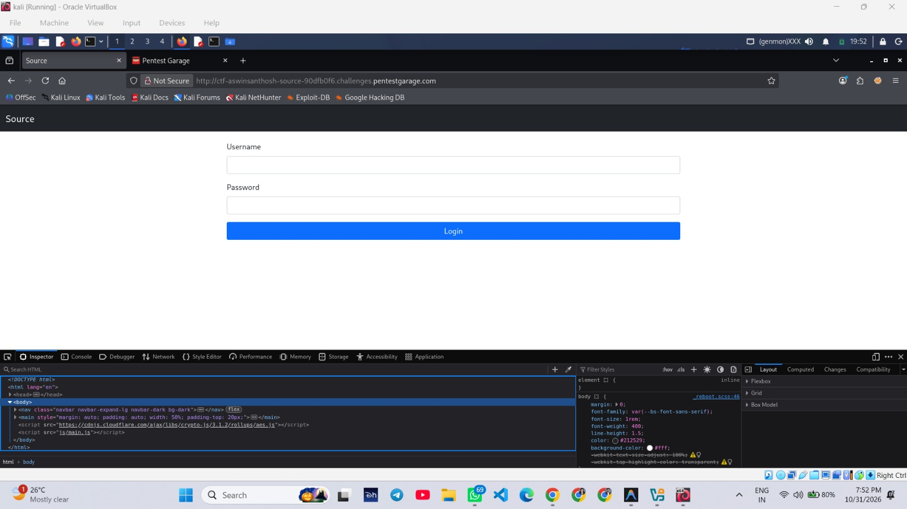
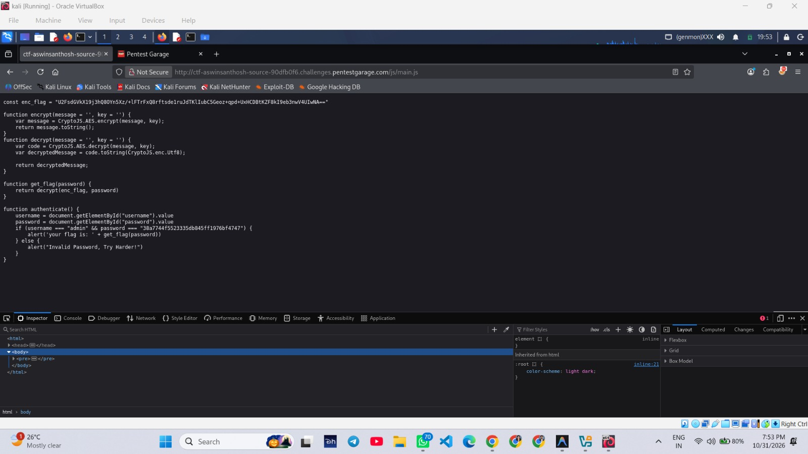
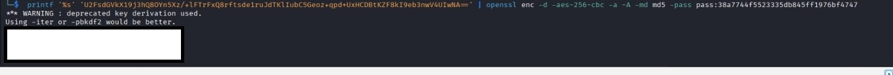

# Pentest Garage – Source

> A detailed web security walkthrough demonstrating how exposed client-side authentication logic and hard-coded secrets can compromise an application's security.

## 1. Lab Overview

| Detail | Information |
|---|---|
| Platform | Pentest Garage |
| Lab Name | Source |
| Category | Web Security |
| Difficulty | Easy |
| Points | 100 |
| Completion Date | 31 October 2026 |
| Status | Completed |

### Objective

The objective of this challenge is to inspect a web application's source code, understand how its authentication mechanism works, and identify whether sensitive information is exposed through client-side JavaScript.

The challenge demonstrates why authentication and access control must not depend on code executed entirely in the user's browser.

## 2. Lab Environment

### Target Environment
- Platform: Pentest Garage
- Challenge: Source
- Target: Challenge-provided web application
- Protocol observed: HTTP

### Attacker Environment
- Operating System: Kali Linux
- Virtualization: Oracle VirtualBox

### Tools Used

| Tool | Purpose |
|---|---|
| Firefox | Access the target web application |
| Firefox Developer Tools | Inspect HTML and client-side resources |
| curl | Retrieve HTTP responses and JavaScript files |
| OpenSSL | Analyze and decrypt the encrypted challenge value |

**Scope:** Testing was restricted to the authorized Source challenge instance and its publicly referenced resources.

## 3. Step 1 – Start the Target Machine

### Objective
Start the Source challenge machine and access the web application.

### Why This Step?
Before performing any security testing, the target environment must be running and accessible. Identifying the correct challenge also ensures that testing remains within the authorized scope.

### Procedure
1. Open the Pentest Garage dashboard.
2. Navigate to the Web Security category.
3. Select the Source challenge.
4. Use Machine Control to start the target.
5. Open the hostname provided by the platform in Firefox.

### Observation
The application displays a login page containing:
- Username field
- Password field
- Login button

The browser indicates that the application is served over HTTP rather than HTTPS.

### Evidence





## 4. Step 2 – Inspect the HTML Using Firefox Developer Tools

### Objective
Inspect the application's HTML structure and identify the resources loaded by the login page.

### Why This Step?
HTML inspection helps identify how a web application handles user input and which JavaScript files are responsible for its functionality.

It can also reveal whether the login process is handled through a conventional server-side form submission or through client-side JavaScript.

### Procedure
1. Open the login page in Firefox.
2. Press `F12` to open Developer Tools.
3. Select the Inspector tab.
4. Examine the login form and the script references.

### Observations
The page contains:
- A navigation section displaying the challenge name.
- A main section containing the login interface.
- Username and password input elements.
- References to two JavaScript resources:
  - CryptoJS AES library.
  - The application's own `js/main.js` file.

### Why the JavaScript References Matter

The CryptoJS AES library indicates that encryption-related functionality is available in the browser.

The custom `js/main.js` file is particularly important because it may contain the application's authentication logic.

This observation provides a reason to investigate the JavaScript implementation further. It does not, by itself, prove that a vulnerability exists.

### Evidence



## 5. Step 3 – Retrieve the Web Page Using curl

### Objective
Retrieve the target application's HTTP response directly from the Kali Linux terminal.

### Why This Step?
Browser inspection is useful, but command-line tools provide another way to examine server responses.

Using curl makes it possible to inspect HTTP response headers and the HTML body without relying on the browser's visual interface.

### Command

Replace `<TARGET_HOST>` with the hostname assigned by the training platform.

```bash
curl -sS -i --max-time 10 http://<TARGET_HOST>/
```

### Command Breakdown

| Option | Explanation |
|---|---|
| `-s` | Enables silent mode |
| `-S` | Displays errors even in silent mode |
| `-i` | Includes HTTP response headers |
| `--max-time 10` | Limits the request duration to 10 seconds |

### Observations

The documented response was:

- HTTP status: `200 OK`
- Content type: `text/html`
- Content length: `1425` bytes

The HTML response contains the login interface and references the JavaScript resources.

The login button invokes a JavaScript function named `authenticate()`.

The form does not define a conventional server submission destination using an `action` attribute or an HTTP submission method using a `method` attribute.

### Security Significance

These observations suggest that the login behavior may be implemented on the client side.

However, this is still a hypothesis. The actual JavaScript function must be inspected before confirming how authentication is performed.

### Evidence



## 6. Step 4 – Inspect the JavaScript Implementation

### Objective
Retrieve and examine the application's custom JavaScript file.

### Why This Step?
The HTML inspection identified `js/main.js` as a resource associated with the login functionality.

Examining this file helps determine:
- Where authentication logic is implemented.
- Whether credentials are hard-coded.
- Whether protected values are stored in the client.
- Whether encryption keys or decryption routines are exposed.

### Command

```bash
curl -sS -i --max-time 10 http://<TARGET_HOST>/js/main.js
```

### Command Explanation

- `curl` retrieves the requested JavaScript resource.
- `-sS` suppresses normal progress output while retaining error messages.
- `-i` displays the HTTP response headers.
- `--max-time 10` limits the request to 10 seconds.
- `/js/main.js` identifies the application's custom JavaScript file.

### Observations

The documented response returned:

- HTTP status: `200 OK`
- Content type: `application/javascript`
- Content length: `842` bytes

The JavaScript implementation contains:

1. An encrypted challenge value.
2. An AES decryption function.
3. A function that passes the encrypted value and a password to the decryption routine.
4. An authentication function that reads the username and password directly from the browser's input fields.
5. A comparison against hard-coded authentication values.

### Security Significance

The authentication-related values and the decryption logic are delivered to the browser.

JavaScript delivered to a client is not secret. A user can inspect it, understand its logic, and execute relevant functions outside the original page.

This is the central security weakness demonstrated by the challenge.

## 7. Step 5 – Analyze the Client-Side Authentication Logic

### Objective
Understand how the application validates credentials and retrieves the protected challenge value.

### Why This Step?
Authentication is a security boundary. If the application relies entirely on client-side code to validate credentials and protect sensitive data, users may be able to bypass the intended restrictions.

### Findings

The JavaScript analysis revealed that:

- Authentication-related credentials are hard-coded in the script.
- The encrypted challenge value is also available in the client-side resource.
- The decryption routine is publicly accessible.
- The password used by the decryption function is present in the same JavaScript implementation.

### Why This Is Vulnerable

Encryption does not provide meaningful confidentiality when the decryption key is exposed alongside the encrypted data.

A user can retrieve the JavaScript file, inspect the implementation, and reproduce the decryption process locally.

The browser must therefore never be trusted as the sole enforcement point for authentication or authorization.

## 8. Step 6 – Analyze the Encrypted Value Using OpenSSL

### Objective
Understand and reproduce the decryption process locally using OpenSSL.

### Why This Step?
The challenge uses CryptoJS AES passphrase-based encryption.

The encrypted value uses an OpenSSL-compatible salted format. The Base64 representation begins with a recognizable prefix that decodes to `Salted__`.

This allows the encrypted value to be analyzed locally without making additional requests to the target.

### Command Structure

The following is a sanitized command template. Replace the placeholders with the corresponding values from your authorized lab notes. Do not publish the actual password or challenge flag.

```bash
printf '%s' '<BASE64_CIPHERTEXT>' | openssl enc -d -aes-256-cbc -a -A -md md5 -pass pass:<LAB_PASSPHRASE>
```

### Command Breakdown

| Option | Explanation |
|---|---|
| `printf '%s'` | Prints the supplied ciphertext without adding a newline |
| `openssl enc` | Runs OpenSSL's symmetric encryption/decryption utility |
| `-d` | Enables decryption mode |
| `-aes-256-cbc` | Selects AES-256 in CBC mode |
| `-a` | Enables Base64 decoding of the input |
| `-A` | Processes Base64 input as a single line |
| `-md md5` | Uses MD5 for the legacy passphrase key derivation required for compatibility |
| `-pass pass:...` | Supplies the lab passphrase |

### Why Use MD5 Here?

The challenge uses a legacy CryptoJS passphrase-encryption format that is compatible with OpenSSL's older MD5-based key derivation.

The MD5 option is used here to reproduce the challenge's existing format. It is not a recommendation for designing new encryption systems.

### Observation

The documented local decryption process successfully recovered the protected challenge value.

OpenSSL may display a warning about deprecated key derivation. This is expected when reproducing the legacy format used by the challenge.

### Security Significance

The encrypted value was recoverable because the application exposed both the ciphertext and the required decryption logic and passphrase to the client.

Encryption cannot protect a secret when the information required to decrypt it is publicly available.

## 9. Step 7 – Verify the Challenge

### Objective
Confirm that the identified weakness allows recovery of the protected challenge value.

### Procedure
1. Analyze the client-side authentication implementation.
2. Identify the exposed encrypted value and its decryption mechanism.
3. Reproduce the documented decryption process locally.
4. Verify the recovered value within the authorized training challenge.
5. Confirm that the platform marks the challenge as completed.

### Observation

The challenge was successfully completed and awarded 100 points.

Sensitive challenge output is intentionally excluded from this public walkthrough.

### Evidence



## 10. Attack Chain Summary

1. Started the authorized Source challenge machine.
2. Accessed the login page.
3. Inspected the HTML using Firefox Developer Tools.
4. Identified the CryptoJS library and custom JavaScript resource.
5. Retrieved the HTML using curl.
6. Retrieved and analyzed `js/main.js`.
7. Identified exposed authentication-related values and client-side decryption logic.
8. Analyzed the encrypted value using OpenSSL.
9. Verified successful completion of the challenge.

No brute-force attack, SQL injection, or server-side exploitation was required.

## 11. Vulnerability Analysis

### Primary Finding

**Client-Side Authentication Logic and Hard-Coded Secret Exposure**

### Root Cause

The application implements authentication-related checks and protected-value recovery in JavaScript delivered to the browser.

The username, password comparison, encrypted value, and decryption logic are accessible to anyone who can retrieve the page's public resources.

### Potential Impact

Depending on the application's server-side controls, this design can result in:

- Exposure of hard-coded credentials.
- Recovery of supposedly protected information.
- Manipulation or bypass of client-side checks.
- Unauthorized access to functionality if the server trusts client-side validation.

### Why Encryption Did Not Protect the Value

Encryption is useful only when the key remains protected.

In this challenge, the encrypted value and the information needed to decrypt it were both exposed through client-side code.

Therefore, the encryption mechanism did not provide an effective security boundary.

## 12. Recommended Remediation

1. Move authentication and authorization checks to the server.
2. Never hard-code passwords, secret keys, or protected values in client-side JavaScript.
3. Store passwords securely using appropriate salted password hashing algorithms such as Argon2id or bcrypt.
4. Keep cryptographic keys in secure server-side secret management systems.
5. Return protected data only after successful server-side authorization.
6. Treat all browser-supplied input as untrusted.
7. Use HTTPS to protect information in transit.

Client-side validation may improve user experience, but it must never replace server-side security controls.

## 13. Key Takeaways

- Always inspect HTML and linked JavaScript resources during web application assessment.
- Browser-delivered JavaScript can be read and analyzed by users.
- Hard-coded credentials are a security risk.
- Encryption does not protect data when the decryption key is exposed.
- `curl` helps inspect HTTP responses independently of a browser.
- OpenSSL can be used to analyze compatible encrypted data formats.
- A suspected vulnerability should be verified before drawing conclusions.
- Security testing must remain within the authorized scope.

## 14. Quick Command Reference

### Retrieve the Main Page

```bash
curl -sS -i --max-time 10 http://<TARGET_HOST>/
```

### Retrieve the JavaScript Resource

```bash
curl -sS -i --max-time 10 http://<TARGET_HOST>/js/main.js
```

### Analyze the Encrypted Value

```bash
printf '%s' '<BASE64_CIPHERTEXT>' | openssl enc -d -aes-256-cbc -a -A -md md5 -pass pass:<LAB_PASSPHRASE>
```

### Browser Developer Tools

```text
F12 → Inspector
```

## 15. Responsible Use

This walkthrough documents an authorized training exercise conducted on the Pentest Garage platform.

The public documentation intentionally excludes:
- Actual challenge flags.
- Hard-coded authentication credentials.
- Sensitive decrypted values.
- Personal identifiers and other restricted information.

All testing was limited to the authorized challenge environment.

---

*Documented for educational purposes and cybersecurity portfolio development.*