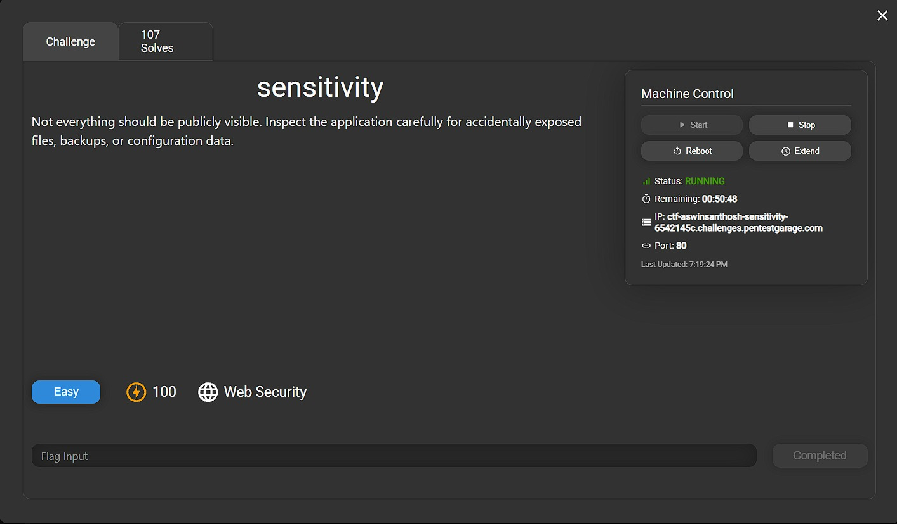
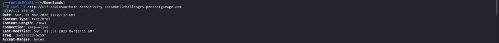
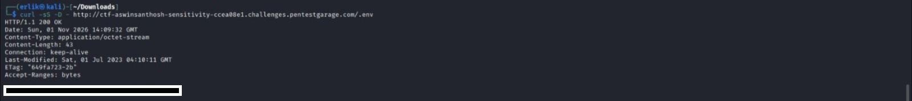

# Sensitivity — Pentest Garage Walkthrough

## Lab Information

| Field | Details |
|---|---|
| Platform | Pentest Garage |
| Lab Name | Sensitivity |
| Category | Web Security |
| Difficulty | Easy |
| Points | 100 |
| Status | Completed |
| Target Port | 80 |
| Web Server | nginx |

## 1. Lab Objective

The objective of this challenge was to identify accidentally exposed files, backups, or configuration data within a web application.

The challenge description suggested that sensitive information might be publicly accessible.

## 2. Environment and Tools

**Attacker Environment:** Kali Linux

**Tools Used:**
- curl
- Web browser
- Terminal

**Target URL:**

`http://ctf-aswinsanthosh-sensitivity-9d22d798.challenges.pentestgarage.com`

All testing was performed against the authorized Pentest Garage challenge environment.

### Target Environment

The following screenshot shows the target machine used for this challenge.



## 3. Reconnaissance

### Step 1: Inspect the Homepage

**Command:**

```bash
TARGET="http://ctf-aswinsanthosh-sensitivity-9d22d798.challenges.pentestgarage.com"

curl -i "$TARGET/"
```

**Why this command?**

The `curl` command sends an HTTP request to the target website.

- `curl` retrieves the server response.
- `-i` displays HTTP response headers along with the page content.
- The response helps us understand how the web server handles the request.

**Observation:**

- The server returned `HTTP 200 OK`.
- The homepage contained a static HTML page.
- The page title was `settle`.
- CSS, JavaScript, and image assets were referenced in the HTML.

**What we learned:**

The website was accessible. However, a successful homepage response does not tell us whether sensitive files are also exposed.

The next step was to check common file paths.

### Screenshot — Homepage Response

The screenshot below shows the HTTP response received from the target homepage.


## 4. Sensitive File Discovery

### Step 2: Check Common File Paths

**Command:**

```bash
for path in robots.txt sitemap.xml .git/HEAD .env index.html backup.zip backup.tar.gz; do
    echo "Checking /$path"
    curl -s -o /dev/null -w "%{http_code}\n" "$TARGET/$path"
done
```

**Why this command?**

Web applications may accidentally expose configuration files, source control information, or backup archives.

Instead of manually requesting each file, this loop checks a small set of common paths and displays their HTTP status codes.

**Command explanation:**

- `for path in ...` — Defines the list of paths to check.
- `echo` — Displays the current path.
- `-s` — Suppresses progress output.
- `-o /dev/null` — Discards the response body.
- `-w "%{http_code}\n"` — Displays the HTTP status code.

**Files checked:**

| Path | Purpose |
|---|---|
| `/robots.txt` | Crawling instructions |
| `/sitemap.xml` | Website page listing |
| `/.git/HEAD` | Git repository information |
| `/.env` | Environment configuration |
| `/index.html` | Main HTML page |
| `/backup.zip` | Possible backup archive |
| `/backup.tar.gz` | Possible backup archive |

**Observation:**

- Most tested paths returned HTTP 404.
- `/index.html` returned HTTP 200.
- `/.env` returned HTTP 200.

**What we learned:**

The `.env` file was accessible from the public website.

HTTP 200 indicates that the server returned a successful response. However, we needed to inspect the response body to confirm whether sensitive information was exposed.

### Screenshot — Sensitive File Discovery

The screenshot shows the HTTP status codes returned while checking common file paths. Notice that `/.env` returned HTTP 200.



## 5. Vulnerability Verification

### Step 3: Retrieve the Exposed Configuration File

**Command:**

```bash
curl -sS -D - "$TARGET/.env"
```

**Why this command?**

We identified that `/.env` returned HTTP 200. The next step was to inspect the actual response.

- `-s` — Suppresses progress output.
- `-S` — Displays errors even when silent mode is enabled.
- `-D -` — Prints response headers to the terminal.
- `"$TARGET/.env"` — Requests the exposed configuration file.

**Observation:**

The server returned:

```http
HTTP/1.1 200 OK
Content-Type: application/octet-stream
Content-Length: 43
```

The response body contained a `FLAG` environment variable.

**Finding:**

The `.env` file was publicly accessible without authentication.

The challenge flag was retrieved and verified successfully.

**Note:** The actual flag is intentionally omitted from this public walkthrough.

### Screenshot — Exposed Configuration File

The screenshot below provides evidence that the `.env` file was publicly accessible. The challenge flag has been redacted.



## 6. Vulnerability Analysis

**Vulnerability:** Sensitive Information Disclosure

**Affected File:** `/.env`

**Root Cause:**

The web server allowed direct access to a configuration-style file located within its publicly accessible document root.

**Potential Impact:**

In real-world applications, `.env` files may contain:

- Database credentials
- API keys
- Secret tokens
- Application configuration
- Other sensitive information

If exposed, this information could allow attackers to gain further unauthorized access to an application or its connected services.

The actual impact depends on the contents of the exposed file.

## 7. Remediation

The following security measures can prevent this issue:

1. Store `.env` files outside the public web root.
2. Configure the web server to block access to sensitive dotfiles.
3. Avoid placing credentials and secret keys in publicly accessible directories.
4. Rotate any credentials or secrets that may have been exposed.
5. Verify that sensitive files cannot be retrieved through HTTP requests.

**Example nginx configuration:**

```nginx
location ~ /\.(?!well-known) {
    deny all;
}
```

This example blocks access to dotfiles while allowing the `/.well-known/` path. Review the application's requirements and test the configuration before deployment.

## 8. Attack Flow

1. Accessed the target homepage.
2. Inspected the initial HTTP response.
3. Checked common sensitive file paths.
4. Identified that `/.env` returned HTTP 200.
5. Retrieved the exposed configuration file.
6. Identified the challenge flag.
7. Verified the challenge successfully.

## 9. Key Takeaways

- Sensitive configuration files should never be publicly accessible.
- HTTP 200 responses do not automatically mean a resource is safe to expose.
- Basic file discovery can reveal serious security misconfigurations.
- Web server access restrictions are important for protecting sensitive files.
- Security testing should include checks for exposed backups and configuration data.

## 10. Responsible Use

This walkthrough documents an authorized educational CTF challenge.

All commands were executed against the designated Pentest Garage training target. Do not perform similar testing against systems without explicit authorization.